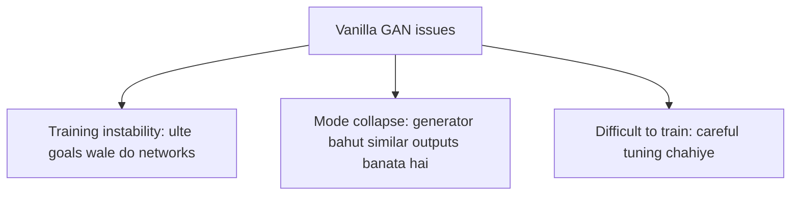
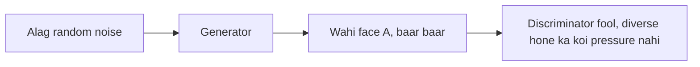

**Ek line mein:** vanilla GAN basic GAN hai jismein ek generator aur ek discriminator hota hai; wo realistic data de sakta hai, par uske <mark>teen main issues hain: training instability, mode collapse aur difficulty in training</mark>. <Cite id="class-dl-chp6" loc="slide 13" />

<Box kind="key">

**Vanilla GAN ke issues ke question mein ye points likho:**

- <mark>Training instability: do networks ek saath, ulte goals ke saath seekhte hain</mark>; ek doosre se bahut strong ho jaye to training unstable.
- <mark>Discriminator bahut strong: generator kharab, lagbhag har image fake kahi jaati hai</mark>; <mark>generator bahut strong: discriminator fakes nahi pehchan pata</mark>.
- <mark>Mode collapse: generator diverse samples ki jagah limited ya bahut similar samples banata hai</mark>.
- <mark>Difficult to train: learning rate, architecture, batch size, training strategy aur G-D balance ki careful tuning chahiye</mark>.
- Chhote changes bhi training pe bada asar karte hain; ye **plug and play nahi** hai.
- Dono networks ko **balanced** tareeke se improve hona chahiye.

</Box>

## Core answer (5 marks, yahan ke har question ke liye)

<Box kind="definition">

A **vanilla GAN** is the basic Generative Adversarial Network with one generator and one discriminator trained against each other. Its issues come from the fact that two networks with opposite goals must learn together. <Cite id="class-dl-chp6" loc="slide 13" />

</Box>

| Problem | Matlab |
|---|---|
| Training instability | Generator aur discriminator balanced tareeke se nahi seekhte |
| Mode collapse | Generator limited ya similar outputs banata hai |
| Training difficulty | GANs ko careful tuning aur experiments chahiye |

<Cite id="class-dl-chp6" loc="slide 13" />

**Conclusion:** GANs bahut realistic data bana sakte hain, par unhe train karna mushkil hai kyunki do networks ko balance rakhte hue saath seekhna padta hai.

## Extended answer (10 marks): ye add karo

### 1. Training instability

Generator discriminator ko fool karna chahta hai; discriminator fool hona nahi chahta. Kabhi ek network doosre se bahut behtar ho jaata hai.

- **Discriminator bahut strong:** generator bahut kharab hota hai aur lagbhag har generated image fake pehchani jaati hai, isliye use useful feedback kam milta hai.
- **Generator bahut strong:** wo tez improve hota hai aur discriminator fake images sahi nahi pehchan pata.

Dono ko balance mein improve hona chahiye. <Cite id="class-dl-chp6" loc="slide 13" /> <Cite id="web-dl-2-d2l-gan" />

### 2. Mode collapse

Hum chahte hain kai alag faces (face 1 se face 5, appearance, features aur style mein variation ke saath). Generator ko lag sakta hai ki ek ya kuch hi type ke samples discriminator ko fool karne ke liye kaafi hain, isliye wo **wahi face baar baar** banata hai. <Cite id="class-dl-chp6" loc="slide 13" />

### 3. Difficult to train

GAN training mein learning rate, network architecture, batch size, training strategy aur generator-discriminator balance ka careful selection chahiye. Chhote changes training pe bada asar karte hain, isliye aksar kai trials lagte hain; ye plug-and-play model nahi hai. <Cite id="class-dl-chp6" loc="slide 13" />

### 4. Ye issues kaise kam kiye jaate hain (extra)

- **DCGAN** ne architecture guidelines (convolutional layers, batch normalization) di jinse image GAN training zyada stable hui. <Cite id="web-dl-2-dcgan-paper" />
- **Wasserstein GAN** loss badalta hai; uske authors behtar stability aur kam mode collapse report karte hain. <Cite id="web-dl-2-wgan-paper" />
- Original GAN paper khud kehta hai ki training mein G aur D ko balance mein rakhna padta hai. <Cite id="web-dl-2-gan-paper" />

## Har question mein kaise fit karein

- **"What are the issues faced by Vanilla GAN models?"** (10 marks) <PYQ id="2024-05/q4b" />: vanilla GAN pe ek line, issue diagram, phir section 1, 2 aur 3 teen pictures ya diagrams ke saath, table, aur ek line conclusion. Extra marks ke liye section 4 add karo.

## Exam tips

- **Draw karo:** teen-issue tree aur "wahi face baar baar" picture.
- **Keywords:** training instability, mode collapse, balance, opposite objectives, careful tuning, limited or similar outputs.
- Common galti: mode collapse ko "model bhool jaata hai" likhna; iska matlab outputs ki **diversity kam** hona hai.

Exam mein English mein likho.
