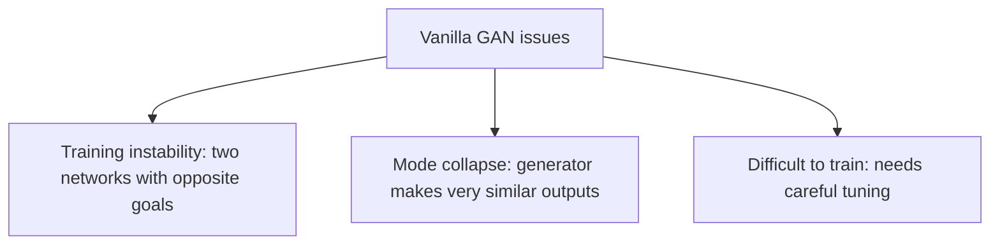
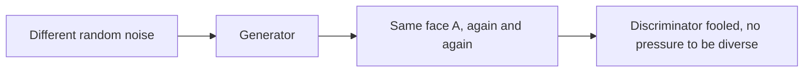

**In one line:** a vanilla GAN is the basic GAN with a generator and a discriminator; it can give realistic data, but it has <mark>three main issues: training instability, mode collapse and difficulty in training</mark>. <Cite id="class-dl-chp6" loc="slide 13" />

<Box kind="key">

**Key points to write (issues of vanilla GAN):**

- <mark>Training instability: two networks learn at the same time with opposite goals</mark>; if one becomes much stronger than the other, training becomes unstable.
- <mark>Discriminator too strong: generator is poor, almost every image is called fake</mark>; <mark>generator too strong: discriminator cannot identify fakes</mark>.
- <mark>Mode collapse: the generator produces limited or very similar samples instead of diverse samples</mark>.
- <mark>Difficult to train: needs careful tuning of learning rate, architecture, batch size, training strategy and G-D balance</mark>.
- Small changes affect training a lot; it is **not plug and play**.
- Both networks must improve in a **balanced** way.

</Box>

## Core answer (5 marks, fits every question here)

<Box kind="definition">

A **vanilla GAN** is the basic Generative Adversarial Network with one generator and one discriminator trained against each other. Its issues come from the fact that two networks with opposite goals must learn together. <Cite id="class-dl-chp6" loc="slide 13" />

</Box>

| Problem | Meaning |
|---|---|
| Training instability | Generator and discriminator may not learn in a balanced way |
| Mode collapse | Generator produces limited or similar outputs |
| Training difficulty | GANs can require careful tuning and experimentation |

<Cite id="class-dl-chp6" loc="slide 13" />

**Conclusion:** GANs can generate highly realistic data, but training them is challenging because the two networks must learn together while keeping a balance.

## Extended answer (10 marks): add these

### 1. Training instability

The generator tries to fool the discriminator; the discriminator tries not to be fooled. Sometimes one network becomes much better than the other.

- **Discriminator too strong:** the generator is very poor and almost every generated image is identified as fake, so it gets little useful feedback.
- **Generator too strong:** it improves fast and the discriminator cannot correctly identify fake images.

Both must improve in balance. <Cite id="class-dl-chp6" loc="slide 13" /> <Cite id="web-dl-2-d2l-gan" />

### 2. Mode collapse

We want many different faces (face 1 to face 5, with variation in appearance, features and style). The generator may find that one or a few types of samples are enough to fool the discriminator, so it produces the **same face again and again**. <Cite id="class-dl-chp6" loc="slide 13" />

### 3. Difficult to train

GAN training needs careful selection of the learning rate, network architecture, batch size, training strategy and the balance between generator and discriminator. Small changes can affect training a lot, so it often needs many trials; it is not a plug-and-play model. <Cite id="class-dl-chp6" loc="slide 13" />

### 4. How these issues are reduced (extra)

- **DCGAN** gave architecture guidelines (convolutional layers, batch normalization) that made image GAN training more stable. <Cite id="web-dl-2-dcgan-paper" />
- **Wasserstein GAN** changes the loss; its authors report improved stability and less mode collapse. <Cite id="web-dl-2-wgan-paper" />
- The original GAN paper itself notes that G and D must be kept in balance during training. <Cite id="web-dl-2-gan-paper" />

## Fit it to each question

- **"What are the issues faced by Vanilla GAN models?"** (10 marks) <PYQ id="2024-05/q4b" />: one line on the vanilla GAN, the issue diagram, then sections 1, 2 and 3 with the three pictures or diagrams, the table, and a one-line conclusion. Add section 4 for extra marks.

## Exam tips

- **Draw** the three-issue tree and the "same face again and again" picture.
- **Keywords:** training instability, mode collapse, balance, opposite objectives, careful tuning, limited or similar outputs.
- Common mistake: describing mode collapse as "the model forgets"; it means **low diversity** of outputs.
