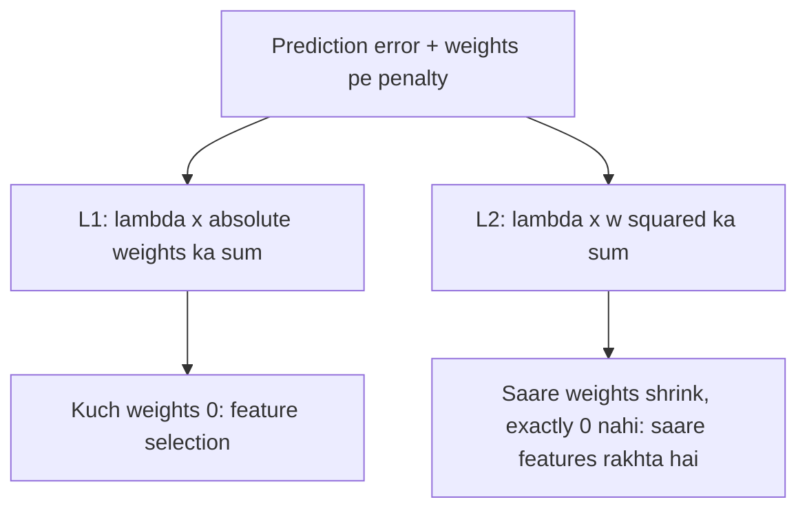

**Ek line mein:** dono loss mein weights ke size pe penalty add karte hain: <mark>L1 (Lasso) $\lambda \sum \lvert w \rvert$ add karta hai aur weights ko zero tak dhakel sakta hai; L2 (Ridge) $\lambda \sum w^2$ add karta hai aur sirf saare weights chhote karta hai</mark>. <Cite id="class-dl-chp2" loc="slides 101 and 103" />

<Box kind="key">

**Ye points likho:**

- <mark>Total Loss = Prediction Error + Regularization Penalty</mark>; $\lambda$ strength set karta hai.
- <mark>L1 (Lasso): Total Loss = Prediction Loss + $\lambda \sum \lvert w \rvert$.</mark> Kuch weights zero (ya zero ke paas): **feature selection**.
- <mark>L2 (Ridge): Total Loss = Prediction Loss + $\lambda \sum w^2$.</mark> Saare weights shrink, aam taur par zero nahi, isliye har feature use hota hai. **Weight decay** bhi kehte hain.
- Examples: weights $6, -4, 2, -1$ se L1 penalty $13$; weights $5, -3, 2, -1$ se L2 penalty $39$.
- $\lambda = 0$ overfit, chhota $\lambda$ best, bahut bada $\lambda$ underfit.
- **Elastic Net** dono use karta hai.

</Box>

## Core answer (5 marks, yahan ke har question ke liye)

<Box kind="definition">

**Regularization** reduces overfitting by adding a penalty on the weights to the loss, so large weights are discouraged. **L1** penalizes the sum of the absolute values of the weights; **L2** penalizes the sum of the squares of the weights. <Cite id="class-dl-chp2" loc="slide 97" />

</Box>

| | L1 (Lasso) | L2 (Ridge) |
|---|---|---|
| Penalty | $\lambda \sum \lvert w \rvert$ | $\lambda \sum w^2$ |
| Effect | Kuch weights 0 | Weights chhote, aam taur par 0 nahi |
| Feature selection | Haan | Nahi |
| Doosre naam | Lasso | Ridge, weight decay |

<Cite id="class-dl-chp2" loc="slides 101 to 104" />

**Conclusion:** L1 unimportant features hata deta hai, L2 saare weights shrink karta hai; Elastic Net dono use karta hai. <Cite id="web-dl-1-gb-reg" loc="§7.1" />

## Extended answer (10 marks): ye add karo

### 1. L1 regularization (Lasso)

Ye saare weights ke absolute values ka sum add karta hai: Total Loss = Prediction Loss + $\lambda \sum |w|$. Bade weights ko badi penalty milti hai, isliye optimizer unhe kam karta hai aur kuch zero ya zero ke paas ho jaate hain. Example: weights $6, -4, 2, -1$ se $6 + 4 + 2 + 1 = 13$. **Advantage:** simple, interpretable model. **Disadvantage:** $\lambda$ bada ho to useful features hat sakte hain. Textbook kehti hai ki L1 sparse solutions deta hai aur feature selector ki tarah kaam karta hai. <Cite id="class-dl-chp2" loc="slides 101 and 102" /> <Cite id="class-dl-m2" loc="p. 35" />

### 2. L2 regularization (Ridge)

Ye saare weights ke squares ka sum add karta hai: Total Loss = Prediction Loss + $\lambda \sum w^2$. Saare weights shrink hote hain lekin aam taur par zero nahi hote. Example: weights $5, -3, 2, -1$ se $25 + 9 + 4 + 1 = 39$; sabse bada weight zyada penalty deta hai. Deep learning mein sabse zyada use hota hai. <Cite id="class-dl-chp2" loc="slides 103 and 104" /> <Cite id="class-dl-m2" loc="p. 34" />

### 3. L1 zero kyun deta hai aur L2 kyun nahi

Har update mein penalty weight ko zero ki taraf kheenchti hai. L1 mein kheench ek **constant step** hai ($\eta\lambda$ har update), isliye chhota weight 0 tak pahunch jaata hai. L2 mein kheench **weight ke proportional** hai (weight ko $1 - 2\eta\lambda$ se multiply karte hain), isliye wo chhota hota jaata hai lekin exactly 0 kabhi nahi. <Cite id="web-dl-1-gb-reg" loc="§7.1.1 and §7.1.2" /> <Cite id="web-dl-1-d2l-weight-decay" />

<Sum>

<Given>

weight $w = 0.05$, $\eta = 0.1$, $\lambda = 0.1$; sirf penalty kaam karti hai (data gradient ignore); 5 updates.

</Given>

<Find>

L1 aur L2 ke saath 5 updates ke baad weight.

</Find>

<Steps>

1. **L1:** har update $\eta\lambda = 0.01$ ghatata hai, to $0.05 \to 0.04 \to 0.03 \to 0.02 \to 0.01 \to 0$.
2. **L2:** har update $1 - 2\eta\lambda = 0.98$ se multiply karta hai, to 5 updates ke baad $0.05 \times 0.98^5 = 0.0452$.

</Steps>

<Answer>

L1 exactly $0$ tak pahunchta hai; L2 $0.0452$ pe pahunchta hai aur shrink hota rehta hai lekin 0 nahi hota.

</Answer>

</Sum>

### 4. $\lambda$ chunna

$\lambda = 0$ matlab regularization nahi (overfit), chhota $\lambda$ best, bahut bada $\lambda$ underfit. <Cite id="class-dl-chp2" loc="slide 99" />

## Har question mein kaise fit karein

- **"What are L1 and L2 regularization methods?"** (10 marks) <PYQ id="2024-05/q5a" />: regularization kyun chahiye aur total-loss formula, **L1 aur L2** penalty, effect, example aur advantage ke saath (section 1 aur 2), diagram aur comparison table, phir section 3 ka "zeros kyun" idea aur $\lambda$.

## Exam tips

- **Dono formulas $\lambda$ ke saath likho**, aur dono effects: L1 zero weights (feature selection), L2 chhote weights.
- Sahi likho: L1 **zero ya zero ke bahut paas** tak pahunchta hai, hamesha exact zero nahi deta.
- Doosre naam likho: Lasso, Ridge, weight decay.

Exam mein English mein likho.
