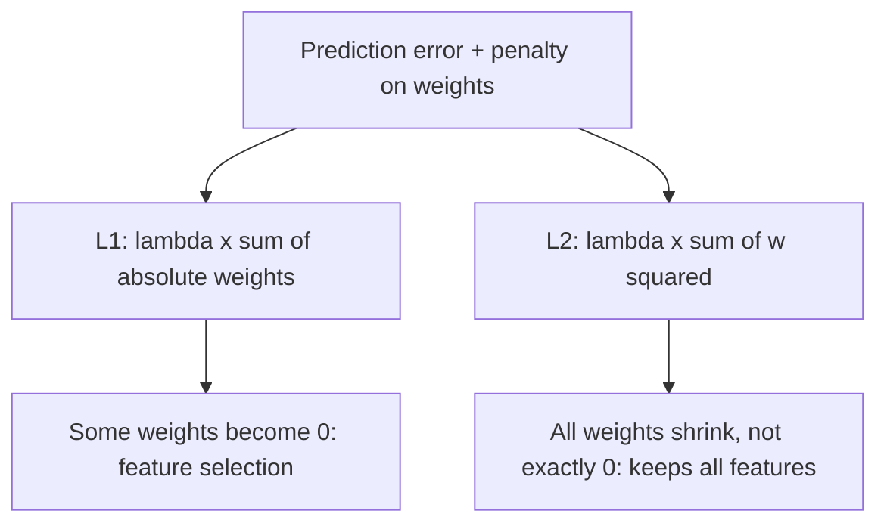

**In one line:** both add a penalty on the size of the weights to the loss: <mark>L1 (Lasso) adds $\lambda \sum \lvert w \rvert$ and can push weights to zero; L2 (Ridge) adds $\lambda \sum w^2$ and only makes all weights small</mark>. <Cite id="class-dl-chp2" loc="slides 101 and 103" />

<Box kind="key">

**Key points to write:**

- <mark>Total Loss = Prediction Error + Regularization Penalty</mark>; $\lambda$ sets the strength.
- <mark>L1 (Lasso): Total Loss = Prediction Loss + $\lambda \sum \lvert w \rvert$.</mark> Some weights become zero (or close to zero): **feature selection**.
- <mark>L2 (Ridge): Total Loss = Prediction Loss + $\lambda \sum w^2$.</mark> Shrinks all weights, usually not to zero, so every feature is still used. Also called **weight decay**.
- Examples: weights $6, -4, 2, -1$ give L1 penalty $13$; weights $5, -3, 2, -1$ give L2 penalty $39$.
- $\lambda = 0$ overfits, small $\lambda$ is best, very large $\lambda$ underfits.
- **Elastic Net** uses both.

</Box>

## Core answer (5 marks, fits every question here)

<Box kind="definition">

**Regularization** reduces overfitting by adding a penalty on the weights to the loss, so large weights are discouraged. **L1** penalizes the sum of the absolute values of the weights; **L2** penalizes the sum of the squares of the weights. <Cite id="class-dl-chp2" loc="slide 97" />

</Box>

| | L1 (Lasso) | L2 (Ridge) |
|---|---|---|
| Penalty | $\lambda \sum \lvert w \rvert$ | $\lambda \sum w^2$ |
| Effect | Some weights become 0 | Weights small, usually not 0 |
| Feature selection | Yes | No |
| Also called | Lasso | Ridge, weight decay |

<Cite id="class-dl-chp2" loc="slides 101 to 104" />

**Conclusion:** L1 removes unimportant features, L2 shrinks all weights; Elastic Net uses both. <Cite id="web-dl-1-gb-reg" loc="§7.1" />

## Extended answer (10 marks): add these

### 1. L1 regularization (Lasso)

It adds the sum of the absolute values of all weights: Total Loss = Prediction Loss + $\lambda \sum |w|$. Large weights give a large penalty, so the optimizer reduces them and some become zero or close to zero. Example: weights $6, -4, 2, -1$ give $6 + 4 + 2 + 1 = 13$. **Advantage:** simpler, interpretable model. **Disadvantage:** may remove useful features if $\lambda$ is large. The textbook says L1 gives sparse solutions and acts as a feature selector. <Cite id="class-dl-chp2" loc="slides 101 and 102" /> <Cite id="class-dl-m2" loc="p. 35" />

### 2. L2 regularization (Ridge)

It adds the sum of the squares of all weights: Total Loss = Prediction Loss + $\lambda \sum w^2$. It shrinks all weights but usually does not make them zero. Example: weights $5, -3, 2, -1$ give $25 + 9 + 4 + 1 = 39$; the largest weight causes most of the penalty. It is the most used in deep learning. <Cite id="class-dl-chp2" loc="slides 103 and 104" /> <Cite id="class-dl-m2" loc="p. 34" />

### 3. Why L1 gives zeros and L2 does not

In each update the penalty pulls a weight toward zero. For L1 the pull is a **constant step** ($\eta\lambda$ per update), so a small weight reaches 0. For L2 the pull is **proportional to the weight** (the weight is multiplied by $1 - 2\eta\lambda$), so it gets smaller and smaller but never exactly 0. <Cite id="web-dl-1-gb-reg" loc="§7.1.1 and §7.1.2" /> <Cite id="web-dl-1-d2l-weight-decay" />

<Sum>

<Given>

weight $w = 0.05$, $\eta = 0.1$, $\lambda = 0.1$; only the penalty acts (data gradient ignored); 5 updates.

</Given>

<Find>

the weight after 5 updates with L1 and with L2.

</Find>

<Steps>

1. **L1:** each update subtracts $\eta\lambda = 0.01$, so $0.05 \to 0.04 \to 0.03 \to 0.02 \to 0.01 \to 0$.
2. **L2:** each update multiplies by $1 - 2\eta\lambda = 0.98$, so after 5 updates $0.05 \times 0.98^5 = 0.0452$.

</Steps>

<Answer>

L1 reaches exactly $0$; L2 reaches $0.0452$ and keeps shrinking but never hits 0.

</Answer>

</Sum>

### 4. Choosing $\lambda$

$\lambda = 0$ means no regularization (overfits), a small $\lambda$ is best, a very large $\lambda$ underfits. <Cite id="class-dl-chp2" loc="slide 99" />

## Fit it to each question

- **"What are L1 and L2 regularization methods?"** (10 marks) <PYQ id="2024-05/q5a" />: why regularization is needed and the total-loss formula, **L1 and L2** with penalty, effect, example and advantage (sections 1 and 2), the diagram and the comparison table, then the "why zeros" idea of section 3 and $\lambda$.

## Exam tips

- **Always write both formulas** with $\lambda$, and the two effects: L1 zero weights (feature selection), L2 small weights.
- Be correct: L1 reaches **zero or extremely near zero**, it does not always give exact zeros.
- Name the other names: Lasso, Ridge, weight decay.
