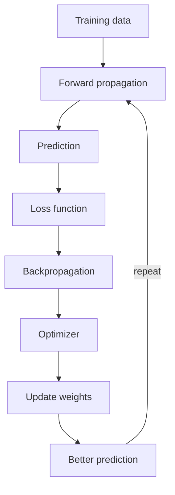
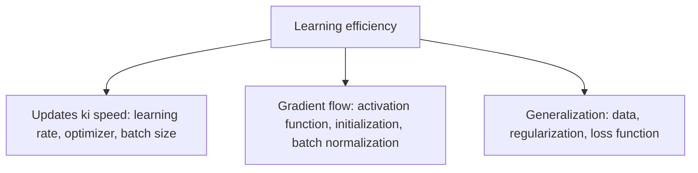

**Ek line mein:** network ek loop repeat karke seekhta hai: <mark>forward propagation (predict), loss (galti naapo), backpropagation (gradient nikalo) aur optimizer (weights update karo)</mark>. <Cite id="class-dl-chp2" loc="slide 59" />

<Box kind="key">

**Har learning-process question mein ye points likho:**

- <mark>Forward propagation: input layers se guzarta hai, information sirf aage jaati hai, aur prediction milta hai.</mark>
- <mark>Loss: predicted aur actual value ka difference.</mark> Ye batata hai kitni error hai, ye nahi ki kaunsa weight badlna hai.
- <mark>Backpropagation cost ki information ko network mein peeche bhejta hai taaki gradient nikle.</mark> Ye sirf gradient compute karta hai.
- <mark>Optimizer (GD, SGD, Adam) weights update karta hai: $W_{new} = W_{old} - \eta \dfrac{\partial L}{\partial W}$.</mark>
- Loss chhota hone tak repeat karo. Problems: **vanishing** aur **exploding** gradients.
- Efficiency in cheezon pe depend karti hai: learning rate, optimizer, batch size, activation function, weight initialization, loss function, data aur regularization, batch normalization.

</Box>

## Core answer (5 marks, yahan ke har question ke liye)

<Box kind="definition">

**Learning** in a neural network means adjusting the weights so that the loss becomes small. It is done by four steps repeated again and again: forward propagation, loss calculation, backpropagation and optimization (weight update). <Cite id="class-dl-chp2" loc="slide 59" />

</Box>

1. **Forward propagation:** input, hidden aur output layers se guzarkar prediction deta hai. <Cite id="class-dl-chp2" loc="slide 4" /> <Cite id="class-dl-m1" loc="p. 26" />
2. **Loss calculation:** prediction ko actual value se compare karte hain (actual 180 g, predicted 220 g: loss high). <Cite id="class-dl-chp2" loc="slide 57" />
3. **Backpropagation:** cost peeche flow karke **gradient** nikalta hai, yani loss ka slope. Sign direction batata hai aur size batati hai ki loss kitni tez badal raha hai. <Cite id="class-dl-m1" loc="p. 26" /> <Cite id="class-dl-chp2" loc="slide 58" />
4. **Optimization aur weight update:** $W_{new} = W_{old} - \eta \dfrac{\partial L}{\partial W}$, $\eta$ = learning rate. <Cite id="class-dl-chp2" loc="slides 57 and 63" />

**Conclusion:** forward propagation predict karta hai, loss naapta hai, backpropagation gradient deta hai aur optimizer weights update karta hai. <Cite id="web-dl-1-d2l-backprop" />

## Extended answer (10 marks): ye add karo

### 1. Har step ka role

| Step | Kaunsa sawaal solve karta hai | Output |
|---|---|---|
| Forward propagation | Network kya predict karta hai? | Prediction |
| Loss | Kitna galat hai? | Ek number (loss) |
| Backpropagation | Kaunsa weight kitni error ka zimmedar? | Gradients |
| Optimizer | Har weight kaise badlein? | Naye weights |

### 2. Numbers ke saath ek cycle (idea samajhne ke liye)

<Sum>

<Given>

$x = 2$, $y = 4$, $w = 3$, prediction $\hat y = wx$, loss $L = (\hat y - y)^2$, learning rate $\eta = 0.1$.

</Given>

<Find>

ek update ke baad naya weight aur naya loss.

</Find>

<Steps>

1. **Forward:** $\hat y = 3 \times 2 = 6$.
2. **Loss:** $(6 - 4)^2 = 4$.
3. **Gradient:** $\dfrac{\partial L}{\partial w} = 2(\hat y - y)x = 2 \times 2 \times 2 = 8$.
4. **Update:** $w = 3 - 0.1 \times 8 = 2.2$.
5. **Naya loss:** $\hat y = 2.2 \times 2 = 4.4$ aur $L = (4.4 - 4)^2 = 0.16$.

</Steps>

<Answer>

$w = 2.2$ aur loss 4 se girkar 0.16 ho gaya.

</Answer>

</Sum>

Loss ka derivative class files mein nahi hai; numbers sirf ek cycle dikhate hain.

### 3. Learning mein problems

- **Vanishing gradient:** gradients bahut chhote ho jaate hain, isliye early layers seekhna band kar deti hain.
- **Exploding gradient:** gradients bahut bade ho jaate hain, isliye training unstable. <Cite id="class-dl-chp2" loc="slides 64 to 67" />

### 4. Learning efficiency ke factors

Learning efficiency matlab loss kitni tez aur stable girta hai aur model naye data pe kitna achha chalta hai. Class files mein ye factors ek jagah nahi diye; training topics se yahan jama kiye gaye hain. <Cite id="web-dl-1-cs231n-nn3" />

| Factor | Learning pe asar |
|---|---|
| Learning rate | Bahut chhota slow, bahut bada minimum skip, sahi value fast aur stable. <Cite id="class-dl-chp2" loc="slide 63" /> |
| Optimizer | Plain GD slow; momentum, AdaGrad, RMSProp aur Adam updates ko tez aur steady karte hain. <Cite id="class-dl-chp2" loc="slide 88" /> |
| Batch size | Chhote batches noisy updates dete hain; bahut bade batches slow. <Cite id="class-dl-chp2" loc="slide 73" /> |
| Activation function | Sigmoid aur tanh deep nets mein vanishing gradient dete hain; ReLU kam affected. <Cite id="class-dl-chp2" loc="slide 65" /> |
| Weight initialization | He (ReLU ke liye) ya Xavier (sigmoid, tanh ke liye) vanishing aur exploding gradients se bachate hain. <Cite id="class-dl-chp2" loc="slide 65" /> |
| Loss function | Task ke hisaab se: regression ke liye MSE, classes ke liye cross entropy. <Cite id="class-dl-chp2" loc="slide 26" /> |
| Data aur overfitting | Chhota dataset ya bahut epochs se model ratta maar leta hai; regularization aur augmentation use karo. <Cite id="class-dl-chp2" loc="slide 97" /> |
| Batch normalization | Layer inputs ko similar range mein rakhta hai, isliye training fast aur stable. <Cite id="class-dl-chp2" loc="slide 112" /> |

## Har question mein kaise fit karein

- **"Explain the learning process in a neural network. How does a neural network update its weights during training? Describe the role of forward propagation, loss calculation, backpropagation, and optimization in this learning."** (10 marks) <PYQ id="2025-05/q6b" />: loop diagram ke saath poora **core answer**, phir roles table aur one-cycle worked example, aur vanishing aur exploding gradient problems.
- **"Explain the major factors influencing the learning efficiency of a deep neural network."** (5 marks) <PYQ id="2026-05/q1c" />: learning loop pe ek line, phir **section 4 ki factors table aur diagram**; har factor ka effect ek sentence mein.

## Exam tips

- **Hamesha draw karo** loop diagram aur update rule minus sign ke saath likho.
- Saaf likho ki **backpropagation sirf gradient compute karta hai**; weights optimizer update karta hai. Inhe mix karna common galti hai.
- Factors mein kam se kam chhe naam likho aur har ka effect do.

Exam mein English mein likho.
