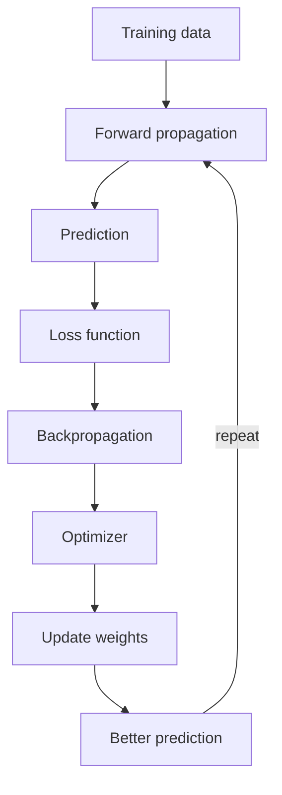
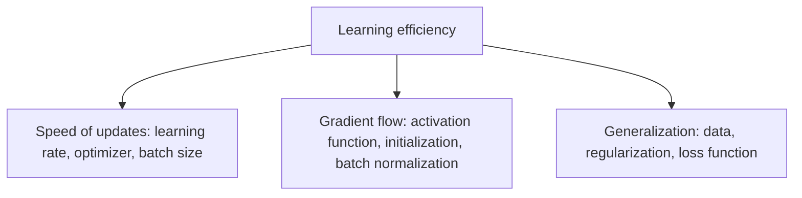

**In one line:** a network learns by repeating a loop: <mark>forward propagation (predict), loss (measure the mistake), backpropagation (find the gradient) and the optimizer (update the weights)</mark>. <Cite id="class-dl-chp2" loc="slide 59" />

<Box kind="key">

**Key points to write (any learning-process question):**

- <mark>Forward propagation: the input goes through the layers, information flows only forward, and gives a prediction.</mark>
- <mark>Loss: the difference between the predicted and the actual value.</mark> It tells how much error exists, not which weight to change.
- <mark>Backpropagation allows the information from the cost to flow backwards through the network to compute the gradient.</mark> It only computes the gradient.
- <mark>Optimizer (GD, SGD, Adam) updates the weights: $W_{new} = W_{old} - \eta \dfrac{\partial L}{\partial W}$.</mark>
- Repeat until the loss is small. Problems: **vanishing** and **exploding** gradients.
- Efficiency depends on: learning rate, optimizer, batch size, activation function, weight initialization, loss function, data and regularization, batch normalization.

</Box>

## Core answer (5 marks, fits every question here)

<Box kind="definition">

**Learning** in a neural network means adjusting the weights so that the loss becomes small. It is done by four steps repeated again and again: forward propagation, loss calculation, backpropagation and optimization (weight update). <Cite id="class-dl-chp2" loc="slide 59" />

</Box>

1. **Forward propagation:** the input passes through the input, hidden and output layers and gives a prediction. <Cite id="class-dl-chp2" loc="slide 4" /> <Cite id="class-dl-m1" loc="p. 26" />
2. **Loss calculation:** the prediction is compared with the actual value (actual 180 g, predicted 220 g: the loss is high). <Cite id="class-dl-chp2" loc="slide 57" />
3. **Backpropagation:** the cost flows backwards to compute the **gradient**, the slope of the loss. Its sign gives the direction and its size tells how fast the loss changes. <Cite id="class-dl-m1" loc="p. 26" /> <Cite id="class-dl-chp2" loc="slide 58" />
4. **Optimization and weight update:** $W_{new} = W_{old} - \eta \dfrac{\partial L}{\partial W}$, where $\eta$ is the learning rate. <Cite id="class-dl-chp2" loc="slides 57 and 63" />

**Conclusion:** forward propagation predicts, the loss measures, backpropagation gives the gradient and the optimizer updates the weights. <Cite id="web-dl-1-d2l-backprop" />

## Extended answer (10 marks): add these

### 1. Roles side by side

| Step | Question it answers | Output |
|---|---|---|
| Forward propagation | What does the network predict? | Prediction |
| Loss | How wrong is it? | One number (the loss) |
| Backpropagation | Which weight caused how much error? | Gradients |
| Optimizer | How should each weight change? | New weights |

### 2. One cycle with numbers (to show the idea)

<Sum>

<Given>

$x = 2$, $y = 4$, $w = 3$, prediction $\hat y = wx$, loss $L = (\hat y - y)^2$, learning rate $\eta = 0.1$.

</Given>

<Find>

the new weight and the new loss after one update.

</Find>

<Steps>

1. **Forward:** $\hat y = 3 \times 2 = 6$.
2. **Loss:** $(6 - 4)^2 = 4$.
3. **Gradient:** $\dfrac{\partial L}{\partial w} = 2(\hat y - y)x = 2 \times 2 \times 2 = 8$.
4. **Update:** $w = 3 - 0.1 \times 8 = 2.2$.
5. **New loss:** $\hat y = 2.2 \times 2 = 4.4$ and $L = (4.4 - 4)^2 = 0.16$.

</Steps>

<Answer>

$w = 2.2$ and the loss falls from 4 to 0.16.

</Answer>

</Sum>

The loss derivative is not in the class files; the numbers only show one cycle.

### 3. Problems while learning

- **Vanishing gradient:** gradients become tiny, so the early layers stop learning.
- **Exploding gradient:** gradients become huge, so training is unstable. <Cite id="class-dl-chp2" loc="slides 64 to 67" />

### 4. Factors that decide learning efficiency

Learning efficiency means how fast and how stably the loss goes down and how well the model works on new data. The class files do not list these factors in one place; they are collected here from the training topics. <Cite id="web-dl-1-cs231n-nn3" />

| Factor | Effect on learning |
|---|---|
| Learning rate | Too small is slow, too large skips the minimum, a proper value is fast and stable. <Cite id="class-dl-chp2" loc="slide 63" /> |
| Optimizer | Plain GD is slow; momentum, AdaGrad, RMSProp and Adam speed up and steady the updates. <Cite id="class-dl-chp2" loc="slide 88" /> |
| Batch size | Small batches give noisy updates; very large batches are slow. <Cite id="class-dl-chp2" loc="slide 73" /> |
| Activation function | Sigmoid and tanh cause vanishing gradients in deep nets; ReLU is less affected. <Cite id="class-dl-chp2" loc="slide 65" /> |
| Weight initialization | He (for ReLU) or Xavier (for sigmoid or tanh) avoid vanishing and exploding gradients. <Cite id="class-dl-chp2" loc="slide 65" /> |
| Loss function | Must suit the task: MSE for regression, cross entropy for classes. <Cite id="class-dl-chp2" loc="slide 26" /> |
| Data and overfitting | A small dataset or too many epochs makes the model memorize; use regularization and augmentation. <Cite id="class-dl-chp2" loc="slide 97" /> |
| Batch normalization | Keeps layer inputs in a similar range, so training is faster and more stable. <Cite id="class-dl-chp2" loc="slide 112" /> |

## Fit it to each question

- **"Explain the learning process in a neural network. How does a neural network update its weights during training? Describe the role of forward propagation, loss calculation, backpropagation, and optimization in this learning."** (10 marks) <PYQ id="2025-05/q6b" />: the **core answer** in full with the loop diagram, then the roles table and the one-cycle worked example, and the vanishing and exploding gradient problems.
- **"Explain the major factors influencing the learning efficiency of a deep neural network."** (5 marks) <PYQ id="2026-05/q1c" />: one line on the learning loop, then the **factors table and diagram of section 4**; give the effect of each factor in one sentence.

## Exam tips

- **Always draw** the loop diagram and write the update rule with its minus sign.
- Say clearly that **backpropagation only computes the gradient**; the optimizer updates the weights. Mixing these is the common mistake.
- For factors, name at least six and give the effect of each.
