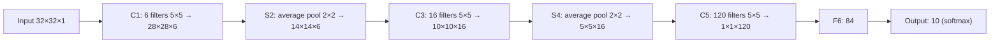

**Ek line mein:** <mark>LeNet-5 handwritten digit recognition ke liye bana CNN architecture hai</mark>, jo <mark>convolution, subsampling (pooling) aur fully connected layers</mark> se features khud seekhta hai; LeCun et al. ne 1998 mein banaya. <Cite id="class-dl-chp4" loc="slide 43" />

<Box kind="key">

**LeNet-5 ke har question mein ye points likho:**

- <mark>Handwritten digit recognition ke liye; LeCun et al., 1998</mark>.
- <mark>Input 32×32×1 grayscale image; output 10 classes (digits 0 se 9)</mark>.
- Layers: <mark>C1 → S2 → C3 → S4 → C5 → F6 → Output</mark> (convolution, subsampling, convolution, subsampling, convolution, fully connected, output).
- <mark>"5" = paanch trainable layers (C1, C3, C5, F6, Output)</mark>; pooling layers count nahi hoti.
- 5×5 filters, tanh activation, lagbhag <mark>60 thousand parameters</mark>.
- <mark>Hierarchical features: edges → curves → digit ke parts → poora digit</mark>.

</Box>

## Core answer (5 marks, yahan ke har question ke liye)

<Box kind="definition">

**LeNet-5** is a CNN architecture designed for handwritten digit recognition, which uses convolution, subsampling/pooling and fully connected layers to automatically learn features from images and classify them. <Cite id="class-dl-chp4" loc="slide 43" />

</Box>

**Kaise kaam karta hai:** image andar aati hai; **C1** edges, lines aur curves dhoondhta hai; **S2** maps chhote karta hai; **C3** shapes aur corners dhoondhta hai; **S4** phir chhota karta hai; **C5** high-level features deta hai; **F6** unhe combine karta hai; **output** layer har digit ki probability deti hai. <Cite id="class-dl-chp4" loc="slide 45" /> <Cite id="class-dl-m4" loc="p. 51" />

**Conclusion:** LeNet-5 handwritten digit recognition ke liye early aur influential CNN hai aur modern CNNs ki foundation. <Cite id="class-dl-chp4" loc="slide 43" />

## Extended answer (10 marks): ye add karo

### 1. Layer table

| Layer | Operation | Output | Kaam |
|---|---|---|---|
| Input | 32×32 grayscale image | 32×32×1 | Raw pixels |
| C1 | 6 filters 5×5, stride 1, tanh | 28×28×6 | Edges, lines, curves |
| S2 | Average pooling 2×2, stride 2 | 14×14×6 | Size kam, depth same |
| C3 | 16 filters 5×5, tanh | 10×10×16 | Shapes, corners |
| S4 | Average pooling 2×2, stride 2 | 5×5×16 | Phir size kam |
| C5 | 120 filters 5×5, tanh | 1×1×120 | High-level features |
| F6 | Fully connected, tanh | 84 | Features combine |
| Output | Fully connected + softmax | 10 | Digits 0 se 9 ki probability |

<Cite id="class-dl-chp4" loc="slide 45" /> Har size $(N - F)/S + 1$ se aata hai, jaise $(32 - 5)/1 + 1 = 28$ aur $(28 - 2)/2 + 1 = 14$. d2l mein bhi yahi layer plan samjhaya gaya hai. <Cite id="web-dl-2-d2l-lenet" />

### 2. "5" kyun aur parameters kitne

Paanch trainable layers: C1, C3, C5, F6, Output. Har layer ko $(F \cdot F \cdot D + 1) \times K$ se (fully connected ke liye inputs × outputs + outputs) gino: C1 $= 156$, C3 $= 2{,}416$ (saare maps joined), C5 $= 48{,}120$, F6 $= 10{,}164$, output $= 850$, total lagbhag **62 thousand**, isliye class ka "lagbhag 60 thousand" sahi hai. (Original paper mein C3 sirf kuch maps se judta hai, isliye kam parameters.) <Cite id="class-dl-chp4" loc="slide 43" /> <Cite id="web-dl-2-wiki-lenet" />

### 3. Important ideas aur LeNet vs fully connected network

- Convolution edges detect karta hai; subsampling size kam karta hai; layers **step by step seekhti hain: edges → curves → digit ke parts → poora digit**. <Cite id="class-dl-m4" loc="p. 85" />
- Fully connected network ko bahut zyada parameters chahiye aur wo pixels ki position ignore karta hai; LeNet shared filters use karta hai.

### 4. LeNet vs AlexNet

| | LeNet-5 | AlexNet |
|---|---|---|
| Year | 1998 | 2012 |
| Task | Handwritten digits | ImageNet, 1000 classes |
| Input | 32×32×1 | 227×227×3 |
| Pooling, activation | Average pooling, tanh | Max pooling, ReLU |
| Parameters | Lagbhag 60 thousand | Lagbhag 62 million |

<Cite id="class-dl-chp4" loc="slide 41" /> <Cite id="web-dl-2-alexnet-paper" />

### 5. Merits aur demerits

**Merits:** features khud seekhta hai aur fully connected network se kam parameters. **Demerits:** alag-alag picture classes ke liye achha scale nahi karta, bade filters, sirf low-level features. <Cite id="class-dl-m4" loc="p. 85" />

## Har question mein kaise fit karein

- **"Describe LeNET architecture."** (10 marks) <PYQ id="2023-12/q6a" />: definition, sizes ke saath diagram, layer table (section 1), "why 5", important ideas, merits-demerits, phir ek line conclusion.

## Exam tips

- **Draw karo:** strip: 32×32×1 → 28×28×6 → 14×14×6 → 10×10×16 → 5×5×16 → 1×1×120 → 84 → 10, C aur S layers label karo.
- **Keywords:** C1, S2, C3, S4, C5, F6, subsampling, tanh, handwritten digits, LeCun 1998.
- Common galti: pooling layers ko "5" mein ginna.

Exam mein English mein likho.
