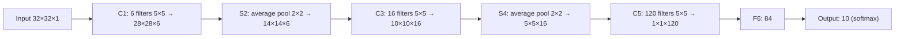

**In one line:** <mark>LeNet-5 is a CNN architecture designed for handwritten digit recognition</mark>, which uses <mark>convolution, subsampling (pooling) and fully connected layers</mark> to learn features automatically; it was developed by LeCun et al. in 1998. <Cite id="class-dl-chp4" loc="slide 43" />

<Box kind="key">

**Key points to write (LeNet-5):**

- <mark>Designed for handwritten digit recognition; LeCun et al., 1998</mark>.
- <mark>Input 32×32×1 grayscale image; output 10 classes (digits 0 to 9)</mark>.
- Layers: <mark>C1 → S2 → C3 → S4 → C5 → F6 → Output</mark> (convolution, subsampling, convolution, subsampling, convolution, fully connected, output).
- <mark>"5" = five trainable layers (C1, C3, C5, F6, Output)</mark>; pooling layers are not counted.
- Filters 5×5, tanh activation, about <mark>60 thousand parameters</mark>.
- <mark>Hierarchical features: edges → curves → parts of digits → complete digit</mark>.

</Box>

## Core answer (5 marks, fits every question here)

<Box kind="definition">

**LeNet-5** is a CNN architecture designed for handwritten digit recognition, which uses convolution, subsampling/pooling and fully connected layers to automatically learn features from images and classify them. <Cite id="class-dl-chp4" loc="slide 43" />

</Box>

**How it works:** the image enters; **C1** finds edges, lines and curves; **S2** shrinks the maps; **C3** finds shapes and corners; **S4** shrinks again; **C5** gives high-level features; **F6** combines them; the **output** layer gives the probability of each digit. <Cite id="class-dl-chp4" loc="slide 45" /> <Cite id="class-dl-m4" loc="p. 51" />

**Conclusion:** LeNet-5 is an early and influential CNN for handwritten digit recognition and a foundation of modern CNNs. <Cite id="class-dl-chp4" loc="slide 43" />

## Extended answer (10 marks): add these

### 1. Layer table

| Layer | Operation | Output | Job |
|---|---|---|---|
| Input | 32×32 grayscale image | 32×32×1 | Raw pixels |
| C1 | 6 filters 5×5, stride 1, tanh | 28×28×6 | Edges, lines, curves |
| S2 | Average pooling 2×2, stride 2 | 14×14×6 | Reduce size, keep depth |
| C3 | 16 filters 5×5, tanh | 10×10×16 | Shapes, corners |
| S4 | Average pooling 2×2, stride 2 | 5×5×16 | Reduce size again |
| C5 | 120 filters 5×5, tanh | 1×1×120 | High-level features |
| F6 | Fully connected, tanh | 84 | Combine features |
| Output | Fully connected + softmax | 10 | Probability of digits 0 to 9 |

<Cite id="class-dl-chp4" loc="slide 45" /> Each size follows $(N - F)/S + 1$, for example $(32 - 5)/1 + 1 = 28$ and $(28 - 2)/2 + 1 = 14$. The same layer plan is explained in d2l. <Cite id="web-dl-2-d2l-lenet" />

### 2. Why "5" and how many parameters

Five trainable layers: C1, C3, C5, F6, Output. Counting each layer as $(F \cdot F \cdot D + 1) \times K$, or inputs × outputs + outputs for the fully connected layers: C1 $= 156$, C3 $= 2{,}416$ (all maps joined), C5 $= 48{,}120$, F6 $= 10{,}164$, output $= 850$, about **62 thousand** in total, so the class value "about 60 thousand" is right. (The original paper joins C3 to only some of the maps, so it has fewer.) <Cite id="class-dl-chp4" loc="slide 43" /> <Cite id="web-dl-2-wiki-lenet" />

### 3. Important ideas and LeNet versus a fully connected network

- Convolution detects edges; subsampling reduces size; the layers learn **step by step: edges → curves → parts of digits → complete digit**. <Cite id="class-dl-m4" loc="p. 85" />
- A fully connected network needs far more parameters and ignores the position of pixels; LeNet uses shared filters.

### 4. LeNet versus AlexNet

| | LeNet-5 | AlexNet |
|---|---|---|
| Year | 1998 | 2012 |
| Task | Handwritten digits | ImageNet, 1000 classes |
| Input | 32×32×1 | 227×227×3 |
| Pooling, activation | Average pooling, tanh | Max pooling, ReLU |
| Parameters | About 60 thousand | About 62 million |

<Cite id="class-dl-chp4" loc="slide 41" /> <Cite id="web-dl-2-alexnet-paper" />

### 5. Merits and demerits

**Merits:** learns features automatically and uses fewer parameters than a fully connected network. **Demerits:** does not scale well to varied picture classes, uses large filters and learns low-level features only. <Cite id="class-dl-m4" loc="p. 85" />

## Fit it to each question

- **"Describe LeNET architecture."** (10 marks) <PYQ id="2023-12/q6a" />: definition, the diagram with sizes, the layer table (section 1), "why 5", important ideas, merits and demerits, then a one-line conclusion.

## Exam tips

- **Draw** the strip: 32×32×1 → 28×28×6 → 14×14×6 → 10×10×16 → 5×5×16 → 1×1×120 → 84 → 10, and label C and S layers.
- **Keywords:** C1, S2, C3, S4, C5, F6, subsampling, tanh, handwritten digits, LeCun 1998.
- Common mistake: counting pooling layers as the "5".
