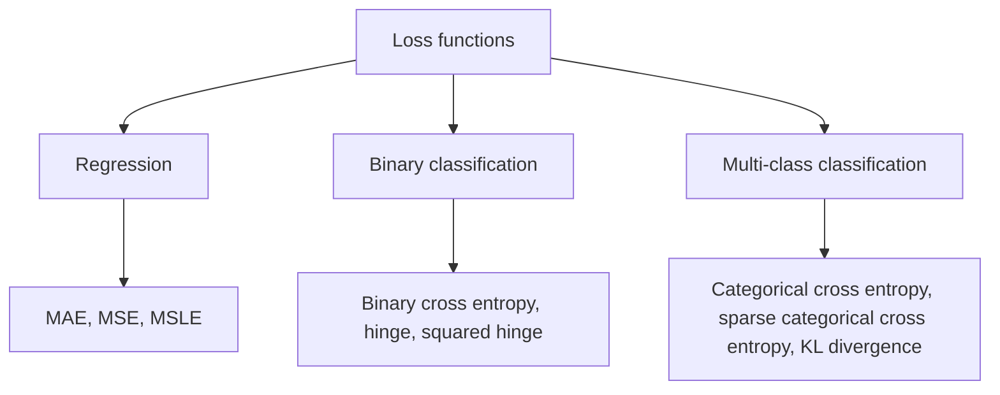
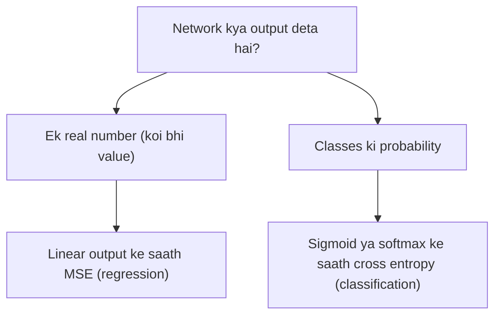

**Ek line mein:** <mark>loss function ek mathematical function hai jo predicted output aur actual output ka difference naapta hai</mark>; training ise chhota karne ki koshish karti hai, aur sahi loss problem type se chuna jaata hai. <Cite id="class-dl-chp2" loc="slide 26" />

<Box kind="key">

**Har loss function question mein ye points likho:**

- <mark>Chhota loss matlab prediction sahi jawab ke paas hai; bada loss matlab door hai.</mark> Kam loss matlab better model.
- Role: loss **backpropagation** se wapas jaakar weights update karwata hai; loss chhota hone tak repeat.
- <mark>Regression: MAE, MSE, MSLE. Binary classification: binary cross entropy, hinge. Multi-class: categorical cross entropy, sparse categorical cross entropy, KL divergence.</mark>
- <mark>MSE $= \frac{1}{n}\sum (y_i - \hat y_i)^2$: error ko square karta hai, isliye bade errors ko zyada penalty; outliers ke liye sensitive.</mark>
- <mark>Cross entropy confident galat prediction ko bahut zyada penalize karta hai</mark> aur better gradients deta hai, isliye classification ke liye suit karta hai.
- Match: linear output ke saath MSE, sigmoid ke saath binary cross entropy, softmax ke saath categorical cross entropy.

</Box>

## Core answer (5 marks, yahan ke har question ke liye)

<Box kind="definition">

A **loss function** is a mathematical function that measures the difference between the predicted output and the actual output. It tells the network how wrong its prediction is. <Cite id="class-dl-chp2" loc="slide 26" />

</Box>

**Training mein role:** forward pass ke baad loss calculate hota hai; backpropagation use peeche bhejkar weights update karta hai; loss chhota hone tak repeat. Error naape bina network improve nahi kar sakta. <Cite id="class-dl-chp2" loc="slides 26 and 27" />

| Problem | Output layer | Loss |
|---|---|---|
| Regression | Linear | MSE ya MAE |
| Do classes | Sigmoid | Binary cross entropy |
| Kai classes | Softmax | Categorical cross entropy |

<Cite id="class-dl-chp2" loc="slide 52" />

**Conclusion:** loss function training ka dil hai; sahi loss problem type se chuna jaata hai aur output function se match kiya jaata hai. <Cite id="web-dl-1-wiki-lossfn" />

## Extended answer (10 marks): ye add karo

### 1. Loss functions ke types

<Cite id="class-dl-chp2" loc="slide 27" />

- **Regression (number predict karna):**
  - **MAE** $= \frac{1}{n}\sum \lvert y_i - \hat y_i \rvert$: average absolute error; har error barabar.
  - **MSE** $= \frac{1}{n}\sum (y_i - \hat y_i)^2$: bade errors ko zyada penalty.
  - **MSLE** $= \frac{1}{n}\sum (\log(1 + y_i) - \log(1 + \hat y_i))^2$: relative error, badi range wali positive values ke liye.
- **Binary classification:** **binary cross entropy** $= -[y\log\hat y + (1 - y)\log(1 - \hat y)]$; **hinge loss** $= \max(0, 1 - y\hat y)$ (labels +1 aur −1) aur uska squared version.
- **Multi-class:** **categorical cross entropy** $= -\sum y_i\log\hat y_i$ (one-hot labels); **sparse categorical cross entropy** (integer labels); **KL divergence** (do distributions compare karta hai).

### 2. MSE vs cross entropy

| | MSE | Cross entropy |
|---|---|---|
| Usage | Regression (continuous target) | Classification (categorical target) |
| Formula | $\frac{1}{n}\sum (y_i - \hat y_i)^2$ | $-\frac{1}{n}\sum [y_i\log\hat y_i + (1 - y_i)\log(1 - \hat y_i)]$ |
| Output range | Koi bhi real value | 0 se 1 (probabilities) |
| Output layer | Linear | Sigmoid ya softmax |
| Penalty | Quadratic; outliers ke liye sensitive | Logarithmic; confident galat prediction pe bahut zyada |
| Impact | House price jaise numbers ke liye achha | Classes ke liye tez convergence, better gradients |

<Cite id="class-dl-m2" loc="p. 14" /> <Cite id="web-dl-1-d2l-softmax" />

### 3. Worked examples

<Sum>

<Given>

MSE: actual 180, 200, 160, 150 aur predicted 185, 195, 170, 145. Cross entropy: true class $y = 1$ (spam), prediction A $= 0.9$ aur prediction B $= 0.1$.

</Given>

<Find>

MSE aur do cross-entropy losses.

</Find>

<Steps>

1. **Errors:** $-5, 5, -10, 5$. Squares: $25, 25, 100, 25$. Sum $= 175$.
2. **MSE** $= 175 / 4 = 43.75$. Akeli error $-10$ ne 175 mein se 100 diya.
3. **Prediction A:** $-\ln 0.9 = 0.105$ (chhota loss).
4. **Prediction B:** $-\ln 0.1 = 2.303$ (bahut bada loss).

</Steps>

<Answer>

MSE $= 43.75$; cross entropy achhe prediction ke liye $0.105$ aur confident galat ke liye $2.303$.

</Answer>

</Sum>

Galat aur confident prediction B ko heavy punish kiya jaata hai, isliye network use jaldi sudhaarta hai. <Cite id="class-dl-chp2" loc="slide 33" /> <Cite id="class-dl-m2" loc="p. 14" />

### 4. Cross entropy kab zyada appropriate hai

Classification mein output probability hota hai aur target ek class. Cross entropy probability ko actual class se compare karta hai aur better gradient deta hai, isliye MSE se tez converge hota hai. <Cite id="web-dl-1-wiki-xent" />

## Har question mein kaise fit karein

- **"Comment on the significance of Loss functions and explain different types of Loss functions while training a network."** (10 marks) <PYQ id="2024-12/q5a" />: core answer (definition, role, tree aur table), phir section 1 ki types list saare formulas ke saath.
- **"Discuss the role of a loss function in training a neural network. Compare Mean Squared Error (MSE) and Cross-Entropy Loss in terms of their usage, characteristics, and impact on model performance. In which scenarios would ..."** (10 marks) <PYQ id="2025-05/q5a" />: role paragraph, **MSE vs cross entropy table**, scenarios ke liye section 4 aur spam example.
- **"Explain how MSE measures prediction error in regression models."** (5 marks) <PYQ id="2026-05/q1e" />: MSE ki definition aur formula, square kyun (bade errors punish, sign hata), 43.75 example aur outlier note.

## Exam tips

- **Hamesha draw karo** problem type ke hisaab se loss ka tree aur matching output layer likho.
- MSE vs cross entropy mein table mein **usage, formula, output range aur penalty** do.
- MSE mein square kyun karte hain ye hamesha likho: sign hat jaata hai aur bade errors zyada punish hote hain.

Exam mein English mein likho.
