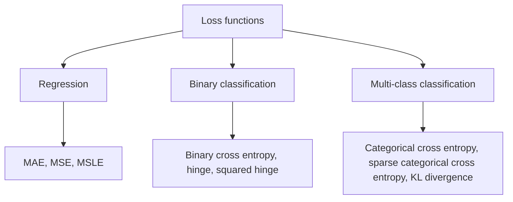
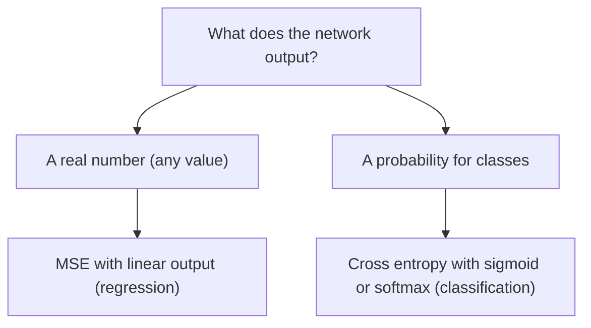

**In one line:** <mark>a loss function is a mathematical function that measures the difference between the predicted output and the actual output</mark>; training tries to make it small, and the right loss is chosen from the problem type. <Cite id="class-dl-chp2" loc="slide 26" />

<Box kind="key">

**Key points to write (any loss function question):**

- <mark>Small loss means the prediction is close to the correct answer; large loss means it is far.</mark> Lower loss means a better model.
- Role: the loss is sent back by **backpropagation** to update the weights; repeat until the loss is small.
- <mark>Regression: MAE, MSE, MSLE. Binary classification: binary cross entropy, hinge. Multi-class: categorical cross entropy, sparse categorical cross entropy, KL divergence.</mark>
- <mark>MSE $= \frac{1}{n}\sum (y_i - \hat y_i)^2$: squares the error, so large errors get a higher penalty; sensitive to outliers.</mark>
- <mark>Cross entropy penalizes a confident wrong prediction very heavily</mark> and gives better gradients, so it suits classification.
- Match: linear output with MSE, sigmoid with binary cross entropy, softmax with categorical cross entropy.

</Box>

## Core answer (5 marks, fits every question here)

<Box kind="definition">

A **loss function** is a mathematical function that measures the difference between the predicted output and the actual output. It tells the network how wrong its prediction is. <Cite id="class-dl-chp2" loc="slide 26" />

</Box>

**Role in training:** after the forward pass the loss is calculated; backpropagation sends it back to update the weights; this repeats until the loss is small. Without measuring the error the network cannot improve. <Cite id="class-dl-chp2" loc="slides 26 and 27" />

| Problem | Output layer | Loss |
|---|---|---|
| Regression | Linear | MSE or MAE |
| Two classes | Sigmoid | Binary cross entropy |
| Many classes | Softmax | Categorical cross entropy |

<Cite id="class-dl-chp2" loc="slide 52" />

**Conclusion:** the loss function is the heart of training; the right loss is chosen from the problem type and matched to the output function. <Cite id="web-dl-1-wiki-lossfn" />

## Extended answer (10 marks): add these

### 1. Types of loss functions

<Cite id="class-dl-chp2" loc="slide 27" />

- **Regression (predicting a number):**
  - **MAE** $= \frac{1}{n}\sum \lvert y_i - \hat y_i \rvert$: average absolute error; every error counts equally.
  - **MSE** $= \frac{1}{n}\sum (y_i - \hat y_i)^2$: large errors get a higher penalty.
  - **MSLE** $= \frac{1}{n}\sum (\log(1 + y_i) - \log(1 + \hat y_i))^2$: relative error, for positive values with a large range.
- **Binary classification:** **binary cross entropy** $= -[y\log\hat y + (1 - y)\log(1 - \hat y)]$; **hinge loss** $= \max(0, 1 - y\hat y)$ (labels +1 and −1) and its squared version.
- **Multi-class:** **categorical cross entropy** $= -\sum y_i\log\hat y_i$ (one-hot labels); **sparse categorical cross entropy** (integer labels); **KL divergence** (compares two distributions).

### 2. MSE vs cross entropy

| | MSE | Cross entropy |
|---|---|---|
| Usage | Regression (continuous target) | Classification (categorical target) |
| Formula | $\frac{1}{n}\sum (y_i - \hat y_i)^2$ | $-\frac{1}{n}\sum [y_i\log\hat y_i + (1 - y_i)\log(1 - \hat y_i)]$ |
| Output range | Any real value | 0 to 1 (probabilities) |
| Output layer | Linear | Sigmoid or softmax |
| Penalty | Quadratic; sensitive to outliers | Logarithmic; very high for a confident wrong prediction |
| Impact | Good for numbers like house price | Faster convergence, better gradients for classes |

<Cite id="class-dl-m2" loc="p. 14" /> <Cite id="web-dl-1-d2l-softmax" />

### 3. Worked examples

<Sum>

<Given>

MSE: actual 180, 200, 160, 150 and predicted 185, 195, 170, 145. Cross entropy: true class $y = 1$ (spam), prediction A $= 0.9$ and prediction B $= 0.1$.

</Given>

<Find>

the MSE and the two cross-entropy losses.

</Find>

<Steps>

1. **Errors:** $-5, 5, -10, 5$. Squares: $25, 25, 100, 25$. Sum $= 175$.
2. **MSE** $= 175 / 4 = 43.75$. The single error $-10$ gives 100 of the 175.
3. **Prediction A:** $-\ln 0.9 = 0.105$ (small loss).
4. **Prediction B:** $-\ln 0.1 = 2.303$ (very large loss).

</Steps>

<Answer>

MSE $= 43.75$; cross entropy $0.105$ for the good prediction and $2.303$ for the confident wrong one.

</Answer>

</Sum>

The wrong, confident prediction B is punished heavily, so the network corrects it quickly. <Cite id="class-dl-chp2" loc="slide 33" /> <Cite id="class-dl-m2" loc="p. 14" />

### 4. When cross entropy is more appropriate

In classification the output is a probability and the target is a class. Cross entropy compares the probability with the actual class and gives a better gradient, so the network converges faster than with MSE. <Cite id="web-dl-1-wiki-xent" />

## Fit it to each question

- **"Comment on the significance of Loss functions and explain different types of Loss functions while training a network."** (10 marks) <PYQ id="2024-12/q5a" />: core answer (definition, role, tree and table), then the types list of section 1 with all formulas.
- **"Discuss the role of a loss function in training a neural network. Compare Mean Squared Error (MSE) and Cross-Entropy Loss in terms of their usage, characteristics, and impact on model performance. In which scenarios would ..."** (10 marks) <PYQ id="2025-05/q5a" />: the role paragraph, the **MSE vs cross entropy table**, section 4 for the scenarios and the spam example.
- **"Explain how MSE measures prediction error in regression models."** (5 marks) <PYQ id="2026-05/q1e" />: definition and formula of MSE, why squared (big errors punished, signs removed), the 43.75 example and the outlier note.

## Exam tips

- **Always draw** the loss-by-problem-type tree and write the matching output layer.
- For MSE vs cross entropy, give **usage, formula, output range and penalty** in a table.
- Always write why we square in MSE: it removes the sign and punishes large errors more.
