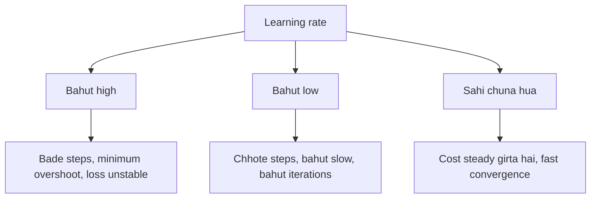

**Ek line mein:** <mark>loss function ek training example ki error hai; cost function poore training set ki average error hai</mark>, aur <mark>learning rate wo step size hai jo decide karta hai ki weights us cost ko kitni tez kam karein</mark>. <Cite id="class-dl-m1" loc="p. 28" /> <Cite id="class-dl-m1" loc="p. 29" />

<Box kind="key">

**Ye points likho:**

- <mark>Loss function: ek training example ki error. Cost function: poore training set ki average error.</mark>
- Dono terms aksar synonym ki tarah use hote hain, lekin thoda farq hai.
- <mark>Cost function = loss (jaise binary cross entropy) + regularization term.</mark>
- Dono actual $y$ aur predicted $y$ ka difference naapte hain aur **negative gradient** ki direction mein parameters adjust karne ka feedback dete hain.
- <mark>Learning rate (step size, alpha) minimum tak pahunchne ke steps ka size hai, aam taur par chhota value.</mark>
- <mark>High rate: fast lekin overshoot ho sakta hai. Low rate: precise lekin slow. Good rate: fast aur stable convergence.</mark>

</Box>

## Core answer (5 marks, yahan ke har question ke liye)

<Box kind="definition">

A **loss function** measures the error for **one** training example. A **cost function** is the **average** of the losses over the **whole** training set. The **learning rate** is the size of the step taken in the direction of the negative gradient. <Cite id="class-dl-m1" loc="pp. 28 and 29" />

</Box>

| | Loss function | Cost function |
|---|---|---|
| Kiski error naapta hai | Ek training example | Poora training set (average error) |
| Example | Ek fruit ke liye $\lvert 185 - 180 \rvert = 5$ g | Saare fruits ke aise losses ka mean |
| Link | Cost = loss + regularization term <Cite id="class-dl-m2" loc="p. 32" /> | |

| Learning rate | Training pe asar |
|---|---|
| High | Bade steps, shuru mein fast, lekin minimum overshoot ho sakta hai; loss uchhalta rehta hai. |
| Low | Chhote steps aur zyada precision, lekin bahut iterations: slow aur costly. |
| Right | Tez learning aur convergence. |

<Cite id="class-dl-m1" loc="p. 29" /> <Cite id="class-dl-chp2" loc="slide 8" />

**Conclusion:** loss per example hai, cost dataset ka average hai, aur achhe se chuna learning rate fast aur stable training deta hai. <Cite id="web-dl-1-wiki-lossfn" />

## Extended answer (10 marks): ye add karo

### 1. Loss vs cost detail mein

- Dono actual $y$ aur predicted $y$ ka difference naapte hain aur feedback dete hain taaki model negative gradient ke saath move karke cost ko zero ke paas laye. <Cite id="class-dl-m1" loc="p. 28" />
- Practice mein training algorithm **cost** minimize karta hai: $J = \dfrac{1}{n}\sum_{i=1}^{n} L_i$ (+ regularization), jahan $L_i$ ek example ka loss hai.
- Kai books dono ke liye "loss" likhti hain; teacher ki tarah "slight difference" likho.

### 2. Learning rate ka effect, chhote example ke saath

Update $W_{new} = W_{old} - \eta \dfrac{\partial J}{\partial W}$ mein learning rate $\eta$ step ko scale karta hai. <Cite id="class-dl-chp2" loc="slide 63" />

<Sum>

<Given>

cost $J(w) = w^2$ (minimum $w = 0$ pe), gradient $2w$, start $w = 1$, har learning rate ke liye do updates.

</Given>

<Find>

$\eta = 0.1$, $0.5$, $1.0$ aur $1.1$ ke liye 2 updates ke baad weight.

</Find>

<Steps>

1. **$\eta = 0.1$:** $w = 1 - 0.1 \times 2 = 0.8$, phir $0.8 - 0.1 \times 1.6 = 0.64$. Slow, steady girawat.
2. **$\eta = 0.5$:** $w = 1 - 0.5 \times 2 = 0$, ek hi baar mein minimum. Is bowl ke liye achha rate.
3. **$\eta = 1.0$:** $w = 1 - 2 = -1$, phir $-1 + 2 = 1$. $1$ aur $-1$ ke beech uchhalta hai, kabhi settle nahi hota.
4. **$\eta = 1.1$:** $w = 1 - 2.2 = -1.2$, phir $-1.2 + 2.64 = 1.44$. Har baar weight aur door jaata hai: diverge.

</Steps>

<Answer>

2 updates ke baad: $0.64$ (bahut low, slow), $0$ (good), $1$ (uchhalta hai), $1.44$ (diverge, bahut high).

</Answer>

</Sum>

### 3. Rules of thumb

- Zyada learning rate: tez learning, lekin final weights non-optimal. Kam rate: behtar weights lekin bahut time. <Cite id="class-dl-m1" loc="p. 35" />
- Aam practice: bade rate se shuru karo aur training ke saath use **ghatao**. <Cite id="web-dl-1-cs231n-nn3" /> <Cite id="web-dl-1-wiki-lr" />

## Har question mein kaise fit karein

- **"Analyze the difference between loss function and cost function, and explain how the learning rate affects the training performance of a neural network."** (10 marks) <PYQ id="assignment-1/q1d" />: loss-vs-cost table (core answer), learning-rate table aur diagram, phir section 2 ka worked example aur rules of thumb.

## Exam tips

- **Hamesha draw karo** "too high, too low, good" learning-rate diagram aur loss-vs-cost table.
- Keyword pair likho: **loss = ek example, cost = dataset ka average**.
- Ye mat likho ki zyada learning rate hamesha better hai; wo overshoot aur diverge ho sakta hai.

Exam mein English mein likho.
