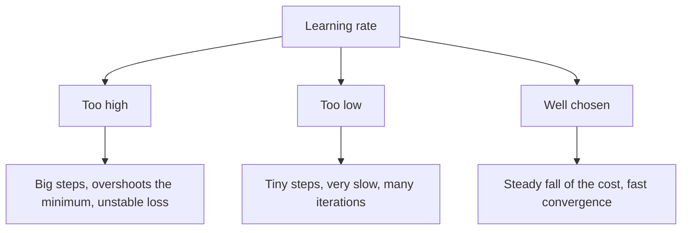

**In one line:** <mark>a loss function is the error of one training example; the cost function is the average error over the whole training set</mark>, and <mark>the learning rate is the step size that decides how fast the weights reduce that cost</mark>. <Cite id="class-dl-m1" loc="p. 28" /> <Cite id="class-dl-m1" loc="p. 29" />

<Box kind="key">

**Key points to write:**

- <mark>Loss function: error of one training example. Cost function: average error across the entire training set.</mark>
- The two terms are often used as synonyms, but there is a slight difference.
- <mark>Cost function = loss (for example binary cross entropy) + regularization term.</mark>
- Both measure the difference between actual $y$ and predicted $y$ and give feedback to adjust the parameters in the direction of the **negative gradient**.
- <mark>Learning rate (step size, alpha) is the size of the steps taken to reach the minimum, usually a small value.</mark>
- <mark>High rate: fast but may overshoot. Low rate: precise but slow. Good rate: fast and stable convergence.</mark>

</Box>

## Core answer (5 marks, fits every question here)

<Box kind="definition">

A **loss function** measures the error for **one** training example. A **cost function** is the **average** of the losses over the **whole** training set. The **learning rate** is the size of the step taken in the direction of the negative gradient. <Cite id="class-dl-m1" loc="pp. 28 and 29" />

</Box>

| | Loss function | Cost function |
|---|---|---|
| Measures the error of | One training example | The whole training set (average error) |
| Example | $\lvert 185 - 180 \rvert = 5$ g for one fruit | The mean of such losses over all fruits |
| Link | Cost = loss + regularization term <Cite id="class-dl-m2" loc="p. 32" /> | |

| Learning rate | Effect on training |
|---|---|
| High | Larger steps, faster at first, but may overshoot the minimum; the loss may bounce around. |
| Low | Small steps and more precision, but many iterations: slow and costly. |
| Right | Faster learning and convergence. |

<Cite id="class-dl-m1" loc="p. 29" /> <Cite id="class-dl-chp2" loc="slide 8" />

**Conclusion:** loss is per example, cost is the average over the dataset, and a well-chosen learning rate gives fast and stable training. <Cite id="web-dl-1-wiki-lossfn" />

## Extended answer (10 marks): add these

### 1. Loss vs cost in more detail

- Both measure the difference between actual $y$ and predicted $y$ and give feedback so the model adjusts its parameters, moving along the negative gradient until the cost is close to zero. <Cite id="class-dl-m1" loc="p. 28" />
- In practice the training algorithm minimizes the **cost** $J = \dfrac{1}{n}\sum_{i=1}^{n} L_i$ (+ regularization), while $L_i$ is the loss of one example.
- Many books use "loss" for both; say "slight difference" as the teacher does.

### 2. Effect of the learning rate, with a small example

In the update $W_{new} = W_{old} - \eta \dfrac{\partial J}{\partial W}$ the learning rate $\eta$ scales the step. <Cite id="class-dl-chp2" loc="slide 63" />

<Sum>

<Given>

cost $J(w) = w^2$ (minimum at $w = 0$), gradient $2w$, start $w = 1$, two updates for each learning rate.

</Given>

<Find>

the weight after 2 updates for $\eta = 0.1$, $0.5$, $1.0$ and $1.1$.

</Find>

<Steps>

1. **$\eta = 0.1$:** $w = 1 - 0.1 \times 2 = 0.8$, then $0.8 - 0.1 \times 1.6 = 0.64$. Slow, steady fall.
2. **$\eta = 0.5$:** $w = 1 - 0.5 \times 2 = 0$, the minimum at once. Good rate for this bowl.
3. **$\eta = 1.0$:** $w = 1 - 2 = -1$, then $-1 + 2 = 1$. It bounces between $1$ and $-1$ and never settles.
4. **$\eta = 1.1$:** $w = 1 - 2.2 = -1.2$, then $-1.2 + 2.64 = 1.44$. The weight moves farther away each time: it diverges.

</Steps>

<Answer>

After 2 updates: $0.64$ (too low, slow), $0$ (good), $1$ (bounces), $1.44$ (diverges, too high).

</Answer>

</Sum>

### 3. Rules of thumb

- Higher learning rate: faster learning, but a non-optimal final set of weights. Lower rate: a more optimal set of weights but a long time. <Cite id="class-dl-m1" loc="p. 35" />
- A common practice is to start with a larger rate and **decrease it** as training goes on. <Cite id="web-dl-1-cs231n-nn3" /> <Cite id="web-dl-1-wiki-lr" />

## Fit it to each question

- **"Analyze the difference between loss function and cost function, and explain how the learning rate affects the training performance of a neural network."** (10 marks) <PYQ id="assignment-1/q1d" />: the loss-vs-cost table (core answer), the learning-rate table and diagram, then the worked example of section 2 and the rules of thumb.

## Exam tips

- **Always draw** the "too high, too low, good" learning-rate diagram and the loss-vs-cost table.
- Write the keyword pair: **loss = one example, cost = average over the dataset**.
- Do not say a higher learning rate is always better; it may overshoot and diverge.
