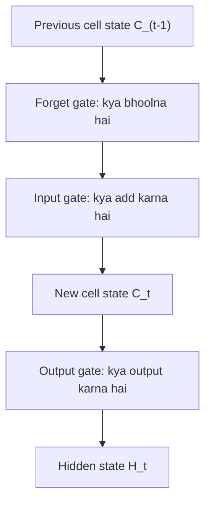
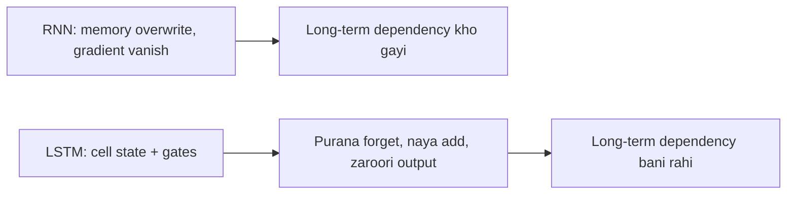

**Ek line mein:** <mark>LSTM ek special RNN hai jo long-term dependencies handle kar sakta hai</mark>; ismein <mark>cell state (long-term memory) aur teen gates: forget, input aur output</mark> hote hain, isliye ye RNN ki vanishing gradient problem solve karta hai. <Cite id="class-dl-m5" loc="p. 18" />

<Box kind="key">

**LSTM ke har question mein ye points likho:**

- <mark>RNN ki limitation: vanishing gradient, isliye long-term dependencies nahi seekh pata</mark> ("I grew up in India ... I speak Hindi").
- <mark>LSTM mein do states: hidden state (short-term memory) aur cell state (long-term memory)</mark>.
- <mark>Teen gates (sigmoid, 0 se 1): forget gate, input gate, output gate</mark>.
- <mark>$C_t = f_t C_{t-1} + i_t N_t$ aur $H_t = o_t \tanh(C_t)$</mark>.
- Cell state har step mein thoda hi badalta hai, isliye <mark>useful information aur gradients kai steps tak travel karte hain</mark>.
- Training abhi bhi BPTT se; keemat: zyada complex, zyada parameters.

</Box>

## Core answer (5 marks, yahan ke har question ke liye)

<Box kind="definition">

**LSTM** is a special kind of recurrent neural network capable of handling long-term dependencies. It is an advanced RNN that allows information to persist and can handle the vanishing gradient problem of the RNN. <Cite id="class-dl-m5" loc="p. 18" />

</Box>

**Kyun chahiye:** plain RNN mein gradient kai time steps peeche jaate hue bahut chhota ho jaata hai, isliye shuruaati information kho jaati hai. LSTM isse bachne ke liye bana hai. <Cite id="class-dl-chp5" loc="slide 11" /> <Cite id="class-dl-m5" loc="p. 16" />

**Architecture:** <Cite id="class-dl-m5" loc="p. 20" /> <Cite id="class-dl-m5" loc="p. 21" />

1. **Forget gate** $f_t = \sigma(x_t U_f + H_{t-1} W_f)$: jo information ab useful nahi use hatata hai (0 bhoolta hai, 1 rakhta hai).
2. **Input gate** $i_t = \sigma(x_t U_i + H_{t-1} W_i)$ aur new information $N_t = \tanh(x_t U_c + H_{t-1} W_c)$: useful nayi information add karta hai.
3. **Output gate** $o_t = \sigma(x_t U_o + H_{t-1} W_o)$: tay karta hai ki output mein kya dikhana hai.

Cell state: $C_t = f_t C_{t-1} + i_t N_t$. Hidden state: $H_t = o_t \tanh(C_t)$. <Cite id="class-dl-m5" loc="p. 24" />

**Conclusion:** cell state long-term memory carry karti hai; gates control karte hain ki kya andar aaye, kya rahe aur kya bahar jaye.

## Extended answer (10 marks): ye add karo

### 1. LSTM RNN ki limitation kaise overcome karta hai

- RNN mein memory **har step pe overwrite** hoti hai, aur gradient baar baar multiply hota hai. <Cite id="web-dl-2-pascanu-gradients" />
- LSTM mein cell state thoda forget aur thoda add se update hoti hai, isliye information kai steps tak lagbhag waisi hi guzar sakti hai, aur gradient ko peeche jaane ka aasan raasta milta hai. <Cite id="web-dl-2-colah-lstm" /> <Cite id="class-dl-chp5" loc="slide 18" />
- Gates **chunte** hain ki kya rakhna hai: purana forget, naya add, sirf zaroori output.

### 2. RNN vs LSTM

| Aspect | RNN | LSTM |
|---|---|---|
| Memory | Hidden state | Hidden state + cell state |
| Gates | Koi nahi | Forget, input, output |
| Long-term dependencies | Struggle karta hai | Handle karne ke liye bana |
| Vanishing gradient | Problem | Gates useful information bachate hain |
| Structure | Simple | Zyada complex, zyada parameters |

<Cite id="class-dl-chp5" loc="slide 17" />

### 3. Worked step

<Sum>

<Given>

$f_t = 0.2$, $C_{t-1} = 10$, $i_t = 0.8$, $N_t = 5$.

</Given>

<Find>

naya cell state $C_t$.

</Find>

<Steps>

1. **Forget part:** $f_t \times C_{t-1} = 0.2 \times 10 = 2$.
2. **Add part:** $i_t \times N_t = 0.8 \times 5 = 4$.
3. **Dono add karo:** $C_t = 2 + 4 = 6$.

</Steps>

<Answer>

$C_t = 6$

</Answer>

</Sum>

<Cite id="class-dl-chp5" loc="slide 17" />

### 4. Application: speech recognition

Audio ek lambi sequence hai, aur ek word ka matlab bahut pehle suni awaazon pe depend kar sakta hai. LSTM useful pehli awaazein cell state mein rakhta hai jab tak zaroorat ho. LSTM Apple ke Siri aur Google voice search ke peeche hai. <Cite id="class-dl-m5" loc="p. 31" /> <Cite id="class-dl-chp5" loc="slide 19" /> Time series aur text classification mein bhi use hota hai. <Cite id="web-dl-2-wiki-lstm" /> Gate equations d2l mein bhi samjhayi gayi hain. <Cite id="web-dl-2-d2l-lstm" />

## Har question mein kaise fit karein

- **"Explain LSTM architecture."** (10 marks) <PYQ id="2023-12/q5b" />: definition, kyun chahiye, cell diagram aur teen gates equations ke saath, worked step, advantages aur applications.
- **"Explain LSTM model, how it overcomes the limitation of RNN."** (10 marks) <PYQ id="2024-05/q4a" />: pehle RNN ki limitation (vanishing gradient), core answer, phir section 1 aur RNN vs LSTM table.
- **"Explain how RNNs are suited for sequential data. Compare the standard RNN architecture with LSTM in terms of long-term dependencies. Provide a real-world application where LSTM would be significantly more beneficial than a simple RNN and justify."** (10 marks) <PYQ id="2025-05/q4b" />: RNN sequences ke liye kyun suit karta hai (hidden state, shared weights) pe do lines, phir RNN vs LSTM table (section 2), aur speech recognition example (section 4).
- **"Analyse the architecture of LSTM."** (10 marks) <PYQ id="assignment-2/q5b" />: cell state aur hidden state, har gate equation aur kaam ke saath, worked step aur chaar-sawaal flow.

## Exam tips

- **Draw karo:** cell, upar cell state line aur teen gates (forget, input, output).
- **Keywords:** cell state, hidden state, forget gate, input gate, output gate, sigmoid, tanh, long-term dependency.
- Common galtiyan: LSTM ko sirf do gates dena, ya bhoolna ki cell state equation mein $f_t$ aur $i_t N_t$ aate hain.

Exam mein English mein likho.
