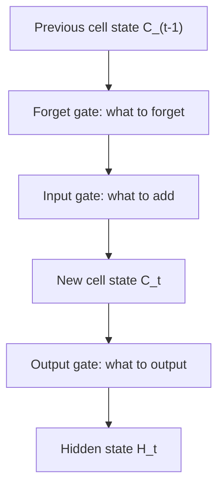
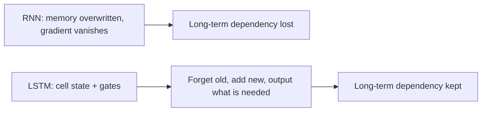

**In one line:** <mark>LSTM is a special kind of RNN capable of handling long-term dependencies</mark>; it adds a <mark>cell state (long-term memory) and three gates: forget, input and output</mark>, so it can overcome the vanishing gradient problem of the RNN. <Cite id="class-dl-m5" loc="p. 18" />

<Box kind="key">

**Key points to write (LSTM):**

- <mark>RNN limitation: vanishing gradient, so it cannot learn long-term dependencies</mark> ("I grew up in India ... I speak Hindi").
- <mark>LSTM has two states: hidden state (short-term memory) and cell state (long-term memory)</mark>.
- <mark>Three gates (sigmoid, 0 to 1): forget gate, input gate, output gate</mark>.
- <mark>$C_t = f_t C_{t-1} + i_t N_t$ and $H_t = o_t \tanh(C_t)$</mark>.
- The cell state changes only a little at each step, so <mark>useful information and gradients travel across many steps</mark>.
- Still trained with BPTT; price: more complex, more parameters.

</Box>

## Core answer (5 marks, fits every question here)

<Box kind="definition">

**LSTM** is a special kind of recurrent neural network capable of handling long-term dependencies. It is an advanced RNN that allows information to persist and can handle the vanishing gradient problem of the RNN. <Cite id="class-dl-m5" loc="p. 18" />

</Box>

**Why needed:** in a plain RNN the gradient becomes very small while travelling back through many time steps, so early information is lost. LSTM is designed to avoid this. <Cite id="class-dl-chp5" loc="slide 11" /> <Cite id="class-dl-m5" loc="p. 16" />

**Architecture:** <Cite id="class-dl-m5" loc="p. 20" /> <Cite id="class-dl-m5" loc="p. 21" />

1. **Forget gate** $f_t = \sigma(x_t U_f + H_{t-1} W_f)$: removes information that is no longer useful (0 forgets, 1 keeps).
2. **Input gate** $i_t = \sigma(x_t U_i + H_{t-1} W_i)$ with new information $N_t = \tanh(x_t U_c + H_{t-1} W_c)$: adds useful new information.
3. **Output gate** $o_t = \sigma(x_t U_o + H_{t-1} W_o)$: decides what is shown as output.

Cell state: $C_t = f_t C_{t-1} + i_t N_t$. Hidden state: $H_t = o_t \tanh(C_t)$. <Cite id="class-dl-m5" loc="p. 24" />

**Conclusion:** the cell state carries long-term memory; the gates control what enters, stays and leaves.

## Extended answer (10 marks): add these

### 1. How LSTM overcomes the limitation of RNN

- In an RNN the memory is **overwritten at every step**, and the gradient is multiplied again and again. <Cite id="web-dl-2-pascanu-gradients" />
- In an LSTM the cell state is updated by a small forget and a small add, so information can pass through many steps almost unchanged, and the gradient has an easy path back through time. <Cite id="web-dl-2-colah-lstm" /> <Cite id="class-dl-chp5" loc="slide 18" />
- The gates **choose** what to keep: forget old, add new, output only what is needed.

### 2. RNN versus LSTM

| Aspect | RNN | LSTM |
|---|---|---|
| Memory | Hidden state | Hidden state + cell state |
| Gates | None | Forget, input, output |
| Long-term dependencies | Struggles | Designed to handle |
| Vanishing gradient | A problem | Gates preserve useful information |
| Structure | Simple | More complex, more parameters |

<Cite id="class-dl-chp5" loc="slide 17" />

### 3. Worked step

<Sum>

<Given>

$f_t = 0.2$, $C_{t-1} = 10$, $i_t = 0.8$, $N_t = 5$.

</Given>

<Find>

the new cell state $C_t$.

</Find>

<Steps>

1. **Forget part:** $f_t \times C_{t-1} = 0.2 \times 10 = 2$.
2. **Add part:** $i_t \times N_t = 0.8 \times 5 = 4$.
3. **Add them:** $C_t = 2 + 4 = 6$.

</Steps>

<Answer>

$C_t = 6$

</Answer>

</Sum>

<Cite id="class-dl-chp5" loc="slide 17" />

### 4. Application: speech recognition

Audio is a long sequence, and the meaning of a word can depend on sounds heard much earlier. The LSTM keeps useful earlier sounds in its cell state until they are needed. LSTM is behind Apple's Siri and Google's voice search. <Cite id="class-dl-m5" loc="p. 31" /> <Cite id="class-dl-chp5" loc="slide 19" /> It is also used for time series and text classification. <Cite id="web-dl-2-wiki-lstm" /> The gate equations are also explained in d2l. <Cite id="web-dl-2-d2l-lstm" />

## Fit it to each question

- **"Explain LSTM architecture."** (10 marks) <PYQ id="2023-12/q5b" />: definition, why needed, the cell diagram and the three gates with equations, the worked step, advantages and applications.
- **"Explain LSTM model, how it overcomes the limitation of RNN."** (10 marks) <PYQ id="2024-05/q4a" />: RNN limitation (vanishing gradient) first, core answer, then section 1 and the RNN versus LSTM table.
- **"Explain how RNNs are suited for sequential data. Compare the standard RNN architecture with LSTM in terms of long-term dependencies. Provide a real-world application where LSTM would be significantly more beneficial than a simple RNN and justify."** (10 marks) <PYQ id="2025-05/q4b" />: two lines on why RNN suits sequences (hidden state, shared weights), then the RNN versus LSTM table (section 2), and the speech recognition example (section 4).
- **"Analyse the architecture of LSTM."** (10 marks) <PYQ id="assignment-2/q5b" />: cell state and hidden state, each gate with its equation and job, the worked step and the four-question flow.

## Exam tips

- **Draw** the cell with the cell state line on top and the three gates (forget, input, output).
- **Keywords:** cell state, hidden state, forget gate, input gate, output gate, sigmoid, tanh, long-term dependency.
- Common mistakes: giving the LSTM only two gates, or forgetting that the cell state equation uses $f_t$ and $i_t N_t$.
