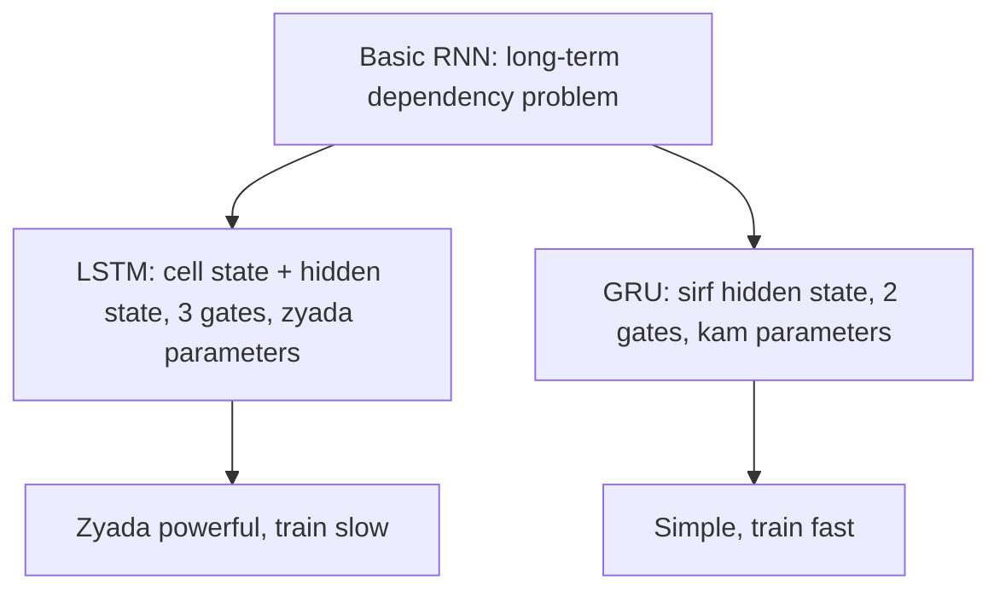

**Ek line mein:** LSTM aur GRU dono gated RNN cells hain jo long-term dependency problem solve karte hain; <mark>LSTM mein cell state plus hidden state aur 3 gates (forget, input, output) hote hain</mark>, jabki <mark>GRU mein sirf hidden state aur 2 gates (reset, update)</mark>, isliye wo simple hai aur uske parameters kam hain. <Cite id="class-dl-m5" loc="p. 31" />

<Box kind="key">

**LSTM vs GRU ke har question mein ye points likho:**

- Dono <mark>basic RNN ki long-term dependency (vanishing gradient) problem</mark> solve karte hain.
- <mark>LSTM: cell state + hidden state, 3 gates: forget, input, output</mark>.
- <mark>GRU: alag cell state nahi, sirf hidden state, 2 gates: reset, update</mark>.
- <mark>GRU simple hai aur parameters kam hain</mark>, isliye fast train hota hai aur bade models ban sakte hain.
- <mark>LSTM zyada powerful aur effective hai kyunki uske 2 ki jagah 3 gates hain</mark>.
- Choice: **GRU fast training aur kam data ke liye; LSTM lambi ya complex sequences mein sabse zyada control ke liye**.

</Box>

## Core answer (5 marks, yahan ke har question ke liye)

<Box kind="definition">

**LSTM** and **GRU** are both advanced RNNs that use gates to control information and handle long-term dependencies. LSTM keeps a cell state (long-term memory) and a hidden state (short-term memory); GRU keeps only the hidden state. <Cite id="class-dl-chp5" loc="slide 20" /> <Cite id="class-dl-m5" loc="p. 21" />

</Box>

| Feature | LSTM | GRU |
|---|---|---|
| Main memory | Cell state + hidden state | Hidden state |
| Gates | Forget, input, output (3) | Reset, update (2) |
| Structure | Zyada complex | Simple |
| Parameters | Zyada | Kam |
| Training speed | Slow | Fast |

<Cite id="class-dl-chp5" loc="slide 21" /> <Cite id="class-dl-m5" loc="p. 31" />

**Conclusion:** dono basic RNN se behtar long-term dependencies handle karte hain, par LSTM zyada gates se aur GRU kam gates se information control karta hai.

## Extended answer (10 marks): ye add karo

### 1. Dono architectures detail mein

**LSTM:** forget gate purani information hatata hai, input gate nayi add karta hai, output gate tay karta hai kya dikhana hai. $C_t = f_t C_{t-1} + i_t N_t$, $H_t = o_t \tanh(C_t)$. <Cite id="class-dl-m5" loc="p. 24" /> <Cite id="web-dl-2-colah-lstm" />

**GRU:** reset gate tay karta hai kitna past use karna hai; update gate tay karta hai kitni old aur new information rakhni hai. $h_t = z_t \odot h_{t-1} + (1 - z_t) \odot \tilde{h}_t$. <Cite id="class-dl-m5" loc="p. 28" /> <Cite id="web-dl-2-gru-paper" />

### 2. Worked step (ek hi tarah ka example)

<Sum>

<Given>

LSTM: $f = 0.2$, $C_{t-1} = 10$, $i = 0.8$, new information $= 5$. GRU: $z = 0.7$, $h_{t-1} = 10$, candidate $= 4$.

</Given>

<Find>

naya LSTM cell state aur naya GRU hidden state.

</Find>

<Steps>

1. **LSTM:** $C_t = 0.2 \times 10 + 0.8 \times 5 = 2 + 4 = 6$.
2. **GRU:** $h_t = 0.7 \times 10 + (1 - 0.7) \times 4 = 7 + 1.2 = 8.2$.

</Steps>

<Answer>

LSTM $C_t = 6$; GRU $h_t = 8.2$.

</Answer>

</Sum>

<Cite id="class-dl-chp5" loc="slide 17" /> <Cite id="class-dl-chp5" loc="slide 21" /> Dhyan do: LSTM do alag numbers ($f$ aur $i$) use karta hai, GRU unhe jodta hai: ek update gate $z$ aur $1 - z$.

### 3. Lambi sequences pe performance aur kya chunein

- **Lambi sequences:** dono long-range dependencies pakadte hain aur vanishing gradient kam karte hain. LSTM zyada powerful aur effective hai (3 gates); GRU simple design ke saath similar kaam deta hai. <Cite id="class-dl-m5" loc="p. 31" />
- **Fast training: GRU.** Isme cell state nahi aur 2 gates hain, isliye har time step mein calculations kam (chaar ki jagah teen weight sets) aur memory kam. <Cite id="web-dl-2-d2l-gru" /> <Cite id="web-dl-2-d2l-lstm" />
- **Bahut lambi ya complex sequences mein sabse zyada power: LSTM.**
- Class mein benchmark numbers nahi hain; practice mein dono ko apne dataset pe compare karte hain.

| Kya chunein | Kab |
|---|---|
| GRU | Fast training, kam data, limited memory |
| LSTM | Bahut lambi ya complex sequences, maximum control |

## Har question mein kaise fit karein

- **"Differentiate between the architecture of LSTM and GRU network."** (10 marks) <PYQ id="2024-12/q3b" />: core diagram aur table, phir section 1 dono cell pictures aur equations ke saath.
- **"Differentiate between the LSTM and GRU network."** (10 marks) <PYQ id="2025-05/q3b" />: wahi, worked step (section 2) aur which-to-use line add karo.
- **"Compare the performance of LSTM and GRU on long-sequence datasets. Which one would you choose for faster training and why?"** (10 marks) <PYQ id="2026-05/q3b" />: core table, phir section 3 poora; answer **GRU** hai kyunki gates aur parameters kam hain.

## Exam tips

- **Draw karo:** pehle comparison table; ye sabse tez 5 marks hain.
- **Keywords:** cell state, hidden state, 3 gates, 2 gates, reset, update, fewer parameters.
- Common galti: GRU ko "no gates" ya "cell state wala" likhna; GRU mein do gates hain aur cell state nahi.

Exam mein English mein likho.
