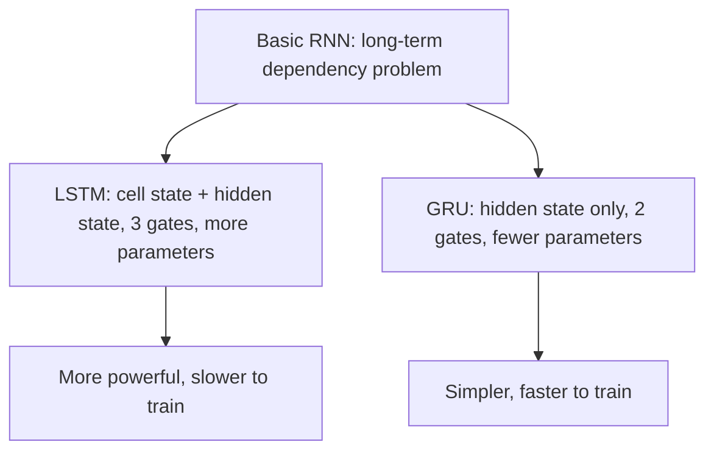

**In one line:** both LSTM and GRU are gated RNN cells that fix the long-term dependency problem; <mark>LSTM has a cell state plus a hidden state and 3 gates (forget, input, output)</mark>, while <mark>GRU has only a hidden state and 2 gates (reset, update)</mark>, so it is simpler and has fewer parameters. <Cite id="class-dl-m5" loc="p. 31" />

<Box kind="key">

**Key points to write (LSTM versus GRU):**

- Both solve the <mark>long-term dependency (vanishing gradient) problem of the basic RNN</mark>.
- <mark>LSTM: cell state + hidden state, 3 gates: forget, input, output</mark>.
- <mark>GRU: no separate cell state, hidden state only, 2 gates: reset, update</mark>.
- <mark>GRU is simpler with fewer parameters</mark>, so it trains faster and bigger models can be built.
- <mark>LSTM is more powerful and effective because it has 3 gates instead of 2</mark>.
- Choice: **GRU for faster training and smaller data; LSTM for the most control on long or complex sequences**.

</Box>

## Core answer (5 marks, fits every question here)

<Box kind="definition">

**LSTM** and **GRU** are both advanced RNNs that use gates to control information and handle long-term dependencies. LSTM keeps a cell state (long-term memory) and a hidden state (short-term memory); GRU keeps only the hidden state. <Cite id="class-dl-chp5" loc="slide 20" /> <Cite id="class-dl-m5" loc="p. 21" />

</Box>

| Feature | LSTM | GRU |
|---|---|---|
| Main memory | Cell state + hidden state | Hidden state |
| Gates | Forget, input, output (3) | Reset, update (2) |
| Structure | More complex | Simpler |
| Parameters | More | Fewer |
| Training speed | Slower | Faster |

<Cite id="class-dl-chp5" loc="slide 21" /> <Cite id="class-dl-m5" loc="p. 31" />

**Conclusion:** both handle long-term dependencies better than a basic RNN, but LSTM controls information with more gates and GRU with fewer.

## Extended answer (10 marks): add these

### 1. The two architectures in detail

**LSTM:** forget gate removes old information, input gate adds new information, output gate selects what to show. $C_t = f_t C_{t-1} + i_t N_t$, $H_t = o_t \tanh(C_t)$. <Cite id="class-dl-m5" loc="p. 24" /> <Cite id="web-dl-2-colah-lstm" />

**GRU:** the reset gate decides how much past to use; the update gate decides how much old and new information to keep. $h_t = z_t \odot h_{t-1} + (1 - z_t) \odot \tilde{h}_t$. <Cite id="class-dl-m5" loc="p. 28" /> <Cite id="web-dl-2-gru-paper" />

### 2. Worked step (same style of example)

<Sum>

<Given>

LSTM: $f = 0.2$, $C_{t-1} = 10$, $i = 0.8$, new information $= 5$. GRU: $z = 0.7$, $h_{t-1} = 10$, candidate $= 4$.

</Given>

<Find>

the new LSTM cell state and the new GRU hidden state.

</Find>

<Steps>

1. **LSTM:** $C_t = 0.2 \times 10 + 0.8 \times 5 = 2 + 4 = 6$.
2. **GRU:** $h_t = 0.7 \times 10 + (1 - 0.7) \times 4 = 7 + 1.2 = 8.2$.

</Steps>

<Answer>

LSTM $C_t = 6$; GRU $h_t = 8.2$.

</Answer>

</Sum>

<Cite id="class-dl-chp5" loc="slide 17" /> <Cite id="class-dl-chp5" loc="slide 21" /> Note that LSTM uses two separate numbers ($f$ and $i$), while GRU ties them: one update gate $z$ and $1 - z$.

### 3. Performance on long sequences and which to choose

- **Long sequences:** both capture long-range dependencies and ease the vanishing gradient. LSTM is more powerful and effective (3 gates); GRU gives similar work with a simpler design. <Cite id="class-dl-m5" loc="p. 31" />
- **Faster training: GRU.** It has no cell state and 2 gates, so it has fewer calculations per time step (three weight sets instead of four) and needs less memory. <Cite id="web-dl-2-d2l-gru" /> <Cite id="web-dl-2-d2l-lstm" />
- **Most power on very long or complex sequences: LSTM.**
- The class gives no benchmark numbers; in practice the two are compared on the dataset itself.

| Choose | When |
|---|---|
| GRU | Faster training, less data, limited memory |
| LSTM | Very long or complex sequences, maximum control |

## Fit it to each question

- **"Differentiate between the architecture of LSTM and GRU network."** (10 marks) <PYQ id="2024-12/q3b" />: core diagram and table, then section 1 with both cell pictures and the equations.
- **"Differentiate between the LSTM and GRU network."** (10 marks) <PYQ id="2025-05/q3b" />: the same, add the worked step (section 2) and the which-to-use line.
- **"Compare the performance of LSTM and GRU on long-sequence datasets. Which one would you choose for faster training and why?"** (10 marks) <PYQ id="2026-05/q3b" />: core table, then section 3 in full; the answer is **GRU** because of fewer gates and parameters.

## Exam tips

- **Draw** the comparison table first; it is the quickest 5 marks.
- **Keywords:** cell state, hidden state, 3 gates, 2 gates, reset, update, fewer parameters.
- Common mistake: saying GRU has no gates or has a cell state; GRU has two gates and no cell state.
