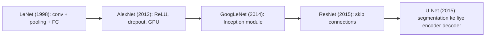
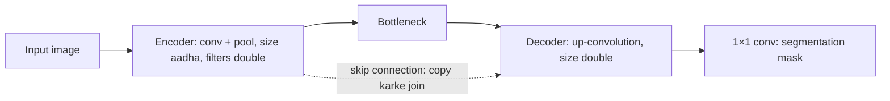

**Ek line mein:** har modern CNN ne <mark>ek naya idea</mark> add kiya: <mark>LeNet ne dikhaya ki CNN features seekhta hai, AlexNet ne use deep banaya (ReLU, dropout, GPU), GoogLeNet ne Inception module diya, ResNet ne skip connections aur U-Net har pixel ko label karta hai</mark>. <Cite id="class-dl-chp4" loc="slide 41" />

<Box kind="key">

**Modern CNN architectures ke har question mein ye points likho:**

- <mark>LeNet-5 (1998): handwritten digits, 5 trainable layers, lagbhag 60 thousand parameters</mark>.
- <mark>AlexNet (2012): 5 conv + 3 FC, ReLU, dropout, GPU; ImageNet jeeta</mark>.
- <mark>GoogLeNet (2014): Inception module (1×1, 3×3, 5×5, pooling parallel mein), global average pooling</mark>.
- <mark>ResNet (2015): skip connection $y = F(x) + x$ bahut deep networks ki degradation problem solve karta hai</mark>.
- <mark>U-Net (2015): segmentation ke liye skip connections wala U-shaped encoder-decoder</mark>.
- Hamesha likho: **year, main idea, labelled diagram, ek merit aur ek limit**.

</Box>

## Core answer (5 marks, yahan ke har question ke liye)

<Box kind="definition">

**Modern CNN architectures** are landmark designs, from LeNet to U-Net, in which every new network solved one problem of the previous ones with one new building idea. <Cite id="class-dl-chp4" loc="slide 41" />

</Box>

| Network | Year | Main idea |
|---|---|---|
| LeNet-5 | 1998 | Features seekhne wala pehla CNN; digits |
| AlexNet | 2012 | ReLU, dropout, GPU ke saath deep CNN |
| GoogLeNet | 2014 | Inception: parallel filters, 1×1 reduction |
| ResNet | 2015 | Skip connection, 152 layers tak |
| U-Net | 2015 | Encoder-decoder, per-pixel labels |

<Cite id="class-dl-chp4" loc="slide 41" />

**ResNet block** (sabse zyada pucha jaane wala diagram): input $x$ do convolutions se guzarta hai aur shortcut se bhi jaata hai; dono add hote hain, $y = F(x) + x$. <Cite id="class-dl-chp4" loc="slide 49" />

**Conclusion:** LeNet ki simplicity se U-Net ki specialization tak, har design ne apne time ki ek problem solve ki. <Cite id="class-dl-m4" loc="p. 86" />

## Extended answer (10 marks): ye add karo

### 1. Har network detail mein

**LeNet-5** (LeCun, 1998): input 32×32×1, C1 (6 filters 5×5) 28×28×6, S2 pooling 14×14×6, C3 (16 filters) 10×10×16, S4 5×5×16, C5 (120 filters) 1×1×120, F6 84, output 10. Tanh, paanch trainable layers. <Cite id="class-dl-chp4" loc="slide 45" /> <Cite id="web-dl-2-wiki-lenet" />

**AlexNet** (2012): input 227×227×3; 5 convolution aur 3 fully connected layers; ReLU, max pooling, dropout 0.5, data augmentation, GPUs; lagbhag 62 million parameters. <Cite id="class-dl-chp4" loc="slide 48" /> <Cite id="web-dl-2-alexnet-paper" />

**GoogLeNet** (2014, 22 layers, ILSVRC 2014 winner): **Inception module** 1×1, 3×3, 5×5 convolutions aur 3×3 max pooling parallel chalata hai aur outputs stack karta hai. 1×1 convolutions computation kam karte hain; **global average pooling** fully connected layers ki jagah leta hai; lagbhag 6.8 million parameters. <Cite id="class-dl-m4" loc="p. 64" /> <Cite id="class-dl-m4" loc="p. 67" /> <Cite id="web-dl-2-googlenet-paper" />

**ResNet** (2015): bahut deep networks mein **degradation problem** aati hai (zyada layers, kharab training). Block residual $F(x) = H(x) - x$ seekhta hai, isliye $y = F(x) + x$; sizes match karne ke liye shortcut pe 1×1 convolution. Versions 18, 34, 50, 101, 152; ResNet-152 ne ILSVRC 2015 jeeta. <Cite id="class-dl-chp4" loc="slide 49" /> <Cite id="web-dl-2-resnet-paper" />

**U-Net** (2015): U-shaped fully convolutional network. **Encoder** (contracting path) size aadha aur filters double karta hai; **decoder** (expanding path) transpose convolution se size double karta hai aur matching encoder map se judta hai (skip connection); aakhri 1×1 convolution mask deta hai. Kam data mein achha; segmentation ke liye bana. <Cite id="class-dl-m4" loc="p. 83" /> <Cite id="class-dl-m4" loc="p. 84" /> <Cite id="web-dl-2-unet-paper" />

### 2. Comparison

| Network | Strength | Limit |
|---|---|---|
| LeNet | Features khud seekhta hai, kam parameters | Low capacity, chhoti images |
| AlexNet | ImageNet jeeta, ReLU aur dropout | Lagbhag 62 million parameters |
| GoogLeNet | Efficient, 6.8 million parameters | Complex design |
| ResNet | Bahut deep networks train karta hai | High resolution pe heavy |
| U-Net | Kam data mein achha, per-pixel output | Plain classification ke liye nahi |

<Cite id="class-dl-m4" loc="p. 86" />

## Har question mein kaise fit karein

- **"Draw and explain any two modern deep learning architectures."** (10 marks) <PYQ id="2025-05/q3a" />: **AlexNet aur ResNet** chuno (ya ResNet aur U-Net). Har ke liye: year, idea, labelled diagram (strip ya residual block), 3-4 points, ek merit aur ek limit. Core table se shuru karo aur ek line conclusion.
- **"Discuss and analyse the architecture of LeNet / AlexNet / GoogLeNet / ResNet and UNet."** (10 marks) <PYQ id="assignment-2/q4c" />: pehle core diagram aur table, phir section 1 se har network ka ek paragraph (2 lines), end mein comparison table.

## Exam tips

- **Draw karo:** ResNet block aur Inception module; ye sabse aasan marks hain.
- **Keywords:** Inception module, 1×1 convolution, global average pooling, residual, skip connection, degradation, contracting aur expanding path.
- "Any two" likha ho to do achhe se likho, paanch kharab nahi.

Exam mein English mein likho.
