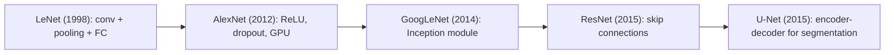
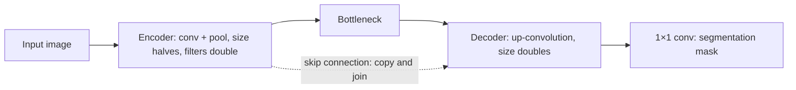

**In one line:** each modern CNN added <mark>one new idea</mark>: <mark>LeNet showed CNNs learn features, AlexNet made them deep (ReLU, dropout, GPU), GoogLeNet added the Inception module, ResNet added skip connections and U-Net labels every pixel</mark>. <Cite id="class-dl-chp4" loc="slide 41" />

<Box kind="key">

**Key points to write (modern CNN architectures):**

- <mark>LeNet-5 (1998): handwritten digits, 5 trainable layers, about 60 thousand parameters</mark>.
- <mark>AlexNet (2012): 5 conv + 3 FC, ReLU, dropout, GPU; won ImageNet</mark>.
- <mark>GoogLeNet (2014): Inception module (1×1, 3×3, 5×5, pooling in parallel), global average pooling</mark>.
- <mark>ResNet (2015): skip connection $y = F(x) + x$ solves the degradation problem of very deep networks</mark>.
- <mark>U-Net (2015): U-shaped encoder-decoder with skip connections for segmentation</mark>.
- Always give: **year, main idea, a labelled diagram, one merit and one limit**.

</Box>

## Core answer (5 marks, fits every question here)

<Box kind="definition">

**Modern CNN architectures** are landmark designs, from LeNet to U-Net, in which every new network solved one problem of the previous ones with one new building idea. <Cite id="class-dl-chp4" loc="slide 41" />

</Box>

| Network | Year | Main idea |
|---|---|---|
| LeNet-5 | 1998 | First CNN to learn features; digits |
| AlexNet | 2012 | Deep CNN with ReLU, dropout, GPU |
| GoogLeNet | 2014 | Inception: parallel filters, 1×1 reduction |
| ResNet | 2015 | Skip connection, up to 152 layers |
| U-Net | 2015 | Encoder-decoder, per-pixel labels |

<Cite id="class-dl-chp4" loc="slide 41" />

**ResNet block** (the most asked diagram): the input $x$ goes through two convolutions and also along a shortcut; the two are added, $y = F(x) + x$. <Cite id="class-dl-chp4" loc="slide 49" />

**Conclusion:** from LeNet's simplicity to U-Net's specialization, each design solved one problem of its time. <Cite id="class-dl-m4" loc="p. 86" />

## Extended answer (10 marks): add these

### 1. Each network in detail

**LeNet-5** (LeCun, 1998): input 32×32×1, C1 (6 filters 5×5) 28×28×6, S2 pooling 14×14×6, C3 (16 filters) 10×10×16, S4 5×5×16, C5 (120 filters) 1×1×120, F6 84, output 10. Tanh, five trainable layers. <Cite id="class-dl-chp4" loc="slide 45" /> <Cite id="web-dl-2-wiki-lenet" />

**AlexNet** (2012): input 227×227×3; 5 convolution and 3 fully connected layers; ReLU, max pooling, dropout 0.5, data augmentation, GPUs; about 62 million parameters. <Cite id="class-dl-chp4" loc="slide 48" /> <Cite id="web-dl-2-alexnet-paper" />

**GoogLeNet** (2014, 22 layers, ILSVRC 2014 winner): the **Inception module** runs 1×1, 3×3, 5×5 convolutions and 3×3 max pooling in parallel and stacks the outputs. 1×1 convolutions reduce computation; **global average pooling** replaces fully connected layers; about 6.8 million parameters. <Cite id="class-dl-m4" loc="p. 64" /> <Cite id="class-dl-m4" loc="p. 67" /> <Cite id="web-dl-2-googlenet-paper" />

**ResNet** (2015): very deep networks suffer the **degradation problem** (more layers, worse training). The block learns the residual $F(x) = H(x) - x$, so $y = F(x) + x$; a 1×1 convolution on the shortcut matches sizes. Versions 18, 34, 50, 101, 152; ResNet-152 won ILSVRC 2015. <Cite id="class-dl-chp4" loc="slide 49" /> <Cite id="web-dl-2-resnet-paper" />

**U-Net** (2015): a U-shaped fully convolutional network. The **encoder** (contracting path) halves the size and doubles the filters; the **decoder** (expanding path) doubles the size with transpose convolution and joins the matching encoder map (skip connection); a final 1×1 convolution gives the mask. Good with limited data; made for segmentation. <Cite id="class-dl-m4" loc="p. 83" /> <Cite id="class-dl-m4" loc="p. 84" /> <Cite id="web-dl-2-unet-paper" />

### 2. Comparison

| Network | Strength | Limit |
|---|---|---|
| LeNet | Learns features automatically, few parameters | Low capacity, small images |
| AlexNet | Won ImageNet, ReLU and dropout | About 62 million parameters |
| GoogLeNet | Efficient, 6.8 million parameters | Complex design |
| ResNet | Trains extremely deep networks | Heavy at high resolution |
| U-Net | Good with limited data, per-pixel output | Not meant for plain classification |

<Cite id="class-dl-m4" loc="p. 86" />

## Fit it to each question

- **"Draw and explain any two modern deep learning architectures."** (10 marks) <PYQ id="2025-05/q3a" />: choose **AlexNet and ResNet** (or ResNet and U-Net). For each: year, idea, labelled diagram (strip or residual block), 3 to 4 points, one merit and one limit. Use the core table to open and a one-line conclusion.
- **"Discuss and analyse the architecture of LeNet / AlexNet / GoogLeNet / ResNet and UNet."** (10 marks) <PYQ id="assignment-2/q4c" />: the core diagram and table first, then one paragraph per network from section 1 (about 2 lines each), end with the comparison table.

## Exam tips

- **Draw** the ResNet block and the Inception module; they are the easiest marks.
- **Keywords:** Inception module, 1×1 convolution, global average pooling, residual, skip connection, degradation, contracting and expanding path.
- If the question says "any two", write two well, not five badly.
