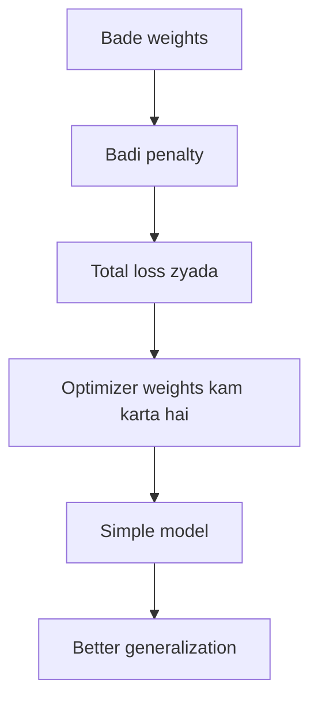
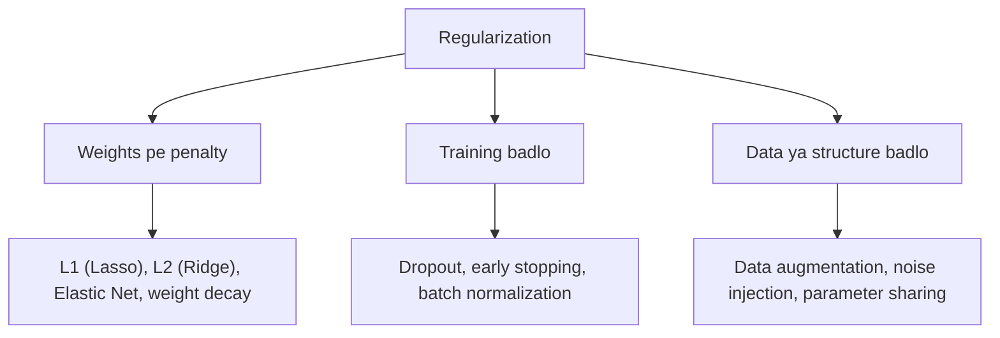

**Ek line mein:** <mark>regularization ek technique hai jo model ki complexity control karke overfitting kam karti hai, taaki model unseen data pe better generalize kare</mark>. <Cite id="class-dl-chp2" loc="slide 97" />

<Box kind="key">

**Har regularization question mein ye points likho:**

- <mark>Overfitting: training accuracy bahut high lekin testing accuracy low.</mark> Causes: complex model, bahut epochs, chhota dataset, noise.
- <mark>Total Loss = Prediction Error + Regularization Penalty.</mark> Bade weights ko discourage kiya jaata hai.
- <mark>$\lambda$ strength control karta hai: $\lambda = 0$ overfit, chhota $\lambda$ best, bahut bada $\lambda$ underfit.</mark>
- Techniques: **L1 (Lasso), L2 (Ridge), Elastic Net, weight decay, dropout, early stopping, batch normalization, data augmentation, noise injection, parameter sharing.**
- <mark>Dropout: training mein random neurons OFF karta hai; testing mein saare neurons use hote hain.</mark>
- <mark>Early stopping: validation loss improve hona band ho to ruk jao, aur best model rakho.</mark>

</Box>

## Core answer (5 marks, yahan ke har question ke liye)

<Box kind="definition">

**Regularization** is a technique used to reduce overfitting by controlling the complexity of the model. Instead of allowing the model to memorize the training data, it encourages the model to learn only the important patterns. Its main goal is to improve generalization. <Cite id="class-dl-chp2" loc="slide 97" />

</Box>

**Kyun chahiye:** network ki training accuracy bahut high ho sakti hai lekin testing accuracy kharab. Zyada epochs se fix nahi hota, kyunki model data ko ratta maarne lagta hai. <Cite id="class-dl-chp2" loc="slides 93 and 97" />

**Kaise kaam karta hai:** loss mein penalty add karta hai: **Total Loss = Prediction Error + Regularization Penalty**. Bahut bade weights discourage hote hain, isliye model simple banta hai aur noise ki jagah important features seekhta hai. <Cite id="class-dl-chp2" loc="slide 99" />

| Technique | One-line idea |
|---|---|
| L1 aur L2 | Weights ke size pe penalty |
| Dropout | Training mein random neurons off |
| Early stopping | Validation loss improve na ho to ruk jao |
| Data augmentation | Purane samples se naye banao |
| Batch normalization | Layer outputs ko similar range mein rakho |

**Conclusion:** regularization thodi si training accuracy dekar unseen data pe bahut better accuracy deti hai. <Cite id="web-dl-1-gb-reg" /> <Cite id="web-dl-1-wiki-overfit" />

## Extended answer (10 marks): ye add karo

### 1. Penalty-based: L1, L2, Elastic Net

- **L1 (Lasso):** $\lambda \sum \lvert w \rvert$ add karta hai; weights shrink hote hain aur kai zero ya zero ke paas ho jaate hain (feature selection). <Cite id="class-dl-chp2" loc="slide 101" />
- **L2 (Ridge):** $\lambda \sum w^2$ add karta hai; bade weight ko badi penalty, isliye saare weights chhote rehte hain. Ise weight decay bhi kehte hain. <Cite id="class-dl-chp2" loc="slide 103" /> <Cite id="web-dl-1-d2l-weight-decay" />
- **Elastic Net:** dono penalties use karta hai. <Cite id="class-dl-chp2" loc="slide 105" />
- Example (L2): weights $5, -3, 2, -1$ se penalty $\lambda(25 + 9 + 4 + 1) = 39\lambda$; sabse bada weight zyada penalty deta hai, isliye wo pehle shrink hota hai. <Cite id="class-dl-chp2" loc="slide 104" />

### 2. Dropout

Har training step mein kuch neurons randomly OFF hote hain (rate aksar 0.5); wo forward propagation, backpropagation ya weight updates mein hissa nahi lete. Neurons ek doosre pe depend nahi kar sakte. Testing mein saare neurons active. <Cite id="class-dl-chp2" loc="slides 107 and 108" /> <Cite id="web-dl-1-paper-dropout" />

### 3. Early stopping

Bahut epochs tak training chale to validation accuracy girti hai. Early stopping training tab rok deta hai jab validation loss kuch epochs (**patience**) tak improve na ho, aur best model rakhta hai. Example: validation loss epoch 4 pe 0.48, phir 0.49, 0.50, 0.51; patience 3 ke saath epoch 7 pe ruk jaata hai aur epoch 4 rakhta hai. <Cite id="class-dl-chp2" loc="slides 113 and 114" />

### 4. Batch normalization

Ye layer ke outputs ko agli layer se pehle normalize karta hai: $\hat x = \dfrac{x - \mu}{\sqrt{\sigma^2 + \epsilon}}$, phir $y = \gamma \hat x + \beta$ ($\gamma$, $\beta$ learn hote hain). Training fast aur stable hoti hai, aur halka regularizing effect bhi milta hai. <Cite id="class-dl-chp2" loc="slides 109 and 110" /> <Cite id="web-dl-1-paper-bn" />

### 5. Data augmentation

Maujooda samples ko badalkar naye training samples banate hain (rotate, flip, zoom, crop, brightness, noise); label wahi rehta hai. <Cite id="class-dl-chp2" loc="slides 115 and 116" /> <Cite id="web-dl-1-wiki-aug" />

### 6. Comparison

| | L1 / L2 | Dropout | Early stopping | Batch norm | Augmentation |
|---|---|---|---|---|---|
| Kispe kaam | Weights | Neurons | Training duration | Layer outputs | Training data |
| Main fayda | Chhote weights | Neuron dependency nahi | Ratta nahi | Fast, stable training | Zyada variety |
| Chahiye | $\lambda$ ka choice | Drop rate | Validation set | Batches | Suitable changes |

## Har question mein kaise fit karein

- **"Explain regularization in neural network."** (5 marks) <PYQ id="2025-05/q1b" />: sirf **core answer** likho: definition, why, penalty formula, diagram aur types list.
- **"Explain the need for regularization in deep neural networks. Discuss various regularization techniques used to reduce overfitting."** (10 marks) <PYQ id="2026-05/q2b" />: core answer (need), phir grouping diagram aur section 1 se 5 short mein, aur $\lambda$ ka role.
- **"Explain early stopping, batch normalization, and data augmentation."** (10 marks) <PYQ id="2023-12/q3b" />: regularization pe ek line, phir section 3, 4 aur 5 apni pictures ke saath, aur comparison table.
- **"Justify the need for regularization and explain how early stopping and dropout achieve regularization."** (10 marks) <PYQ id="assignment-1/q2a" />: need (core answer), phir section 2 aur 3, early stopping flowchart ka idea (validation loss check, patience ka wait, stop) aur dropout chain: random drop, kam dependency, general patterns, kam overfitting.

## Exam tips

- **Hamesha likho** "Total Loss = Prediction Error + Regularization Penalty" aur $\lambda$ ka kaam batao.
- Early stopping ke liye **training vs validation loss curves** aur dropout ke liye crossed neurons wala network draw karo.
- Mix mat karo: dropout sirf training mein hota hai; testing mein saare neurons on.

Exam mein English mein likho.
