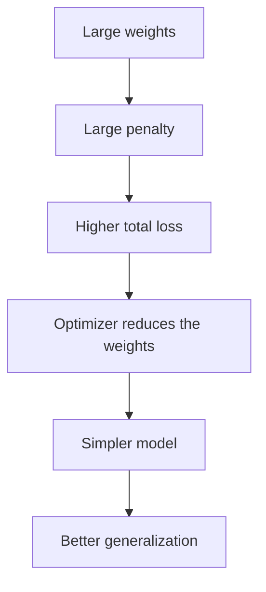
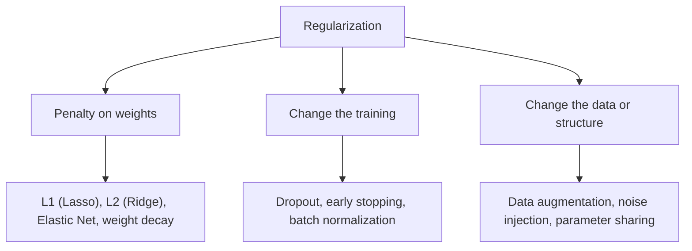

**In one line:** <mark>regularization is a technique used to reduce overfitting by controlling the complexity of the model, so that it generalizes better to unseen data</mark>. <Cite id="class-dl-chp2" loc="slide 97" />

<Box kind="key">

**Key points to write (any regularization question):**

- <mark>Overfitting: very high training accuracy but low testing accuracy.</mark> Causes: complex model, too many epochs, small dataset, noise.
- <mark>Total Loss = Prediction Error + Regularization Penalty.</mark> Large weights are discouraged.
- <mark>$\lambda$ controls the strength: $\lambda = 0$ overfits, small $\lambda$ is best, very large $\lambda$ underfits.</mark>
- Techniques: **L1 (Lasso), L2 (Ridge), Elastic Net, weight decay, dropout, early stopping, batch normalization, data augmentation, noise injection, parameter sharing.**
- <mark>Dropout: randomly turns OFF neurons in training; all neurons are used in testing.</mark>
- <mark>Early stopping: stop when the validation loss stops improving, and keep the best model.</mark>

</Box>

## Core answer (5 marks, fits every question here)

<Box kind="definition">

**Regularization** is a technique used to reduce overfitting by controlling the complexity of the model. Instead of allowing the model to memorize the training data, it encourages the model to learn only the important patterns. Its main goal is to improve generalization. <Cite id="class-dl-chp2" loc="slide 97" />

</Box>

**Why it is needed:** a network can give very high training accuracy but poor testing accuracy. More epochs do not fix it, because the model starts to memorize the data. <Cite id="class-dl-chp2" loc="slides 93 and 97" />

**How it works:** it adds a penalty to the loss: **Total Loss = Prediction Error + Regularization Penalty**. Very large weights are discouraged, so the model becomes simpler and learns the important features instead of noise. <Cite id="class-dl-chp2" loc="slide 99" />

| Technique | One-line idea |
|---|---|
| L1 and L2 | Penalty on the size of the weights |
| Dropout | Randomly switch neurons off in training |
| Early stopping | Stop when validation loss stops improving |
| Data augmentation | Make new samples from old ones |
| Batch normalization | Keep layer outputs in a similar range |

**Conclusion:** regularization trades a little training accuracy for much better accuracy on unseen data. <Cite id="web-dl-1-gb-reg" /> <Cite id="web-dl-1-wiki-overfit" />

## Extended answer (10 marks): add these

### 1. Penalty-based: L1, L2, Elastic Net

- **L1 (Lasso):** adds $\lambda \sum \lvert w \rvert$; shrinks weights and many become zero or near zero (feature selection). <Cite id="class-dl-chp2" loc="slide 101" />
- **L2 (Ridge):** adds $\lambda \sum w^2$; a large weight gets a large penalty, so all weights stay small. Also called weight decay. <Cite id="class-dl-chp2" loc="slide 103" /> <Cite id="web-dl-1-d2l-weight-decay" />
- **Elastic Net:** uses both penalties. <Cite id="class-dl-chp2" loc="slide 105" />
- Example (L2): weights $5, -3, 2, -1$ give penalty $\lambda(25 + 9 + 4 + 1) = 39\lambda$; the largest weight causes most of it, so it shrinks first. <Cite id="class-dl-chp2" loc="slide 104" />

### 2. Dropout

It randomly turns OFF some neurons in every training step (rate often 0.5); they take no part in forward propagation, backpropagation or weight updates. Neurons cannot depend on each other. In testing all neurons are active. <Cite id="class-dl-chp2" loc="slides 107 and 108" /> <Cite id="web-dl-1-paper-dropout" />

### 3. Early stopping

If training runs for too many epochs the validation accuracy falls. Early stopping stops training when the validation loss does not improve for a number of epochs (the **patience**) and keeps the best model. Example: validation loss 0.48 at epoch 4, then 0.49, 0.50, 0.51; with patience 3 it stops at epoch 7 and keeps epoch 4. <Cite id="class-dl-chp2" loc="slides 113 and 114" />

### 4. Batch normalization

It normalizes the outputs of a layer before the next layer: $\hat x = \dfrac{x - \mu}{\sqrt{\sigma^2 + \epsilon}}$, then $y = \gamma \hat x + \beta$ ($\gamma$, $\beta$ are learned). Training becomes faster and more stable, and it also has a mild regularizing effect. <Cite id="class-dl-chp2" loc="slides 109 and 110" /> <Cite id="web-dl-1-paper-bn" />

### 5. Data augmentation

New training samples are made by changing existing ones (rotate, flip, zoom, crop, brightness, noise); the label stays the same. <Cite id="class-dl-chp2" loc="slides 115 and 116" /> <Cite id="web-dl-1-wiki-aug" />

### 6. Comparison

| | L1 / L2 | Dropout | Early stopping | Batch norm | Augmentation |
|---|---|---|---|---|---|
| Acts on | Weights | Neurons | Training duration | Layer outputs | Training data |
| Main benefit | Small weights | No neuron dependency | Stops memorizing | Fast, stable training | More variety |
| Needs | Choice of $\lambda$ | Drop rate | Validation set | Batches | Suitable changes |

## Fit it to each question

- **"Explain regularization in neural network."** (5 marks) <PYQ id="2025-05/q1b" />: write the **core answer** only: definition, why, the penalty formula, the diagram and the types list.
- **"Explain the need for regularization in deep neural networks. Discuss various regularization techniques used to reduce overfitting."** (10 marks) <PYQ id="2026-05/q2b" />: core answer (need), then the grouping diagram and sections 1 to 5 in brief, and the role of $\lambda$.
- **"Explain early stopping, batch normalization, and data augmentation."** (10 marks) <PYQ id="2023-12/q3b" />: one line on regularization, then sections 3, 4 and 5 with their pictures, and the comparison table.
- **"Justify the need for regularization and explain how early stopping and dropout achieve regularization."** (10 marks) <PYQ id="assignment-1/q2a" />: the need (core answer), then sections 2 and 3 with the early stopping flowchart idea (check validation loss, wait for patience, stop) and the dropout chain: random drop, less dependency, general patterns, less overfitting.

## Exam tips

- **Always write** the formula "Total Loss = Prediction Error + Regularization Penalty" and say what $\lambda$ does.
- Draw the **training vs validation loss curves** for early stopping, and the network with crossed neurons for dropout.
- Do not mix: dropout is used only in training; in testing all neurons are on.
