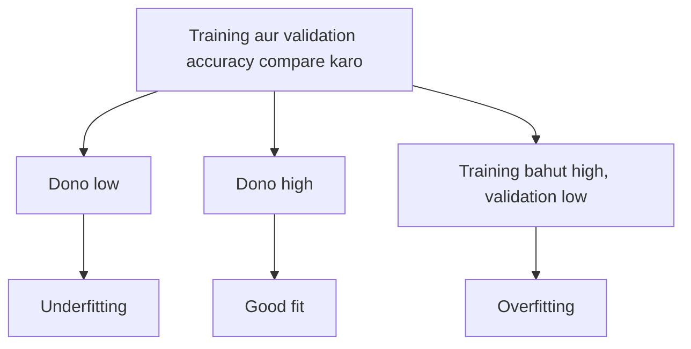
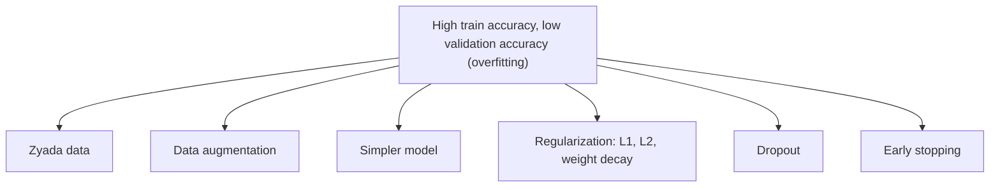

**Ek line mein:** <mark>overfitting matlab training accuracy bahut high lekin testing (validation) accuracy low, kyunki model ne noise samet training data ratta maar liya; underfitting matlab model seekhne ke liye bahut simple hai, dono pe accuracy kharab</mark>. <Cite id="class-dl-chp2" loc="slides 93 and 94" />

<Box kind="key">

**Ye points likho:**

- <mark>Underfitting: model bahut simple hai, training aur testing dono data pe poor performance (high bias).</mark>
- <mark>Overfitting: model training data ko noise samet bahut achhe se seekh leta hai, isliye training pe bahut achha lekin testing pe poor (high variance).</mark>
- <mark>Good fit: sahi patterns seekhta hai aur dono pe achha chalta hai.</mark>
- **Kaise pehchanein:** underfitting mein training aur validation loss dono high; overfitting mein **training loss girta hai lekin validation loss badhta hai**.
- Overfitting ke causes: complex model, bahut epochs, chhota dataset, noise.
- **Overfitting ke fixes:** zyada data, data augmentation, simpler model, L1/L2, dropout, early stopping.

</Box>

## Core answer (5 marks, yahan ke har question ke liye)

<Box kind="definition">

**Underfitting:** the model is too simple to learn the important patterns, so it performs poorly on both training and testing data. **Overfitting:** the model learns the training data too well, including noise and unnecessary details, so it performs very well on training data but poorly on testing data. **Good fit:** it learns the correct patterns and performs well on both. <Cite id="class-dl-chp2" loc="slides 93 and 94" />

</Box>

**Roz ka example:** underfitting apple ko banana bol deta hai. Overfitting seekhta hai "apple mein hamesha kala daag hota hai", isliye bina daag wala naya apple "Not Apple" ho jaata hai. <Cite id="class-dl-chp2" loc="slide 93" />

| | Underfitting | Good fit | Overfitting |
|---|---|---|---|
| Model complexity | Bahut simple | Balanced | Bahut complex |
| Training accuracy | Low | High | Bahut high |
| Testing accuracy | Low | High | Low |
| Bias / variance | High bias | Balanced | High variance |
| Generalization | Poor | Excellent | Poor |

**Conclusion:** aim hai good fit aur achhi generalization. <Cite id="web-dl-1-gb-ml" loc="§5.2" /> <Cite id="web-dl-1-wiki-overfit" />

## Extended answer (10 marks): ye add karo

### 1. Loss curves se problem pehchano

Overfit model mein training loss girta rehta hai jabki validation loss **badhne** lagta hai; dono ke beech ka gap badhta hai. Underfit model mein dono losses high rehte hain. <Cite id="class-dl-chp2" loc="slides 93 and 95" />

### 2. Causes

| Overfitting | Underfitting |
|---|---|
| Complex model | Model bahut simple |
| Bahut epochs | Kam epochs, training jaldi band |
| Chhota dataset | Features kam ya kharab |
| Data mein noise | Learning rate bahut high |

<Cite id="class-dl-chp2" loc="slide 96" />

### 3. High training accuracy aur low validation accuracy ke solutions

1. **Zyada data ya data augmentation** (flip, rotate, zoom), taaki model ko zyada variety dikhe. <Cite id="class-dl-chp2" loc="slide 115" />
2. **Simpler model**, kam layers ya neurons ke saath.
3. **L1 ya L2 regularization:** Total Loss = Prediction Error + Penalty. <Cite id="class-dl-chp2" loc="slide 97" />
4. **Dropout:** training mein random neurons off karo. <Cite id="class-dl-chp2" loc="slide 108" />
5. **Early stopping:** validation loss improve hona band ho to ruk jao aur best model rakho. <Cite id="class-dl-chp2" loc="slide 113" />

**Underfitting ke fixes:** zyada epochs, zyada complex model, better features.

### 4. Bias aur variance

Model complexity badhne par bias girta hai aur variance badhta hai; best model wahan hai jahan total error sabse kam ho. <Cite id="web-dl-1-d2l-generalization" />

## Har question mein kaise fit karein

- **"Explain the concept of overfitting and under fitting in neural network."** (5 marks) <PYQ id="2025-05/q1d" />: **core answer** likho: dono definitions, teen-curve picture, apple example aur table, plus causes aur fixes pe ek line.
- **"Identify the problem when a deep learning model achieves high training accuracy but low validation accuracy. Suggest suitable solutions."** (10 marks) <PYQ id="2026-05/q3a" />: pehli line mein problem ka naam (**overfitting**), phir section 1 se 3: kaise pehchanein, causes, aur remedies diagram ke saath paanch solutions.

## Exam tips

- **Hamesha draw karo** teen curves (underfit, good fit, overfit) ya train aur validation loss curves.
- **Keywords** likho: underfitting ke liye high bias, overfitting ke liye high variance.
- "Suggest solutions" mein kam se kam paanch do aur har ka naam ek line mein likho.

Exam mein English mein likho.
