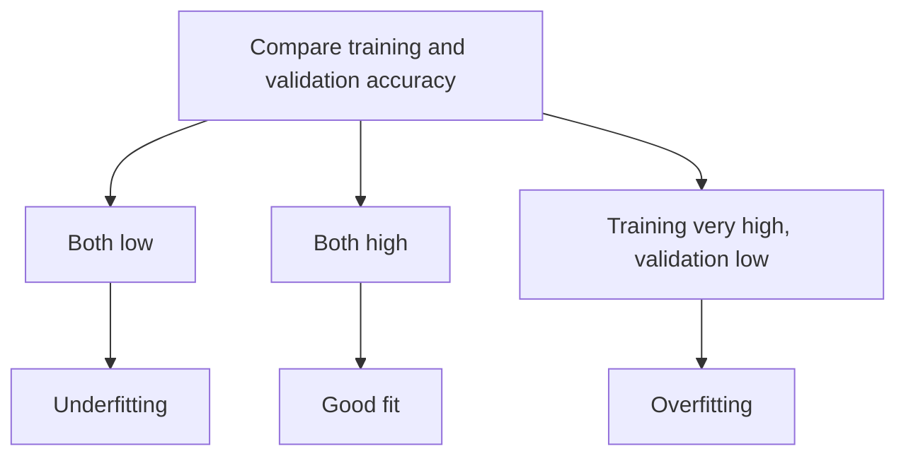
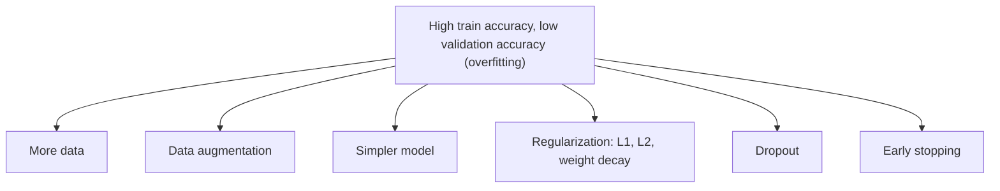

**In one line:** <mark>overfitting is very high training accuracy but low testing (validation) accuracy, because the model memorized the training data including noise; underfitting is a model too simple to learn, with poor accuracy on both</mark>. <Cite id="class-dl-chp2" loc="slides 93 and 94" />

<Box kind="key">

**Key points to write:**

- <mark>Underfitting: the model is too simple, performs poorly on both training and testing data (high bias).</mark>
- <mark>Overfitting: the model learns the training data too well including noise, so it is very good on training data but poor on testing data (high variance).</mark>
- <mark>Good fit: it learns the correct patterns and performs well on both.</mark>
- **How to identify:** underfitting has high training and validation loss; overfitting has **falling training loss but rising validation loss**.
- Causes of overfitting: complex model, too many epochs, small dataset, noise.
- **Fixes for overfitting:** more data, data augmentation, simpler model, L1/L2, dropout, early stopping.

</Box>

## Core answer (5 marks, fits every question here)

<Box kind="definition">

**Underfitting:** the model is too simple to learn the important patterns, so it performs poorly on both training and testing data. **Overfitting:** the model learns the training data too well, including noise and unnecessary details, so it performs very well on training data but poorly on testing data. **Good fit:** it learns the correct patterns and performs well on both. <Cite id="class-dl-chp2" loc="slides 93 and 94" />

</Box>

**Everyday example:** underfitting calls an apple a banana. Overfitting learns "an apple always has a black spot", so a new apple without the spot is "Not Apple". <Cite id="class-dl-chp2" loc="slide 93" />

| | Underfitting | Good fit | Overfitting |
|---|---|---|---|
| Model complexity | Too simple | Balanced | Too complex |
| Training accuracy | Low | High | Very high |
| Testing accuracy | Low | High | Low |
| Bias / variance | High bias | Balanced | High variance |
| Generalization | Poor | Excellent | Poor |

**Conclusion:** the aim is a good fit with good generalization. <Cite id="web-dl-1-gb-ml" loc="§5.2" /> <Cite id="web-dl-1-wiki-overfit" />

## Extended answer (10 marks): add these

### 1. Identify the problem from the loss curves

For an overfit model the training loss keeps falling while the validation loss starts to **rise**; the gap between them grows. For an underfit model both losses stay high. <Cite id="class-dl-chp2" loc="slides 93 and 95" />

### 2. Causes

| Overfitting | Underfitting |
|---|---|
| Complex model | Model too simple |
| Too many epochs | Too few epochs, training stopped early |
| Small dataset | Not enough or poor features |
| Noise in the data | Learning rate too high |

<Cite id="class-dl-chp2" loc="slide 96" />

### 3. Solutions for high training accuracy and low validation accuracy

1. **More data or data augmentation** (flip, rotate, zoom), so the model sees more variety. <Cite id="class-dl-chp2" loc="slide 115" />
2. **Simpler model** with fewer layers or neurons.
3. **L1 or L2 regularization:** Total Loss = Prediction Error + Penalty. <Cite id="class-dl-chp2" loc="slide 97" />
4. **Dropout:** randomly turn off neurons in training. <Cite id="class-dl-chp2" loc="slide 108" />
5. **Early stopping:** stop when the validation loss stops improving and keep the best model. <Cite id="class-dl-chp2" loc="slide 113" />

**Fixes for underfitting:** more epochs, a more complex model, better features.

### 4. Bias and variance

As model complexity grows, bias falls and variance rises; the best model sits where the total error is lowest. <Cite id="web-dl-1-d2l-generalization" />

## Fit it to each question

- **"Explain the concept of overfitting and under fitting in neural network."** (5 marks) <PYQ id="2025-05/q1d" />: write the **core answer**: both definitions, the three-curve picture, the apple example and the table, plus a line on causes and fixes.
- **"Identify the problem when a deep learning model achieves high training accuracy but low validation accuracy. Suggest suitable solutions."** (10 marks) <PYQ id="2026-05/q3a" />: name the problem (**overfitting**) in the first line, then sections 1 to 3: how to identify it, the causes, and the five solutions with the remedies diagram.

## Exam tips

- **Always draw** the three curves (underfit, good fit, overfit) or the train and validation loss curves.
- Write the **keywords**: high bias for underfitting, high variance for overfitting.
- For "suggest solutions" give at least five and name each one in one line.
