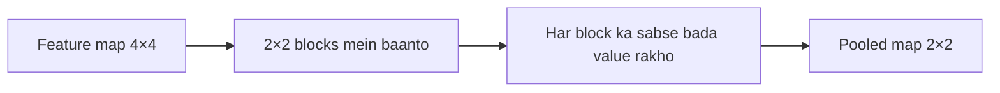
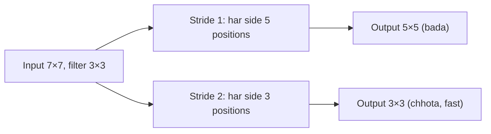

**Ek line mein:** <mark>pooling layer feature maps ka size kam karti hai aur sabse important information rakhti hai</mark>, aur <mark>stride wo pixels hain jitne filter har step mein move karta hai</mark>; dono output ko chhota karte hain. <Cite id="class-dl-chp4" loc="slide 31" />

<Box kind="key">

**Pooling, stride, flatten ke har question mein ye points likho:**

- <mark>Pooling = feature maps ka size kam karo, sabse important information rakho</mark>.
- Types: <mark>max pooling (sabse bada value), average pooling (mean), min pooling</mark>; max pooling sabse common hai.
- Pooling <mark>height aur width kam karti hai, depth nahi</mark>; computation aur parameters kam; chhote shifts se kam farq.
- Pooling output size: <mark>$(N - F)/S + 1$</mark>, jaise 8×8, 2×2 window aur stride 2 se 4×4.
- <mark>Stride = pixels ki sankhya jitne filter move karta hai</mark>; bada stride matlab chhota output.
- <mark>Flatten tabhi chahiye jab fully connected layer aati hai</mark>.

</Box>

## Core answer (5 marks, yahan ke har question ke liye)

<Box kind="definition">

A **pooling layer** is a layer in a CNN used to reduce the size of feature maps while keeping the most important information. <Cite id="class-dl-chp4" loc="slide 31" />

</Box>

**Kyun use hoti hai:** height aur width kam karti hai, isliye computation aur aage ki layers ke parameters kam hote hain, aur model chhote position changes se kam hilta hai. <Cite id="web-dl-2-d2l-pooling" />

**Kaise kaam karti hai:** ek chhoti window (jaise 2×2) stride ke hisaab se feature map pe move karti hai. Har position pe ek number rakhti hai: **maximum** (max pooling), **average** (average pooling) ya minimum. Depth nahi badalti.

**Stride:** pixels ki sankhya jitne filter (ya pooling window) har step mein move karta hai. Stride 1 zyada positions check karta hai; stride 2 kam positions aur chhota output deta hai. <Cite id="class-dl-chp4" loc="slide 12" />

**Conclusion:** max pooling sabse common hai; wo sabse strong feature rakhta hai aur noise bhi kam karta hai. <Cite id="class-dl-m4" loc="p. 35" />

## Extended answer (10 marks): ye add karo

### 1. Pooling ke types example ke saath

<Cite id="class-dl-chp4" loc="slides 32 and 33" />

<Sum>

<Given>

4×4 feature map $\begin{bmatrix} 4 & 3 & 1 & 5 \\ 1 & 3 & 4 & 8 \\ 4 & 5 & 4 & 3 \\ 6 & 5 & 9 & 4 \end{bmatrix}$, 2×2 window, stride 2.

</Given>

<Find>

max-pooled aur average-pooled maps.

</Find>

<Steps>

1. **Output size:** $(4 - 2)/2 + 1 = 2$, yani 2×2.
2. **Max pooling:** top-left block (4, 3, 1, 3) se 4; top-right (1, 5, 4, 8) se 8; bottom-left (4, 5, 6, 5) se 6; bottom-right (4, 3, 9, 4) se 9.
3. **Average pooling:** $11/4 = 2.75$; $18/4 = 4.5$; $20/4 = 5$; $20/4 = 5$.

</Steps>

<Answer>

Max: $\begin{bmatrix} 4 & 8 \\ 6 & 9 \end{bmatrix}$; average: $\begin{bmatrix} 2.75 & 4.5 \\ 5 & 5 \end{bmatrix}$.

</Answer>

<Box kind="verify">

Har max apne block ke baaki numbers se bada ya barabar hai, aur har average apne block ke sabse chhote aur sabse bade ke beech hai.

</Box>

</Sum>

| Type | Kya rakhta hai | Note |
|---|---|---|
| Max | Sabse strong value | Sabse common; strongest feature rakhta hai, noise kam |
| Average | Block ka mean | Smooth, overall level rakhta hai |
| Min | Sabse chhota value | Kam use hota hai |

### 2. Stride detail mein

Convolution ka output size: $\lfloor (N - F + 2P)/S \rfloor + 1$. 7×7 input aur 3×3 filter, no padding: stride 1 se $(7 - 3)/1 + 1 = 5$, yani 5×5; stride 2 se $(7 - 3)/2 + 1 = 3$, yani 3×3. <Cite id="class-dl-chp4" loc="slide 19" /> <Cite id="web-dl-2-d2l-padding-strides" /> Stride "kitna door" hai; padding image ke chaaron taraf pixels add karti hai.

### 3. Kya flatten karna zaroori hai?

**Flatten** 3D feature maps ko fully connected layers ke liye 1D vector bana deta hai (5×5×64 se 1600). Usual CNN classifier mein ye **zaroori** hai kyunki fully connected layer vector leti hai. Jab fully connected layer nahi aati tab **zaroori nahi**: GoogLeNet global average pooling use karta hai aur U-Net fully convolutional hai. <Cite id="class-dl-chp4" loc="slide 28" /> <Cite id="class-dl-m4" loc="p. 64" /> <Cite id="class-dl-m4" loc="p. 80" />

## Har question mein kaise fit karein

- **"Explain Pooling operation in CNN."** (5 marks) <PYQ id="2024-05/q1e" /> <PYQ id="2024-12/q1e" />: core answer; time ho to 4×4 max aur average example add karo.
- **"What is the use of stride and pooling operation in CNN? Is it necessary to use flattening in CNN?"** (10 marks) <PYQ id="assignment-2/q4a" />: stride (core + section 2), pooling (core + section 1), phir flatten pe section 3; end mein ek line pipeline: convolution, pooling, flatten, fully connected.

## Exam tips

- **Draw karo:** numbers ke saath 4×4 se 2×2 max pooling picture; samajh dikhane ka sabse tez tareeka.
- **Keywords:** feature map, window, stride, max pooling, downsampling, not depth.
- Common galtiyan: pooling se channels badalna likhna, ya bhoolna ki stride pooling ka step bhi tay karta hai.

Exam mein English mein likho.
