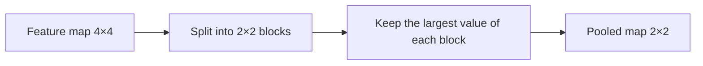
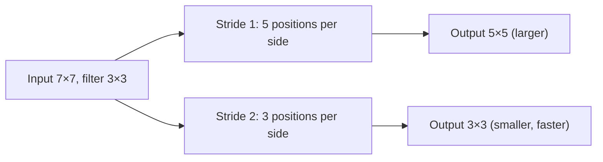

**In one line:** <mark>a pooling layer reduces the size of the feature maps while keeping the most important information</mark>, and <mark>stride is the number of pixels the filter moves at each step</mark>; both make the output smaller. <Cite id="class-dl-chp4" loc="slide 31" />

<Box kind="key">

**Key points to write (pooling, stride, flatten):**

- <mark>Pooling = reduce the size of feature maps, keep the most important information</mark>.
- Types: <mark>max pooling (largest value), average pooling (mean), min pooling</mark>; max pooling is the most common.
- Pooling reduces <mark>height and width, not depth</mark>; fewer computations and parameters; less sensitive to small shifts.
- Pooling output size: <mark>$(N - F)/S + 1$</mark>, for example 8×8 with a 2×2 window and stride 2 gives 4×4.
- <mark>Stride = number of pixels by which the filter moves</mark>; a larger stride gives a smaller output.
- <mark>Flatten is needed only when a fully connected layer follows</mark>.

</Box>

## Core answer (5 marks, fits every question here)

<Box kind="definition">

A **pooling layer** is a layer in a CNN used to reduce the size of feature maps while keeping the most important information. <Cite id="class-dl-chp4" loc="slide 31" />

</Box>

**Why it is used:** it reduces height and width, so the computation and the parameters of later layers fall, and the model becomes less sensitive to small changes in position. <Cite id="web-dl-2-d2l-pooling" />

**How it works:** a small window (for example 2×2) moves over the feature map by the stride. At each position it keeps one number: the **maximum** (max pooling), the **average** (average pooling) or the minimum. Depth does not change.

**Stride:** the number of pixels by which the filter (or pooling window) moves at each step. Stride 1 checks more positions; stride 2 checks fewer and gives a smaller output. <Cite id="class-dl-chp4" loc="slide 12" />

**Conclusion:** max pooling is the most common; it keeps the strongest feature and also suppresses noise. <Cite id="class-dl-m4" loc="p. 35" />

## Extended answer (10 marks): add these

### 1. Types of pooling with an example

<Cite id="class-dl-chp4" loc="slides 32 and 33" />

<Sum>

<Given>

4×4 feature map $\begin{bmatrix} 4 & 3 & 1 & 5 \\ 1 & 3 & 4 & 8 \\ 4 & 5 & 4 & 3 \\ 6 & 5 & 9 & 4 \end{bmatrix}$, 2×2 window, stride 2.

</Given>

<Find>

the max-pooled and average-pooled maps.

</Find>

<Steps>

1. **Output size:** $(4 - 2)/2 + 1 = 2$, so 2×2.
2. **Max pooling:** top-left block (4, 3, 1, 3) gives 4; top-right (1, 5, 4, 8) gives 8; bottom-left (4, 5, 6, 5) gives 6; bottom-right (4, 3, 9, 4) gives 9.
3. **Average pooling:** $11/4 = 2.75$; $18/4 = 4.5$; $20/4 = 5$; $20/4 = 5$.

</Steps>

<Answer>

Max: $\begin{bmatrix} 4 & 8 \\ 6 & 9 \end{bmatrix}$; average: $\begin{bmatrix} 2.75 & 4.5 \\ 5 & 5 \end{bmatrix}$.

</Answer>

<Box kind="verify">

Each max is at least as large as the other numbers of its block, and each average lies between the smallest and largest of its block.

</Box>

</Sum>

| Type | What it keeps | Note |
|---|---|---|
| Max | Strongest value | Most common; keeps the strongest feature, reduces noise |
| Average | Mean of the block | Smoother, keeps the overall level |
| Min | Smallest value | Rarely used |

### 2. Stride in detail

Output size of a convolution: $\lfloor (N - F + 2P)/S \rfloor + 1$. For a 7×7 input and a 3×3 filter with no padding: stride 1 gives $(7 - 3)/1 + 1 = 5$, so 5×5; stride 2 gives $(7 - 3)/2 + 1 = 3$, so 3×3. <Cite id="class-dl-chp4" loc="slide 19" /> <Cite id="web-dl-2-d2l-padding-strides" /> Stride is "how far"; padding adds pixels around the image.

### 3. Is flattening necessary?

**Flatten** converts the 3D feature maps into a 1D vector for the fully connected layers (5×5×64 gives 1600). It is **necessary** in the usual CNN classifier because a fully connected layer takes a vector. It is **not needed** when no fully connected layer follows: GoogLeNet uses global average pooling and U-Net is fully convolutional. <Cite id="class-dl-chp4" loc="slide 28" /> <Cite id="class-dl-m4" loc="p. 64" /> <Cite id="class-dl-m4" loc="p. 80" />

## Fit it to each question

- **"Explain Pooling operation in CNN."** (5 marks) <PYQ id="2024-05/q1e" /> <PYQ id="2024-12/q1e" />: core answer; add the 4×4 max and average example if there is time.
- **"What is the use of stride and pooling operation in CNN? Is it necessary to use flattening in CNN?"** (10 marks) <PYQ id="assignment-2/q4a" />: stride (core + section 2), pooling (core + section 1), then section 3 on flatten; end with a one-line pipeline: convolution, pooling, flatten, fully connected.

## Exam tips

- **Draw** the 4×4 to 2×2 max pooling picture with the numbers; it is the quickest way to show you understand.
- **Keywords:** feature map, window, stride, max pooling, downsampling, not depth.
- Common mistakes: saying pooling changes the number of channels, or forgetting that stride also sets the pooling step.
