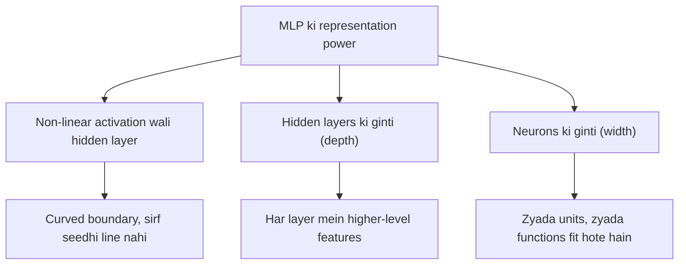

**Ek line mein:** <mark>representation power matlab network kitne tarah ke functions represent kar sakta hai; MLPs universal function approximators hain</mark>, yani enough units wali ek hidden layer kisi bhi measurable function ko approximate kar sakti hai. <Cite id="class-dl-m1" loc="p. 24" />

<Box kind="key">

**Ye points likho:**

- <mark>Hidden layer ke bina model linear hota hai; non-linear activation wali hidden layer non-linear (curved) boundary deti hai.</mark>
- <mark>Universal approximation theorem: linear output layer aur kam se kam ek hidden layer wala feedforward network, enough hidden units hon to, kisi bhi measurable function ko kisi bhi desired non-zero error tak approximate kar sakta hai.</mark>
- <mark>Ek hidden layer kisi bhi function ko represent karne ke liye kaafi hai, lekin wo bahut bada ho sakta hai aur learn ya generalize na kar paye.</mark>
- <mark>Deeper models ko bahut kam units chahiye aur wo aksar generalization error kam karte hain.</mark>
- Factors: hidden layers ki ginti, neurons ki ginti, non-linear activation function, depth versus width.
- Har hidden layer **higher-level features** seekhti hai (edges, shapes, objects).

</Box>

## Core answer (5 marks, yahan ke har question ke liye)

<Box kind="definition">

**Representation power** is how many different functions a network can learn to represent. MLPs have a lot of it because they are **universal function approximators**. <Cite id="class-dl-m1" loc="p. 16" />

</Box>

**Universal approximation theorem:** a feedforward network with a linear output layer and at least one hidden layer with any activation function (such as the logistic sigmoid) can approximate any measurable function from one finite-dimensional space to another with any desired non-zero amount of error, provided the network is given enough hidden units. <Cite id="class-dl-m1" loc="p. 24" /> <Cite id="web-dl-1-gb-mlp" loc="§6.4.1" />

1. **Linear versus non-linear:** hidden layer nahi ho to model sirf seedhi line banata hai; hidden layer weighted sums pe activation lagati hai aur curved boundary deti hai. <Cite id="class-dl-chp1" loc="slide 30" />
2. **Depth:** theory mein ek hidden layer kaafi hai, lekin wo bahut badi ho sakti hai aur generalize na kare; deeper models bahut kam units use kar sakte hain. <Cite id="class-dl-m1" loc="p. 24" />
3. **Hierarchical features:** har hidden layer pichhli par banti hai (edges, phir shapes, phir objects). <Cite id="class-dl-chp1" loc="slide 30" />

**Conclusion:** MLPs universal function approximators hain, aur depth unhe complex functions represent karne mein efficient banata hai.

## Extended answer (10 marks): ye add karo

### 1. Width versus depth

| | Wide aur shallow (ek badi hidden layer) | Deep (kai chhoti layers) |
|---|---|---|
| Theory mein | Koi bhi function represent kar sakta hai | Wahi functions represent kar sakta hai |
| Practice mein | Bahut zyada units lag sakte hain | Bahut kam units chahiye |
| Learning | Learn ya generalize fail ho sakta hai | Aksar generalization error kam |

<Cite id="class-dl-m1" loc="p. 24" />

### 2. Theorem kya kehta hai aur kya nahi

- Ye kehta hai ki **achhe weights exist karte hain**. Ye **nahi** kehta ki training unhe dhoondh legi, ya kitne hidden units chahiye. <Cite id="web-dl-1-gb-mlp" loc="§6.4.1" />
- Theorem ke pehle versions sigmoid jaise squashing activations pe the; baad ke kaam ne dikhaya ki ReLU networks bhi universal hain. <Cite id="web-dl-1-wiki-uat" />

### 3. Hierarchy se kya fayda

## Har question mein kaise fit karein

- **"Comment on the Representation Power of MLPs."** (5 marks) <PYQ id="2024-12/q1a" />: **core answer** likho: definition, theorem, teen comments (linear vs non-linear, depth, hierarchy) aur diagram. Extra marks ke liye width-versus-depth table add karo.

## Exam tips

- **Theorem hamesha** teacher ke words mein likho; wahi main keyword hai.
- **Dono side** likho: theory mein ek hidden layer kaafi hai, lekin practice mein depth better hai.
- Ye mat likho ki theorem learning guarantee karta hai; wo sirf kehta hai ki solution exist karta hai.

Exam mein English mein likho.
