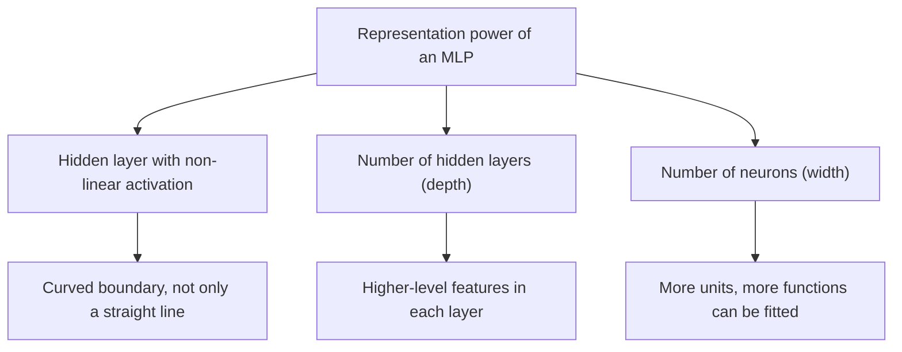

**In one line:** <mark>representation power is the range of functions a network can represent; MLPs are universal function approximators</mark>, which means a hidden layer with enough units can approximate any measurable function. <Cite id="class-dl-m1" loc="p. 24" />

<Box kind="key">

**Key points to write:**

- <mark>Without a hidden layer the model is linear; a hidden layer with a non-linear activation gives a non-linear (curved) boundary.</mark>
- <mark>Universal approximation theorem: a feedforward network with a linear output layer and at least one hidden layer can approximate any measurable function with any desired non-zero error, given enough hidden units.</mark>
- <mark>A single hidden layer is sufficient to represent any function, but it may be infeasibly large and may fail to learn and generalize.</mark>
- <mark>Deeper models need far fewer units and often reduce generalization error.</mark>
- Factors: number of hidden layers, number of neurons, non-linear activation function, depth versus width.
- Each hidden layer learns **higher-level features** (edges, shapes, objects).

</Box>

## Core answer (5 marks, fits every question here)

<Box kind="definition">

**Representation power** is how many different functions a network can learn to represent. MLPs have a lot of it because they are **universal function approximators**. <Cite id="class-dl-m1" loc="p. 16" />

</Box>

**Universal approximation theorem:** a feedforward network with a linear output layer and at least one hidden layer with any activation function (such as the logistic sigmoid) can approximate any measurable function from one finite-dimensional space to another with any desired non-zero amount of error, provided the network is given enough hidden units. <Cite id="class-dl-m1" loc="p. 24" /> <Cite id="web-dl-1-gb-mlp" loc="§6.4.1" />

1. **Linear versus non-linear:** with no hidden layer the model draws only a straight line; the hidden layer applies activation functions to weighted sums and gives a curved boundary. <Cite id="class-dl-chp1" loc="slide 30" />
2. **Depth:** one hidden layer is enough in theory, but it may be too large and may fail to generalize; deeper models can use far fewer units. <Cite id="class-dl-m1" loc="p. 24" />
3. **Hierarchical features:** each hidden layer builds on the last (edges, then shapes, then objects). <Cite id="class-dl-chp1" loc="slide 30" />

**Conclusion:** MLPs are universal function approximators, and depth makes them efficient at representing complex functions.

## Extended answer (10 marks): add these

### 1. Width versus depth

| | Wide and shallow (one big hidden layer) | Deep (many smaller layers) |
|---|---|---|
| In theory | Can represent any function | Can represent the same functions |
| In practice | May need an infeasibly large number of units | Needs far fewer units |
| Learning | May fail to learn and generalize | Often lowers generalization error |

<Cite id="class-dl-m1" loc="p. 24" />

### 2. What the theorem does and does not say

- It says a **good set of weights exists**. It does **not** say that training will find it, or how many hidden units are needed. <Cite id="web-dl-1-gb-mlp" loc="§6.4.1" />
- The first versions of the theorem used squashing activations such as the sigmoid; later work showed that ReLU networks are also universal. <Cite id="web-dl-1-wiki-uat" />

### 3. Why hierarchy helps

## Fit it to each question

- **"Comment on the Representation Power of MLPs."** (5 marks) <PYQ id="2024-12/q1a" />: write the **core answer**: definition, the theorem, the three comments (linear vs non-linear, depth, hierarchy) and the diagram. For extra marks add the width-versus-depth table.

## Exam tips

- **Always write the theorem** in the teacher's words; it is the main keyword.
- Mention **both sides**: one hidden layer is enough in theory, but depth is better in practice.
- Do not claim that the theorem guarantees learning; it only says a solution exists.
