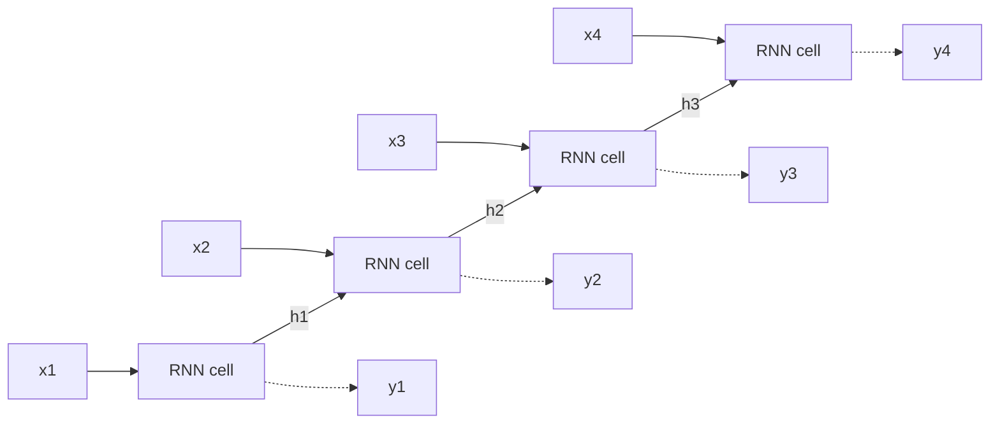
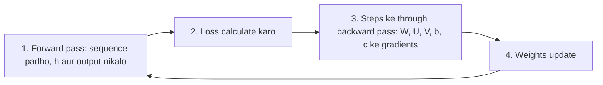

**Ek line mein:** <mark>RNN ek neural network hai jismein hidden states hote hain aur past outputs ko inputs ki tarah use kiya ja sakta hai</mark>; wo sequence ko ek-ek step mein padhta hai, <mark>har step pe same weights</mark> ke saath, aur <mark>backpropagation through time (BPTT)</mark> se train hota hai. <Cite id="class-dl-m5" loc="p. 9" />

<Box kind="key">

**RNN architecture, working, BPTT ke har question mein ye points likho:**

- <mark>RNN = sequential data + previous information + hidden state</mark>.
- <mark>Har time step pe same cell aur same weights ($U$, $W$, $V$, $b$, $c$)</mark>: kam parameters, koi bhi sequence length.
- <mark>$h_t = \tanh(U x_t + W h_{t-1} + b)$ aur $\hat{y}_t = \text{softmax}(V h_t + c)$</mark>.
- Components: **input $x_t$, hidden state $h_t$, weights aur biases, activation, output $\hat{y}_t$, recurrent connection**.
- <mark>BPTT = time mein aage, phir time mein peeche</mark>: forward pass, loss, backward pass, weights update.
- Problem: <mark>vanishing aur exploding gradients</mark>; remedies: gradient clipping, truncated BPTT, LSTM ya GRU.

</Box>

## Core answer (5 marks, yahan ke har question ke liye)

<Box kind="definition">

An **RNN** is a type of neural network that has hidden states and allows past outputs to be used as inputs. It is designed to work with sequential data: "I will process the current input, but I will also carry some information from previous steps." <Cite id="class-dl-m5" loc="p. 9" /> <Cite id="class-dl-chp5" loc="slide 3" />

</Box>

**Kyun chahiye:** feedforward network ko pichhle inputs ki yaad nahi hoti aur har element ke liye alag parameters chahiye. RNN **har time step pe same weights** use karta hai, isliye parameters kam aur koi bhi sequence length chalti hai. <Cite id="class-dl-m5" loc="p. 7" /> <Cite id="class-dl-m5" loc="p. 8" />

**Working, step by step:** <Cite id="class-dl-chp5" loc="slide 7" />

1. Current input $x_t$ aur pichhla hidden state $h_{t-1}$ lo.
2. Cell dono combine karta hai: $h_t = \tanh(U x_t + W h_{t-1} + b)$, output $\hat{y}_t = \text{softmax}(V h_t + c)$.
3. $h_t$ agle step ko do; har element ke liye repeat. $U, W, V, b, c$ har step pe same hain.

**Conclusion:** hidden state aur shared weights RNN ka dil hain; ye kam parameters mein memory dete hain.

## Extended answer (10 marks): ye add karo

### 1. Key components

| Component | Kya hai | Symbol |
|---|---|---|
| Input | Time $t$ pe sequence ka element | $x_t$ |
| Hidden state | Pichhle steps ki memory | $h_t$ (pichhla $h_{t-1}$) |
| Weights aur biases | $U$ input se hidden, $W$ hidden se hidden, $V$ hidden se output | $U, W, V, b, c$ |
| Activation | Cell mein tanh, output pe softmax | $g_1, g_2$ |
| Output | Time $t$ ki prediction | $\hat{y}_t$ |
| Recurrent connection | $h_t$ ko agle step bhejne wala loop | - |

<Cite id="class-dl-m5" loc="p. 9" /> <Cite id="web-dl-2-d2l-rnn" />

### 2. Types aur uses

Many to one (sentiment analysis), one to many (image captioning), many to many (machine translation), one to one. <Cite id="class-dl-chp5" loc="slide 8" /> Uses: speech recognition, music generation, translation, video analysis, DNA sequences. <Cite id="class-dl-m5" loc="p. 15" /> Textbook mein bhi unfolded graph aur shared parameters isi tarah samjhaye gaye hain. <Cite id="web-dl-2-goodfellow-rnn" />

### 3. BPTT se training

BPTT time steps pe lagaya gaya backpropagation hai: time mein aage, phir time mein peeche. <Cite id="class-dl-chp5" loc="slide 10" />

**Example:** "I love eating ___" ka target "pizza" hai. RNN "apple" predict kare to loss high hai; BPTT error ko $h_3, h_2, h_1$ se peeche bhejta hai aur weights update hote hain, isliye agli baar pizza aata hai. <Cite id="class-dl-chp5" loc="slide 14" /> Weight steps ke beech shared hai, isliye uska gradient har step ke contribution ka sum hota hai. <Cite id="web-dl-2-d2l-bptt" />

### 4. Problems aur remedies

- **Vanishing gradient:** gradient bahut chhota, shuruaati steps almost kuch nahi seekhte.
- **Exploding gradient:** gradient bahut bada, training unstable. <Cite id="class-dl-chp5" loc="slide 11" /> <Cite id="web-dl-2-pascanu-gradients" />
- **Remedies:** gradient clipping, **truncated BPTT** (sirf fixed steps tak backpropagate), aur LSTM ya GRU gates. <Cite id="class-dl-chp5" loc="slide 22" /> <Cite id="class-dl-m5" loc="p. 14" />

## Har question mein kaise fit karein

- **"Explain RNN architecture in detail."** (10 marks) <PYQ id="2023-12/q4a" />: definition, kyun chahiye, unfolded diagram, working steps, types, BPTT aur limitations pe ek line.
- **"Explain the key components of an RNN."** (10 marks) <PYQ id="2024-12/q4a" />: component table (section 1) equations ke saath, cell picture, unfolding aur learning do lines mein.
- **"Explain the working of RNN with the help of suitable diagram."** (10 marks) <PYQ id="2025-05/q4a" />: core answer "I love AI learning" jaise unfolded diagram ke saath, step by step working, BPTT se learning, uses.
- **"Describe the architecture and training mechanism of RNN using BPTT in detail."** (10 marks) <PYQ id="2026-05/q4b" />: architecture ke liye core answer, phir section 3 aur 4 poore (steps, example, problems, remedies).

## Exam tips

- **Draw karo:** unfolded RNN, $x_1 \dots x_4$, $h_1 \dots h_4$ ke saath aur neeche "same weights" likho.
- **Keywords:** hidden state, recurrent, shared weights, unfolding, BPTT, vanishing aur exploding gradient, truncated BPTT.
- Common galti: har step pe alag weights banana; weights same hote hain.

Exam mein English mein likho.
