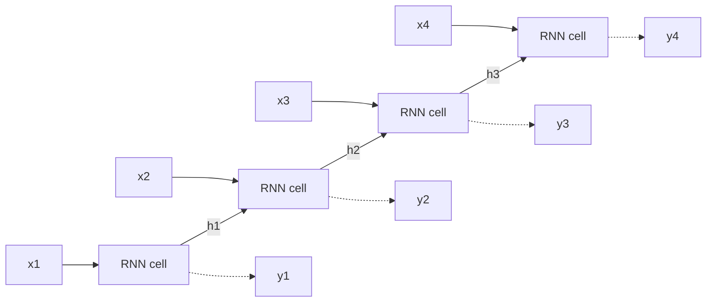
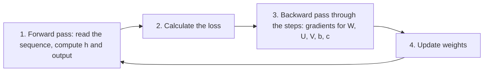

**In one line:** <mark>an RNN is a type of neural network that has hidden states and allows past outputs to be used as inputs</mark>; it reads a sequence one step at a time, using the <mark>same weights at every step</mark>, and is trained by <mark>backpropagation through time (BPTT)</mark>. <Cite id="class-dl-m5" loc="p. 9" />

<Box kind="key">

**Key points to write (RNN architecture, working, BPTT):**

- <mark>RNN = sequential data + previous information + hidden state</mark>.
- <mark>Same cell and same weights ($U$, $W$, $V$, $b$, $c$) at every time step</mark>: fewer parameters, any sequence length.
- <mark>$h_t = \tanh(U x_t + W h_{t-1} + b)$ and $\hat{y}_t = \text{softmax}(V h_t + c)$</mark>.
- Components: **input $x_t$, hidden state $h_t$, weights and biases, activation, output $\hat{y}_t$, recurrent connection**.
- <mark>BPTT = forward through time, then backward through time</mark>: forward pass, loss, backward pass, update weights.
- Problem: <mark>vanishing and exploding gradients</mark>; remedies: gradient clipping, truncated BPTT, LSTM or GRU.

</Box>

## Core answer (5 marks, fits every question here)

<Box kind="definition">

An **RNN** is a type of neural network that has hidden states and allows past outputs to be used as inputs. It is designed to work with sequential data: "I will process the current input, but I will also carry some information from previous steps." <Cite id="class-dl-m5" loc="p. 9" /> <Cite id="class-dl-chp5" loc="slide 3" />

</Box>

**Why needed:** a feedforward network has no memory of previous inputs and needs separate parameters for each element. An RNN uses the **same weights at every time step**, so it has fewer parameters and handles sequences of any length. <Cite id="class-dl-m5" loc="p. 7" /> <Cite id="class-dl-m5" loc="p. 8" />

**Working, step by step:** <Cite id="class-dl-chp5" loc="slide 7" />

1. Take the current input $x_t$ and the previous hidden state $h_{t-1}$.
2. The cell combines them: $h_t = \tanh(U x_t + W h_{t-1} + b)$, output $\hat{y}_t = \text{softmax}(V h_t + c)$.
3. Pass $h_t$ to the next step; repeat for every element. $U, W, V, b, c$ are the same at every step.

**Conclusion:** the hidden state and the shared weights are the heart of the RNN; they give memory with few parameters.

## Extended answer (10 marks): add these

### 1. Key components

| Component | What it is | Symbol |
|---|---|---|
| Input | Element of the sequence at time $t$ | $x_t$ |
| Hidden state | Memory from previous steps | $h_t$ (previous $h_{t-1}$) |
| Weights and biases | $U$ input to hidden, $W$ hidden to hidden, $V$ hidden to output | $U, W, V, b, c$ |
| Activation | tanh in the cell, softmax at the output | $g_1, g_2$ |
| Output | Prediction at time $t$ | $\hat{y}_t$ |
| Recurrent connection | Loop that sends $h_t$ to the next step | - |

<Cite id="class-dl-m5" loc="p. 9" /> <Cite id="web-dl-2-d2l-rnn" />

### 2. Types and uses

Many to one (sentiment analysis), one to many (image captioning), many to many (machine translation), one to one. <Cite id="class-dl-chp5" loc="slide 8" /> Uses: speech recognition, music generation, translation, video analysis, DNA sequences. <Cite id="class-dl-m5" loc="p. 15" /> The textbook treats the unfolded graph and shared parameters in the same way. <Cite id="web-dl-2-goodfellow-rnn" />

### 3. Training with BPTT

BPTT is backpropagation applied across the time steps: forward through time, then backward through time. <Cite id="class-dl-chp5" loc="slide 10" />

**Example:** for "I love eating ___" the target is "pizza". If the RNN predicts "apple", the loss is high; BPTT sends the error back through $h_3, h_2, h_1$ and the weights are updated, so the next try gives pizza. <Cite id="class-dl-chp5" loc="slide 14" /> A weight is shared across steps, so its gradient is the sum of its contributions from all steps. <Cite id="web-dl-2-d2l-bptt" />

### 4. Problems and remedies

- **Vanishing gradient:** gradient becomes very small, early steps learn almost nothing.
- **Exploding gradient:** gradient becomes very large, training is unstable. <Cite id="class-dl-chp5" loc="slide 11" /> <Cite id="web-dl-2-pascanu-gradients" />
- **Remedies:** gradient clipping, **truncated BPTT** (backpropagate only a fixed number of steps), and LSTM or GRU gates. <Cite id="class-dl-chp5" loc="slide 22" /> <Cite id="class-dl-m5" loc="p. 14" />

## Fit it to each question

- **"Explain RNN architecture in detail."** (10 marks) <PYQ id="2023-12/q4a" />: definition, why needed, unfolded diagram, working steps, types, a line on BPTT and limitations.
- **"Explain the key components of an RNN."** (10 marks) <PYQ id="2024-12/q4a" />: the component table (section 1) with the equations, the cell picture, unfolding and learning in two lines.
- **"Explain the working of RNN with the help of suitable diagram."** (10 marks) <PYQ id="2025-05/q4a" />: core answer with the "I love AI learning" style unfolded diagram, step by step working, learning by BPTT, uses.
- **"Describe the architecture and training mechanism of RNN using BPTT in detail."** (10 marks) <PYQ id="2026-05/q4b" />: core answer for the architecture, then sections 3 and 4 in full (steps, example, problems, remedies).

## Exam tips

- **Draw** the unfolded RNN with $x_1 \dots x_4$, $h_1 \dots h_4$ and "same weights" written under it.
- **Keywords:** hidden state, recurrent, shared weights, unfolding, BPTT, vanishing and exploding gradient, truncated BPTT.
- Common mistake: drawing different weights at each step; the weights are the same.
