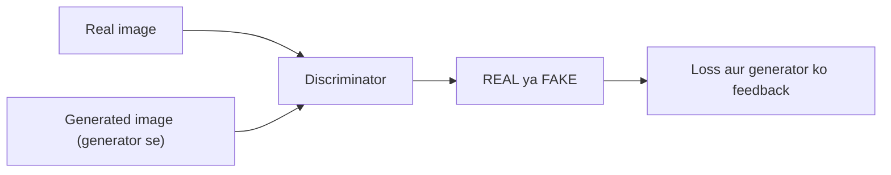

**Ek line mein:** <mark>discriminator GAN ka judge hai: wo real ya generated image leta hai aur REAL ya FAKE output deta hai</mark>, aur uska jawab generator ko improve hone ka feedback deta hai. <Cite id="class-dl-chp6" loc="slide 9" />

<Box kind="key">

**Discriminator ke question mein ye points likho:**

- <mark>Check karne ki zimmedari ki input real hai ya generated</mark>.
- <mark>Input: dataset ki real image aur generator ki generated image; output: REAL ya FAKE</mark>.
- <mark>Goal: real images ko generated images se sahi alag pehchanna</mark> (art critic).
- <mark>Uski prediction se loss banta hai</mark>; backpropagation dono networks update karta hai.
- <mark>Generator is feedback se zyada realistic images banata hai</mark>; discriminator khud bhi behtar detector banta hai.
- Mainly **training ke time** chahiye; training ke baad generator akela naye samples banata hai.

</Box>

## Core answer (5 marks, yahan ke har question ke liye)

<Box kind="definition">

The **discriminator (D)** is the network of a GAN that looks at real and fake samples and predicts whether each is real or fake. <Cite id="class-dl-chp6" loc="slide 3" />

</Box>

| | Discriminator |
|---|---|
| Input | Dataset ki real image, ya generated image |
| Output | REAL ya FAKE |
| Goal | Real ko generated se sahi alag karna |
| Analogy | Art critic jo dekhta hai painting asli hai ya nakli |

<Cite id="class-dl-chp6" loc="slide 9" />

**Kyun important hai:** wo galti kare to uska apna loss badhta hai, aur backpropagation dono networks update karta hai. Generator is feedback se apni images ko zyada realistic banata hai, jabki discriminator fakes pakadne mein behtar hota hai. <Cite id="class-dl-chp6" loc="slide 10" />

**Conclusion:** discriminator real vs fake check karta hai aur generator ko behtar samples banane pe majboor karta hai.

## Extended answer (5 marks ka question, zyada chahiye to hi add karo)

### 1. Training loop mein discriminator

1. D ko real images (label real) aur generated images (label fake) milti hain.
2. Wo har ek ke liye REAL ya FAKE predict karta hai.
3. Loss calculate hota hai: galat prediction se high loss, sahi se low loss.
4. Backpropagation D ko (behtar judge banane ke liye) aur G ko (D ko behtar fool karne ke liye) update karta hai.
5. Aakhir mein D farq nahi bata pata. <Cite id="class-dl-chp6" loc="slide 10" />

Original formulation mein D ek binary classifier hai aur G ke saath contest minimax game hai. <Cite id="web-dl-2-gan-paper" /> <Cite id="web-dl-2-d2l-gan" />

### 2. Generator vs discriminator

| | Generator | Discriminator |
|---|---|---|
| Input | Random noise | Real ya generated image |
| Output | Generated image | REAL ya FAKE |
| Goal | Discriminator ko fool karna | Fool na hona |
| Analogy | Artist ya forger | Art critic ya examiner |
| Training ke baad | Naya data banane ke liye use | Mainly zaroorat nahi |

<Cite id="class-dl-chp6" loc="slides 9 and 11" />

## Har question mein kaise fit karein

- **"Explain the role of the Discriminator in GAN architecture."** (5 marks) <PYQ id="assignment-2/q6d" />: core answer hi poora answer hai: role, input, output, goal, chhota diagram, kyun important aur ek line conclusion. Time ho to generator vs discriminator table add karo.

## Exam tips

- **Draw karo:** dono inputs (real aur generated) discriminator mein jaate hue, REAL ya FAKE output aur feedback arrow ke saath.
- **Keywords:** real or fake, distinguish, loss, feedback, art critic, backpropagation.
- Common galti: ye bhoolna ki D **dono** real aur generated images dekhta hai.

Exam mein English mein likho.
