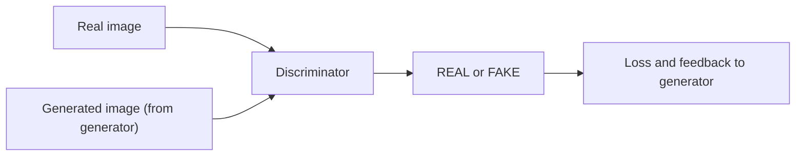

**In one line:** <mark>the discriminator is the judge of a GAN: it takes a real or a generated image and outputs REAL or FAKE</mark>, and its answer gives the generator the feedback it needs to improve. <Cite id="class-dl-chp6" loc="slide 9" />

<Box kind="key">

**Key points to write (discriminator):**

- <mark>Responsible for checking whether an input is real or generated</mark>.
- <mark>Input: a real image from the dataset and a generated image from the generator; output: REAL or FAKE</mark>.
- <mark>Goal: correctly distinguish real images from generated images</mark> (art critic).
- <mark>Its prediction produces the loss</mark>; backpropagation updates both networks.
- <mark>The generator uses this feedback to make more realistic images</mark>; the discriminator itself becomes a better detector.
- Mainly needed **during training**; after training the generator alone creates new samples.

</Box>

## Core answer (5 marks, fits every question here)

<Box kind="definition">

The **discriminator (D)** is the network of a GAN that looks at real and fake samples and predicts whether each is real or fake. <Cite id="class-dl-chp6" loc="slide 3" />

</Box>

| | Discriminator |
|---|---|
| Input | A real image from the dataset, or a generated image |
| Output | REAL or FAKE |
| Goal | Correctly distinguish real from generated |
| Analogy | Art critic checking whether a painting is genuine or fake |

<Cite id="class-dl-chp6" loc="slide 9" />

**Why it matters:** if it makes mistakes its own loss increases, and backpropagation updates both networks. The generator uses this feedback to make its images more realistic, while the discriminator becomes better at detecting fakes. <Cite id="class-dl-chp6" loc="slide 10" />

**Conclusion:** the discriminator checks real versus fake and pushes the generator to produce better samples.

## Extended answer (5 marks question, add only if more is wanted)

### 1. Discriminator inside the training loop

1. D receives real images (label real) and generated images (label fake).
2. It predicts REAL or FAKE for each.
3. The loss is calculated: wrong prediction gives a high loss, correct gives a low loss.
4. Backpropagation updates D (to judge better) and G (to fool D better).
5. At the end D can no longer tell the difference. <Cite id="class-dl-chp6" loc="slide 10" />

In the original formulation D is a binary classifier and the contest is a minimax game with G. <Cite id="web-dl-2-gan-paper" /> <Cite id="web-dl-2-d2l-gan" />

### 2. Generator versus discriminator

| | Generator | Discriminator |
|---|---|---|
| Input | Random noise | Real or generated image |
| Output | Generated image | REAL or FAKE |
| Goal | Fool the discriminator | Not be fooled |
| Analogy | Artist or forger | Art critic or examiner |
| After training | Used to create new data | Mainly not needed |

<Cite id="class-dl-chp6" loc="slides 9 and 11" />

## Fit it to each question

- **"Explain the role of the Discriminator in GAN architecture."** (5 marks) <PYQ id="assignment-2/q6d" />: the core answer is the full answer: role, input, output, goal, the small diagram, why it matters and a one-line conclusion. Add the generator versus discriminator table if you have time.

## Exam tips

- **Draw** both inputs (real and generated) going into the discriminator, with the REAL or FAKE output and the feedback arrow.
- **Keywords:** real or fake, distinguish, loss, feedback, art critic, backpropagation.
- Common mistake: forgetting that D sees **both** real and generated images.
