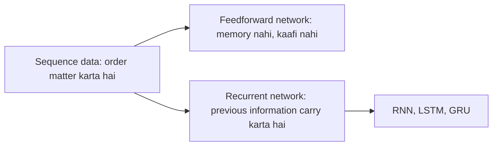
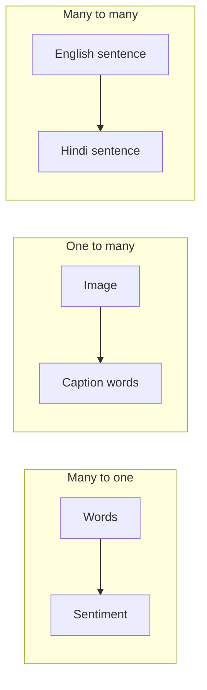
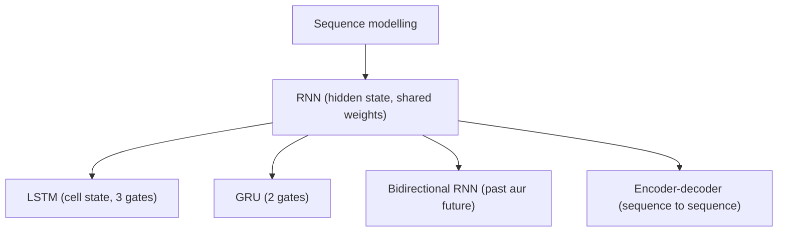

**Ek line mein:** <mark>sequence wo data hai jismein elements ka order matter karta hai</mark>; <mark>sequence learning problem</mark> hai "neural network us data se kaise seekhe jahan order aur previous information matter karti hai?", aur iske liye <mark>RNN, LSTM aur GRU</mark> use hote hain. <Cite id="class-dl-chp5" loc="slide 3" />

<Box kind="key">

**Sequence learning aur modelling ke har question mein ye points likho:**

- <mark>Sequence = data jismein elements ka order matter karta hai</mark> (sentence, speech, stock prices, weather readings, music notes).
- <mark>Sequence learning problem: order aur previous information matter kare to neural network kaise seekhe?</mark>
- <mark>Sequence models wo models hain jo sequences input ya output karte hain</mark>: text, audio, video, time series.
- <mark>Feedforward network mein memory nahi hoti</mark>, isliye kaafi nahi.
- <mark>Networks: RNN, LSTM, GRU, bidirectional RNN, encoder-decoder (seq2seq)</mark>.
- Kinds: <mark>many to one, one to many, many to many</mark>.

</Box>

## Core answer (5 marks, yahan ke har question ke liye)

<Box kind="definition">

A **sequence** is data where the order of the elements matters. The **sequence learning problem** is: "How can a neural network learn from data when the order and previous information matter?" **Sequence models** are machine learning models that input or output sequences of data. <Cite id="class-dl-chp5" loc="slide 3" /> <Cite id="class-dl-m5" loc="p. 3" />

</Box>

| Sequence data | Kya predict karna hai |
|---|---|
| Sentence | Sentiment ya next word |
| Speech | Recognized words |
| Stock prices | Future price |
| Weather readings | Future temperature |
| Music notes | Next note |

<Cite id="class-dl-chp5" loc="slide 3" />

**Sabme common kya hai:** input step by step aata hai, aur previous information current prediction ko affect karti hai. "I went to the bank to deposit money" mein "bank" ka matlab doosre words pe depend karta hai.

**Normal network kaafi kyun nahi:** feedforward network har input ko alag treat karta hai aur uski memory nahi hoti. Hume aisa network chahiye jo pehle ke steps ki information baad ke steps tak le jaye: RNN. <Cite id="class-dl-chp5" loc="slide 5" />

**Conclusion:** sequence learning ka matlab hai tab seekhna jab order aur previous information matter karti hai, aur RNN isi ke liye bana hai.

## Extended answer (10 marks): ye add karo

### 1. Sequence modelling aur uske applications

Sequence models text streams, audio clips, video clips aur time series handle karte hain. <Cite id="class-dl-m5" loc="p. 3" /> <Cite id="web-dl-2-d2l-sequence" />

| Application | Input se output |
|---|---|
| Speech recognition | Audio sequence se text |
| Sentiment classification | Words ki sequence se ek label |
| Video activity recognition | Frames ki sequence se ek label |
| Machine translation | Sequence se alag length ki sequence |
| Music generation, time-series prediction | Past values se next values |

<Cite id="class-dl-m5" loc="p. 4" /> <Cite id="class-dl-m5" loc="p. 5" /> <Cite id="class-dl-m5" loc="p. 15" />

### 2. Sequence models ke kinds

### 3. Sequence modelling ke liye networks

1. **RNN:** hidden state, har step pe same weights; past outputs inputs ki tarah use hote hain. <Cite id="class-dl-m5" loc="p. 9" />
2. **LSTM aur GRU:** long-term dependencies aur vanishing gradient ke liye gated RNNs.
3. **Bidirectional RNN:** sequence ko forward aur backward padhta hai, isliye past aur future dono dekhta hai. <Cite id="class-dl-m5" loc="p. 32" />
4. **Encoder-decoder (seq2seq):** input sequence ko alag length ki output sequence mein map karta hai. <Cite id="class-dl-m5" loc="p. 38" />
5. **Recursive networks:** tree-structured data ke liye RNNs ka generalization. <Cite id="class-dl-m5" loc="p. 34" />

Textbook mein bhi recurrent aur recursive nets sequence modelling ke liye isi tarah cover hain. <Cite id="web-dl-2-goodfellow-rnn" />

## Har question mein kaise fit karein

- **"Describe sequence learning problem."** (5 marks) <PYQ id="2023-12/q1e" />: core answer: definition, examples table, sabme common kya hai, normal network kyun fail, aur RNN jawab ke roop mein.
- **"What do you mean by sequence modelling? Which networks can be used for sequence modelling?"** (10 marks) <PYQ id="assignment-2/q5a" />: definition aur problem (core), applications (section 1), types (section 2) aur paanch networks (section 3).

## Exam tips

- **Draw karo:** sequence examples "previous information affects the current prediction" ke arrow ke saath, ya network tree.
- **Keywords:** order matters, previous information, memory, hidden state, many to one, many to many.
- Common galti: ye likhna bhool jaana ki feedforward network **kyun** kaafi nahi (memory nahi).

Exam mein English mein likho.
