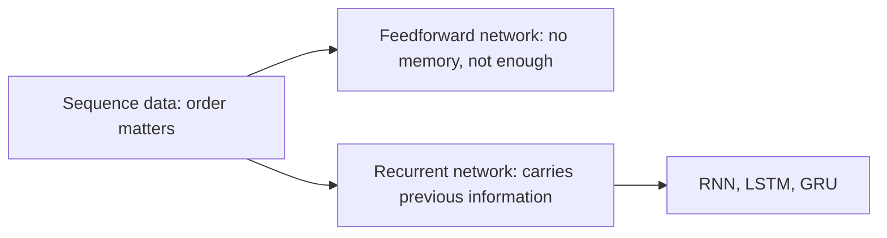
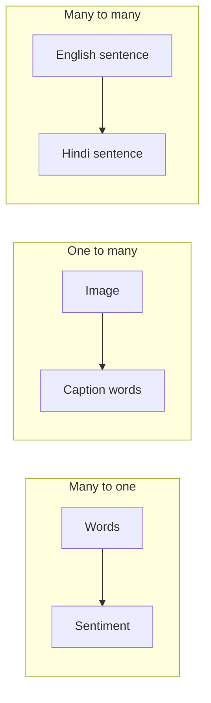
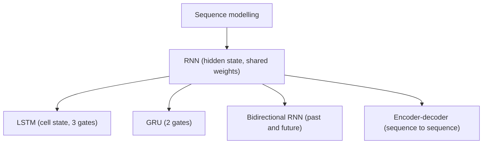

**In one line:** a <mark>sequence is data where the order of the elements matters</mark>; the <mark>sequence learning problem</mark> is "how can a neural network learn from data when the order and previous information matter?", and <mark>RNN, LSTM and GRU</mark> are the networks used for it. <Cite id="class-dl-chp5" loc="slide 3" />

<Box kind="key">

**Key points to write (sequence learning and modelling):**

- <mark>Sequence = data where the order of elements matters</mark> (sentence, speech, stock prices, weather readings, music notes).
- <mark>Sequence learning problem: how can a neural network learn when order and previous information matter?</mark>
- <mark>Sequence models are models that input or output sequences of data</mark>: text, audio, video, time series.
- A <mark>feedforward network has no memory</mark> of previous inputs, so it is not enough.
- <mark>Networks: RNN, LSTM, GRU, bidirectional RNN, encoder-decoder (seq2seq)</mark>.
- Kinds: <mark>many to one, one to many, many to many</mark>.

</Box>

## Core answer (5 marks, fits every question here)

<Box kind="definition">

A **sequence** is data where the order of the elements matters. The **sequence learning problem** is: "How can a neural network learn from data when the order and previous information matter?" **Sequence models** are machine learning models that input or output sequences of data. <Cite id="class-dl-chp5" loc="slide 3" /> <Cite id="class-dl-m5" loc="p. 3" />

</Box>

| Sequence data | What we want to predict |
|---|---|
| Sentence | Sentiment or next word |
| Speech | Recognized words |
| Stock prices | Future price |
| Weather readings | Future temperature |
| Music notes | Next note |

<Cite id="class-dl-chp5" loc="slide 3" />

**What is common:** the input comes step by step, and previous information affects the current prediction. In "I went to the bank to deposit money" the meaning of "bank" depends on the other words.

**Why a normal network is not enough:** a feedforward network treats each input separately and has no memory. We need a network that carries information from earlier steps to later steps: the RNN. <Cite id="class-dl-chp5" loc="slide 5" />

**Conclusion:** sequence learning means learning when order and previous information matter, and the RNN is designed for it.

## Extended answer (10 marks): add these

### 1. Sequence modelling and its applications

Sequence models handle text streams, audio clips, video clips and time series. <Cite id="class-dl-m5" loc="p. 3" /> <Cite id="web-dl-2-d2l-sequence" />

| Application | Input to output |
|---|---|
| Speech recognition | Audio sequence to text |
| Sentiment classification | Sequence of words to one label |
| Video activity recognition | Sequence of frames to one label |
| Machine translation | Sequence to sequence of a different length |
| Music generation, time-series prediction | Past values to the next values |

<Cite id="class-dl-m5" loc="p. 4" /> <Cite id="class-dl-m5" loc="p. 5" /> <Cite id="class-dl-m5" loc="p. 15" />

### 2. Kinds of sequence models

### 3. Networks used for sequence modelling

1. **RNN:** hidden state, same weights at every step; past outputs are used as inputs. <Cite id="class-dl-m5" loc="p. 9" />
2. **LSTM and GRU:** gated RNNs for long-term dependencies and the vanishing gradient problem.
3. **Bidirectional RNN:** reads the sequence forward and backward, so it sees past and future. <Cite id="class-dl-m5" loc="p. 32" />
4. **Encoder-decoder (seq2seq):** maps an input sequence to an output sequence of a different length. <Cite id="class-dl-m5" loc="p. 38" />
5. **Recursive networks:** a generalization of RNNs for tree-structured data. <Cite id="class-dl-m5" loc="p. 34" />

The textbook covers recurrent and recursive nets for sequence modelling in the same way. <Cite id="web-dl-2-goodfellow-rnn" />

## Fit it to each question

- **"Describe sequence learning problem."** (5 marks) <PYQ id="2023-12/q1e" />: core answer: definition, the examples table, what is common, why a normal network fails, and the RNN as the answer.
- **"What do you mean by sequence modelling? Which networks can be used for sequence modelling?"** (10 marks) <PYQ id="assignment-2/q5a" />: definition and the problem (core), applications (section 1), the types (section 2) and the five networks (section 3).

## Exam tips

- **Draw** the sequence examples with an arrow to "previous information affects the current prediction", or the network tree.
- **Keywords:** order matters, previous information, memory, hidden state, many to one, many to many.
- Common mistake: forgetting to say **why** a feedforward network is not enough (no memory).
