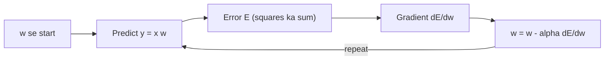
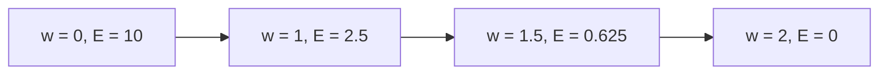

**Ek line mein:** $y = xw$ ke liye error <mark>$E = \dfrac{1}{2}\sum_{n=1}^{N} (y_n - x_n w)^2$</mark> hai, uska slope <mark>$\dfrac{\partial E}{\partial w} = -\sum (y_n - x_n w)\,x_n$</mark> hai, aur gradient descent $w$ ko slope ke ulte move karta hai: <mark>$w \leftarrow w - \alpha \dfrac{\partial E}{\partial w}$</mark>. <Cite id="class-dl-chp2" loc="slide 63" />

<Box kind="key">

**Ye points likho (method):**

- Ek pair ka prediction: $\hat y_n = x_n w$. **Ek pair ki error:** $y_n - x_n w$.
- <mark>Isko square karo taaki positive aur negative errors cancel na ho, aur saare $N$ pairs pe add karo.</mark> $\tfrac{1}{2}$ ek convention hai jo differentiate karte waqt 2 ko cancel kar deta hai.
- <mark>Chain rule se differentiate karo:</mark> square se $2(y_n - x_n w)$ aata hai aur andar ke part se $-x_n$.
- <mark>Update rule: $w \leftarrow w + \alpha \sum (y_n - x_n w)\,x_n$</mark>, $\alpha$ = learning rate.
- Predictions chhote hon to $w$ badhta hai, bade hon to $w$ ghatta hai.
- Class rule $W_{new} = W_{old} - \eta\,\partial L / \partial W$ deti hai; gradient ka derivation standard calculus hai.

</Box>

## Core answer (5 marks): method

<Box kind="definition">

**Sum-of-squared error (SSE)** is the total of the squares of the differences between the actual outputs $y_n$ and the predictions $x_n w$ over all $N$ pairs. Gradient descent reduces it by changing $w$ step by step. <Cite id="class-dl-chp2" loc="slide 63" />

</Box>

**Steps:**

1. Prediction $\hat y_n = x_n w$ aur error $y_n - x_n w$ likho.
2. Square karke add karo: $E = \dfrac{1}{2}\sum_{n=1}^{N} (y_n - x_n w)^2$.
3. Differentiate karo: $\dfrac{\partial E}{\partial w} = -\sum_{n=1}^{N} (y_n - x_n w)\,x_n$.
4. Update: $w \leftarrow w - \alpha \dfrac{\partial E}{\partial w} = w + \alpha \sum_{n=1}^{N} (y_n - x_n w)\,x_n$.
5. $E$ girna band hone tak repeat karo.

**Conclusion:** predictions chhote hon to $w$ badhta hai aur bade hon to ghatta hai, jab tak error sabse chhota na ho jaye. <Cite id="web-dl-1-d2l-linreg" />

## Extended answer (10 marks): worked example

Numerical ek chhote data set pe solve kiya hai. Class files update rule deti hain, ye derivation nahi, isliye upar ke step 1 aur 2 standard calculus hain. <Cite id="web-dl-1-wiki-mse" />

<Sum>

<Given>

pairs $(1, 2)$ aur $(2, 4)$, start $w = 0$, learning rate $\alpha = 0.1$.

</Given>

<Find>

do updates ke liye $E$, gradient aur naya $w$.

</Find>

<Steps>

1. **Update 1, errors:** $2 - 0 = 2$ aur $4 - 0 = 4$. To $E = \tfrac{1}{2}(4 + 16) = 10$.
2. **Gradient:** $-(2 \times 1 + 4 \times 2) = -10$.
3. **Naya $w$:** $0 - 0.1 \times (-10) = 1$. Nayi errors $1$ aur $2$, to $E = \tfrac{1}{2}(1 + 4) = 2.5$.
4. **Update 2, gradient:** $-(1 \times 1 + 2 \times 2) = -5$. Naya $w = 1 + 0.1 \times 5 = 1.5$. Errors $0.5$ aur $1$, to $E = \tfrac{1}{2}(0.25 + 1) = 0.625$.
5. **Kahan ruk-ta hai:** exact minimum $w^* = \dfrac{\sum x_n y_n}{\sum x_n^2} = \dfrac{10}{5} = 2$, kyunki data $y = 2x$ follow karta hai.

</Steps>

<Answer>

$w: 0 \to 1 \to 1.5 \to \dots \to 2$ aur $E: 10 \to 2.5 \to 0.625 \to \dots \to 0$.

</Answer>

<Box kind="verify">

Data ke liye $E$ expand karo: $E = \tfrac{1}{2}[(2 - w)^2 + (4 - 2w)^2] = 10 - 10w + 2.5w^2$. Iska slope $-10 + 5w$ hai: $w = 0$ pe $-10$, $w = 1$ pe $-5$ aur $w = 2$ pe $0$. Aur $E(1.5) = 10 - 15 + 5.625 = 0.625$.

</Box>

</Sum>

**Update sahi kyun hai:** $w = 0$ pe slope $-10$ negative hai, yani $w$ badhne se $E$ girta hai; rule $w - \alpha \cdot (\text{slope})$ tab $w$ ko badhata hai. <Cite id="class-dl-chp2" loc="slide 63" />

## Har question mein kaise fit karein

- **"Suppose we have N input-output pairs ... Calculate the sum-of-squared error function E ... derive the gradient descent update rule."** (5 marks) <PYQ id="2023-12/q1b" />: core answer ke paanch-step method ko $E$, gradient aur update ke final formulas ke saath likho. Time ho to ek line mein do-pair example add karo.

## Exam tips

- **Chain-rule step zaroor dikhao:** square se $2(\cdot)$ aata hai aur andar ka derivative $-x_n$ deta hai, minus sign wahin se aata hai.
- $E$ mein $\tfrac{1}{2}$ likho aur bolo ki ye convention hai jo 2 ko cancel karta hai. Iske bina gradient mein extra 2 aata hai (ye bhi chalega, bas consistent raho).
- Loop draw karo (predict, error, gradient, update, repeat).

Exam mein English mein likho.
