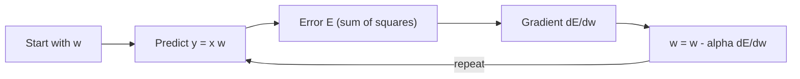
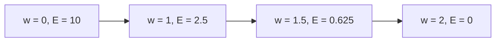

**In one line:** for $y = xw$ the error is <mark>$E = \dfrac{1}{2}\sum_{n=1}^{N} (y_n - x_n w)^2$</mark>, its slope is <mark>$\dfrac{\partial E}{\partial w} = -\sum (y_n - x_n w)\,x_n$</mark>, and gradient descent moves $w$ against the slope: <mark>$w \leftarrow w - \alpha \dfrac{\partial E}{\partial w}$</mark>. <Cite id="class-dl-chp2" loc="slide 63" />

<Box kind="key">

**Key points to write (the method):**

- Prediction of one pair: $\hat y_n = x_n w$. **Error of one pair:** $y_n - x_n w$.
- <mark>Square it so that positive and negative errors cannot cancel, and add over all $N$ pairs.</mark> The $\tfrac{1}{2}$ is a convention that cancels the 2 on differentiation.
- <mark>Differentiate with the chain rule:</mark> the square gives $2(y_n - x_n w)$ and the inner part gives $-x_n$.
- <mark>Update rule: $w \leftarrow w + \alpha \sum (y_n - x_n w)\,x_n$</mark>, with $\alpha$ the learning rate.
- $w$ grows when predictions are too small and shrinks when they are too large.
- The class gives the rule $W_{new} = W_{old} - \eta\,\partial L / \partial W$; the derivation of the gradient is standard calculus.

</Box>

## Core answer (5 marks): the method

<Box kind="definition">

**Sum-of-squared error (SSE)** is the total of the squares of the differences between the actual outputs $y_n$ and the predictions $x_n w$ over all $N$ pairs. Gradient descent reduces it by changing $w$ step by step. <Cite id="class-dl-chp2" loc="slide 63" />

</Box>

**Steps:**

1. Write the prediction $\hat y_n = x_n w$ and the error $y_n - x_n w$.
2. Square and add: $E = \dfrac{1}{2}\sum_{n=1}^{N} (y_n - x_n w)^2$.
3. Differentiate: $\dfrac{\partial E}{\partial w} = -\sum_{n=1}^{N} (y_n - x_n w)\,x_n$.
4. Update: $w \leftarrow w - \alpha \dfrac{\partial E}{\partial w} = w + \alpha \sum_{n=1}^{N} (y_n - x_n w)\,x_n$.
5. Repeat until $E$ stops falling.

**Conclusion:** $w$ grows when the predictions are too small and shrinks when they are too large, until the error is smallest. <Cite id="web-dl-1-d2l-linreg" />

## Extended answer (10 marks): worked example

The numerical is solved here on a small data set. The class files give the update rule but not this derivation, so steps 1 and 2 above are standard calculus. <Cite id="web-dl-1-wiki-mse" />

<Sum>

<Given>

pairs $(1, 2)$ and $(2, 4)$, start $w = 0$, learning rate $\alpha = 0.1$.

</Given>

<Find>

$E$, the gradient and the new $w$ for two updates.

</Find>

<Steps>

1. **Update 1, errors:** $2 - 0 = 2$ and $4 - 0 = 4$. So $E = \tfrac{1}{2}(4 + 16) = 10$.
2. **Gradient:** $-(2 \times 1 + 4 \times 2) = -10$.
3. **New $w$:** $0 - 0.1 \times (-10) = 1$. New errors are $1$ and $2$, so $E = \tfrac{1}{2}(1 + 4) = 2.5$.
4. **Update 2, gradient:** $-(1 \times 1 + 2 \times 2) = -5$. New $w = 1 + 0.1 \times 5 = 1.5$. Errors $0.5$ and $1$, so $E = \tfrac{1}{2}(0.25 + 1) = 0.625$.
5. **Where it ends:** the exact minimum is $w^* = \dfrac{\sum x_n y_n}{\sum x_n^2} = \dfrac{10}{5} = 2$, because the data follow $y = 2x$.

</Steps>

<Answer>

$w: 0 \to 1 \to 1.5 \to \dots \to 2$ and $E: 10 \to 2.5 \to 0.625 \to \dots \to 0$.

</Answer>

<Box kind="verify">

Expand $E$ for the data: $E = \tfrac{1}{2}[(2 - w)^2 + (4 - 2w)^2] = 10 - 10w + 2.5w^2$. Its slope $-10 + 5w$ is $-10$ at $w = 0$, $-5$ at $w = 1$ and $0$ at $w = 2$. Also $E(1.5) = 10 - 15 + 5.625 = 0.625$.

</Box>

</Sum>

**Why the update is right:** the slope $-10$ at $w = 0$ is negative, so $E$ falls when $w$ grows; the rule $w - \alpha \cdot (\text{slope})$ then raises $w$. <Cite id="class-dl-chp2" loc="slide 63" />

## Fit it to each question

- **"Suppose we have N input-output pairs ... Calculate the sum-of-squared error function E ... derive the gradient descent update rule."** (5 marks) <PYQ id="2023-12/q1b" />: write the five-step method of the core answer with the final formulas for $E$, the gradient and the update. If time allows, add the two-pair example in one line.

## Exam tips

- **Always show** the chain-rule step: the square gives $2(\cdot)$ and the inner derivative gives $-x_n$, so the minus sign comes from there.
- Write $\tfrac{1}{2}$ in $E$ and say it is a convention, so the 2 cancels. Without it the gradient has an extra factor of 2 (also acceptable, but be consistent).
- Draw the loop (predict, error, gradient, update, repeat).
