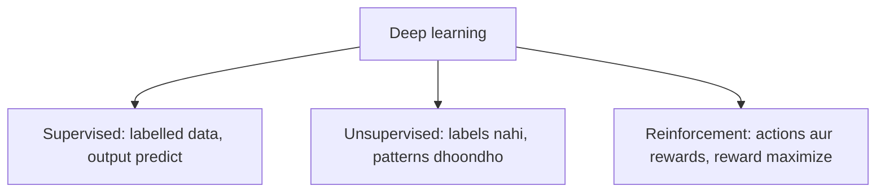
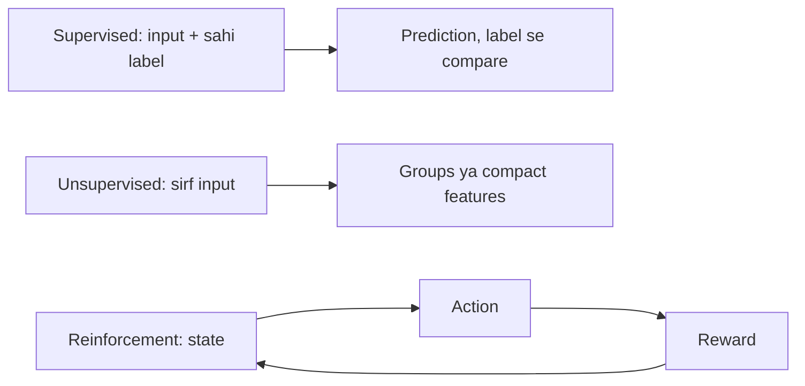

**Ek line mein:** deep learning ko model ke seekhne ke tareeke se teen classes mein baanta jaata hai: <mark>supervised (labelled answers ke saath), unsupervised (bina labels ke) aur reinforcement learning (actions aur rewards se)</mark>. <Cite id="class-dl-chp1" loc="slide 25" />

<Box kind="key">

**Ye points likho:**

- <mark>Supervised: labelled data se seekhta hai, input X se output Y ka mapping.</mark> Networks: CNN, RNN, LSTM.
- <mark>Unsupervised: bina labels ke data se seekhta hai aur patterns ya groups khud dhoondhta hai.</mark> Networks: autoencoders, DBN, GANs.
- <mark>Reinforcement: actions karke rewards ya punishments se seekhta hai, time ke saath reward maximize karne ke liye.</mark>
- Har class ka **ek example aur ek use case** do (cat/dog images, animals ko group karna, robot ka chalna seekhna).
- End mein **comparison table**: learns from, needs labels, main goal.

</Box>

## Core answer (5 marks, yahan ke har question ke liye)

<Box kind="definition">

Deep learning models are mainly divided into three types based on how they learn from data: **supervised learning**, **unsupervised learning** and **reinforcement learning**. <Cite id="class-dl-chp1" loc="slide 25" />

</Box>

1. **Supervised learning:** input ke saath sahi output milta hai, aur model X se Y ka mapping seekhta hai. *Example:* cat ki photo do aur bolo "ye cat hai". *Uses:* image classification, spam detection, handwriting recognition, medical diagnosis. <Cite id="class-dl-m1" loc="p. 36" />
2. **Unsupervised learning:** labels nahi; model data ko khud group ya compress karta hai. *Example:* bina naam ke bahut saari animal photos; similar wali group ho jaati hain. *Uses:* customer segmentation, dimensionality reduction, anomaly detection. <Cite id="class-dl-m1" loc="p. 36" />
3. **Reinforcement learning:** agent state dekhta hai, action leta hai, reward paata hai aur apni policy update karta hai. *Example:* robot ka chalna seekhna. *Uses:* game playing, robotics, self-driving cars. <Cite id="class-dl-m1" loc="p. 36" />

**Conclusion:** supervised madad ke saath seekhta hai, unsupervised khud dhoondhta hai, reinforcement karke seekhta hai. <Cite id="web-dl-1-gb-ml" loc="§5.7 and §5.8" />

## Extended answer (10 marks): ye add karo

### 1. Har class ki picture aur networks

### 2. Comparison table

| Feature | Supervised | Unsupervised | Reinforcement |
|---|---|---|---|
| Learns from | Labelled data | Unlabelled data | Actions aur feedback |
| Needs labels? | Haan | Nahi | Nahi (sirf reward) |
| Main goal | Output predict karna | Patterns ya groups dhoondhna | Total reward maximize karna |
| Typical networks | CNN, RNN, LSTM | Autoencoders, DBN, GAN | Actions chunne wale deep networks |
| Example task | Spam detection | Customer segmentation | Chess ya Go khelna |

<Cite id="class-dl-chp1" loc="slide 25" /> <Cite id="class-dl-m1" loc="p. 36" />

### 3. Hybrid ("other types" pucha ho to)

**Hybrid** approach unsupervised aur supervised methods ko combine karti hai: jaise autoencoder bina labels ke features seekhta hai, phir classifier unhe labels ke saath use karta hai. <Cite id="class-dl-chp1" loc="slide 25" />

## Har question mein kaise fit karein

- **"What are the Three Classes of Deep Learning, explain each?"** (10 marks) <PYQ id="2024-05/q2a" /> <PYQ id="2024-12/q2a" />: definition line aur class diagram, phir har class definition, example, use cases aur networks ke saath (core answer, points 1 se 3), section 1 ki pictures aur comparison table.

## Exam tips

- **Hamesha draw karo** teen-branch tree aur comparison table; marks inhi se aate hain.
- **Har class ka ek real example** do; examiner wahi dhoondhta hai.
- Ye mat likho ki reinforcement learning ko labels chahiye; use sirf reward signal chahiye.

Exam mein English mein likho.
