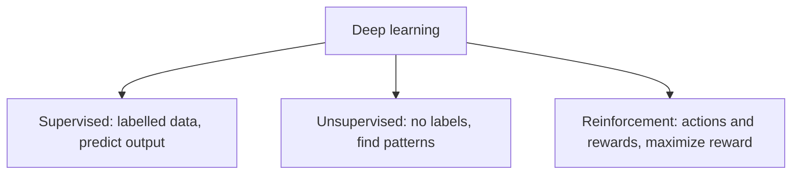
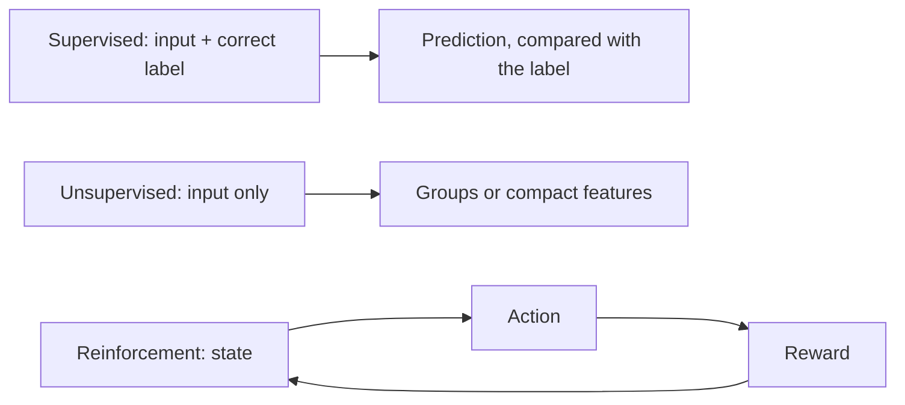

**In one line:** deep learning is divided into three classes by how the model learns: <mark>supervised (with labelled answers), unsupervised (without labels) and reinforcement learning (by actions and rewards)</mark>. <Cite id="class-dl-chp1" loc="slide 25" />

<Box kind="key">

**Key points to write:**

- <mark>Supervised: learns from labelled data, a mapping from input X to output Y.</mark> Networks: CNN, RNN, LSTM.
- <mark>Unsupervised: learns from data without labels and finds patterns or groups by itself.</mark> Networks: autoencoders, DBN, GANs.
- <mark>Reinforcement: learns by doing actions and getting rewards or punishments, to maximize reward over time.</mark>
- Give **one example and one use case** for each (cat/dog images, grouping animals, robot learning to walk).
- End with the **comparison table**: learns from, needs labels, main goal.

</Box>

## Core answer (5 marks, fits every question here)

<Box kind="definition">

Deep learning models are mainly divided into three types based on how they learn from data: **supervised learning**, **unsupervised learning** and **reinforcement learning**. <Cite id="class-dl-chp1" loc="slide 25" />

</Box>

1. **Supervised learning:** the input comes with the correct output, and the model learns the mapping from X to Y. *Example:* give a photo of a cat and say "this is a cat". *Uses:* image classification, spam detection, handwriting recognition, medical diagnosis. <Cite id="class-dl-m1" loc="p. 36" />
2. **Unsupervised learning:** no labels; the model groups or compresses the data on its own. *Example:* many animal photos without names; similar ones are grouped. *Uses:* customer segmentation, dimensionality reduction, anomaly detection. <Cite id="class-dl-m1" loc="p. 36" />
3. **Reinforcement learning:** the agent observes the state, takes an action, gets a reward and updates its policy. *Example:* a robot learning to walk. *Uses:* game playing, robotics, self-driving cars. <Cite id="class-dl-m1" loc="p. 36" />

**Conclusion:** supervised learns with help, unsupervised finds by itself, reinforcement learns by doing. <Cite id="web-dl-1-gb-ml" loc="§5.7 and §5.8" />

## Extended answer (10 marks): add these

### 1. Each class with its picture and networks

### 2. Comparison table

| Feature | Supervised | Unsupervised | Reinforcement |
|---|---|---|---|
| Learns from | Labelled data | Unlabelled data | Actions and feedback |
| Needs labels? | Yes | No | No (only a reward) |
| Main goal | Predict the output | Find patterns or groups | Maximize the total reward |
| Typical networks | CNN, RNN, LSTM | Autoencoders, DBN, GAN | Deep networks that choose actions |
| Example task | Spam detection | Customer segmentation | Playing chess or Go |

<Cite id="class-dl-chp1" loc="slide 25" /> <Cite id="class-dl-m1" loc="p. 36" />

### 3. Hybrid (when asked "other types")

A **hybrid** approach combines unsupervised and supervised methods: for example an autoencoder learns features without labels, and a classifier then uses them with labels. <Cite id="class-dl-chp1" loc="slide 25" />

## Fit it to each question

- **"What are the Three Classes of Deep Learning, explain each?"** (10 marks) <PYQ id="2024-05/q2a" /> <PYQ id="2024-12/q2a" />: the definition line and class diagram, then each class with definition, example, use cases and networks (core answer, points 1 to 3), the pictures from section 1 and the comparison table.

## Exam tips

- **Always draw** the three-branch tree and the comparison table; they carry most of the marks.
- Give **one real example per class**; examiners look for it.
- Do not say reinforcement learning "needs labels"; it needs only a reward signal.
