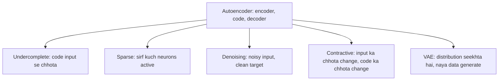

**Ek line mein:** <mark>autoencoder apne input ko chhote code mein compress karta hai aur us code se input wapas banata hai (goal: Input ≈ Output)</mark>, aur uske types mein farq sirf us **extra rule** ka hai jo use copy karne ki jagah useful features seekhne pe majboor karta hai. <Cite id="class-dl-chp3" loc="slide 2" /> <Cite id="class-dl-chp3" loc="slide 8" />

<Box kind="key">

**Har autoencoder-types question mein ye points likho:**

- <mark>Autoencoder = encoder + bottleneck (code) + decoder; apna hi input reconstruct karna seekhta hai, labels nahi chahiye.</mark>
- <mark>Undercomplete: code input se chhota (Code Size < Input Size).</mark>
- <mark>Sparse: sirf kuch hidden neurons active; Total Loss = Reconstruction Loss + Sparsity Penalty (L1 ya KL divergence).</mark>
- <mark>Denoising: noisy input, clean target; Input (noisy) ≠ Target (clean).</mark>
- <mark>Contractive: input ka chhota change code ka chhota change; Total Loss = Reconstruction Loss + Contractive Penalty.</mark>
- <mark>VAE: distribution (μ, σ²) seekhta hai, z sample karta hai, naya data generate kar sakta hai; Loss = Reconstruction Loss + KL divergence.</mark>
- L1 aur L2 regularization **techniques** hain; sparse, denoising, contractive aur VAE autoencoder **types** hain.

</Box>

## Core answer (5 marks, yahan ke har question ke liye)

<Box kind="definition">

An **autoencoder** is an unsupervised neural network that learns to compress the input into a smaller representation (encoding) and then reconstruct the original input from it. **Goal: Input ≈ Output.** <Cite id="class-dl-chp3" loc="slide 2" />

</Box>

**Working:** (1) input diya jaata hai, (2) encoder compress karta hai, (3) bottleneck important information rakhta hai, (4) decoder input reconstruct karta hai, (5) output ko input se compare karke loss nikalte hain (MSE ya L1), (6) backpropagation weights update karta hai, (7) output input jaisa hone tak repeat. <Cite id="class-dl-chp3" loc="slides 2 and 3" />

| Type | Copy rokne wala rule | Loss |
|---|---|---|
| Undercomplete | Code input se chhota | Reconstruction |
| Sparse | Kam active neurons | Reconstruction + sparsity penalty |
| Denoising | Noisy input ke liye clean target | Clean input ke against reconstruction |
| Contractive | Code kam badalna chahiye | Reconstruction + contractive penalty |
| VAE | Code ek distribution hai | Reconstruction + KL divergence |

<Cite id="class-dl-chp3" loc="slide 8" />

**Conclusion:** types sirf us extra constraint mein alag hain jo autoencoder ko copy ki jagah seekhne pe majboor karta hai. <Cite id="web-dl-1-wiki-ae" />

## Extended answer (10 marks): ye add karo

### 1. Undercomplete autoencoder

Hidden layer (bottleneck) mein input se kam neurons hote hain (jaise 784 se 64 se 784), isliye network ko data compress karke sirf important features rakhne padte hain. **Disadvantage:** bahut chhota bottleneck information kho deta hai. <Cite id="class-dl-chp3" loc="slides 13 and 14" /> <Cite id="web-dl-1-gb-ae" loc="§14.1" />

### 2. Sparse autoencoder

Ek time pe sirf thode se hidden neurons active hote hain (jaise 100 mein se 5 se 10); baaki inactive. **Total Loss = Reconstruction Loss + Sparsity Penalty**, jisme activations pe L1 ya average activation limit karne wala KL divergence hota hai. Ye **overcomplete** hidden layer ke liye suit karta hai, jo warna input ratta maar leti. **Disadvantage:** bahut zyada sparsity important information kho deti hai. <Cite id="class-dl-chp3" loc="slides 19 and 20" /> <Cite id="class-dl-m3" loc="pp. 17 and 19" /> <Cite id="web-dl-1-ng-sparse" />

**Overfitting rokne mein effectiveness:** ye memorize karne ki capacity limit karta hai, **lekin features nikalne ki ability limit kiye bina**, isliye code size aur regularization alag alag chune ja sakte hain. Isko sparsity penalty chahiye, sparsity level dhyaan se chunna padta hai, aur training zyada complex hoti hai. <Cite id="class-dl-m3" loc="p. 19" />

### 3. Denoising autoencoder

Ye **noisy input** leta hai lekin **clean original** rebuild karna seekhta hai (Noisy Input → Autoencoder → Clean Output). Loss (MSE ya MAE) clean target ke against nikalta hai. Noise types: Gaussian, salt-and-pepper, masking, speckle. Ye noise hatata hai aur robust features seekhta hai. <Cite id="class-dl-chp3" loc="slides 23 and 24" /> <Cite id="web-dl-1-paper-dae" />

### 4. Contractive autoencoder

Input ka chhota change code ka sirf chhota change deta hai. **Total Loss = Reconstruction Loss + Contractive Penalty**, penalty $\lambda \left\lVert \dfrac{\partial h}{\partial x} \right\rVert_F^2$ jo input $x$ ke respect mein code $h$ ke slope pe lagti hai. Ye stable, robust features deta hai. <Cite id="class-dl-chp3" loc="slides 21 and 22" /> <Cite id="web-dl-1-paper-cae" />

### 5. Variational autoencoder (VAE)

Encoder ek fixed code ki jagah **mean $\mu$** aur **variance $\sigma^2$** deta hai; ek point sample hota hai, $z = \mu + \sigma\varepsilon$, aur decoder usse rebuild karta hai. **Total VAE Loss = Reconstruction Loss + KL Divergence Loss**; KL term latent space ko $N(0, 1)$ ke paas, smooth aur sampling ke liye achha rakhta hai. Ye **naya data generate kar sakta hai**. <Cite id="class-dl-chp3" loc="slides 27 and 28" /> <Cite id="web-dl-1-paper-vae" />

### 6. Sparse, denoising aur contractive ki comparison

| | Sparse | Denoising | Contractive |
|---|---|---|---|
| Idea | Kam neurons active | Noisy input, clean target | Input ka chhota change, code ka chhota change |
| Kya add hota hai | Sparsity penalty | Input pe noise | Contractive penalty |
| Kispe kaam | Activations | Data | Encoder ki sensitivity |
| Main fayda | Memorization nahi; overcomplete ke saath chalta hai | Robust features, clean output | Stable, robust features |
| Drawback | Bahut zyada sparsity information khoti hai | Suitable noise chahiye | Extra penalty, $\lambda$ chunna |

Teeno reconstruction loss ke upar regularization add karte hain. Textbook: denoising decoder ko input ke chhote lekin finite changes se resist karata hai, contractive encoder ko infinitely chhote changes se resist karata hai. <Cite id="class-dl-chp3" loc="slide 31" /> <Cite id="class-dl-m3" loc="p. 22" />

**Applications:** compression, denoising, dimensionality reduction, feature extraction, anomaly detection, generation (VAE). **Disadvantages:** output hamesha identical nahi, kuch information kho sakti hai, bottleneck size achhe se chunna padta hai. <Cite id="class-dl-chp3" loc="slides 3 and 34" />

## Har question mein kaise fit karein

- **"Explain any three types of Autoencoders."** (10 marks) <PYQ id="2024-05/q5b" /> <PYQ id="2024-12/q5b" />: training picture ke saath autoencoder pe ek line, phir section 1 se 4 mein se **koi teen** (undercomplete, sparse, denoising sabse safe), har ek definition, loss, picture aur drawback ke saath, aur types table.
- **"Explain the working of auto encoders. Also discuss type of auto encoders in detail."** (10 marks) <PYQ id="2025-05/q2b" />: working steps aur training picture (core answer), phir types table aur section 1 se 5, end mein advantages aur applications.
- **"Compare and analyze the working of Sparse, Denoising, and Contractive Autoencoders."** (10 marks) <PYQ id="assignment-1/q3d" />: section 2, 3 aur 4 do do line mein, phir **section 6 ki comparison table**, "same and different" paragraph aur reg-types picture.
- **"Evaluate the effectiveness of Sparse Autoencoders in preventing overfitting in deep learning models."** (10 marks) <PYQ id="assignment-1/q3c" />: overcomplete autoencoder ki overfitting problem, sparse kaise kaam karta hai (section 2), phir **effectiveness paragraph**: strengths (memorization nahi, meaningful features) aur limits (bahut zyada sparsity, extra tuning).

## Exam tips

- **Hamesha draw karo** encoder, bottleneck aur decoder, aur jis type ko explain karo uska **loss** likho.
- "L1 ek type ka autoencoder hai" mat likho; L1 sparse autoencoder ke andar use hone wali technique hai.
- "Evaluate" mein **strengths aur limits** dono do, aur end mein verdict likho.

Exam mein English mein likho.
