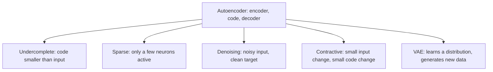

**In one line:** <mark>an autoencoder compresses its input into a small code and rebuilds the input from it (goal: Input ≈ Output)</mark>, and its types differ only in the **extra rule** that forces it to learn useful features instead of copying. <Cite id="class-dl-chp3" loc="slide 2" /> <Cite id="class-dl-chp3" loc="slide 8" />

<Box kind="key">

**Key points to write (any autoencoder-types question):**

- <mark>Autoencoder = encoder + bottleneck (code) + decoder; trained to reconstruct its own input, no labels needed.</mark>
- <mark>Undercomplete: code smaller than input (Code Size < Input Size).</mark>
- <mark>Sparse: only a few hidden neurons are active; Total Loss = Reconstruction Loss + Sparsity Penalty (L1 or KL divergence).</mark>
- <mark>Denoising: noisy input, clean target; Input (noisy) ≠ Target (clean).</mark>
- <mark>Contractive: a small input change gives a small change in the code; Total Loss = Reconstruction Loss + Contractive Penalty.</mark>
- <mark>VAE: learns a distribution (μ, σ²), samples z, can generate new data; Loss = Reconstruction Loss + KL divergence.</mark>
- L1 and L2 are regularization **techniques**; sparse, denoising, contractive and VAE are autoencoder **types**.

</Box>

## Core answer (5 marks, fits every question here)

<Box kind="definition">

An **autoencoder** is an unsupervised neural network that learns to compress the input into a smaller representation (encoding) and then reconstruct the original input from it. **Goal: Input ≈ Output.** <Cite id="class-dl-chp3" loc="slide 2" />

</Box>

**Working:** (1) the input is given, (2) the encoder compresses it, (3) the bottleneck stores the important information, (4) the decoder reconstructs the input, (5) the output is compared with the input and the loss is calculated (MSE or L1), (6) backpropagation updates the weights, (7) repeat until the output is similar to the input. <Cite id="class-dl-chp3" loc="slides 2 and 3" />

| Type | Rule that stops copying | Loss |
|---|---|---|
| Undercomplete | Code smaller than input | Reconstruction |
| Sparse | Few active neurons | Reconstruction + sparsity penalty |
| Denoising | Clean target for a noisy input | Reconstruction against clean input |
| Contractive | Code must change little | Reconstruction + contractive penalty |
| VAE | Code is a distribution | Reconstruction + KL divergence |

<Cite id="class-dl-chp3" loc="slide 8" />

**Conclusion:** the types differ only in the extra constraint that forces the autoencoder to learn rather than copy. <Cite id="web-dl-1-wiki-ae" />

## Extended answer (10 marks): add these

### 1. Undercomplete autoencoder

The hidden layer (bottleneck) has fewer neurons than the input (for example 784 to 64 to 784), so the network must compress the data and keep only important features. **Disadvantage:** a too-small bottleneck loses information. <Cite id="class-dl-chp3" loc="slides 13 and 14" /> <Cite id="web-dl-1-gb-ae" loc="§14.1" />

### 2. Sparse autoencoder

Only a small number of hidden neurons are active at a time (for example 5 to 10 of 100); the rest stay inactive. **Total Loss = Reconstruction Loss + Sparsity Penalty**, with L1 on the activations or KL divergence limiting the average activation. It suits an **overcomplete** hidden layer, which could otherwise memorize the input. **Disadvantage:** too much sparsity loses important information. <Cite id="class-dl-chp3" loc="slides 19 and 20" /> <Cite id="class-dl-m3" loc="pp. 17 and 19" /> <Cite id="web-dl-1-ng-sparse" />

**Effectiveness against overfitting:** it limits the capacity to memorize **without limiting the ability to extract features**, so the code size and the regularization can be chosen separately. It needs a sparsity penalty, a sparsity level that is chosen with care, and a more complex training. <Cite id="class-dl-m3" loc="p. 19" />

### 3. Denoising autoencoder

It receives a **noisy input** but is trained to rebuild the **clean original** (Noisy Input → Autoencoder → Clean Output). The loss (MSE or MAE) is calculated against the clean target. Noise types: Gaussian, salt-and-pepper, masking, speckle. It removes noise and learns robust features. <Cite id="class-dl-chp3" loc="slides 23 and 24" /> <Cite id="web-dl-1-paper-dae" />

### 4. Contractive autoencoder

A small change in the input gives only a small change in the code. **Total Loss = Reconstruction Loss + Contractive Penalty**, with penalty $\lambda \left\lVert \dfrac{\partial h}{\partial x} \right\rVert_F^2$ on the slope of the code $h$ with respect to the input $x$. It gives stable, robust features. <Cite id="class-dl-chp3" loc="slides 21 and 22" /> <Cite id="web-dl-1-paper-cae" />

### 5. Variational autoencoder (VAE)

The encoder gives a **mean $\mu$** and **variance $\sigma^2$** instead of one fixed code; a point is sampled, $z = \mu + \sigma\varepsilon$, and the decoder rebuilds from it. **Total VAE Loss = Reconstruction Loss + KL Divergence Loss**; the KL term keeps the latent space close to $N(0, 1)$, smooth and good for sampling. It **can generate new data**. <Cite id="class-dl-chp3" loc="slides 27 and 28" /> <Cite id="web-dl-1-paper-vae" />

### 6. Compare sparse, denoising and contractive

| | Sparse | Denoising | Contractive |
|---|---|---|---|
| Idea | Few neurons active | Noisy input, clean target | Small input change, small code change |
| What is added | Sparsity penalty | Noise on the input | Contractive penalty |
| Acts on | The activations | The data | The encoder's sensitivity |
| Main benefit | No memorization; works with overcomplete | Robust features, clean output | Stable, robust features |
| Drawback | Too much sparsity loses information | Needs suitable noise | Extra penalty, choosing $\lambda$ |

All three add regularization on top of the reconstruction loss. The textbook: denoising makes the decoder resist small but finite changes of the input, contractive makes the encoder resist infinitely small changes. <Cite id="class-dl-chp3" loc="slide 31" /> <Cite id="class-dl-m3" loc="p. 22" />

**Applications:** compression, denoising, dimensionality reduction, feature extraction, anomaly detection, generation (VAE). **Disadvantages:** output is not always identical, some information may be lost, the bottleneck size must be chosen well. <Cite id="class-dl-chp3" loc="slides 3 and 34" />

## Fit it to each question

- **"Explain any three types of Autoencoders."** (10 marks) <PYQ id="2024-05/q5b" /> <PYQ id="2024-12/q5b" />: one line on the autoencoder with the training picture, then **any three** of sections 1 to 4 (undercomplete, sparse, denoising are the safest), each with definition, loss, picture and drawback, and the types table.
- **"Explain the working of auto encoders. Also discuss type of auto encoders in detail."** (10 marks) <PYQ id="2025-05/q2b" />: the working steps and training picture (core answer), then the types table and sections 1 to 5, ending with advantages and applications.
- **"Compare and analyze the working of Sparse, Denoising, and Contractive Autoencoders."** (10 marks) <PYQ id="assignment-1/q3d" />: sections 2, 3 and 4 in two lines each, then the **comparison table of section 6**, the "same and different" paragraph and the reg-types picture.
- **"Evaluate the effectiveness of Sparse Autoencoders in preventing overfitting in deep learning models."** (10 marks) <PYQ id="assignment-1/q3c" />: the overfitting problem of an overcomplete autoencoder, how sparse works (section 2), then the **effectiveness paragraph**: strengths (no memorization, meaningful features) and limits (too much sparsity, extra tuning).

## Exam tips

- **Always draw** encoder, bottleneck and decoder, and write the **loss** of every type you explain.
- Do not say "L1 is a type of autoencoder"; L1 is a technique used inside the sparse autoencoder.
- For "evaluate", give both **strengths and limits**, and end with a verdict.
