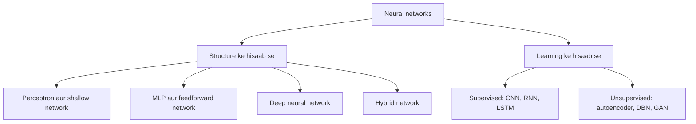
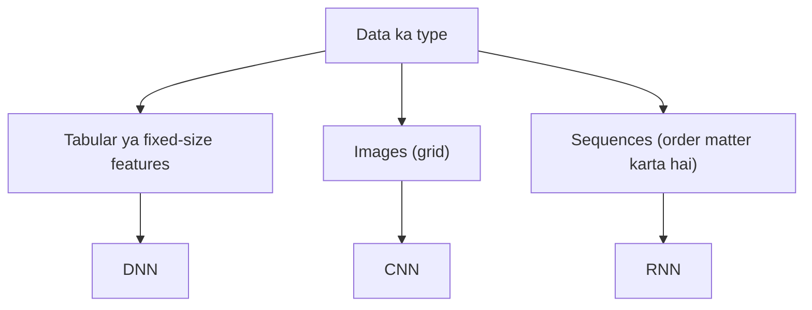

**Ek line mein:** neural networks ko **structure** (kitni layers) aur **kaise seekhte hain** ke hisaab se classify karte hain, aur <mark>network ka type data ke type ke hisaab se chuna jaata hai</mark>: tabular data ke liye DNN, images ke liye CNN, sequences ke liye RNN. <Cite id="class-dl-chp1" loc="slide 25" />

<Box kind="key">

**Har "types" ya "CNN vs RNN vs DNN" question mein ye points likho:**

- <mark>Perceptron sabse simple neural network hai, binary classification ke liye</mark>; shallow network (sirf input + output) XOR solve nahi kar sakta.
- <mark>MLP = input layer + ek ya zyada hidden layers + output layer</mark>, fully connected, non-linear problems solve karta hai.
- <mark>DNN = ek input layer, do ya zyada hidden layers aur ek output layer.</mark>
- <mark>Hybrid network alag-alag types ke neural networks ko combine karta hai.</mark>
- **Learning ke hisaab se:** supervised (CNN, RNN, LSTM), unsupervised (autoencoder, DBN, GAN).
- <mark>CNN: images (grid data). RNN: sequence data, hidden state ke saath. DNN: tabular data.</mark>

</Box>

## Core answer (5 marks, yahan ke har question ke liye)

<Box kind="definition">

A **perceptron** is the simplest neural network used for binary classification. A **Deep Neural Network (DNN)** has one input layer, two or more hidden layers and one output layer. A **hybrid network** combines different types of neural networks. <Cite id="class-dl-chp1" loc="slide 13" /> <Cite id="class-dl-chp2" loc="slide 2" /> <Cite id="class-dl-chp1" loc="slide 16" />

</Box>

**Itne types kyun:** ek network har problem ke liye fit nahi hota. Shallow network sirf linear problems solve karta hai, isliye hidden layers add karte hain; images aur sequences ke liye special structure chahiye. <Cite id="class-dl-chp1" loc="slide 16" />

1. **Perceptron / shallow network:** sirf input aur output layer; sirf linear problems, XOR nahi. <Cite id="class-dl-chp1" loc="slide 16" />
2. **MLP / feedforward network:** fully connected layers, information sirf aage jaati hai; non-linear problems solve karta hai. <Cite id="class-dl-m1" loc="p. 17" />
3. **DNN:** pehli hidden layer simple features seekhti hai, deeper layers complex features. <Cite id="class-dl-chp2" loc="slide 2" />
4. **Hybrid:** ek network ki limits door karta hai.
5. **CNN, RNN, LSTM** (supervised) aur **autoencoder, DBN, GAN** (unsupervised). <Cite id="class-dl-chp1" loc="slide 25" />

**Conclusion:** structure aur learning method decide karte hain ki kaunsa network use hoga. <Cite id="web-dl-1-wiki-types-ann" />

## Extended answer (10 marks): ye add karo

### 1. Structure types ki pictures

### 2. CNN vs RNN vs DNN

| Aspect | DNN | CNN | RNN |
|---|---|---|---|
| Data handled | Tabular data, fixed-size inputs <Cite id="class-dl-chp4" loc="slide 67" /> | Images aur grid-like data <Cite id="class-dl-chp4" loc="slide 5" /> | Sequences: text, speech, time series <Cite id="class-dl-chp5" loc="slide 5" /> |
| Structure | Input, do ya zyada hidden layers, output; har neuron agli layer se judta hai <Cite id="class-dl-chp2" loc="slide 2" /> | Convolution + pooling layers, phir flatten aur fully connected layers <Cite id="class-dl-chp4" loc="slide 28" /> | Ek cell, hidden state wapas feed hoti hai; har step pe same weights <Cite id="class-dl-m5" loc="p. 12" /> |
| Memory | Nahi | Nahi | Pichhle inputs yaad rakhta hai |
| Parameters | Images ke liye bahut zyada | Kam (weight sharing) | Kam (time mein shared) |
| Training | Backpropagation | Backpropagation | Backpropagation through time |
| Main problem | Spatial structure kho deta hai | Image-like data chahiye | Vanishing ya exploding gradients |
| Applications | Tabular data se prediction | Image classification, face recognition, object detection | Speech recognition, translation, next-word prediction <Cite id="class-dl-chp5" loc="slide 13" /> |

### 3. Feedforward vs recurrent (base farq)

Feedforward network data ek hi direction mein bhejta hai; feedback connections jodne par wo recurrent network ban jaata hai. <Cite id="class-dl-m1" loc="p. 10" />

## Har question mein kaise fit karein

- **"Explain types of neural network."** (5 marks) <PYQ id="2025-05/q1c" />: **core answer** likho: upar ke order mein paanch types, learning wala diagram aur ek line ka conclusion.
- **"Compare CNN, RNN, and DNN architectures in terms of data types handled, structure, and applications."** (10 marks) <PYQ id="2026-05/q5b" />: har network pe ek line, phir section 2 ka **comparison table** (data, structure, applications ki teen rows), aur "which data" diagram banao.

## Exam tips

- **Hamesha draw karo:** "types" ke liye structure / learning wala tree, "compare" ke liye table.
- Teacher ke words use karo: perceptron = binary classification, DNN = do ya zyada hidden layers.
- Comparison mein **data type** wali row mat bhoolo; question pehle wahi puchta hai.

Exam mein English mein likho.
