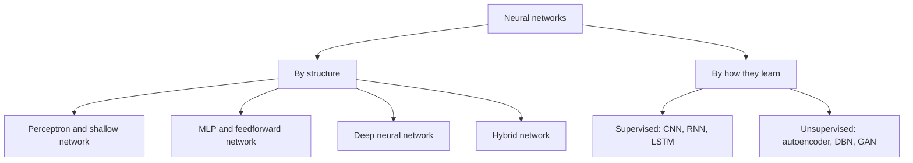
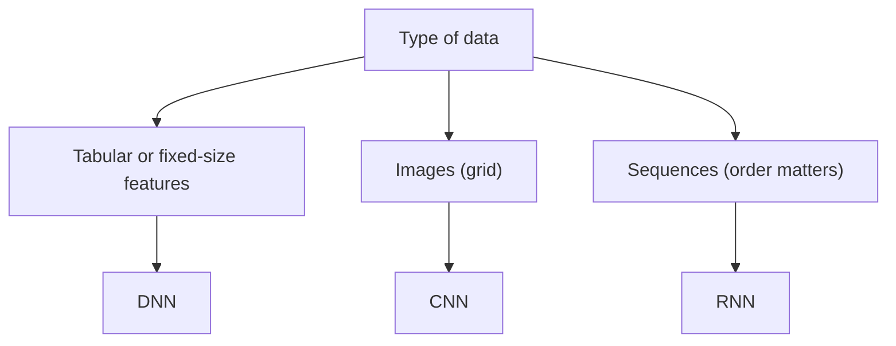

**In one line:** neural networks are classified **by structure** (how many layers) and **by how they learn**, and <mark>the type of network is chosen to match the type of data</mark>: DNN for tabular data, CNN for images, RNN for sequences. <Cite id="class-dl-chp1" loc="slide 25" />

<Box kind="key">

**Key points to write (any "types" or "CNN vs RNN vs DNN" question):**

- <mark>Perceptron is the simplest neural network, used for binary classification</mark>; a shallow network (input + output only) cannot solve XOR.
- <mark>MLP = input layer + one or more hidden layers + output layer</mark>, fully connected, solves non-linear problems.
- <mark>DNN = one input layer, two or more hidden layers and one output layer.</mark>
- <mark>Hybrid network combines different types of neural networks.</mark>
- **By learning:** supervised (CNN, RNN, LSTM), unsupervised (autoencoder, DBN, GAN).
- <mark>CNN: images (grid data). RNN: sequence data, with a hidden state. DNN: tabular data.</mark>

</Box>

## Core answer (5 marks, fits every question here)

<Box kind="definition">

A **perceptron** is the simplest neural network used for binary classification. A **Deep Neural Network (DNN)** has one input layer, two or more hidden layers and one output layer. A **hybrid network** combines different types of neural networks. <Cite id="class-dl-chp1" loc="slide 13" /> <Cite id="class-dl-chp2" loc="slide 2" /> <Cite id="class-dl-chp1" loc="slide 16" />

</Box>

**Why many types:** one network cannot suit every problem. A shallow network solves only linear problems, so we add hidden layers; images and sequences need special structures. <Cite id="class-dl-chp1" loc="slide 16" />

1. **Perceptron / shallow network:** input and output layer only; solves only linear problems, cannot solve XOR. <Cite id="class-dl-chp1" loc="slide 16" />
2. **MLP / feedforward network:** fully connected layers, information flows only forward; solves non-linear problems. <Cite id="class-dl-m1" loc="p. 17" />
3. **DNN:** learns simple features in the first hidden layer and complex ones in the deeper layers. <Cite id="class-dl-chp2" loc="slide 2" />
4. **Hybrid:** removes the limits of a single network.
5. **CNN, RNN, LSTM** (supervised) and **autoencoder, DBN, GAN** (unsupervised). <Cite id="class-dl-chp1" loc="slide 25" />

**Conclusion:** the structure and the learning method decide which type of network is used. <Cite id="web-dl-1-wiki-types-ann" />

## Extended answer (10 marks): add these

### 1. Pictures of the structure types

### 2. CNN vs RNN vs DNN

| Aspect | DNN | CNN | RNN |
|---|---|---|---|
| Data handled | Tabular data, fixed-size inputs <Cite id="class-dl-chp4" loc="slide 67" /> | Images and grid-like data <Cite id="class-dl-chp4" loc="slide 5" /> | Sequences: text, speech, time series <Cite id="class-dl-chp5" loc="slide 5" /> |
| Structure | Input, two or more hidden layers, output; every neuron connects to the next layer <Cite id="class-dl-chp2" loc="slide 2" /> | Convolution + pooling layers, then flatten and fully connected layers <Cite id="class-dl-chp4" loc="slide 28" /> | One cell with a hidden state fed back; same weights at every step <Cite id="class-dl-m5" loc="p. 12" /> |
| Memory | None | None | Remembers earlier inputs |
| Parameters | Very many for images | Few (weight sharing) | Few (shared across time) |
| Training | Backpropagation | Backpropagation | Backpropagation through time |
| Main problem | Loses spatial structure | Needs image-like data | Vanishing or exploding gradients |
| Applications | Prediction from tabular data | Image classification, face recognition, object detection | Speech recognition, translation, next-word prediction <Cite id="class-dl-chp5" loc="slide 13" /> |

### 3. Feedforward vs recurrent (the base difference)

A feedforward network sends data one way; when feedback connections are added it becomes a recurrent network. <Cite id="class-dl-m1" loc="p. 10" />

## Fit it to each question

- **"Explain types of neural network."** (5 marks) <PYQ id="2025-05/q1c" />: write the **core answer**: five types in the order above, the learning-based diagram and a one-line conclusion.
- **"Compare CNN, RNN, and DNN architectures in terms of data types handled, structure, and applications."** (10 marks) <PYQ id="2026-05/q5b" />: one line on each network, then the **comparison table** in section 2 with the three rows asked (data, structure, applications), and draw the "which data" diagram.

## Exam tips

- **Always draw:** the by-structure / by-learning tree for "types", and a table for "compare".
- Use the teacher's words: perceptron = binary classification, DNN = two or more hidden layers.
- For the comparison, never forget the **data type** row; it is what the question asks first.
