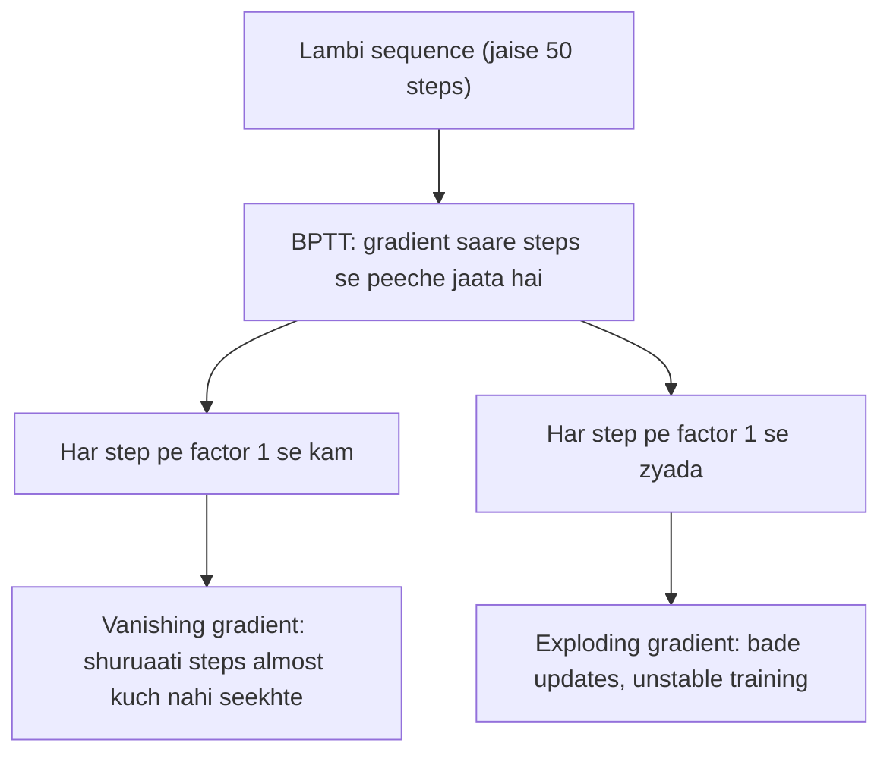
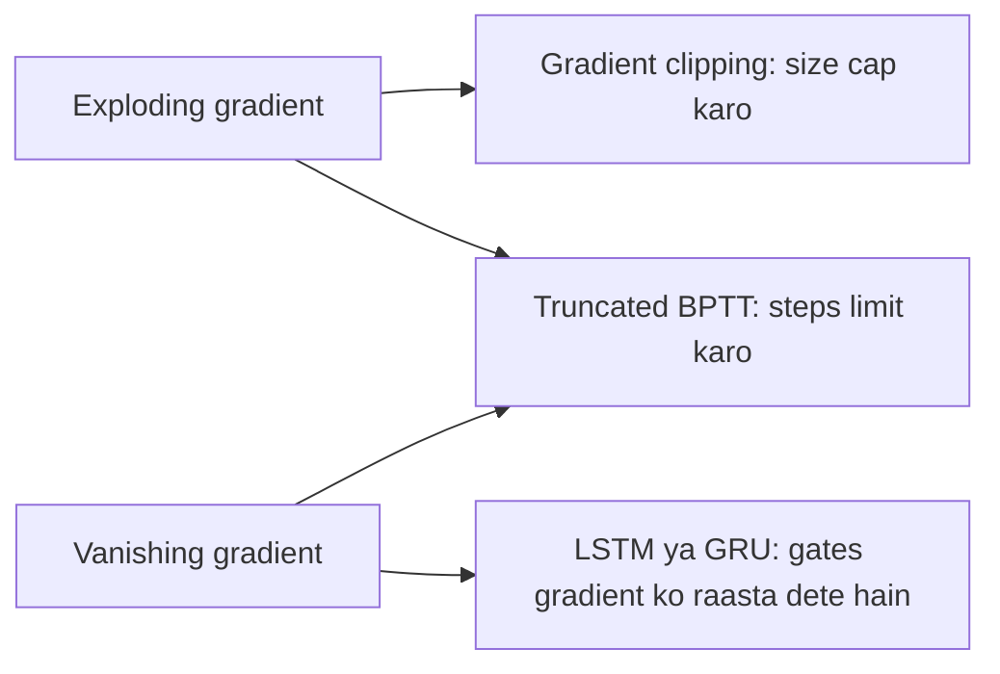

**Ek line mein:** RNN mein gradient time steps se peeche jaate hue baar baar multiply hota hai; <mark>agar wo bahut chhota ho jaye to vanishing gradient, aur bahut bada ho jaye to exploding gradient</mark>. <Cite id="class-dl-chp5" loc="slide 11" />

<Box kind="key">

**Vanishing aur exploding gradient ke har question mein ye points likho:**

- <mark>Reason: BPTT gradient ko kai time steps se bhejta hai, aur har step pe wo multiply hota hai</mark>.
- <mark>Vanishing gradient: gradient bahut chhota (1, 0.1, 0.01, 0.001 ...); shuruaati steps almost kuch nahi seekhte, isliye long-term dependencies seekhna mushkil</mark>.
- <mark>Exploding gradient: gradient bahut bada (1, 10, 100, 1000 ...); weights ke bade updates, unstable training</mark>.
- <mark>Exploding ka fix: gradients clip (truncate) karo</mark>; truncated BPTT bhi.
- <mark>Vanishing ka fix: LSTM ya GRU gates</mark>.
- Dono vanilla RNN ko lambi sequences pe weak banate hain.

</Box>

## Core answer (5 marks, yahan ke har question ke liye)

<Box kind="definition">

**Vanishing gradient:** the gradient values become too small, so the model stops learning or takes far too long. **Exploding gradient:** the gradient becomes extremely large, giving very large weight updates and unstable training. Both occur in an RNN because it is trained with backpropagation through time (BPTT), where the gradient travels through many time steps. <Cite id="class-dl-chp5" loc="slides 10 and 11" />

</Box>

| | Vanishing gradient | Exploding gradient |
|---|---|---|
| Gradient | Bahut chhota (1, 0.1, 0.01, 0.001, 0.0001) | Bahut bada (1, 10, 100, 1000, 10000) |
| Result | Early steps almost kuch nahi seekhte; long-term dependencies mushkil | Weights ke bade updates; unstable training |
| Fix | LSTM ya GRU | Gradient clipping, truncated BPTT |

<Cite id="class-dl-chp5" loc="slide 11" /> <Cite id="class-dl-m5" loc="p. 14" />

**Conclusion:** vanishing = bahut chhota, exploding = bahut bada; dono kai time steps pe multiply hone se aate hain. <Cite id="web-dl-2-pascanu-gradients" />

## Extended answer (10 marks): ye add karo

### 1. Ye kyun hota hai

Early step ka loss gradient har step ke ek factor ka product hota hai, kyunki har step pe wahi weight $W$ use hota hai. 1 se chhota factor product ko ghatata hai; 1 se bada badhata hai. <Cite id="web-dl-2-pascanu-gradients" /> <Cite id="web-dl-2-d2l-bptt" />

<Sum>

<Given>

Gradient 50 time steps se peeche jaata hai, har baar same factor $a$ se multiply hota hai.

</Given>

<Find>

$a = 0.5$ aur $a = 1.5$ ke liye 50 steps ke baad gradient ka size.

</Find>

<Steps>

1. **Rule:** 50 steps baad gradient $a^{50}$ se multiply ho chuka hota hai.
2. **$a = 0.5$:** $0.5^{50} \approx 8.9 \times 10^{-16}$, lagbhag zero. Ye vanishing gradient hai.
3. **$a = 1.5$:** $1.5^{50} \approx 6.4 \times 10^{8}$, karodon guna bada. Ye exploding gradient hai.

</Steps>

<Answer>

$\approx 10^{-15}$ (vanish) aur $\approx 6 \times 10^{8}$ (explode).

</Answer>

</Sum>

### 2. Effects

- **Vanishing:** RNN "I was born in India" ko kai words baad "I speak Hindi" se jod nahi pata. <Cite id="class-dl-chp5" loc="slide 11" />

- **Exploding:** weights bahut bade ho jaate hain, loss unstable ya invalid ho jaata hai.

### 3. Remedies

Exploding gradients clipping ya truncating se aasani se fix ho jaate hain. Vanishing gradients mushkil the; **LSTM** (aur GRU) ne gates se problem solve ki. <Cite id="class-dl-m5" loc="p. 14" /> <Cite id="class-dl-chp5" loc="slide 22" /> Pascanu et al. ne is analysis ke saath clipping propose ki. <Cite id="web-dl-2-pascanu-gradients" /> Textbook mein bhi yahi long-term dependency problem discuss hui hai. <Cite id="web-dl-2-goodfellow-rnn" />

## Har question mein kaise fit karein

- **"Explain vanishing and exploding gradient in RNNs."** (10 marks) <PYQ id="2023-12/q6b" />: core answer (definitions, diagram, table), phir section 1 (kyun, 50-step example ke saath), section 2 (effects) aur section 3 (remedies).

## Exam tips

- **Draw karo:** cause diagram (lambi sequence, BPTT, factor 1 se kam ya zyada) aur do-column table.
- **Keywords:** BPTT, har step pe multiply, long-term dependency, gradient clipping, truncated BPTT, LSTM.
- Common galti: ye likhna bhool jaana ki vanishing gradient LSTM ya GRU se aur exploding gradient clipping se solve hota hai.

Exam mein English mein likho.
