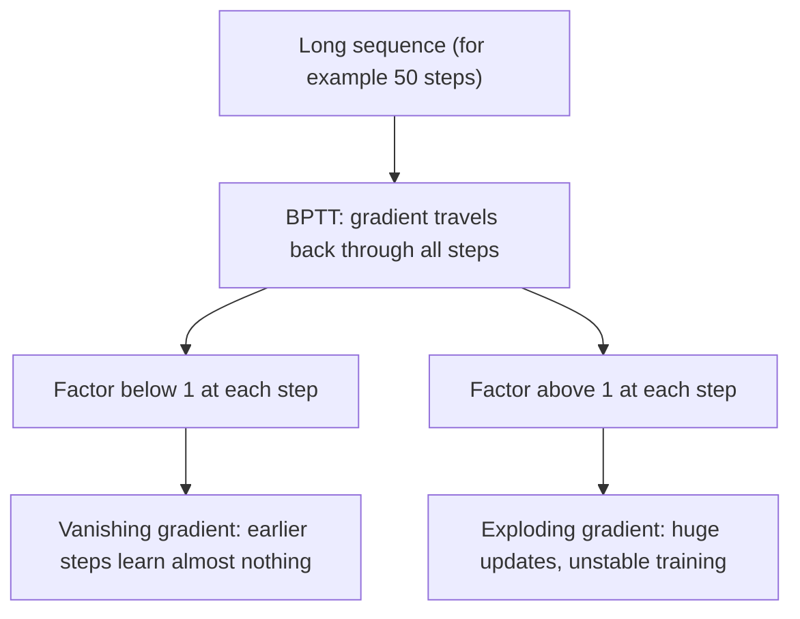
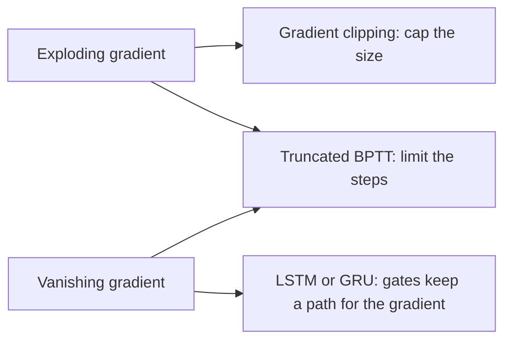

**In one line:** in an RNN the gradient is multiplied again and again while it travels back through the time steps; <mark>if it becomes very small it is the vanishing gradient, if it becomes very large it is the exploding gradient</mark>. <Cite id="class-dl-chp5" loc="slide 11" />

<Box kind="key">

**Key points to write (vanishing and exploding gradient):**

- <mark>Cause: BPTT sends the gradient through many time steps, and it is multiplied at every step</mark>.
- <mark>Vanishing gradient: gradient becomes too small (1, 0.1, 0.01, 0.001 ...); earlier steps learn almost nothing, so long-term dependencies are hard to learn</mark>.
- <mark>Exploding gradient: gradient becomes very large (1, 10, 100, 1000 ...); huge weight updates, unstable training</mark>.
- <mark>Fix for exploding: clip (truncate) the gradients</mark>; also truncated BPTT.
- <mark>Fix for vanishing: LSTM or GRU gates</mark>.
- Both make a vanilla RNN weak on long sequences.

</Box>

## Core answer (5 marks, fits every question here)

<Box kind="definition">

**Vanishing gradient:** the gradient values become too small, so the model stops learning or takes far too long. **Exploding gradient:** the gradient becomes extremely large, giving very large weight updates and unstable training. Both occur in an RNN because it is trained with backpropagation through time (BPTT), where the gradient travels through many time steps. <Cite id="class-dl-chp5" loc="slides 10 and 11" />

</Box>

| | Vanishing gradient | Exploding gradient |
|---|---|---|
| Gradient | Very small (1, 0.1, 0.01, 0.001, 0.0001) | Very large (1, 10, 100, 1000, 10000) |
| Result | Early steps learn almost nothing; long-term dependencies are hard | Huge weight updates; unstable training |
| Fix | LSTM or GRU | Gradient clipping, truncated BPTT |

<Cite id="class-dl-chp5" loc="slide 11" /> <Cite id="class-dl-m5" loc="p. 14" />

**Conclusion:** vanishing = too small, exploding = too large; both come from multiplying across many time steps. <Cite id="web-dl-2-pascanu-gradients" />

## Extended answer (10 marks): add these

### 1. Why it happens

The loss gradient at an early step is a product of one factor per step, because the same weight $W$ is used at every step. A factor below 1 shrinks the product; a factor above 1 grows it. <Cite id="web-dl-2-pascanu-gradients" /> <Cite id="web-dl-2-d2l-bptt" />

<Sum>

<Given>

A gradient passes back through 50 time steps, each time multiplied by the same factor $a$.

</Given>

<Find>

the size of the gradient after 50 steps for $a = 0.5$ and $a = 1.5$.

</Find>

<Steps>

1. **Rule:** after 50 steps the gradient is multiplied by $a^{50}$.
2. **$a = 0.5$:** $0.5^{50} \approx 8.9 \times 10^{-16}$, almost zero. This is the vanishing gradient.
3. **$a = 1.5$:** $1.5^{50} \approx 6.4 \times 10^{8}$, hundreds of millions of times larger. This is the exploding gradient.

</Steps>

<Answer>

$\approx 10^{-15}$ (vanishes) and $\approx 6 \times 10^{8}$ (explodes).

</Answer>

</Sum>

### 2. Effects

- **Vanishing:** the RNN cannot link "I was born in India" with "I speak Hindi" many words later. <Cite id="class-dl-chp5" loc="slide 11" />

- **Exploding:** weights jump to huge values, the loss becomes unstable or invalid.

### 3. Remedies

Exploding gradients are easy to fix by clipping or truncating. Vanishing gradients were harder; the **LSTM** (and GRU) solved the problem with gates. <Cite id="class-dl-m5" loc="p. 14" /> <Cite id="class-dl-chp5" loc="slide 22" /> Clipping was proposed with this analysis by Pascanu et al. <Cite id="web-dl-2-pascanu-gradients" /> The textbook discusses the same long-term dependency problem. <Cite id="web-dl-2-goodfellow-rnn" />

## Fit it to each question

- **"Explain vanishing and exploding gradient in RNNs."** (10 marks) <PYQ id="2023-12/q6b" />: core answer (definitions, diagram, table), then section 1 (why, with the 50-step example), section 2 (effects) and section 3 (remedies).

## Exam tips

- **Draw** the cause diagram (long sequence, BPTT, factor below or above 1) and the two-column table.
- **Keywords:** BPTT, multiplied at every step, long-term dependency, gradient clipping, truncated BPTT, LSTM.
- Common mistake: forgetting to say that vanishing gradient is solved by LSTM or GRU and exploding gradient by clipping.
