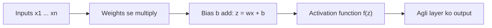
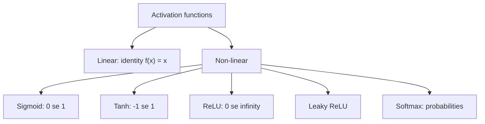
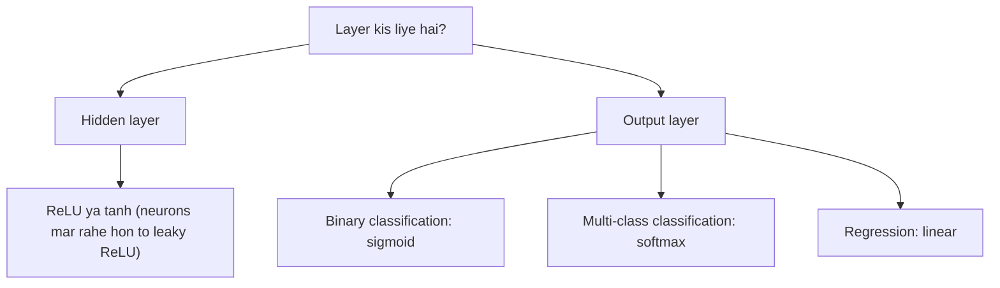

Ye syllabus <Syl m="2" /> hai, "activation functions: tanh, logistic, linear, softmax, ReLU, leaky ReLU".

## Activation function kya hai

<Box kind="definition">

An **activation function** is a mathematical function used in a neural network to decide whether a neuron should be activated (pass information) or not. It takes the output from a neuron and converts it into a new value, which is then passed to the next layer. <Cite id="class-dl-chp2" loc="slide 9" />

**Simple definition:** an activation function decides the output of a neuron and helps the neural network learn complex patterns. <Cite id="class-dl-chp2" loc="slide 9" />

</Box>

Har activation function (ya non-linearity) ek single number leta hai aur us par ek fixed mathematical operation karta hai. Ye model mein non-linearity laata hai, jisse network data ke complex patterns seekh aur represent kar sake. Ye inputs ka weighted sum nikaal kar aur bias jod kar decide karta hai ki neuron activate ho ya nahi. <Cite id="class-dl-m2" loc="p. 3" />

Neuron pehle $z = wx + b$ nikaalta hai, phir activation function $f(z)$ us result ko process karta hai, aur processed value agli layer ko bheji jaati hai. <Cite id="class-dl-chp2" loc="slide 9" />

## Iski zaroorat kyun hai?

- Activation function ke bina neural network simple linear model ki tarah behave karta hai. Ye image recognition, speech recognition ya object classification jaise complex relationships nahi seekh sakta. <Cite id="class-dl-chp2" loc="slide 9" />
- Iske saath network complex (non-linear) patterns seekh sakta hai, har neuron ka output decide kar sakta hai, prediction accuracy badha sakta hai aur real-world problems solve kar sakta hai.
- Ye **non-linearity laata hai**, **complex patterns seekhne mein help karta hai**, **backpropagation ke dauran help karta hai** (gradients flow karte hain taaki learning ho sake) aur **output range decide karta hai**. <Cite id="class-dl-chp2" loc="slide 25" />
- Alag problems ko alag outputs chahiye, isliye alag tasks ke liye alag activation functions use hote hain. <Cite id="class-dl-chp2" loc="slide 9" />

## Activation functions ke types

Activation functions ko do types mein baanta ja sakta hai: **linear** aur **non-linear** activation functions. <Cite id="class-dl-m2" loc="p. 3" />

- **Linear (identity)** function $f(x) = x$ ki range $(-\infty, \infty)$ hai. Ye neural networks ko diye gaye usual data ki complexity ya parameters mein help nahi karta. <Cite id="class-dl-m2" loc="p. 4" />
- **Non-linear** functions model ko alag-alag data ke saath generalize ya adapt hona aasan banaate hain. Do terms chahiye: **derivative** (x ke change ke saath y ka change, ise slope bhi kehte hain) aur **monotonic function** (wo function jo poori tarah non-increasing ya non-decreasing ho). <Cite id="class-dl-m2" loc="p. 4" />
- Notes ke purane functions: **binary step** function (threshold $\theta$ ke hisaab se output 0 ya 1, single-layer nets mein), **bipolar step** function (output +1 ya −1) aur **ramp** function. <Cite id="class-dl-m2" loc="p. 5" />

## 1. Sigmoid (logistic) activation function

<Box kind="definition">

The **sigmoid activation function** converts any input value into a value between 0 and 1. The output represents a probability, which makes it suitable for binary (yes or no) classification problems. $\sigma(x) = \dfrac{1}{1 + e^{-x}}$ <Cite id="class-dl-chp2" loc="slide 11" />

</Box>

- Curve **S-shaped** hai. Bahut bada negative input 0 ke paas output deta hai, input 0 par 0.5, aur bahut bada positive input 1 ke paas. Output range: **0 se 1**. <Cite id="class-dl-chp2" loc="slide 11" />
- Ye 0 aur 1 ke beech rehta hai, isliye un models mein khaas use hota hai jahan probability predict karni ho. Function differentiable aur monotonic hai, lekin iska derivative monotonic nahi. Derivative: $f'(x) = f(x)(1 - f(x))$. <Cite id="class-dl-m2" loc="p. 8" /> <Cite id="class-dl-m1" loc="p. 20" />
- **Kahan use hota hai:** binary classification ki output layer mein: apple ya not apple, spam ya not spam, pass ya fail, disease ya no disease, fraud ya not fraud. Output 0.95 ho to fruit 95% probability se apple hai; 0.15 ho to apple nahi. <Cite id="class-dl-chp2" loc="slide 11" />
- **Advantages:** probability values deta hai, samajhna aasan, smooth aur continuous curve. **Disadvantages:** deep networks mein vanishing gradient problem ho sakti hai, deep networks mein training slow ho jaati hai, aur modern deep networks ki hidden layers mein aam taur par use nahi hota. <Cite id="class-dl-chp2" loc="slide 11" />

## 2. Tanh (hyperbolic tangent) activation function

<Box kind="definition">

The **tanh** activation function converts any input into a value between −1 and +1. Unlike sigmoid, tanh can produce negative, zero and positive values, which helps the network learn better. $\tanh(x) = \dfrac{e^x - e^{-x}}{e^x + e^{-x}}$ <Cite id="class-dl-chp2" loc="slide 13" />

</Box>

- tanh bhi S-shaped (sigmoidal) hai aur (0, 0) se guzarta hai. Bahut bada negative input −1 ke paas, input 0 par 0, bahut bada positive input +1 ke paas. Range **−1 se +1**. <Cite id="class-dl-chp2" loc="slide 13" />
- Negative inputs strongly negative map hote hain aur zero inputs zero ke paas. Function differentiable aur monotonic hai, jabki iska derivative monotonic nahi. Derivative: $f'(x) = 1 - f(x)^2$. <Cite id="class-dl-m2" loc="p. 9" /> <Cite id="class-dl-m1" loc="p. 20" />
- **Kahan use hota hai:** mainly hidden layers mein, jab network ko positive aur negative dono relationships seekhne hon (image recognition, speech recognition, handwritten digits, NLP, time-series prediction). Iska output zero-centered hai, jisse learning tez hoti hai. <Cite id="class-dl-chp2" loc="slide 13" />
- **Disadvantages:** vanishing gradient problem ho sakti hai, bahut deep networks mein slow hai aur aaj ReLU se kam use hota hai.

## 3. ReLU (rectified linear unit)

<Box kind="definition">

**ReLU** is an activation function that returns the input value if it is positive, otherwise it returns 0. ReLU keeps positive values unchanged and converts all negative values to 0. $\text{ReLU}(x) = \max(0, x)$ <Cite id="class-dl-chp2" loc="slide 15" />

</Box>

- $x > 0$ ho to output $x$; $x \le 0$ ho to output 0. Range: **[0, ∞)**. Function aur uska derivative dono monotonic hain. <Cite id="class-dl-chp2" loc="slide 15" /> <Cite id="class-dl-m2" loc="p. 10" />
- ReLU deep neural networks ki hidden layers mein sabse zyada use hone wala activation function hai kyunki ye simple hai aur models ko tez train karta hai. Ye compute mein fast, implement karna easy, complex patterns seekhne mein able aur vanishing gradient se kam affected hai. <Cite id="class-dl-chp2" loc="slide 15" />
- **Kahan use hota hai:** DNNs aur CNNs ki hidden layers (image recognition, face recognition, speech recognition, object detection, medical image analysis).
- **Disadvantage:** negative inputs 0 ho jaate hain. Agar koi neuron hamesha negative inputs paaye to wo seekhna band kar sakta hai; ise **dying ReLU problem** kehte hain. Classification ki output layer ke liye bhi suitable nahi. <Cite id="class-dl-chp2" loc="slide 15" />

## 4. Leaky ReLU

<Box kind="definition">

**Leaky ReLU** is an improved version of the ReLU activation function. Unlike ReLU, which converts all negative values to 0, Leaky ReLU allows a small value for negative inputs instead of making them zero. $f(x) = \begin{cases} x & x > 0 \\ 0.01x & x \le 0 \end{cases}$ <Cite id="class-dl-chp2" loc="slide 17" />

</Box>

- Ye **dying ReLU problem** solve karne ki koshish hai. Chhota constant (aam taur par 0.01) leak kehlata hai. Constant 0.01 na ho to ise Randomized ReLU kehte hain. Range: **(−∞, ∞)**. Leaky aur Randomized ReLU dono functions aur unke derivatives monotonic hain. <Cite id="class-dl-m2" loc="p. 11" />
- Jis neuron ko hamesha negative input mile, wo bhi chhota non-zero output deta hai, isliye wo seekhta rehta hai.
- **Kahan use hota hai:** hidden layers mein, jab dying ReLU problem ka chance ho. **Advantages:** dying ReLU solve karta hai, fast aur efficient. **Disadvantages:** chhota negative slope chunna padta hai, ReLU se thoda complex, aur output layer mein aam taur par use nahi. <Cite id="class-dl-chp2" loc="slide 17" />

 0 ke liye f(x) = x aur x ≤ 0 ke liye 0.01x. Negative inputs ko chhota negative value milta hai, zero nahi." />

## 5. Softmax

<Box kind="definition">

**Softmax** is an activation function that converts the output of a neural network into probability values. The probabilities of all classes add up to 1 (100%). It is mainly used when there are more than two classes. $\text{Softmax}(z_i) = \dfrac{e^{z_i}}{\sum_{j=1}^{n} e^{z_j}}$ <Cite id="class-dl-chp2" loc="slide 19" />

</Box>

- Har probability 0 aur 1 ke beech hoti hai aur saari probabilities ka total 1 hota hai. Sabse high probability wali class prediction chuni jaati hai. Softmax function ek more generalized logistic activation function hai, jo multiclass classification mein use hota hai. <Cite id="class-dl-chp2" loc="slide 19" /> <Cite id="class-dl-m2" loc="p. 8" />
- Sum ka 1.0 hone wali is property ko **normalization** kehte hain; impossible event 0 se aur sure event 1 se dikhaya jaata hai. <Cite id="class-dl-m1" loc="p. 22" />
- **Kahan use hota hai:** multi-class classification ki output layer (fruit classification, handwritten digit recognition 0 se 9, animal, flower aur image classification). **Disadvantages:** binary classification ke liye suitable nahi, kai classes ek saath predict nahi kar sakta, simpler functions se zyada computation chahiye. <Cite id="class-dl-chp2" loc="slide 19" />

## 6. Linear (identity) activation function

Linear (identity) activation function input jaisi hi value return karta hai: $f(x) = x$, range $(-\infty, +\infty)$, origin se guzarti slope 1 wali seedhi line. Ye regression problems (fruit weight, house price, temperature, sales) ki output layer mein use hota hai. Disadvantages: complex non-linear relationships nahi seekh sakta, classification ke liye suitable nahi aur hidden layers mein kam hi use hota hai. <Cite id="class-dl-chp2" loc="slide 21" /> <Cite id="class-dl-m2" loc="p. 5" />

## Worked example: ek hi input par paanch functions

<Sum>

<Given>

ek neuron ka weighted sum pehle $z = -2$ aur phir $z = 2$. $e^{2} = 7.389$ aur $e^{-2} = 0.1353$ lo.

</Given>

<Find>

sigmoid, tanh, ReLU aur leaky ReLU (0.01) ke outputs.

</Find>

<Steps>

1. **Sigmoid:** $\sigma(-2) = 1/(1 + e^{2}) = 1/8.389 = 0.119$ aur $\sigma(2) = 1/(1 + e^{-2}) = 1/1.1353 = 0.881$.
2. **Tanh:** $\tanh(2) = (7.389 - 0.1353)/(7.389 + 0.1353) = 7.2537/7.5243 = 0.964$, aur symmetry se $\tanh(-2) = -0.964$.
3. **ReLU:** $\max(0, -2) = 0$ aur $\max(0, 2) = 2$.
4. **Leaky ReLU:** $0.01 \times (-2) = -0.02$ aur $z = 2$ ke liye output $2$.

</Steps>

<Answer>

| $z$ | Sigmoid | Tanh | ReLU | Leaky ReLU |
|---|---|---|---|---|
| −2 | 0.119 | −0.964 | 0 | −0.02 |
| 2 | 0.881 | 0.964 | 2 | 2 |

</Answer>

<Box kind="verify">

Sigmoid: $0.119 + 0.881 = 1$, jaisa $\sigma(-z) + \sigma(z)$ ke liye hona chahiye. Tanh odd function hai, isliye dono values barabar aur opposite sign ki hain. Sigmoid values teacher ki table se match karti hain (0.12 aur 0.88). <Cite id="class-dl-chp2" loc="slide 23" />

</Box>

</Sum>

## Kaun sa activation function use karein

| Function | Range | Best used in |
|---|---|---|
| Sigmoid | (0, 1) | Output layer (binary classification) |
| Tanh | (−1, 1) | Hidden layers |
| ReLU | [0, ∞) | Hidden layers (most common) |
| Leaky ReLU | (−∞, ∞) | Hidden layers (fixes dying ReLU) |
| Softmax | (0, 1), sum 1 | Output layer (multi-class classification) |
| Linear | (−∞, ∞) | Output layer (regression) |

<Cite id="class-dl-chp2" loc="slide 23" />

Hidden layers mein non-linear functions use karo taaki network complex patterns seekh sake. <Cite id="class-dl-chp2" loc="slide 53" />

## Ye kahan pucha gaya

| Agar question kahe | Kya likhna hai | Kab aaya |
|---|---|---|
| "What is an activation function? Describe any four activation functions." | Definition, phir sigmoid, tanh, ReLU, leaky ReLU formula, graph, range, use ke saath | <PYQ id="2023-12/q2b" /> |
| "What is the significance of activation functions in neural networks? Explain different types used in NN." | Significance (non-linearity, output control, backpropagation mein help), phir chhe types aur ek table | <PYQ id="2024-05/q6a" /> <PYQ id="2024-12/q6a" /> <PYQ id="2025-05/q6a" /> |

## Quick revision

- Activation function: decide karta hai ki neuron activate ho ya nahi; non-linearity laata hai. Iske bina network sirf linear model hai.
- Sigmoid $1/(1+e^{-x})$: S-curve, 0 se 1, probability, binary output layer. Derivative $f(1-f)$.
- Tanh: −1 se 1, zero-centered, hidden layers. Derivative $1 - f^2$.
- ReLU $\max(0, x)$: [0, ∞), hidden layers mein sabse common, dying ReLU problem.
- Leaky ReLU: negative input ke liye $0.01x$, dying ReLU fix karta hai.
- Softmax: probabilities jinka sum 1, multi-class output layer.
- Linear $f(x) = x$: regression output layer.

**Conclusion.** Activation functions neural networks ka dil hain: ye deep learning models ko powerful, flexible aur real-world problems solve karne layak banate hain, aur choice layer aur task par depend karti hai. <Cite id="class-dl-m2" loc="p. 13" />
