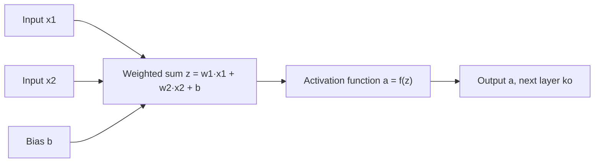
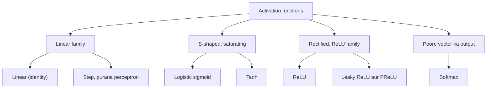
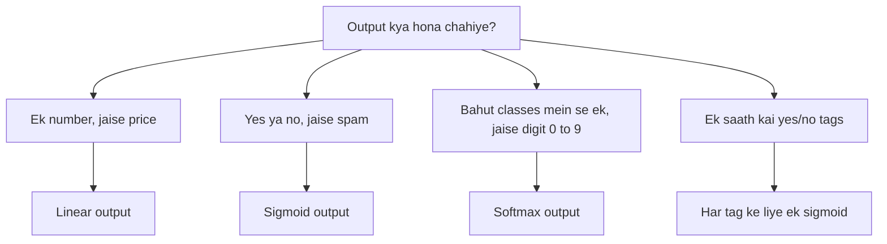

Naye ideas se pehle, purane ideas jo chahiye woh yahan hain. Agar aapko pehle se pata hai, toh next section pe chale jao.

## Pehle basics

- Ek **neuron** kuch input numbers leta hai, har ek ko ek **weight** se multiply karta hai (woh input kitna important hai), sabko add karta hai, aur ek extra number add karta hai jise **bias** kehte hain (ek starting offset).
- Is total ko **weighted sum** (ya pre-activation) kehte hain, likhte hain $z$. Symbols mein, $z = w_1x_1 + w_2x_2 + \dots + b$.
- Ek **layer** matlab bahut saare neurons side by side. Ek **network** matlab layers ek ke baad ek: ek layer ka output agli layer ka input banta hai.
- **Training** weights ko badalti hai taaki network ke answers sahi answers ke paas aa jaayein. Isme **gradients** use hote hain: gradient ek slope hai jo batata hai "agar is weight ko thoda sa hilao, toh error kitna badlega".
- Deep network mein kisi early layer ka gradient, uske baad ki saari layers ke slopes ko **multiply** karke milta hai (chain rule). Ye yaad rakhna: agar bahut saare slopes chhote hain, toh unka product aur bhi chhota ho jaata hai.

## Activation function kya hai

<Box kind="definition">

**Activation function** ek fixed rule hai jo neuron apne weighted sum $z$ pe lagata hai, ye decide karne ke liye ki aage kaunsa number bhejna hai. Neuron ka output, $a = f(z)$, uski **activation** kehlata hai aur next layer ko jaata hai.

</Box>

Light ke dimmer switch ke baare mein socho. Weighted sum matlab aapne switch ko kitna zor se dabaya. Activation function decide karta hai ki us push pe bulb actually kitna bright hoga: shayad ek point se neeche bilkul nahi, shayad ek maximum brightness tak aur usse zyada nahi. Ye syllabus <Syl m="2" />, section 2.1 hai.

**Ye kaise kaam karta hai, step by step:**

1. Neuron previous layer se (ya raw data se) inputs leta hai.
2. Har input ko uske weight se multiply karta hai, sab add karta hai aur bias add karta hai. Isse $z$ milta hai, jo inputs ka sirf ek straight-line mix hai.
3. Activation function $z$ ko reshape karta hai, jaise use 0 se 1 ke beech squash karna, ya negative values ko zero kar dena.
4. Result next layer ke har neuron ko bheja jaata hai.
5. Training ke time, backpropagation activation function ka **slope** bhi use karta hai ye nikaalne ke liye ki har weight kitna badalna chahiye.

## Ye kyun zaroori hai: "collapse" problem

Maan lo network mein **koi** activation function nahi hai, toh har layer bas apna weighted sum aage bhej deti hai. Tab har layer ek straight-line (linear) rule hai, aur ek straight line ko doosri straight line mein daalo toh bhi straight line hi milti hai. Example: ek layer jo $2x + 1$ compute karti hai, uske baad ek layer jo $3h - 2$ compute karti hai, bilkul ek single layer ke barabar hai jo $6x + 1$ compute karti hai, kyunki $3(2x + 1) - 2 = 6x + 3 - 2 = 6x + 1$.

<Box kind="verify">

Ek real input lo, $x = 1$. Do layers: pehli deti hai $2(1) + 1 = 3$, doosri deti hai $3(3) - 2 = 7$. Ek layer: $6(1) + 1 = 7$. Same answer, matlab doosri layer ne kuch naya add nahi kiya.

</Box>

Toh activation functions ke bina ek deep network ek single layer se zyada powerful nahi hai, chahe kitni bhi layers ho. Woh kabhi curved pattern nahi seekh sakta, jaise XOR problem (output 1 jab do inputs mein se exactly ek 1 ho), jise koi single straight line separate nahi kar sakti. <Cite id="gfdl-ch6" loc="§6.1" />

<Box kind="intuition">

Activation function har layer ke baad ek **bend** (non-linearity) add karta hai. Bahut saare bends stack karke network lagbhag koi bhi curved shape bana sakta hai, jaise bahut saari chhoti seedhi sticks ko jodkar ek circle trace ho jaata hai.

</Box>

**Activation functions ki significance, ek list mein:**

1. **Non-linearity.** Ye network ko curved, complex relationships seekhne dete hain, jaise images mein faces ya speech mein words. Inke bina depth bekaar hai.
2. **Ye output range control karte hain.** Sigmoid 0 aur 1 ke beech number deta hai, jise probability ki tarah padh sakte hain; softmax class probabilities deta hai jinka total 1 hota hai.
3. **Ye decide karte hain ki network kitna achha train hoga.** Training ko useful slopes chahiye. Jo activation ek badi range mein flat ho jaata hai (**saturate** hota hai) woh tiny gradients aur slow learning deta hai. <Cite id="gfdl-ch6" loc="§6.3.2" />
4. **Ye decide karte hain ki neuron "fire" karega ya nahi.** Asli brain cell ki tarah, ek unit kuch inputs pe off aur kuch pe on ho sakta hai, isliye alag-alag neurons alag patterns mein specialise karte hain.

**Ek achha activation function kaisa hota hai:** non-linear ho; lagbhag har jagah slope ho, taaki gradients compute ho sakein; apni zyada range mein flat na ho; compute karna sasta ho; aur ideally outputs zero ke aas-paas centred hon.

Exam mein English mein likho: "Without a non-linear activation function, a deep network collapses into a single linear layer."

## Saturation aur vanishing gradient (choices ke peeche ka key idea)

Ek function **saturate** hota hai jab uska curve lagbhag flat ho jaata hai, yaani input mein bada change karo toh bhi output mein na ke barabar change. Flat matlab slope lagbhag zero. Backpropagation mein, early layer tak pahunchne wala gradient baad ki saari layers ke slopes ka product hai. Agar har slope chhota hai, toh bahut saare multiply karke number zero ke paas aa jaata hai, isliye early layers ko lagbhag koi signal nahi milta aur woh seekhna band kar deti hain. Isko **vanishing gradient problem** kehte hain. <Cite id="glorot2010" /> <Cite id="d2l-numerical-stability" />

Whispering game socho: agar har insaan jo suna uska sirf ek chauthai aage bataye, toh das logon ke baad lagbhag kuch nahi bachta.

Yahi ek idea batata hai ki sigmoid aur tanh hidden layers mein kyun pasand nahi kiye jaate aur ReLU default kyun bana.

## Activation functions ke types

### Linear (identity) activation

**Ye kya hai.** Neuron apna weighted sum bina badle aage bhej deta hai: $f(z) = z$. Output koi bhi number ho sakta hai, bahut negative se bahut positive tak.

**Advantages:** sabse simple; output range ko limit nahi karta, isliye koi bhi real value de sakta hai.

**Disadvantages:** koi bend add nahi karta, isliye hidden layers mein upar dikhaya collapse hota hai; iska slope har jagah same hai, isliye ye network ko curved data model karne mein help nahi kar sakta.

**Application:** sirf **regression** network ki **output layer** mein, jahan answer ek simple number hai jaise house price ya kal ka temperature. <Cite id="gfdl-ch6" loc="§6.2.2.1" />

**Step (threshold)** function, output 1 agar $z \ge 0$ warna 0, original perceptron mein use hota tha. Iska slope har jagah zero hai (sirf 0 pe jump hai), isliye gradients koi signal nahi dete aur ise gradient descent se train nahi kar sakte. Isliye smooth functions ne iski jagah le li.

### Logistic sigmoid

**Ye kya hai.** Ek smooth "S"-shaped curve jo kisi bhi input ko 0 se 1 ki range mein squash karta hai. Bade positive inputs pe output 1 ke paas, bade negative inputs pe 0 ke paas, aur input 0 pe exactly 0.5.

$$
\sigma(z) = \frac{1}{1 + e^{-z}}
$$

Yahan $e \approx 2.718$. Words mein: $z$ jitna bada, $e^{-z}$ utna chhota, isliye fraction 1 ki taraf jaata hai.

**Ye kaise behave karta hai.** Iska slope centre pe sabse bada hai (wahan sirf 0.25) aur dono ends pe lagbhag zero ho jaata hai, jahan curve flat hai.

**Advantages:**

- Output naturally ek **probability** ki tarah padha jaata hai.
- Smooth hai, har jagah slope hai, isliye gradient descent se train ho sakta hai.

**Disadvantages:**

- **Saturate** hota hai, isliye deep networks mein gradients vanish ho jaate hain; iska slope kabhi 0.25 se zyada nahi hota.
- **Zero-centred nahi hai**: outputs hamesha positive hain, jisse weight updates seedha achhe answer ki taraf jaane ki jagah zig-zag kar sakte hain. <Cite id="cs231n-nn1" />
- Exponential chahiye, jo ReLU se slow compute hota hai.

**Applications:** yes/no (binary) classifier ka output jaise spam filter ya disease test; multi-label tagging mein har label ke liye ek sigmoid; LSTM cells ke andar gates. <Cite id="gfdl-ch6" loc="§6.2.2.2" />

Saturation ki wajah se, Goodfellow et al. kehte hain ki feedforward networks ki hidden layers mein sigmoid ab **discouraged** hai, lekin output pe suitable loss (cross-entropy) ke saath theek hai. <Cite id="gfdl-ch6" loc="§6.3.2" /> <Cite id="glorot2010" />

### Hyperbolic tangent (tanh)

**Ye kya hai.** Sigmoid jaisa hi S shape, lekin −1 se +1 ki range tak stretched aur zero pe centred: input 0 pe output 0. Ye ek stretched aur shifted sigmoid hai.

Words mein: ye $e^{z}$ ko $e^{-z}$ se compare karta hai. Jab $z$ bada positive hai toh upar aur neeche lagbhag barabar hain, isliye answer +1 ke paas; jab $z$ bada negative hai toh −1 ke paas; $z = 0$ pe upar wala part 0 hai.

$$
\tanh(z) = \frac{e^{z} - e^{-z}}{e^{z} + e^{-z}}
$$

**Advantages:**

- **Zero-centred**, isliye positive aur negative outputs balance hote hain aur training sigmoid se zyada steady hoti hai.
- Centre pe iska slope 1 hai (sigmoid ke 0.25 ka chaar guna), isliye zero ke paas ye straight line jaisa behave karta hai aur hidden layers mein usually sigmoid se better train hota hai. <Cite id="gfdl-ch6" loc="§6.3.2" />

**Disadvantages:** bade positive ya negative inputs pe ye **ab bhi saturate** hota hai, isliye vanishing gradient rehta hai; isko bhi exponentials chahiye.

**Applications:** recurrent networks jaise RNN, LSTM aur GRU ke hidden units; purane shallow networks.

<Figure caption="Sigmoid (0 se 1) aur tanh (−1 se 1) ka same S shape hai. Dekho dono bade positive ya negative inputs pe flat ho jaate hain: wahi flatness saturation hai.">
  <CurvePlot curves="sigmoid,tanh" x="-6,6" y="-1.2,1.2" xLabel="weighted sum z" yLabel="output f(z)" />
</Figure>

<Figure caption="Slopes. Sigmoid ka slope kabhi 0.25 se zyada nahi; tanh ka peak 1 hai. Dono centre se door lagbhag zero ho jaate hain, isliye deep sigmoid ya tanh networks mein gradients vanish hote hain.">
  <CurvePlot curves="sigmoid-derivative,tanh-derivative" x="-6,6" y="0,1.1" xLabel="weighted sum z" yLabel="slope f′(z)" />
</Figure>

### ReLU (rectified linear unit)

**Ye kya hai.** "Positive numbers ko bina badle jaane do, negative numbers ko zero kar do." Ye ek one-way valve jaisa hai: paani aage free flow karta hai, peeche nahi.

$$
\text{ReLU}(z) = \max(0, z)
$$

**Ye kaise behave karta hai.** Positive inputs pe slope exactly 1 hai, isliye gradients bina chhote hue peeche jaate hain. Negative inputs pe output aur slope dono 0 hain. (Exactly zero pe slope undefined hai; software bas 0 use karta hai.)

**Advantages:**

- **Positive inputs pe vanishing gradient nahi**, isliye deep networks bahut fast train hote hain. <Cite id="gfdl-ch6" loc="§6.3.1" />
- **Bahut sasta:** bas zero se ek comparison, koi exponential nahi.
- **Sparse:** bahut saare neurons exactly 0 output karte hain, isliye kisi input ke liye sirf kuch hi active hote hain. Glorot et al. ne dikhaya ki deep rectifier networks achhe train hote hain aur aise sparse representations dete hain. <Cite id="glorot2011" />

**Disadvantages:**

- **Dying ReLU:** agar kisi neuron ka weighted sum har training example ke liye negative hai, toh uska output aur slope hamesha 0 rehte hain, isliye uske weights phir kabhi nahi badalte; neuron "dead" ho jaata hai. Goodfellow et al. note karte hain ki ReLU un examples se nahi seekh sakta jahan uski activation zero hai. <Cite id="gfdl-ch6" loc="§6.3.1" />
- Zero-centred nahi, aur output ki koi upper limit nahi.

**Applications:** lagbhag saare modern networks mein **hidden layers ka default**: image recognition ke CNNs (AlexNet, VGG, ResNet) aur fully connected networks. <Cite id="mlm-relu" />

### Leaky ReLU (aur PReLU)

**Ye kya hai.** ReLU ek chhote "leak" ke saath: negative inputs ke liye flat zero ki jagah, unka ek chhota fraction aage jaane deta hai, usually 1%.

$$
\text{LeakyReLU}(z) = z \text{ if } z > 0, \quad \alpha z \text{ otherwise}
$$

Yahan $\alpha$ (alpha) ek chhota fixed number hai, commonly $0.01$.

**Advantages:**

- Har neuron ko hamesha kuch gradient milta hai, isliye neurons **die nahi kar sakte**. <Cite id="gfdl-ch6" loc="§6.3.1" />
- ReLU ki saari speed aur simplicity rehti hai.

**Disadvantages:** ek aur number ($\alpha$) choose karna padta hai; ReLU se gain guaranteed nahi hai. Goodfellow et al. kehte hain ki ye variants usually ReLU jitna hi achha perform karte hain aur kabhi-kabhi better.

**Variant:** **Parametric ReLU (PReLU)** $\alpha$ ko fix karne ki jagah ek aisa number banata hai jo network training mein **seekhta** hai. <Cite id="he2015prelu" />

**Applications:** hidden layers jahan bahut saare ReLU neurons die ho jaate hain; GAN discriminators mein commonly use hota hai.

<Figure caption="ReLU negative inputs pe zero pe flat hai; leaky ReLU wahan ek chhota slope rakhta hai. (Plot mein α = 0.1 liya hai taaki slope dikhe; 0.01 zyada common hai.) Positive inputs pe dono straight line y = x hain.">
  <CurvePlot curves="relu,leaky-relu" x="-4,4" y="-1,4" xLabel="weighted sum z" yLabel="output f(z)" />
</Figure>

### Softmax

**Ye kya hai.** Softmax baaki sab se alag hai: ye ek number pe nahi, balki scores ki **poori list** pe ek saath kaam karta hai. Ye $K$ classes ke raw scores (jinhe **logits** kehte hain) ko probabilities mein badalta hai jo sab 0 aur 1 ke beech hain aur jinka **total exactly 1** hai.

**Ye kaise kaam karta hai, step by step:**

1. Har class ka raw score lo.
2. Har score pe $e$ ki power lagao, jisse har value positive ho jaati hai aur bade scores bahut bade ho jaate hain.
3. In values ko add karo.
4. Har value ko total se divide karo, taaki shares ka sum 1 ho.

$$
\text{softmax}(z)_k = \frac{e^{z_k}}{\sum_{j=1}^{K} e^{z_j}}
$$

Words mein: class $k$ ki probability = uska exponential divided by saare exponentials ka sum.

**Worked example (softmax haath se).**

<Sum>

<Given>

teen classes ke raw scores, $z = [2, 1, 0.1]$ (cat, dog, bird).

</Given>

<Find>

har class ki softmax probability.

</Find>

<Steps>

1. Har score pe $e$ ki power lagao, taaki har value positive ho: $e^{2} = 7.389$, $e^{1} = 2.718$, $e^{0.1} = 1.105$.
2. Inko add karo, taaki woh total mile jisme se shares baante jaayenge: $7.389 + 2.718 + 1.105 = 11.212$.
3. Har value ko total se divide karo, taaki har class ko uska share mile: $7.389 \div 11.212 = 0.659$, $2.718 \div 11.212 = 0.242$, $1.105 \div 11.212 = 0.099$.

</Steps>

<Answer>

cat ≈ 0.66, dog ≈ 0.24, bird ≈ 0.10. Sabse bade score (cat) ko sabse badi probability milti hai.

</Answer>

<Box kind="verify">

Check 1: probabilities ka total 1 hona chahiye. $0.659 + 0.242 + 0.099 = 1.000$. Sahi.

Check 2, ek alag raasta: pehle har score se sabse bada score (2) subtract karo, milta hai $[0, -1, -1.9]$. Phir $e^{0} = 1$, $e^{-1} = 0.368$, $e^{-1.9} = 0.150$, total $1.518$, aur $1 \div 1.518 = 0.659$, $0.368 \div 1.518 = 0.242$, $0.150 \div 1.518 = 0.099$. Same answer, aur isse ye bhi dikhta hai ki software overflow se bachne ke liye safely sabse bada score subtract kar sakta hai.

</Box>

</Sum>

Ek pizza socho jo dosto mein unki bhookh ke hisaab se baanta jaata hai: sabko share milta hai, sabse bhookhe ko sabse bada, aur shares milkar hamesha exactly ek poora pizza bante hain.

**Advantages:**

- Har class ke liye ek clear **probability** deta hai, samajhna aasaan.
- Sabse bade score ko sabse badi probability milti hai, lekin baaki throw away nahi hote (isliye "soft" max).
- Categorical cross-entropy loss ke saath naturally pair hota hai. Do classes ke saath ye wahi answer deta hai jo dono scores ke difference pe lagaya gaya sigmoid deta hai. <Cite id="gfdl-ch6" loc="§6.2.2.3" /> <Cite id="d2l-softmax-regression" />

**Disadvantages:** sirf output pe use hota hai; classes compete karti hain, isliye multi-label problems ke liye galat hai; jab ek score baaki sab se bahut bada ho toh saturate ho sakta hai; bade scores ke exponentials overflow ho sakte hain (software pehle sabse bada score subtract kar deta hai, jisse answer nahi badalta).

**Applications:** kisi bhi one-of-many classifier ki output layer: digit recognition (0 se 9), ImageNet classes, language models mein next-word prediction.

## Kuch aur activation functions jo mil sakte hain

- **Softplus:** ReLU ka ek smooth version. Aap expect karoge ki ye ReLU se better hoga kyunki har jagah smooth hai, lekin comparisons mein ReLU better nikla, aur Goodfellow et al. kehte hain ki iska use generally discouraged hai. <Cite id="gfdl-ch6" loc="§6.3.3" />
- **ELU, GELU, Swish (SiLU):** naye smooth ReLU-jaise functions jo modern networks jaise transformers mein milte hain. Ye Keras mein built-in hain. <Cite id="keras-activations" />

## Comparison table

| Function | Formula | Output range | Zero-centred | Saturates | Main advantage | Main problem | Typical use |
|---|---|---|---|---|---|---|---|
| Linear | $z$ | koi bhi number | yes | no | Simple, koi bhi output value | Non-linearity nahi | Regression output |
| Sigmoid | $\dfrac{1}{1+e^{-z}}$ | (0, 1) | no | yes | Probability jaisa padhte hain | Vanishing gradient | Binary output |
| Tanh | $\dfrac{e^{z}-e^{-z}}{e^{z}+e^{-z}}$ | (−1, 1) | yes | yes | Zero-centred, strong slope | Ab bhi vanish | RNN, LSTM hidden units |
| ReLU | $\max(0,z)$ | [0, ∞) | no | no (positive inputs pe) | Fast, vanishing nahi | Dying ReLU | Default hidden layer |
| Leaky ReLU | $z$ ya $\alpha z$ | (−∞, ∞) | roughly | no | Dead neurons nahi | Extra number $\alpha$ | Hidden layers |
| Softmax | $\dfrac{e^{z_k}}{\sum_j e^{z_j}}$ | (0, 1), sum = 1 | no | ho sakta hai | Har class ki probability | Sirf outputs ke liye | Multi-class output |

## Activation function kaise choose karein

<Box kind="exam">

**Hidden layers:** **ReLU** se start karo. Agar bahut neurons die ho jaayein, toh **leaky ReLU** try karo. Recurrent networks ke andar **tanh** (aur gates ke liye sigmoid) use karo.

**Output layer, task ke hisaab se:**

- Ek number predict karna (regression) → **linear**.
- Yes ya no (binary classification) → **sigmoid**, ek output.
- Bahut saari classes mein se exactly ek (multi-class) → **softmax**.
- Ek saath kai yes/no labels (multi-label) → har label ke liye ek **sigmoid**.

</Box>

Output activation aur loss function saath mein choose hote hain: linear ke saath squared error, sigmoid ke saath binary cross-entropy, softmax ke saath categorical cross-entropy (loss functions wala note dekho). <Cite id="gfdl-ch6" loc="§6.2.2" />

<Box kind="pitfall">

- ReLU ko "linear" mat bolo. Ye zero ke dono taraf linear hai lekin zero pe bent hai, aur wahi ek bend network ko non-linear banane ke liye kaafi hai.
- Softmax ko hidden layers mein ya multi-label problems ke liye use mat karo: uske outputs ka total 1 hona chahiye, isliye labels aapas mein compete karenge.
- Sigmoid ka slope maximum 0.25 hai, 0.5 nahi. Zero pe **output** 0.5 hai.

</Box>

## Ye kahan poocha gaya

| If the question says | What to write | Seen as |
|---|---|---|
| "What is an activation function? Describe any four activation functions." | Definition aur dimmer-switch analogy, non-linearity kyun chahiye (collapse words mein), neuron diagram; phir sigmoid, tanh, ReLU aur leaky ReLU, har ek ke saath kya karta hai, one-line formula, range, advantages, disadvantages aur use; ek graph aur comparison table | <PYQ id="2023-12/q2b" /> |
| "What is the significance of Activation Functions in Neural Networks, explain different types Activation functions used in NN." | Chaar-point significance list aur collapse idea, saturation words mein; phir linear, sigmoid, tanh, ReLU, leaky ReLU aur softmax with range, pros, cons aur use; comparison table; output layer ke liye kaise choose karein | <PYQ id="2024-05/q6a" /> <PYQ id="2024-12/q6a" /> <PYQ id="2025-05/q6a" /> |

## Quick revision

- Neuron: weighted sum $z$, phir activation $a = f(z)$.
- Activation nahi: saari layers ek straight line mein collapse, depth waste.
- Saturation: flat curve matlab near-zero slope; bahut layers mein multiply hokar gradients vanish.
- Sigmoid: range (0, 1), slope maximum 0.25, saturate hota hai, zero-centred nahi. Binary output.
- Tanh: range (−1, 1), zero-centred, centre pe slope 1, ab bhi saturate. RNN/LSTM.
- ReLU $\max(0,z)$: default hidden layer, fast, positive inputs pe slope 1; die ho sakta hai.
- Leaky ReLU: negative inputs ke liye chhota slope $\alpha \approx 0.01$; kabhi die nahi hota. PReLU $\alpha$ seekhta hai.
- Softmax: scores se probabilities jinka total 1. Multi-class output.
- Output layer: number ke liye linear, yes/no ke liye sigmoid, one-of-many ke liye softmax.

**Conclusion:** activation functions network ko non-linearity dete hain, jisse depth useful banti hai; network ke andar usually ReLU choose hota hai, aur output activation task ke hisaab se choose hota hai.

Exam mein English mein likho: "Activation functions introduce non-linearity, so depth becomes useful; ReLU is the default for hidden layers and the output activation is chosen to match the task."
