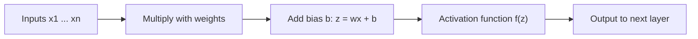
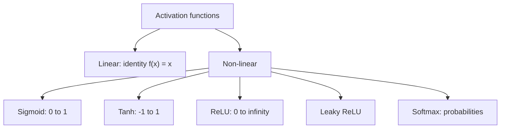
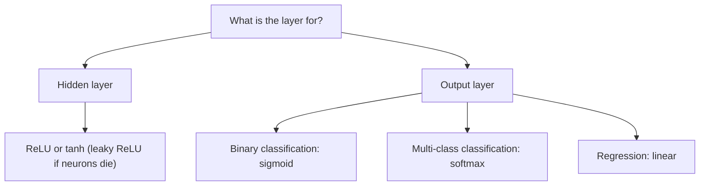

This is syllabus <Syl m="2" />, "activation functions: tanh, logistic, linear, softmax, ReLU, leaky ReLU".

## What an activation function is

<Box kind="definition">

An **activation function** is a mathematical function used in a neural network to decide whether a neuron should be activated (pass information) or not. It takes the output from a neuron and converts it into a new value, which is then passed to the next layer. <Cite id="class-dl-chp2" loc="slide 9" />

**Simple definition:** an activation function decides the output of a neuron and helps the neural network learn complex patterns. <Cite id="class-dl-chp2" loc="slide 9" />

</Box>

Every activation function (or non-linearity) takes a single number and performs a certain fixed mathematical operation on it. It introduces non-linearity into the model, allowing the network to learn and represent complex patterns in the data. It decides whether a neuron should be activated by calculating the weighted sum of inputs and adding a bias term. <Cite id="class-dl-m2" loc="p. 3" />

The neuron first calculates $z = wx + b$, the activation function $f(z)$ then processes the result, and the processed value is sent to the next layer. <Cite id="class-dl-chp2" loc="slide 9" />

## Why do we need it?

- Without an activation function, a neural network behaves like a simple linear model. It cannot learn complex relationships such as image recognition, speech recognition or object classification. <Cite id="class-dl-chp2" loc="slide 9" />
- With it, the network can learn complex (non-linear) patterns, decide the output of each neuron, improve prediction accuracy and solve real-world problems.
- It **introduces non-linearity**, **helps learn complex patterns**, **helps during backpropagation** (gradients can flow so learning can occur) and **determines the output range**. <Cite id="class-dl-chp2" loc="slide 25" />
- Different problems need different outputs, so different activation functions are used for different tasks. <Cite id="class-dl-chp2" loc="slide 9" />

## Types of activation functions

The activation functions can be divided into two types: **linear** activation functions and **non-linear** activation functions. <Cite id="class-dl-m2" loc="p. 3" />

- The **linear (identity)** function $f(x) = x$ has range $(-\infty, \infty)$. It does not help with the complexity or various parameters of the usual data fed to neural networks. <Cite id="class-dl-m2" loc="p. 4" />
- **Non-linear** functions make it easy for the model to generalize or adapt to a variety of data. Two terms are needed: **derivative** (change in y with respect to change in x, also called the slope) and **monotonic function** (a function that is entirely non-increasing or non-decreasing). <Cite id="class-dl-m2" loc="p. 4" />
- Older functions in the notes: the **binary step** function (output 0 or 1 by a threshold $\theta$, used in single-layer nets), the **bipolar step** function (output +1 or −1) and the **ramp** function. <Cite id="class-dl-m2" loc="p. 5" />

## 1. Sigmoid (logistic) activation function

<Box kind="definition">

The **sigmoid activation function** converts any input value into a value between 0 and 1. The output represents a probability, which makes it suitable for binary (yes or no) classification problems. $\sigma(x) = \dfrac{1}{1 + e^{-x}}$ <Cite id="class-dl-chp2" loc="slide 11" />

</Box>

- The curve is **S-shaped**. A very large negative input gives an output close to 0, input 0 gives 0.5, and a very large positive input gives an output close to 1. Output range: **0 to 1**. <Cite id="class-dl-chp2" loc="slide 11" />
- It exists between 0 and 1, so it is especially used for models where we have to predict a probability. The function is differentiable and monotonic, but its derivative is not monotonic. Derivative: $f'(x) = f(x)(1 - f(x))$. <Cite id="class-dl-m2" loc="p. 8" /> <Cite id="class-dl-m1" loc="p. 20" />
- **Where it is used:** the output layer of binary classification problems: apple or not apple, spam or not spam, pass or fail, disease or no disease, fraud or not fraud. If the output is 0.95 the fruit is an apple with 95% probability; if it is 0.15 it is not an apple. <Cite id="class-dl-chp2" loc="slide 11" />
- **Advantages:** produces probability values, easy to understand, smooth and continuous curve. **Disadvantages:** can suffer from the vanishing gradient problem in deep networks, training becomes slower in deep networks, and it is not commonly used in hidden layers of modern deep networks. <Cite id="class-dl-chp2" loc="slide 11" />

## 2. Tanh (hyperbolic tangent) activation function

<Box kind="definition">

The **tanh** activation function converts any input into a value between −1 and +1. Unlike sigmoid, tanh can produce negative, zero and positive values, which helps the network learn better. $\tanh(x) = \dfrac{e^x - e^{-x}}{e^x + e^{-x}}$ <Cite id="class-dl-chp2" loc="slide 13" />

</Box>

- tanh is also S-shaped (sigmoidal) and passes through (0, 0). A very large negative input gives close to −1, input 0 gives 0, a very large positive input gives close to +1. Range **−1 to +1**. <Cite id="class-dl-chp2" loc="slide 13" />
- Negative inputs are mapped strongly negative and zero inputs are mapped near zero. The function is differentiable and monotonic, while its derivative is not monotonic. Derivative: $f'(x) = 1 - f(x)^2$. <Cite id="class-dl-m2" loc="p. 9" /> <Cite id="class-dl-m1" loc="p. 20" />
- **Where it is used:** mainly the hidden layers, when the network needs to learn both positive and negative relationships (image recognition, speech recognition, handwritten digits, NLP, time-series prediction). Its output is zero-centered, which helps faster learning. <Cite id="class-dl-chp2" loc="slide 13" />
- **Disadvantages:** can suffer from the vanishing gradient problem, is slower in very deep networks and is less used today than ReLU.

## 3. ReLU (rectified linear unit)

<Box kind="definition">

**ReLU** is an activation function that returns the input value if it is positive, otherwise it returns 0. ReLU keeps positive values unchanged and converts all negative values to 0. $\text{ReLU}(x) = \max(0, x)$ <Cite id="class-dl-chp2" loc="slide 15" />

</Box>

- If $x > 0$ the output is $x$; if $x \le 0$ the output is 0. Range: **[0, ∞)**. The function and its derivative are both monotonic. <Cite id="class-dl-chp2" loc="slide 15" /> <Cite id="class-dl-m2" loc="p. 10" />
- ReLU is the most widely used activation function in the hidden layers of deep neural networks because it is simple and trains models faster. It is fast to compute, easy to implement, able to learn complex patterns and less affected by the vanishing gradient problem. <Cite id="class-dl-chp2" loc="slide 15" />
- **Where it is used:** hidden layers of DNNs and CNNs (image recognition, face recognition, speech recognition, object detection, medical image analysis).
- **Disadvantage:** negative inputs become 0. Some neurons may stop learning if they always receive negative inputs; this is called the **dying ReLU problem**. It is also not suitable for the output layer in classification problems. <Cite id="class-dl-chp2" loc="slide 15" />

## 4. Leaky ReLU

<Box kind="definition">

**Leaky ReLU** is an improved version of the ReLU activation function. Unlike ReLU, which converts all negative values to 0, Leaky ReLU allows a small value for negative inputs instead of making them zero. $f(x) = \begin{cases} x & x > 0 \\ 0.01x & x \le 0 \end{cases}$ <Cite id="class-dl-chp2" loc="slide 17" />

</Box>

- It is an attempt to solve the **dying ReLU problem**. The small constant (usually 0.01) is called the leak. When the constant is not 0.01 it is called Randomized ReLU. Range: **(−∞, ∞)**. Both Leaky and Randomized ReLU functions and their derivatives are monotonic. <Cite id="class-dl-m2" loc="p. 11" />
- A neuron that always gets a negative input still gives a small non-zero output, so it continues learning.
- **Where it is used:** hidden layers, when there is a possibility of the dying ReLU problem. **Advantages:** solves the dying ReLU problem, fast and efficient. **Disadvantages:** the small negative slope must be chosen, slightly more complex than ReLU, and not commonly used in the output layer. <Cite id="class-dl-chp2" loc="slide 17" />

 0 and 0.01x for x ≤ 0. Negative inputs give a small negative value, not zero." />

## 5. Softmax

<Box kind="definition">

**Softmax** is an activation function that converts the output of a neural network into probability values. The probabilities of all classes add up to 1 (100%). It is mainly used when there are more than two classes. $\text{Softmax}(z_i) = \dfrac{e^{z_i}}{\sum_{j=1}^{n} e^{z_j}}$ <Cite id="class-dl-chp2" loc="slide 19" />

</Box>

- Each probability is between 0 and 1 and the total of all probabilities is 1. The class with the highest probability is selected as the prediction. The softmax function is a more generalized logistic activation function, used for multiclass classification. <Cite id="class-dl-chp2" loc="slide 19" /> <Cite id="class-dl-m2" loc="p. 8" />
- This property of adding up to 1.0 is called **normalization**; an impossible event is denoted by 0 and a sure event by 1. <Cite id="class-dl-m1" loc="p. 22" />
- **Where it is used:** the output layer of multi-class classification (fruit classification, handwritten digit recognition 0 to 9, animal, flower and image classification). **Disadvantages:** not suitable for binary classification, cannot predict multiple classes at the same time, needs more computation than simpler functions. <Cite id="class-dl-chp2" loc="slide 19" />

## 6. Linear (identity) activation function

The linear (identity) activation function returns the same value as the input: $f(x) = x$, range $(-\infty, +\infty)$, a straight line through the origin with slope 1. It is used in the output layer for regression problems (fruit weight, house price, temperature, sales). Its disadvantages: it cannot learn complex non-linear relationships, is not suitable for classification and is rarely used in hidden layers. <Cite id="class-dl-chp2" loc="slide 21" /> <Cite id="class-dl-m2" loc="p. 5" />

## Worked example: five functions on the same input

<Sum>

<Given>

a neuron with weighted sum $z = -2$ and then $z = 2$. Use $e^{2} = 7.389$ and $e^{-2} = 0.1353$.

</Given>

<Find>

the sigmoid, tanh, ReLU and leaky ReLU (0.01) outputs.

</Find>

<Steps>

1. **Sigmoid:** $\sigma(-2) = 1/(1 + e^{2}) = 1/8.389 = 0.119$ and $\sigma(2) = 1/(1 + e^{-2}) = 1/1.1353 = 0.881$.
2. **Tanh:** $\tanh(2) = (7.389 - 0.1353)/(7.389 + 0.1353) = 7.2537/7.5243 = 0.964$, and by symmetry $\tanh(-2) = -0.964$.
3. **ReLU:** $\max(0, -2) = 0$ and $\max(0, 2) = 2$.
4. **Leaky ReLU:** $0.01 \times (-2) = -0.02$ and for $z = 2$ the output is $2$.

</Steps>

<Answer>

| $z$ | Sigmoid | Tanh | ReLU | Leaky ReLU |
|---|---|---|---|---|
| −2 | 0.119 | −0.964 | 0 | −0.02 |
| 2 | 0.881 | 0.964 | 2 | 2 |

</Answer>

<Box kind="verify">

Sigmoid: $0.119 + 0.881 = 1$, as it must for $\sigma(-z) + \sigma(z)$. Tanh is an odd function, so the two values are equal with opposite signs. The sigmoid values match the teacher's table (0.12 and 0.88). <Cite id="class-dl-chp2" loc="slide 23" />

</Box>

</Sum>

## Which activation function to use

| Function | Range | Best used in |
|---|---|---|
| Sigmoid | (0, 1) | Output layer (binary classification) |
| Tanh | (−1, 1) | Hidden layers |
| ReLU | [0, ∞) | Hidden layers (most common) |
| Leaky ReLU | (−∞, ∞) | Hidden layers (fixes dying ReLU) |
| Softmax | (0, 1), sum 1 | Output layer (multi-class classification) |
| Linear | (−∞, ∞) | Output layer (regression) |

<Cite id="class-dl-chp2" loc="slide 23" />

Use non-linear functions in the hidden layers so that the network can learn complex patterns. <Cite id="class-dl-chp2" loc="slide 53" />

## Where this was asked

| If the question says | What to write | Seen as |
|---|---|---|
| "What is an activation function? Describe any four activation functions." | Definition, then sigmoid, tanh, ReLU, leaky ReLU with formula, graph, range, use | <PYQ id="2023-12/q2b" /> |
| "What is the significance of activation functions in neural networks? Explain different types used in NN." | Significance (non-linearity, controls output, helps backpropagation), then the six types and a table | <PYQ id="2024-05/q6a" /> <PYQ id="2024-12/q6a" /> <PYQ id="2025-05/q6a" /> |

## Quick revision

- Activation function: decides whether a neuron is activated; adds non-linearity. Without it the network is just a linear model.
- Sigmoid $1/(1+e^{-x})$: S-curve, 0 to 1, probability, binary output layer. Derivative $f(1-f)$.
- Tanh: −1 to 1, zero-centered, hidden layers. Derivative $1 - f^2$.
- ReLU $\max(0, x)$: [0, ∞), most used in hidden layers, dying ReLU problem.
- Leaky ReLU: $0.01x$ for negative input, fixes dying ReLU.
- Softmax: probabilities that sum to 1, multi-class output layer.
- Linear $f(x) = x$: regression output layer.

**Conclusion.** Activation functions are the heart of neural networks: they make deep learning models powerful, flexible and capable of solving real-world problems, and the choice depends on the layer and the task. <Cite id="class-dl-m2" loc="p. 13" />
