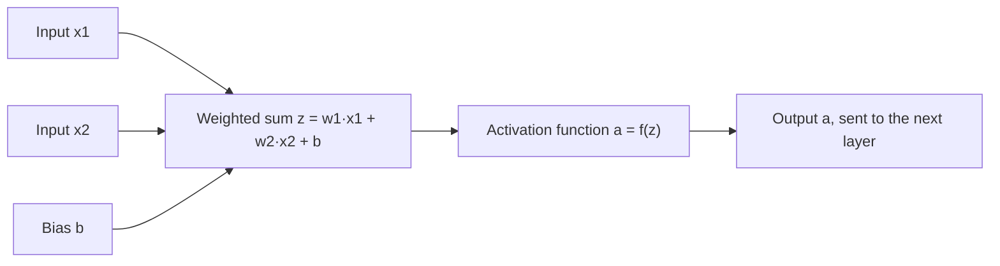
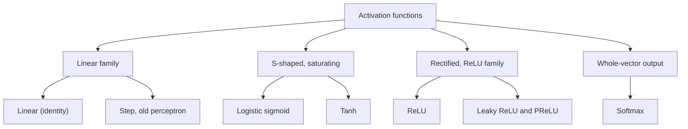
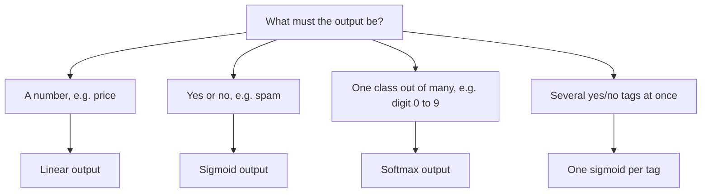

Before the new ideas, here are the old ones you need. If you already know them, skip to the next section.

## The basics first

- A **neuron** takes some input numbers, multiplies each by a **weight** (how important that input is), adds them all up, and adds one more number called the **bias** (a starting offset).
- That total is called the **weighted sum** (or pre-activation), written $z$. In symbols, $z = w_1x_1 + w_2x_2 + \dots + b$.
- A **layer** is many neurons side by side. A **network** is layers one after another: the outputs of one layer are the inputs of the next.
- **Training** changes the weights so the network's answers get closer to the right answers. It uses **gradients**: a gradient is a slope that says "if you nudge this weight a little, how much does the error change".
- In a deep network the gradient for an early layer is found by **multiplying** the slopes of all the layers after it (the chain rule). Keep this in mind: if many of those slopes are tiny, their product is tinier still.

## What an activation function is

<Box kind="definition">

An **activation function** is a fixed rule that a neuron applies to its weighted sum $z$ to decide what number it passes on. The neuron's output, $a = f(z)$, is called its **activation** and goes to the next layer.

</Box>

Think of a dimmer switch on a light. The weighted sum is how hard you push the switch. The activation function decides how bright the bulb actually gets for that push: maybe not at all below some point, maybe up to a maximum brightness and no more. This is syllabus <Syl m="2" />, section 2.1.

**How it works, step by step:**

1. The neuron receives inputs from the previous layer (or the raw data).
2. It multiplies each input by its weight, adds them up and adds the bias. This gives $z$, which is only a straight-line mix of the inputs.
3. The activation function reshapes $z$, for example squashing it into 0 to 1, or cutting negative values to zero.
4. The result is sent on to every neuron of the next layer.
5. During training, backpropagation also uses the **slope** of the activation function to work out how much each weight should change.

## Why we need it: the "collapse" problem

Suppose a network has **no** activation function, so every layer just passes on its weighted sum. Each layer is then a straight-line (linear) rule, and a straight line fed into another straight line is still a straight line. For example, a layer that computes $2x + 1$ followed by a layer that computes $3h - 2$ is exactly the same as one layer computing $6x + 1$, because $3(2x + 1) - 2 = 6x + 3 - 2 = 6x + 1$.

<Box kind="verify">

Try a real input, $x = 1$. Two layers: the first gives $2(1) + 1 = 3$, the second gives $3(3) - 2 = 7$. One layer: $6(1) + 1 = 7$. Same answer, so the second layer added nothing new.

</Box>

So a deep network without activation functions is no more powerful than a single layer, however many layers it has. It could never learn a curved pattern, such as the XOR problem (output 1 when exactly one of two inputs is 1), which no single straight line can separate. <Cite id="gfdl-ch6" loc="§6.1" />

<Box kind="intuition">

The activation function adds a **bend** (non-linearity) after every layer. Stacking many bends lets the network build almost any curved shape, the way many short straight sticks can be arranged to trace a circle.

</Box>

**The significance of activation functions, in one list:**

1. **Non-linearity.** They let the network learn curved, complex relationships such as faces in images or words in speech. Without them, depth is useless.
2. **They control the output range.** Sigmoid gives a number between 0 and 1, which can be read as a probability; softmax gives class probabilities that add to 1.
3. **They decide how well the network trains.** Training needs useful slopes. An activation that goes flat over a wide range (it **saturates**) gives tiny gradients and slow learning. <Cite id="gfdl-ch6" loc="§6.3.2" />
4. **They decide whether a neuron "fires".** Like a real brain cell, a unit can be off for some inputs and on for others, so different neurons specialise in different patterns.

**What a good activation function looks like:** it is non-linear; it has a slope almost everywhere, so gradients can be computed; it does not go flat over most of its range; it is cheap to compute; and ideally its outputs are centred around zero.

## Saturation and the vanishing gradient (the key idea behind the choices)

A function **saturates** when its curve goes almost flat, so a big change in input makes almost no change in output. Flat means the slope is nearly zero. During backpropagation, the gradient reaching an early layer is the product of the slopes of all later layers. If each slope is small, multiplying many of them gives a number close to zero, so the early layers receive almost no signal and stop learning. This is the **vanishing gradient problem**. <Cite id="glorot2010" /> <Cite id="d2l-numerical-stability" />

Think of a whispering game: if each person passes on only a quarter of what they heard, after ten people almost nothing is left.

This one idea explains why sigmoid and tanh fell out of favour in hidden layers and why ReLU became the default.

## Types of activation functions

### Linear (identity) activation

**What it is.** The neuron passes its weighted sum on unchanged: $f(z) = z$. The output can be any number, from very negative to very positive.

**Advantages:** simplest possible; does not limit the output range, so it can give any real value.

**Disadvantages:** adds no bend, so in hidden layers it causes the collapse shown above; its slope is the same everywhere, so it cannot help the network model curved data.

**Application:** only in the **output layer** of a **regression** network, where the answer is a plain number such as a house price or tomorrow's temperature. <Cite id="gfdl-ch6" loc="§6.2.2.1" />

A **step (threshold)** function, output 1 if $z \ge 0$ and 0 otherwise, was used in the original perceptron. Its slope is zero everywhere (except at 0, where it jumps), so gradients give no signal and it cannot be trained by gradient descent. That is why smooth functions replaced it.

### Logistic sigmoid

**What it is.** A smooth "S"-shaped curve that squashes any input into the range 0 to 1. Large positive inputs give outputs near 1, large negative inputs give outputs near 0, and an input of 0 gives exactly 0.5.

$$
\sigma(z) = \frac{1}{1 + e^{-z}}
$$

Here $e \approx 2.718$. In words: the bigger $z$ is, the smaller $e^{-z}$ becomes, so the fraction moves towards 1.

**How it behaves.** Its slope is largest at the centre (only 0.25 there) and falls to almost zero at both ends, where the curve is flat.

**Advantages:**

- The output reads naturally as a **probability**.
- Smooth, with a slope everywhere, so it can be trained by gradient descent.

**Disadvantages:**

- **Saturates**, so gradients vanish in deep networks; its slope is never more than 0.25.
- **Not zero-centred**: outputs are always positive, which can make weight updates zig-zag instead of heading straight to a good answer. <Cite id="cs231n-nn1" />
- Needs an exponential, which is slower to compute than ReLU.

**Applications:** the output of a yes/no (binary) classifier such as a spam filter or disease test; one sigmoid per label in multi-label tagging; the gates inside LSTM cells. <Cite id="gfdl-ch6" loc="§6.2.2.2" />

Because of the saturation, Goodfellow et al. say sigmoid is now **discouraged in hidden layers** of feedforward networks, but it is fine at the output when paired with a suitable loss (cross-entropy). <Cite id="gfdl-ch6" loc="§6.3.2" /> <Cite id="glorot2010" />

### Hyperbolic tangent (tanh)

**What it is.** The same S shape as sigmoid, but stretched to the range −1 to +1 and centred on zero: an input of 0 gives 0. It is a stretched and shifted sigmoid.

In words: it compares $e^{z}$ with $e^{-z}$. When $z$ is large and positive the top and bottom are almost equal, so the answer is near +1; when $z$ is large and negative it is near −1; at $z = 0$ the top is 0.

$$
\tanh(z) = \frac{e^{z} - e^{-z}}{e^{z} + e^{-z}}
$$

**Advantages:**

- **Zero-centred**, so positive and negative outputs balance and training is steadier than with sigmoid.
- Its slope at the centre is 1 (four times sigmoid's 0.25), so it behaves more like a straight line near zero and usually trains better than sigmoid in hidden layers. <Cite id="gfdl-ch6" loc="§6.3.2" />

**Disadvantages:** it **still saturates** for large positive or negative inputs, so the vanishing gradient remains; it also needs exponentials.

**Applications:** hidden units of recurrent networks such as RNN, LSTM and GRU; older shallow networks.

<Figure caption="Sigmoid (0 to 1) and tanh (−1 to 1) have the same S shape. Notice both go flat for large positive or negative inputs: that flatness is saturation.">
  <CurvePlot curves="sigmoid,tanh" x="-6,6" y="-1.2,1.2" xLabel="weighted sum z" yLabel="output f(z)" />
</Figure>

<Figure caption="The slopes. The sigmoid's slope never exceeds 0.25; tanh's peaks at 1. Both fall to almost zero away from the centre, which is why gradients vanish in deep sigmoid or tanh networks.">
  <CurvePlot curves="sigmoid-derivative,tanh-derivative" x="-6,6" y="0,1.1" xLabel="weighted sum z" yLabel="slope f′(z)" />
</Figure>

### ReLU (rectified linear unit)

**What it is.** "Pass positive numbers through unchanged, replace negative numbers with zero." It is like a one-way valve: water flows forwards freely, but not backwards.

$$
\text{ReLU}(z) = \max(0, z)
$$

**How it behaves.** For positive inputs the slope is exactly 1, so gradients pass backwards without shrinking. For negative inputs the output and the slope are both 0. (At exactly zero the slope is undefined; software simply uses 0.)

**Advantages:**

- **No vanishing gradient for positive inputs**, so deep networks train much faster. <Cite id="gfdl-ch6" loc="§6.3.1" />
- **Very cheap:** just a comparison with zero, no exponential.
- **Sparse:** many neurons output exactly 0, so only some are active for a given input. Glorot et al. showed deep rectifier networks train well and give such sparse representations. <Cite id="glorot2011" />

**Disadvantages:**

- **Dying ReLU:** if a neuron's weighted sum is negative for every training example, its output and slope are always 0, so its weights never change again; the neuron is "dead". Goodfellow et al. note ReLU cannot learn from examples where its activation is zero. <Cite id="gfdl-ch6" loc="§6.3.1" />
- Not zero-centred, and the output has no upper limit.

**Applications:** the **default for hidden layers** in almost all modern networks: CNNs for image recognition (AlexNet, VGG, ResNet) and fully connected networks. <Cite id="mlm-relu" />

### Leaky ReLU (and PReLU)

**What it is.** ReLU with a small "leak": instead of a flat zero for negative inputs, it lets through a small fraction of them, usually 1%.

$$
\text{LeakyReLU}(z) = z \text{ if } z > 0, \quad \alpha z \text{ otherwise}
$$

Here $\alpha$ (alpha) is a small fixed number, commonly $0.01$.

**Advantages:**

- Every neuron always gets some gradient, so neurons **cannot die**. <Cite id="gfdl-ch6" loc="§6.3.1" />
- Keeps all the speed and simplicity of ReLU.

**Disadvantages:** one more number ($\alpha$) to choose; the gain over ReLU is not guaranteed. Goodfellow et al. say these variants usually perform about as well as ReLU and sometimes better.

**Variant:** **Parametric ReLU (PReLU)** makes $\alpha$ a number the network **learns** during training instead of fixing it. <Cite id="he2015prelu" />

**Applications:** hidden layers where many ReLU neurons die; GAN discriminators commonly use it.

<Figure caption="ReLU is flat at zero for negative inputs; leaky ReLU keeps a small slope there. (The plot uses α = 0.1 so the slope is visible; 0.01 is more common.) For positive inputs both are the straight line y = x.">
  <CurvePlot curves="relu,leaky-relu" x="-4,4" y="-1,4" xLabel="weighted sum z" yLabel="output f(z)" />
</Figure>

### Softmax

**What it is.** Softmax is different from the others: it works on a **whole list** of scores at once, not one number. It turns the raw scores (called **logits**) for $K$ classes into probabilities that are all between 0 and 1 and **add up to exactly 1**.

**How it works, step by step:**

1. Take the raw score of every class.
2. Raise $e$ to each score, which makes every value positive and makes bigger scores much bigger.
3. Add these values up.
4. Divide each value by the total, so the shares sum to 1.

$$
\text{softmax}(z)_k = \frac{e^{z_k}}{\sum_{j=1}^{K} e^{z_j}}
$$

In words: the probability of class $k$ is its exponential divided by the sum of all the exponentials.

**Worked example (softmax by hand).**

<Sum>

<Given>

raw scores for three classes, $z = [2, 1, 0.1]$ (cat, dog, bird).

</Given>

<Find>

the softmax probability of each class.

</Find>

<Steps>

1. Raise $e$ to each score, to make every value positive: $e^{2} = 7.389$, $e^{1} = 2.718$, $e^{0.1} = 1.105$.
2. Add them, to get the total that will be shared out: $7.389 + 2.718 + 1.105 = 11.212$.
3. Divide each value by the total, so each class gets its share: $7.389 \div 11.212 = 0.659$, $2.718 \div 11.212 = 0.242$, $1.105 \div 11.212 = 0.099$.

</Steps>

<Answer>

cat ≈ 0.66, dog ≈ 0.24, bird ≈ 0.10. The biggest score (cat) gets the biggest probability.

</Answer>

<Box kind="verify">

Check 1: the probabilities must add to 1. $0.659 + 0.242 + 0.099 = 1.000$. Correct.

Check 2, a different route: subtract the largest score (2) from every score first, giving $[0, -1, -1.9]$. Then $e^{0} = 1$, $e^{-1} = 0.368$, $e^{-1.9} = 0.150$, total $1.518$, and $1 \div 1.518 = 0.659$, $0.368 \div 1.518 = 0.242$, $0.150 \div 1.518 = 0.099$. The same answer, which also shows why software can safely subtract the largest score to avoid overflow.

</Box>

</Sum>

Think of a pizza shared among friends by how hungry each one is: everyone gets a share, the hungriest gets the biggest, and the shares always make exactly one whole pizza.

**Advantages:**

- Gives a clear **probability for each class**, easy to interpret.
- The biggest score gets the biggest probability, but the others are not thrown away (hence "soft" max).
- Pairs naturally with categorical cross-entropy loss. With two classes it gives the same answer as a sigmoid applied to the difference of the two scores. <Cite id="gfdl-ch6" loc="§6.2.2.3" /> <Cite id="d2l-softmax-regression" />

**Disadvantages:** used only at the output; classes compete, so it is wrong for multi-label problems; it can saturate when one score is much larger than the rest; exponentials of big scores can overflow (software subtracts the largest score first, which does not change the answer).

**Applications:** the output layer of any one-of-many classifier: digit recognition (0 to 9), ImageNet classes, next-word prediction in language models.

## Other activation functions you may meet

- **Softplus:** a smooth version of ReLU. You might expect it to beat ReLU because it is smooth everywhere, but in comparisons ReLU did better, and Goodfellow et al. say its use is generally discouraged. <Cite id="gfdl-ch6" loc="§6.3.3" />
- **ELU, GELU, Swish (SiLU):** newer smooth ReLU-like functions found in modern networks such as transformers. They are built into Keras. <Cite id="keras-activations" />

## Comparison table

| Function | Formula | Output range | Zero-centred | Saturates | Main advantage | Main problem | Typical use |
|---|---|---|---|---|---|---|---|
| Linear | $z$ | any number | yes | no | Simple, any output value | No non-linearity | Regression output |
| Sigmoid | $\dfrac{1}{1+e^{-z}}$ | (0, 1) | no | yes | Reads as a probability | Vanishing gradient | Binary output |
| Tanh | $\dfrac{e^{z}-e^{-z}}{e^{z}+e^{-z}}$ | (−1, 1) | yes | yes | Zero-centred, stronger slope | Still vanishes | RNN, LSTM hidden units |
| ReLU | $\max(0,z)$ | [0, ∞) | no | no (for positive inputs) | Fast, no vanishing | Dying ReLU | Default hidden layer |
| Leaky ReLU | $z$ or $\alpha z$ | (−∞, ∞) | roughly | no | No dead neurons | Extra number $\alpha$ | Hidden layers |
| Softmax | $\dfrac{e^{z_k}}{\sum_j e^{z_j}}$ | (0, 1), sum = 1 | no | can | Probability for each class | Only for outputs | Multi-class output |

## Choosing an activation function

<Box kind="exam">

**Hidden layers:** start with **ReLU**. If many neurons die, try **leaky ReLU**. Use **tanh** (and sigmoid for gates) inside recurrent networks.

**Output layer, by task:**

- Predict a number (regression) → **linear**.
- Yes or no (binary classification) → **sigmoid**, one output.
- Exactly one of many classes (multi-class) → **softmax**.
- Several yes/no labels at once (multi-label) → one **sigmoid** per label.

</Box>

The output activation and the loss function are chosen together: linear goes with squared error, sigmoid with binary cross-entropy, softmax with categorical cross-entropy (see the note on loss functions). <Cite id="gfdl-ch6" loc="§6.2.2" />

<Box kind="pitfall">

- Do not say ReLU is "linear". It is linear on each side of zero but bent at zero, and that single bend is enough to make the network non-linear.
- Do not use softmax in hidden layers or for multi-label problems: its outputs must add to 1, so the labels would compete with each other.
- Sigmoid's slope is at most 0.25, not 0.5. The **output** at zero is 0.5.

</Box>

## Where this was asked

| If the question says | What to write | Seen as |
|---|---|---|
| "What is an activation function? Describe any four activation functions." | Definition and dimmer-switch analogy, why non-linearity is needed (collapse in words), a neuron diagram; then sigmoid, tanh, ReLU and leaky ReLU, each with what it does, one-line formula, range, advantages, disadvantages and use; a graph and the comparison table | <PYQ id="2023-12/q2b" /> |
| "What is the significance of Activation Functions in Neural Networks, explain different types Activation functions used in NN." | The four-point significance list and the collapse idea, saturation in words; then linear, sigmoid, tanh, ReLU, leaky ReLU and softmax with range, pros, cons and use; the comparison table; how to choose for the output layer | <PYQ id="2024-05/q6a" /> <PYQ id="2024-12/q6a" /> <PYQ id="2025-05/q6a" /> |

## Quick revision

- Neuron: weighted sum $z$, then activation $a = f(z)$.
- No activation: all layers collapse into one straight line, so depth is wasted.
- Saturation: a flat curve gives a near-zero slope; multiplied over many layers, gradients vanish.
- Sigmoid: range (0, 1), slope at most 0.25, saturates, not zero-centred. Binary output.
- Tanh: range (−1, 1), zero-centred, slope 1 at centre, still saturates. RNN/LSTM.
- ReLU $\max(0,z)$: default hidden layer, fast, slope 1 for positive inputs; can die.
- Leaky ReLU: small slope $\alpha \approx 0.01$ for negative inputs; never dies. PReLU learns $\alpha$.
- Softmax: scores to probabilities that add to 1. Multi-class output.
- Output layer: linear for a number, sigmoid for yes/no, softmax for one-of-many.

**Conclusion:** activation functions give a neural network its non-linearity, so depth becomes useful; ReLU is the usual choice inside the network, and the output activation is picked to match the task.
