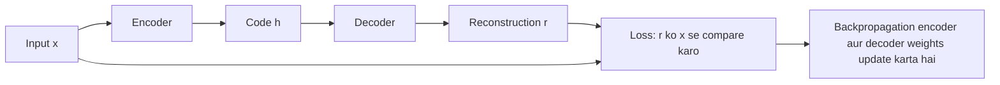
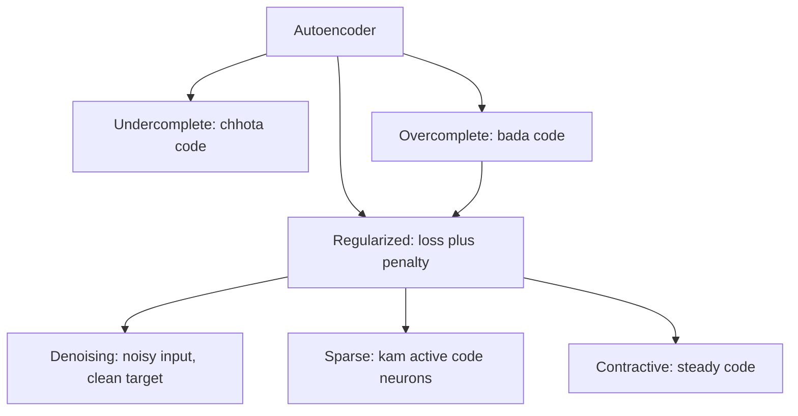
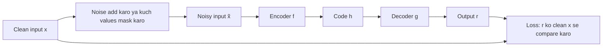
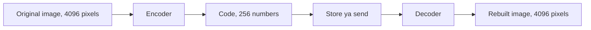

Naye ideas se pehle, purane ideas jo chahiye woh yahan hain. Agar aapko pehle se pata hai, toh next section pe chale jao.

## Pehle basics

- Neural network ek bada formula hai jisme bahut saare adjust hone wale numbers hote hain, jinhe **weights** kehte hain (aur **biases**, jo har neuron pe add hone wale extra numbers hain).
- **Layer** matlab neurons ki ek row. Har neuron apne inputs ka weighted sum leta hai aur use ek **activation function** (jaise sigmoid ya ReLU) se pass karta hai.
- **Training** matlab weights ko aise adjust karna ki network ka output **target** (jo answer humein chahiye) ke paas aa jaaye.
- **Loss** ek number hai jo batata hai ki output target se kitna door hai. Kam matlab better.
- **Backpropagation** nikaalta hai ki loss ke liye har weight kitna zimmedaar hai, aur **gradient descent** har weight ko thoda sa hilata hai taaki loss kam ho.
- **Supervised learning** ko har example ka label chahiye (ye photo "cat" hai). **Unsupervised learning** mein labels nahi hote; network ko data mein patterns khud dhoondhne padte hain.
- **Regularization** matlab koi bhi trick jo network ko sirf ratta maarne (memorize karne) se rokti hai, jaise loss mein ek penalty add karna.

## Introduction: autoencoder kya hai

**Analogy.** Socho aap apne dost ko SMS pe ek lamba address bhejte ho. Aap har word poora type nahi karte; aap short version likhte ho ("Flat 3B, Shanti Apts, nr station, Thane W"). Dost use padhke poora address wapas bana leta hai. Achha short version likhne ke liye aapko pata hona chahiye ki kaunse parts important hain.

<Box kind="definition">

**Autoencoder:** ek neural network jise apne input ko output tak copy karna sikhaya jaata hai, beech ki ek narrow layer ke through jise **code** kehte hain (isko bottleneck ya latent representation bhi kehte hain). Pehla half, **encoder**, input ko code mein squeeze karta hai; doosra half, **decoder**, code se input ko wapas banata hai. Wapas bane output ko **reconstruction** kehte hain.

</Box>

Ye syllabus <Syl m="3" /> hai.

**Ye kyun zaroori hai.**

- Zyaadatar real data (photos, sound, sensor readings) ke labels nahi hote, aur labelling slow aur mehngi hai. Autoencoder sirf data se seekhta hai, kyunki **input hi apna target hai**.
- Real data mein bahut repetition hota hai. Photo mein paas-paas ke pixels lagbhag same hote hain. Autoencoder ek **short summary** dhoondhta hai jo important patterns rakhti hai aur repetition hata deti hai.
- Ye summary compression, noise hataane, high-dimensional data ko plot karne, unusual inputs pakadne aur doosre network ke liye ready-made features ke kaam aati hai.

**Key point.** Copy karna bekaar lagta hai. Trick ye hai ki hum network ko perfectly copy **nahi** karne dete. Hum ek restriction lagate hain (narrow code, noisy input, penalty), taaki input ko achhe se rebuild karne ka ek hi tareeka bache: data ke real patterns seekhna. Woh patterns, jo code mein store hote hain, wahi humein chahiye. <Cite id="gfdl-ch14" />

Exam mein English mein likho: "An autoencoder is trained to copy its input to its output through a narrow code, so it is forced to learn the important features of the data."

## Main components aur architecture

| Part | What it is | What it does |
|---|---|---|
| Input layer | Data, jaise $28\times28$ image jo 784 numbers mein flatten ki gayi | Jise compress karna hai |
| Encoder | Ek ya zyada layers jo patli hoti jaati hain | Input ko short code mein badalta hai |
| Code (bottleneck) | Beech ki sabse patli layer | Input ki short summary rakhta hai |
| Decoder | Layers jo phir se chaudi hoti hain, aksar encoder ki mirror image | Code ko wapas full-size output banata hai |
| Output layer | Input jitni hi size | Wapas bana input (reconstruction) |
| Loss | Reconstruction error | Batata hai network ne input kitna achha rebuild kiya |

<Figure caption="Ek deep undercomplete autoencoder. Encoder 6 inputs ko 2-number code tak patla karta hai; decoder use wapas 6 tak chauda karta hai. Output layer input jitni hi badi hai, aur goal hai output = input.">
  <NetworkFigure layers="6,4,2,4,6" title="Encoder, code, decoder" labels="Input x,Encoder,Code h,Decoder,Output r" />
</Figure>

**Ek formula jo yaad rakhna hai.** Symbols mein encoder hai $h = f(x)$ (input $x$ code $h$ banta hai), decoder hai $r = g(h)$ (code reconstruction $r$ banta hai), aur training reconstruction loss $L(x, g(f(x)))$ ko kam karti hai. Words mein: "rebuild hua output original input se kitna alag hai?" Real numbers ke liye usual choice **squared error** hai: har output value ko uski input value se subtract karo, square karo, aur sab add karo.

$$
L(x, r) = \sum_{i=1}^{d} (x_i - r_i)^2
$$

Yahan $d$ input values ki ginti hai, $x_i$ $i$-th input value hai aur $r_i$ $i$-th rebuilt value. 0 se 1 ke beech ke inputs (jaise pixel brightness) ke liye binary cross-entropy bhi common hai. <Cite id="gfdl-ch14" loc="§14.1" /> <Cite id="keras-blog-autoencoders" />

**Chhota worked example.**

Given: input $x = [1, 0, 1, 0]$ aur reconstruction $r = [0.9, 0.1, 0.8, 0.0]$.
To find: squared-error loss $L(x, r)$.

1. Har output ko uske input se subtract karo, ye dekhne ke liye ki har value kitni galat hai: $1 - 0.9 = 0.1$, $0 - 0.1 = -0.1$, $1 - 0.8 = 0.2$, $0 - 0 = 0$.
2. Har difference ka square karo, taaki upar ki galti aur neeche ki galti dono positive count hon: $0.01$, $0.01$, $0.04$, $0$.
3. Squares add karo, kyunki poore input ke liye loss ek hi number hota hai: $0.01 + 0.01 + 0.04 + 0 = 0.06$.

**Loss $L = 0.06$** (koi unit nahi; perfect copy pe $0$ aata).

<Box kind="verify">

Alag order mein add karo:

$$
(0.04 + 0) + (0.01 + 0.01) = 0.04 + 0.02 = 0.06
$$

Same answer. Range check: har value zyada se zyada $0.2$ galat hai, toh har square zyada se zyada $0.04$ hai aur chaar milke zyada se zyada $0.16$; $0.06$ $0$ aur $0.16$ ke beech hai, toh answer sensible hai.

</Box>

## Autoencoder kaise kaam karta hai (training)

1. Ek input lo (label ki zaroorat nahi).
2. **Encode:** encoder use short code mein squeeze karta hai.
3. **Decode:** decoder code se full-size output wapas banata hai.
4. **Compare:** loss measure karta hai ki output input se kitna door hai.
5. **Learn:** backpropagation aur gradient descent decoder aur encoder dono ke weights adjust karte hain taaki loss kam ho.
6. Bahut saare examples aur epochs pe **repeat** karo. Training ke baad aksar sirf encoder rakhte hain (code banane ke liye) ya sirf decoder (code se rebuild karne ke liye).

**Ek real wale ka size.** Classic MNIST example 784 pixels ko 32-number code mein compress karta hai, lagbhag 24.5 guna chhota. <Cite id="keras-blog-autoencoders" />

**Deep autoencoders.** Encoder aur decoder mein kai layers ho sakti hain. Deep wale better codes seekh sakte hain; 30-unit code wale ek deep autoencoder ne 30 dimensions wale PCA se kam reconstruction error diya. <Cite id="gfdl-ch14" loc="§14.3" /> <Cite id="gfdl-ch14" loc="§14.9" />

**Autoencoders ke advantages**

- Bina labels ke seekhte hain, isliye huge unlabelled datasets use kar sakte hain.
- Non-linear (curved) patterns seekhte hain, PCA ke ulat.
- Flexible: ek hi idea se compression, denoising, anomaly detection aur feature learning hota hai.

**Disadvantages**

- Rebuilt output **lossy** hota hai (paas, exact nahi), aur images ke liye aksar thoda blurry.
- **Data-specific:** faces pe train hua model maps jaisi cheezon pe kharab karta hai. <Cite id="keras-blog-autoencoders" />
- Agar code bahut bada ho ya network bahut powerful, toh **copy karke cheat** kar sakta hai, isliye restriction chahiye.
- Code size aur depth chunne mein trial and error lagta hai, aur training mein time lagta hai.

## Linear autoencoder aur PCA

**Linear autoencoder** koi activation function use nahi karta, toh encoder aur decoder sirf weighted sums (matrix multiplications) karte hain. Ye sirf flat (straight-line, flat-plane) patterns dhoondh sakta hai.

**PCA se rishta.** **PCA** (principal component analysis) ek classic method hai jo un directions ko rakhta hai jinme data sabse zyada failta hai aur baaki ko hata deta hai. Chhote code wala linear autoencoder yahi seekhta hai: agar 2-D points ek seedhi line ke paas hain, toh ek 1-number code jo bataye "line pe kitni door" unhe achhe se rebuild karne ke liye kaafi hai.

<Box kind="exam">

**Likhne wala key fact:** jab decoder linear ho aur loss mean squared error ho, toh undercomplete autoencoder **PCA wala hi subspace** span karna seekhta hai. Non-linear encoder aur decoder ke saath ye PCA ka zyada powerful, **non-linear generalization** ban jaata hai: curved patterns follow kar sakta hai. <Cite id="gfdl-ch14" loc="§14.1" /> <Cite id="wiki-pca" />

</Box>

| | PCA / linear autoencoder | Non-linear autoencoder |
|---|---|---|
| Patterns it can find | Flat (lines, planes) | Curved |
| Training | PCA ka direct solution hai; linear AE gradient descent use karta hai | Gradient descent |
| Power | Limited | Zyada, par overfit ho sakta hai |
| Speed | Fast | Slower |

## Undercomplete aur overcomplete autoencoders

<Box kind="definition">

**Undercomplete autoencoder:** code input se **chhota** hai.
**Overcomplete autoencoder:** code input se **bada** hai. (Same size wale code mein bhi overcomplete wali hi problem hai.)

</Box>

**Undercomplete: bottleneck seekhne pe majboor karta hai.** Agar aapko poori movie ek sentence mein batani ho, toh aap sirf important baat hi bologe. Chhote code ke saath network har value copy nahi kar sakta, toh use training data ke sabse important ("salient") features rakhne padte hain. Koi extra penalty nahi chahiye; ise plain reconstruction loss se train karte hain, kyunki narrow code khud copying rokta hai. <Cite id="gfdl-ch14" loc="§14.1" /> <Cite id="gfg-undercomplete-autoencoder" />

<Box kind="pitfall">

Sirf narrow code kaafi nahi hai. Agar encoder aur decoder bahut powerful (deep aur wide) hain, toh woh phir bhi "cheat" kar sakte hain: theory mein ek 1-number code bhi training set ke index jaisa kaam kar sakta hai, toh network useful features seekhne ki jagah ratta maar leta hai. Capacity sensible rakho. <Cite id="gfdl-ch14" loc="§14.1" />

</Box>

**Overcomplete: cheat karne ki jagah.** Input jitne ya usse bade code ke saath, ek simple network bhi har input value seedha aage pass karke perfect score le sakta hai aur kuch nahi seekhta. Isliye overcomplete autoencoder tabhi useful hai jab woh **regularized** ho: use "input copy karo" ke alawa ek extra rule milta hai. Iska fayda ek bada, rich code hai jo bahut saare features describe kar sakta hai. <Cite id="gfdl-ch14" loc="§14.2" /> <Cite id="gfg-overcomplete-autoencoder" />

<Figure caption="Left: undercomplete, code (2 neurons) input (5) se chhota hai, toh network ko summary banani padti hai. Right: overcomplete, code (6) input (3) se bada hai, toh extra rule ke bina woh bas copy kar sakta hai.">
  <NetworkFigure layers="5,2,5" title="Undercomplete" labels="Input,Code,Output" />
  <NetworkFigure layers="3,6,3" title="Overcomplete" labels="Input,Code,Output" />
</Figure>

| | Undercomplete | Overcomplete |
|---|---|---|
| Code size | Input se chhota | Input se bada (ya barabar) |
| What stops copying | Narrow bottleneck | Add kiya gaya regularizer (sparsity, noise, contraction) |
| Advantage | Simple, extra penalty nahi, compression deta hai | Rich, detailed features |
| Disadvantage | Bahut narrow toh detail khota hai; bahut powerful toh phir bhi ratta maar sakta hai | Regularize na karo toh identity (pure copy) seekh leta hai |
| Typical use | Compression, dimensionality reduction | Doosre task ke liye features |

## Autoencoders mein regularization

**Ye kya hai.** Sirf code chhota karne ki jagah, **regularized autoencoder** loss mein ek doosra goal add karta hai, taaki network ko input rebuild bhi karna pade **aur** koi aur achhi property bhi rakhni pade. Words mein: **total loss = reconstruction error + ek penalty**. (Book ke symbols mein, $J = L(x, g(f(x))) + \Omega$, jahan $\Omega$, "omega", penalty hai.) <Cite id="gfdl-ch14" loc="§14.2" />

**Ye kyun zaroori hai.** Isse hum bada (overcomplete bhi) code use kar sakte hain bina network ke seedha copy kiye. Extra rule decide karta hai ki kis tarah ke features seekhe jaayenge.

**Practice mein use hone wali teen achhi properties** (har ek se ek syllabus type banta hai):

| Property wanted | Type |
|---|---|
| Noise ya missing values se robust | Denoising |
| Sirf kuch code neurons active | Sparse |
| Chhote input changes pe code mushkil se badle | Contractive |

Module 2 ki normal tricks bhi kaam karti hain, jaise weight decay aur dropout. <Cite id="gfdl-ch7" />

## Denoising autoencoder (DAE)

**Ye kya hai.** Denoising autoencoder ko input ki ek **kharab (noisy) copy** di jaati hai aur use **clean original** output karna sikhaya jaata hai. <Cite id="gfdl-ch14" loc="§14.2.2" />

**Analogy.** Teacher aapko ek page deta hai jisme kuch words smudge ho gaye hain aur kehta hai poora page likho. Aap ye tabhi kar sakte ho jab aapko language samajh aati ho, letters copy karke nahi.

**Ye kyun zaroori hai.** Bade code wala plain autoencoder seedha copy kar sakta hai. Agar input kharab hai par target clean hai, toh copy karne se damage wapas aata hai aur punish hota hai, isliye network ko data ka real structure seekhna padta hai.

**Kaise kaam karta hai, step by step**

1. Ek clean input lo.
2. Use ek random rule se **corrupt** karo: ya toh values ka ek random hissa zero kar do (**masking noise**, original paper mein use hua <Cite id="vincent2008" />) ya chhota random **Gaussian noise** add karo. <Cite id="gfdl-ch14" loc="§14.5.1" />
3. Noisy copy ko encoder se pass karke code lo, aur decoder se output.
4. Output aur **clean** input (noisy wala nahi) ke beech loss nikalo.
5. Backpropagate karke update karo. Har baar jab example dikhao, **fresh noise** daalo, taaki network same kharab copy do baar na dekhe.

**Formula (pehle words mein).** "Input corrupt karo, corrupted copy ko encode aur decode karo, phir clean input se compare karo": $J = L(x, g(f(\tilde{x})))$, jahan $\tilde{x}$ ("x tilde") corrupted input hai. <Cite id="gfdl-ch14" loc="§14.5" />

**Ye kaam kyun karta hai.** Real data (faces, digits) saare possible inputs ke space ke andar ek patli, curved surface ke paas hota hai, jise **manifold** kehte hain. Noise point ko us surface se door dhakelta hai; DAE use wapas laana seekhta hai, toh use seekhna padta hai ki real data kahan rehta hai. <Cite id="gfdl-ch14" loc="§14.5" />

**Advantages:** robust features seekhta hai; bade code ke saath bhi seedha copy nahi seekhta; noise seedha hataata hai; stacked DAEs deep networks ko pretrain karne ka ek early tareeka the. <Cite id="vincent2010" />
**Disadvantages:** noise ka type aur amount chunna padta hai (bahut kam kuch nahi sikhata, bahut zyada signal hi barbaad kar deta hai); sirf usi tarah ka noise hataata hai jispe train hua; output blurry ho sakta hai.

**Applications:** noisy photos, purane scans aur audio saaf karna; robust feature learning; pretraining. <Cite id="keras-denoising-autoencoder" /> <Cite id="gfg-denoising-autoencoder" /> <Cite id="av-denoising-autoencoder" />

Exam mein English mein likho: "A denoising autoencoder is trained to reconstruct the clean input from a corrupted copy, so it cannot simply copy and must learn robust features."

## Sparse autoencoder

**Ye kya hai.** Ek autoencoder jiska code bada ho sakta hai, par kisi bhi ek input ke liye **sirf kuch code neurons active ho sakte hain**; baaki zero ya zero ke bahut paas rehte hain. <Cite id="gfdl-ch14" loc="§14.2.1" />

**Analogy.** Ek bade hospital mein bahut saare specialists hote hain. Tooti haddi ke liye sirf bone doctor aur X-ray technician kaam karte hain; baaki chup rehte hain. Har specialist ek tarah ke case mein expert ban jaata hai. Waise hi har code neuron ek particular pattern (ek edge, ek stroke, ek texture) pe respond karna seekhta hai.

**Ye kyun zaroori hai.** Isse bina copying ke ek bada, rich code milta hai, aur features samajhna aasaan hota hai kyunki har neuron ka ek matlab hota hai.

**Kaise kaam karta hai**

1. Input ko normal tareeke se encode karo.
2. Loss mein ek **sparsity penalty** add karo jo badhti hai jab bahut saare code neurons active hon. Dhyan do, penalty **activations** (code neurons ke outputs) pe hai, weights pe nahi.
3. Ab training "achha rebuild karo" aur "kam se kam neurons use karo" ke beech balance karti hai, toh har input neurons ka ek chhota, alag group on karta hai.

**Do common penalties (words mein).** Theory answer ke liye words kaafi hain; formula tabhi likho jab question maange.

- **L1 penalty:** code values ke size add karo (minus sign ignore karke) aur ek strength number $\lambda$ ("lambda") se multiply karo: $\Omega = \lambda\sum_j |h_j|$. Har active neuron cost badhata hai, toh training zyaadatar code values ko zero ya zero ke bahut paas dhakel deti hai.
- **KL-divergence penalty:** ek chhota target chuno ki har code neuron average mein kitni baar active hona chahiye (jaise 0.05, matlab lagbhag 5% time). Training set pe har neuron ki actual average activity measure karo, aur ek penalty add karo jo badhti hai jitna woh target se door jaaye. Jab average target ke barabar ho toh penalty zero hai. <Cite id="ufldl-autoencoders" /> <Cite id="wiki-kl-divergence" />

**Chhota worked example (L1 penalty).**

Given: code $h = [0.5, 0, -0.2, 0]$ aur strength $\lambda = 0.1$.
To find: L1 sparsity penalty $\Omega$.

1. Har code value ka size lo, sign hata ke, kyunki negative activity bhi activity hi hai: $0.5, 0, 0.2, 0$.
2. Inhe add karo, code ki total activity paane ke liye: $0.5 + 0 + 0.2 + 0 = 0.7$.
3. Strength se multiply karo, jo batati hai sparsity kitni important hai: $0.1 \times 0.7 = 0.07$.

**Penalty $\Omega = 0.07$** (koi unit nahi).

<Box kind="verify">

Pehle multiply, phir add: $0.1 \times 0.5 = 0.05$ aur $0.1 \times 0.2 = 0.02$, aur $0.05 + 0.02 = 0.07$. Same answer. Sign check: L1 penalty kabhi negative nahi ho sakti, aur $0.07 > 0$.

</Box>

<Figure caption="6 neurons ke overcomplete code wala sparse autoencoder. Is ek input ke liye sirf 2 code neurons active hain; cross kiye hue inactive hain (zero ke paas). Alag input alag kuch neurons on karega.">
  <NetworkFigure layers="4,6,4" title="Only a few code neurons fire" labels="Input,Code h,Output" dropped="1:1,1:2,1:4,1:5" />
</Figure>

**Advantages:** bina copying ke rich, overcomplete code; neurons specialise karte hain, toh features samajhna aasaan; classification ke liye achhe features.
**Disadvantages:** tune karne ke liye extra settings (target activity, penalty strength); bahut strong penalty reconstruction kharab karti hai; KL wale form ko bahut saare examples pe average activity chahiye.

**Applications:** classifiers ke liye feature learning, images aur text mein parts ya patterns dhoondhna. <Cite id="gfg-sparse-autoencoder" />

## Contractive autoencoder (CAE)

**Ye kya hai.** Ek autoencoder jiske code ko **steady** rehna padta hai: agar input bas thoda sa badle, toh code mushkil se badalna chahiye. <Cite id="rifai2011" />

**Analogy.** Car ka suspension. Road ke chhote bumps (input mein chhote, unimportant changes) passenger seat (code) ko mushkil se hilane chahiye. Road ka asli turn phir bhi car ko ghumata hai.

**Ye kyun zaroori hai.** Chhote bekaar changes (ek pixel ka noise, thoda brightness change) se ye nahi badalna chahiye ki network input ko kya "samajhta" hai. Steady code robust features deta hai.

**Kaise kaam karta hai**

1. Input ko normal tareeke se encode karo.
2. Measure karo ki code kitna **sensitive** hai: har code value aur har input value ke liye, jab woh input value thoda hilaao toh code value kitni badalti hai? Ye sensitivities ek table banati hain jise **Jacobian** kehte hain. <Cite id="wiki-jacobian" />
3. Ek penalty add karo jo us table ki saari entries ke squares ka sum hai (iska squared **Frobenius norm**).
4. Training do kheenchon ke beech balance karti hai: reconstruction loss chahta hai ki code badle jab input sach mein badle, aur penalty chahti hai ki woh kam se kam badle. Result: code un directions ko follow karta hai jinme real data badalta hai aur baaki ko ignore karta hai.

**Formula (sirf agar maanga jaaye):** total loss = reconstruction loss + strength $\times$ (squared sensitivities ka sum), yaani $J = L(x, g(f(x))) + \lambda\left\lVert \dfrac{\partial h}{\partial x}\right\rVert_F^2$, jahan $\lambda$ strength set karta hai. "Contractive" naam ka matlab: inputs ka ek chhota neighbourhood codes ke aur bhi chhote neighbourhood pe map hota hai. <Cite id="gfdl-ch14" loc="§14.7" />

**Advantages:** chhote changes se robust features; data ka shape (uska manifold) seekhta hai.
**Disadvantages:** badi layers ke liye sensitivity table compute karna mehenga hai; tune karne ke liye ek aur setting ($\lambda$).

**Applications:** robust feature extraction, pretraining, noisy data pe classification. <Cite id="gfg-contractive-autoencoder" />

**DAE versus CAE.** Kareebi cousins. Denoising autoencoder **reconstruction** ko input ke chhote par finite changes se resist karwata hai. Contractive autoencoder **code (features)** ko input ke bahut hi chhote changes se resist karwata hai. <Cite id="gfdl-ch14" loc="§14.7" />

## Aur types jo dikh sakte hain

- **Convolutional autoencoder:** encoder aur decoder mein dense layers ki jagah convolution layers use karta hai. Images ke liye best. <Cite id="keras-denoising-autoencoder" />
- **Variational autoencoder (VAE):** encoder har code value ke liye ek average aur ek spread output karta hai, aur code unse sample hota hai, toh iska decoder naya data generate kar sakta hai. Ye zyada generative models mein aata hai. <Cite id="kingma2013-vae" /> <Cite id="gfg-vae" />

## Saare types side by side

| Type | Rule that stops copying | What it learns | Main use |
|---|---|---|---|
| Undercomplete | Code input se chhota | Sabse important features | Compression, dimensionality reduction |
| Overcomplete | Code input se bada; regularizer chahiye | Rich features (sirf regularized ho toh) | Doosre task ke liye features |
| Denoising | Noisy input, clean target | Robust features, noise kaise hataayein | Image aur audio cleaning |
| Sparse | Kam code neurons active (activations pe penalty) | Ek neuron per pattern | Classification ke liye features |
| Contractive | Chhote input changes pe code insensitive (derivatives pe penalty) | Real data directions follow karne wale features | Robust features |

## Application: image compression

**Ye kya hai.** Autoencoder use karke image ko uske saare pixels ki jagah uske short code ke roop mein store ya send karna. Ye syllabus <Syl m="3" /> topic 3.3 hai.

**Ye kyun zaroori hai.** Images badi hoti hain. Ek $64 \times 64$ grey image 4096 numbers hai; agar code mein 256 numbers hain, toh store ya send karne ko 16 guna kam.

**Kaise kaam karta hai**

1. Jis tarah ki images compress karni hain, unki bahut saari images pe ek undercomplete (usually convolutional) autoencoder train karo.
2. **Compress:** image ko sirf encoder se chalao aur code rakh lo.
3. Image ki jagah code **store ya send** karo.
4. **Decompress:** code pe decoder chalao aur image wapas lo.

**Advantages:** us type ki images ke hisaab se tuned compression seekhta hai; ek trained model us tarah ki kisi bhi image pe kaam karta hai; denoising ke saath combine ho sakta hai.
**Disadvantages:**

- Ye **lossy** hai: rebuilt image original ke paas hai, par exactly same nahi. <Cite id="keras-blog-autoencoders" />
- Ye **data-specific** hai: faces pe train hua, faces achhe se compress karta hai par maps nahi. <Cite id="keras-blog-autoencoders" />
- Dono sides ko trained decoder chahiye.
- Simple autoencoder shayad hi kabhi JPEG ko beat karta hai. <Cite id="keras-blog-autoencoders" /> Dhyan se design kiye learned systems code ko round (quantize) bhi karte hain aur entropy coding se pack karte hain; inke baare mein report hua hai ki ye JPEG aur JPEG 2000 ko beat karte hain, ya JPEG 2000 ke competitive hain. <Cite id="balle2016" /> <Cite id="theis2017" /> <Cite id="wiki-image-compression" />

## Aur applications

- **Dimensionality reduction:** plotting ya fast learning ke liye bahut saare features ko kuch mein squeeze karna. <Cite id="gfdl-ch14" loc="§14.9" /> <Cite id="wiki-dimensionality-reduction" />
- **Feature learning aur pretraining:** trained encoder ko classifier ke pehle part ki tarah use karna. <Cite id="mlm-autoencoder-features" />
- **Denoising:** DAE se noisy images ya signals saaf karna. <Cite id="tf-autoencoder" />
- **Anomaly detection:** sirf normal data pe train karo (jaise normal bank transactions). Ajeeb input kharab rebuild hota hai, toh high reconstruction error use flag kar deta hai. <Cite id="tf-autoencoder" />
- **Information retrieval:** short binary codes se database similar items bahut fast dhoondh leta hai (semantic hashing). <Cite id="gfdl-ch14" loc="§14.9" />

Upar sab ke liye achhi further reading: <Cite id="gfg-autoencoders" /> <Cite id="gfg-autoencoder-types" /> <Cite id="gfg-autoencoder-working" /> <Cite id="ibm-autoencoder" /> <Cite id="av-autoencoders" /> <Cite id="tp-autoencoders" /> <Cite id="wiki-autoencoder" />, aur <Cite id="nptel-dl" /> ke autoencoder lectures.

## Ye kahan poocha gaya

| If the question says | What to write | Seen as |
|---|---|---|
| "Explain denoising autoencoder model" ya "What are denoising autoencoders?" | Definition, kyun zaroori, corrupt-phir-rebuild steps, flow diagram, masking ya Gaussian noise, advantages, uses | <PYQ id="2023-12/q1d" /> <PYQ id="2024-12/q1d" /> |
| "What are undercomplete autoencoders?" | Code input se chhota, bottleneck important features pe majboor karta hai, PCA se link, zyada capacity ka risk, uses | <PYQ id="2024-05/q1d" /> |
| "Main components of an autoencoder and its architecture" | Encoder, code, decoder, loss; labelled diagram; training steps; advantages aur uses | <PYQ id="2024-05/q3b" /> |
| "Explain any three types of autoencoders" | Undercomplete, denoising aur sparse (ya contractive): idea, working, pros aur cons, use; comparison table | <PYQ id="2024-05/q5b" /> <PYQ id="2024-12/q5b" /> |
| "Working of autoencoders and types in detail" | Pehle architecture aur training steps, phir undercomplete, overcomplete, denoising, sparse aur contractive; comparison table | <PYQ id="2025-05/q2b" /> |

## Quick revision

- Autoencoder = encoder (input se short code) + code + decoder (code se wapas input), output = input banane ke liye train hota hai. Labels nahi chahiye. Loss: $L(x, g(f(x)))$, usually squared error.
- Undercomplete: code input se chhota; bottleneck seekhne pe majboor karta hai. Linear plus squared error PCA subspace span karta hai.
- Overcomplete: code input se bada; copy kar sakta hai, isliye regularize karna zaroori (loss + penalty).
- Denoising: noisy input, clean target. Robust features seekhta hai; images aur audio saaf karne mein use hota hai.
- Sparse: sirf kuch code neurons active; activations pe penalty (L1 ya chhote target jaise 0.05 ke saath KL).
- Contractive: chhote input changes pe code mushkil se badalta hai; penalty = squared sensitivities ka sum (Jacobian, Frobenius norm).
- Image compression: encoder code banata hai, use store ya send karo, decoder rebuild karta hai. Lossy aur data-specific.

**Conclusion.** Autoencoder unlabelled data ki ek short, useful summary seekhta hai, ek restriction ke andar apna hi input rebuild karne ki koshish karke; jo restriction chuni jaati hai (narrow code, noise, sparsity, steadiness) wahi type decide karti hai aur ye bhi ki woh kis kaam ke liye achha hai.

Exam mein English mein likho: "An autoencoder learns a compact representation of unlabelled data by reconstructing its own input under a constraint; the constraint decides its type."
