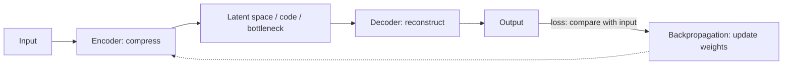
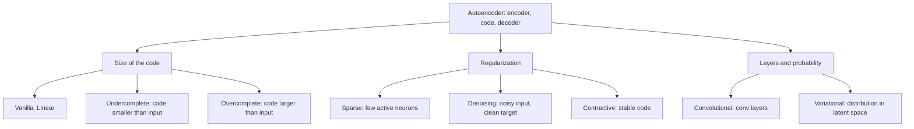
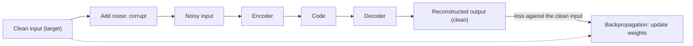
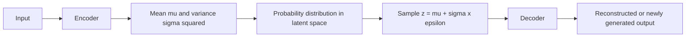

Naye ideas se pehle wo purani baatein jo chahiye. Agar pata hai to seedha agle section par jao.

## Basics pehle

- **Neuron** inputs leta hai, har ek ko **weight** se multiply karta hai, **bias** add karta hai, aur result activation function se guzarta hai. Weights aur biases wo **parameters** hain jo network seekhta hai. <Cite id="class-dl-chp2" loc="slide 4" />
- **Loss** error hai: output us se kitna door hai jo humein chahiye tha. Network **backpropagation** (gradient peeche flow karta hai) aur weight update se loss kam karta hai. <Cite id="class-dl-chp3" loc="slide 3" />
- **Supervised learning** ko labels chahiye (har example ka sahi answer). **Unsupervised learning** ko labels nahi chahiye. Autoencoder ko labels nahi chahiye kyunki **input hi uska target hai**. <Cite id="class-dl-chp3" loc="slide 6" />
- **Dimensionality** un values ki sankhya hai jo ek example describe karti hain. 28 × 28 image mein 28 × 28 = 784 pixel values hain, to uski 784 dimensions hain. <Cite id="class-dl-chp3" loc="slide 4" />

## Autoencoder kya hai?

**Problem.** Bahut saara real-world data (images, audio, text) bahut bada hota hai. Problems hain high storage requirement, slow processing, kai unnecessary features aur useful patterns seekhne mein difficulty. Humein data ko important information khoye bina compress karne ka method chahiye. <Cite id="class-dl-chp3" loc="slide 2" />

<Box kind="definition">

**Autoencoder:** an unsupervised neural network that learns to compress the input into a smaller representation (encoding) and then reconstruct the original input from that compressed representation. **Goal: Input ≈ Output.** <Cite id="class-dl-chp3" loc="slide 2" />

</Box>

Textbook ke words: "Autoencoders are self-supervised machine learning models which are used to reduce the size of input data by recreating it." Ye supervised models ki tarah train hote hain, par inference mein unsupervised models ki tarah kaam karte hain, isliye inhe self-supervised kehte hain. PCA jaisi dusri dimensionality reduction techniques ke mukable ek advantage ye hai ki autoencoders **complex non-linear correlations** capture kar sakte hain. <Cite id="class-dl-m3" loc="p. 4" />

**"Autoencoder" naam kyun?** *Auto* matlab wo automatically (bina labels ke) seekhta hai; *encoder* matlab wo data compress karta hai. To autoencoder automatically encode (compress) aur decode (reconstruct) karna seekhta hai. <Cite id="class-dl-chp3" loc="slide 2" />

**Rozmarra ka example.** Aap ek lamba chapter padhte ho aur paanch line ka chhota summary likhte ho (encoder aur code). Baad mein sirf un paanch lines se chapter dobara likhne ki koshish karte ho (decoder). Agar summary mein important points the to rewrite chapter jaisa lagta hai. Agar space ki limit na hoti to aap chapter ko seedha copy kar dete, aur kuch seekhte nahi; **chhoti summary size aapko samajhne par majboor karti hai**.

### Main components

| Part | Kya karta hai |
|---|---|
| **Input** | Raw data (image, audio, text) |
| **Encoder (compress)** | Dimensionality kam karta hai aur important information nikalta hai |
| **Latent space / Code / Bottleneck** | Chhoti compressed representation (important features) |
| **Decoder (reconstruct)** | Code se original data reconstruct karta hai |
| **Output** | Reconstructed data; input jaisa dikhta hai |

<Cite id="class-dl-chp3" loc="slide 2" />

<Cite id="class-dl-chp3" loc="slide 4" /> Ye syllabus <Syl m="3" /> hai.

Teacher do paas ke words alag karte hain: **latent representation** encoder ki seekhi hui overall compact representation hai, aur **latent code** wo numerical vector hai jo use represent karta hai (jaise [0.8, 0.3, 0.6, 0.2, …]). Dono interchangeably use hote hain. <Cite id="class-dl-chp3" loc="slide 4" />

**Sum 1: code kitna chhota hai?** <Cite id="class-dl-chp3" loc="slide 4" />

<Sum>

<Given>

$28 \times 28$ pixels ka input. Encoder ise $784 \to 128 \to 64 \to 16$ kam karta hai.

</Given>

<Find>

input values ki sankhya, aur code kitni baar chhota hai.

</Find>

<Steps>

1. **Input values:** $28 \times 28 = 784$.
2. **Code size:** 16 values (bottleneck).
3. **Compression:** $784 \div 16 = 49$.

</Steps>

<Answer>

Code mein 784 ki jagah 16 values hain: wo 49 guna chhota hai.

</Answer>

<Box kind="verify">

Peeche se check karo: $16 \times 49 = 784$. Decoder ko sirf 16 numbers se saare 784 pixels rebuild karne hain, isliye output input ke close ho sakta hai, identical nahi.

</Box>

</Sum>

## Autoencoder kaise kaam karta hai aur kaise train hota hai

Teacher ke steps (image ke liye): <Cite id="class-dl-chp3" loc="slide 2" />

1. Input (image / data) do.
2. Encoder ise compress karta hai.
3. Important information bottleneck mein store hoti hai.
4. Decoder original data reconstruct karta hai.
5. Output ko input se compare karo.
6. Loss calculate hota hai.
7. Backpropagation weights update karta hai.
8. Output input jaisa hone tak repeat karo.

Textbook kehta hai ki unlabeled dataset ko supervised problem ki tarah frame kiya jaata hai: output $\hat x$, input $x$ ka reconstruction, jo **reconstruction error** $L(x, \hat x)$ minimize karke train hota hai, jo original input aur reconstruction ka difference naapta hai. Bottleneck key hai: "without the presence of an information bottleneck, our network could easily learn to simply memorize the input values by passing these values along through the network". <Cite id="class-dl-m3" loc="p. 6" />

### Loss function

Loss input aur output ka difference naapta hai. Do sabse common loss functions: <Cite id="class-dl-chp3" loc="slide 3" />

- **MSE loss:** $L_{MSE} = \dfrac{1}{n}\sum_{i=1}^{n} (x_i - \hat x_i)^2$
- **L1 loss (MAE):** $L_{L1} = \dfrac{1}{n}\sum_{i=1}^{n} |x_i - \hat x_i|$

jahan $x_i$ original input hai aur $\hat x_i$ reconstructed output.

**Sum 2: reconstruction loss.** <Cite id="class-dl-chp3" loc="slide 12" />

<Sum>

<Given>

Input $x = [1, 2, 3, 4]$ aur reconstructed output $\hat x = [0.9, 1.9, 3.1, 4.0]$ (teacher ke linear autoencoder ka example).

</Given>

<Find>

MSE loss aur L1 loss.

</Find>

<Steps>

1. **Differences** $x_i - \hat x_i$: $0.1, 0.1, -0.1, 0$.
2. **MSE:** squares $0.01, 0.01, 0.01, 0$; sum $= 0.03$; $n = 4$ se divide: $0.03 / 4 = 0.0075$.
3. **L1:** absolute values $0.1, 0.1, 0.1, 0$; sum $= 0.3$; 4 se divide: $0.3 / 4 = 0.075$.

</Steps>

<Answer>

MSE $= 0.0075$ aur L1 $= 0.075$. Dono chhote hain kyunki output input ke kareeb hai.

</Answer>

<Box kind="verify">

Perfect reconstruction ($\hat x = x$) dono ke liye 0 deta. Agar output door hota (jaise sab zero), to MSE $(1 + 4 + 9 + 16)/4 = 7.5$ hota, to loss achhe aur bure ko saaf alag karta hai.

</Box>

</Sum>

### Training mein kya dhyan rakhein (teacher ki list)

**Code (bottleneck) size** sabse critical hyperparameter hai: ye decide karta hai data kitna compress hoga aur ye regularization term ki tarah bhi kaam kar sakta hai. **Layers ki sankhya** bhi critical hai: zyada depth model complexity badhati hai, kam depth process karne mein faster. **Har layer mein nodes** encoder ki har agli layer ke saath kam hote hain (aur decoder mein wapas badhte hain). Do famous reconstruction losses MSE aur L1 hain. <Cite id="class-dl-chp3" loc="slide 7" />

### Ideal autoencoder do cheezein balance karta hai

Use inputs ke prati itna sensitive hona chahiye ki accurate reconstruction bana sake, aur itna insensitive ki training data ko simply memorize ya overfit na kare. To loss ke do terms hote hain: reconstruction loss $L(x, \hat x)$ aur ek **regularizer** jo memorization discourage karta hai: $L(x, \hat x) + \text{regularizer}$. Regularizer ke aage ek scaling parameter trade-off adjust karta hai. <Cite id="class-dl-m3" loc="p. 7" />

## Architecture

- **Encoder:** high-dimensional input ko chhoti representation mein badalta hai aur important features nikalta hai (784 pixels se 64 features). <Cite id="class-dl-chp3" loc="slide 3" />
- **Bottleneck:** sabse chhoti hidden layer; sirf sabse important information store karti hai. Ise latent space, code ya compressed representation bhi kehte hain. <Cite id="class-dl-chp3" loc="slide 3" />
- **Decoder:** bottleneck representation se original input reconstruct karta hai; low-dimensional code ko wapas high-dimensional data mein badalta hai. Output input ke jitna ho sake close hona chahiye. <Cite id="class-dl-chp3" loc="slide 3" />

**Advantages:** automatically seekhta hai (unsupervised), labels nahi chahiye, data compress karta hai, useful features seekhta hai, redundancy hataata hai, kai applications ke liye useful. **Disadvantages:** output hamesha input jaisa identical nahi, compression mein kuch information kho sakti hai, sahi bottleneck size chahiye, bade data ke liye computationally expensive ho sakta hai. <Cite id="class-dl-chp3" loc="slide 3" />

### Autoencoders ki properties

Teacher ki slides teen properties batati hain. <Cite id="class-dl-chp3" loc="slide 6" />

- **Data-specific:** autoencoders sirf us data jaisa data meaningfully compress kar sakte hain jis par wo train hue. Handwritten digits par train hua autoencoder landscape photos compress nahi kar sakta. (Ye gzip jaise standard compression algorithm se alag hain.)
- **Lossy:** output bilkul input jaisa nahi hota; wo ek close par degraded representation hota hai. Lossless compression chahiye to ye sahi raasta nahi.
- **Unsupervised:** train karne ke liye explicit labels nahi chahiye. Aur precise kahein to ye **self-supervised** hain, kyunki ye training data se apne labels khud banate hain.

### Autoencoder versus PCA

| Aspect | Autoencoder | PCA (Principal Component Analysis) |
|---|---|---|
| Type | Neural network (deep learning) | Mathematical technique (linear algebra) |
| Learning | Non-linear features seekhta hai | Linear features seekhta hai |
| Data | Complex data ke saath achha | Simple / linear data ke saath achha |
| Architecture | Encoder + bottleneck + decoder | Koi encoder ya decoder nahi |
| Power | Zyada powerful | Simpler |

<Cite id="class-dl-chp3" loc="slide 3" />

Textbook: kyunki neural networks non-linear relationships seekh sakte hain, autoencoder ko "a more powerful (nonlinear) generalization of PCA" maana ja sakta hai. PCA data ko describe karne wala lower-dimensional **hyperplane** dhundta hai; autoencoders non-linear **manifolds** seekh sakte hain (manifold simple words mein ek continuous, non-intersecting surface hai). <Cite id="class-dl-m3" loc="p. 13" />

## Autoencoders ke types

Teacher nau types draw karte hain: <Cite id="class-dl-chp3" loc="slide 8" />

| # | Type | Matlab | Main purpose |
|---|---|---|---|
| 1 | **Vanilla** | Ek encoder aur ek decoder wala basic autoencoder | Input compress aur reconstruct karna seekhta hai |
| 2 | **Linear** | Sirf linear activation functions | Simple linear relationships seekhta hai (PCA jaisa) |
| 3 | **Undercomplete** | Hidden layer (code) mein input se kam neurons | Data compress karta hai aur important features seekhta hai |
| 4 | **Overcomplete** | Hidden layer mein input se zyada neurons | Detailed features seekhta hai (input copy karne se bachne ke liye regularization chahiye) |
| 5 | **Sparse** | Sirf kuch neurons active ho sakte hain | Memorization se bachkar useful features seekhta hai |
| 6 | **Contractive** | Aise features seekhta hai jo chhote input changes par bahut kam badalte hain | Model ko chhote input variations ke prati robust banata hai |
| 7 | **Denoising** | Input jaan-boojh kar noisy, par output clean data hona chahiye | Noise hataata hai aur clean input reconstruct karta hai |
| 8 | **Convolutional (CAE)** | Fully connected layers ke bajaye convolutional layers | Compression, denoising aur image reconstruction ke liye image features seekhta hai |
| 9 | **Variational (VAE)** | Fixed code ke bajaye probability distribution seekhta hai | Training data jaisa naya data generate karta hai (generative model) |

<Cite id="class-dl-chp3" loc="slides 8 and 29" />

### Vanilla autoencoder

<Box kind="definition">

**Vanilla Autoencoder:** the basic (standard) autoencoder that learns to compress the input into a smaller representation (code) and then reconstruct the original input. It consists of Encoder → Bottleneck (Code) → Decoder. <Cite id="class-dl-chp3" loc="slide 9" />

</Box>

"Vanilla" matlab basic ya standard version: ye sparse constraints, noise addition, convolution layers ya variational learning jaisi special techniques use nahi karta. <Cite id="class-dl-chp3" loc="slide 9" /> Ye image compression, feature extraction, dimensionality reduction, data representation learning aur data mein basic patterns seekhne ke liye use hota hai. **Disadvantages:** noise effectively nahi hata sakta, naya data generate nahi kar sakta, sahi design na ho to input memorize kar sakta hai, advanced autoencoders se kam powerful. <Cite id="class-dl-chp3" loc="slide 10" />

### Linear autoencoder

<Box kind="definition">

**Linear Autoencoder:** an autoencoder that uses only linear activation functions (or no activation function) in both the encoder and the decoder. It learns only linear relationships in the data. <Cite id="class-dl-chp3" loc="slide 11" />

</Box>

Vanilla autoencoder linear aur non-linear dono patterns seekh sakta hai, par kuch datasets mein sirf simple linear relationships hote hain, jahan non-linear activations unnecessary hain aur computation badhate hain. ReLU, Sigmoid, Tanh ya Leaky ReLU use nahi hota. <Cite id="class-dl-chp3" loc="slide 11" />

**Mathematical idea.** Encoder: Code $Z = W_1 X + b_1$. Decoder: Output $\hat X = W_2 Z + b_2$, jahan $W$ weights hai aur $b$ bias. Kahin bhi activation function use nahi hota. <Cite id="class-dl-chp3" loc="slide 12" />

**PCA se relationship.** Linear autoencoder Principal Component Analysis jaisa hi behave karta hai: dono dimensions kam karte hain, important information preserve karte hain aur data compress karte hain. Difference ye hai ki linear autoencoder neural-network based hai, training se seekhta hai aur deep networks tak extend ho sakta hai, jabki PCA ek statistical technique hai jo mathematical decomposition use karti hai aur sirf linear dimensionality reduction tak limited hai. <Cite id="class-dl-chp3" loc="slide 12" />

**Advantages:** simple architecture, fast training, low computational cost, implement karna aasan. **Disadvantages:** sirf linear relationships seekhta hai, complex non-linear patterns capture nahi kar sakta, real-world image data ke liye kam accurate. Apple example mein sirf brightness changes (linear) achhe se kaam karte hain; alag backgrounds, rotations aur shapes (non-linear) se reconstruction kharab aati hai. <Cite id="class-dl-chp3" loc="slides 11 and 12" />

### Undercomplete autoencoder

**Problem.** Vanilla autoencoder bina meaningful features seekhe input ko seedha output mein copy kar sakta hai. Agar network ke paas enough neurons hain to wo data samajhne ke bajaye memorize kar sakta hai. Humein network ko sirf sabse important information seekhne par majboor karne ka tareeka chahiye. <Cite id="class-dl-chp3" loc="slide 13" />

<Box kind="definition">

**Undercomplete Autoencoder:** an autoencoder in which the hidden layer (Bottleneck/Code) has fewer neurons than the input layer. Because of this smaller bottleneck, the network is forced to compress the data and keep only the important features. <Cite id="class-dl-chp3" loc="slide 13" />

</Box>

Ise "undercomplete" isliye kehte hain kyunki **Code Size < Input Size**. Example: Input layer 784 neurons, bottleneck 64 neurons, output layer 784 neurons: bottleneck input se chhota hai. <Cite id="class-dl-chp3" loc="slide 13" /> Textbook ise yun samjhata hai: "the simplest architecture for constructing an autoencoder is to constrain the number of nodes present in the hidden layer(s) of the network, limiting the amount of information that can flow through the network". Reconstruction error ke hisaab se network ko penalize karke model input ke sabse important attributes seekhta hai. <Cite id="class-dl-m3" loc="p. 12" />

**Kaise kaam karta hai.** (1) Input encoder mein jaata hai. (2) Encoder information compress karta hai. (3) Bottleneck sirf important features store karta hai. (4) Decoder original input reconstruct karta hai. (5) Loss calculate hota hai. (6) Weights backpropagation se update hote hain. <Cite id="class-dl-chp3" loc="slide 13" />

**Main idea.** Bottleneck network ko memorize ke bajaye seekhne par majboor karta hai: sirf sabse useful information guzarti hai. Example: 100 input features, bottleneck 20, aur 100 output features: model ko 100 features sirf 20 mein compress karne hain, jisse sabse informative features seekhne ko encourage milta hai. <Cite id="class-dl-chp3" loc="slide 14" />

**Advantages:** meaningful features seekhta hai, data efficiently compress karta hai, input ki simple copying rokta hai, overfitting kam karta hai, train karna aasan. **Disadvantages:** bahut chhota bottleneck important information kho sakta hai, reconstruction quality ghat sakti hai, bottleneck size chunna important hai. <Cite id="class-dl-chp3" loc="slide 14" /> Ye image compression, feature extraction, dimensionality reduction, data representation learning aur deep networks ko pre-train karne ke liye use hota hai. <Cite id="class-dl-chp3" loc="slide 13" />

Textbook ek caution add karta hai: undercomplete autoencoder mein explicit regularization term nahi hota, to ye sunishchit karne ka ek hi tareeka hai ki wo memorize nahi kar raha, hidden nodes ki sankhya restrict karna. Deep autoencoders ke liye encoder aur decoder ki capacity bhi matter karti hai: agar wo kaafi powerful hon to ek-node bottleneck bhi memorize kar sakta hai. <Cite id="class-dl-m3" loc="p. 15" />

| | Undercomplete | Vanilla |
|---|---|---|
| Bottleneck | Input se chhota | Basic architecture; size specifically constrained nahi |
| Purpose | Data compression force karta hai | Strongly compress kar bhi sakta hai, nahi bhi |
| Kya seekhta hai | Important features | Reconstruction ka basic version |
| Risk | Bottleneck bahut chhota ho to information kho sakti hai | Bada ho to input copy kar sakta hai |

<Cite id="class-dl-chp3" loc="slide 14" />

### Overcomplete autoencoder

<Box kind="definition">

**Overcomplete Autoencoder:** an autoencoder in which the hidden layer (Code/Bottleneck) has more neurons than the input layer. This larger hidden layer allows the network to learn more detailed feature representations. It is called overcomplete because **Code Size > Input Size**. <Cite id="class-dl-chp3" loc="slide 15" />

</Box>

Example: 784 input neurons, 1024 bottleneck neurons, 784 output neurons. Ye richer feature representations seekhne, zyada information preserve karne, fine details capture karne aur reconstruction quality improve karne mein help karta hai. <Cite id="class-dl-chp3" loc="slide 15" /> **Catch:** hidden layer mein input se zyada neurons hain, to network ke paas input memorize karne ki capacity hai, isliye **regularization techniques (sparse regularization, dropout, noise injection) add ki jaati hain** taaki wo copy karne ke bajaye meaningful features seekhe. Textbook ke words mein, overcomplete case mein "even a linear encoder and linear decoder can learn to copy the input to the output without learning anything useful about the data distribution". <Cite id="class-dl-chp3" loc="slides 16 and 17" />

**Advantages:** rich feature representations seekhta hai, better reconstruction quality, zyada information preserve, complex datasets ke liye useful. **Disadvantages:** input memorize kar sakta hai, overfitting ka zyada risk, usually regularization chahiye, undercomplete se computationally zyada expensive. <Cite id="class-dl-chp3" loc="slide 16" />

**Sum 3: undercomplete ya overcomplete?** <Cite id="class-dl-chp3" loc="slides 13 and 15" />

<Sum>

<Given>

Teen autoencoders, har ek mein 784 input values: (a) code 64, (b) code 1024, (c) code 784.

</Given>

<Find>

kaun undercomplete hai aur kaun overcomplete.

</Find>

<Steps>

1. **(a)** $64 < 784$: code input se chhota, to **undercomplete**.
2. **(b)** $1024 > 784$: code input se bada, to **overcomplete**.
3. **(c)** $784 = 784$: code na chhota na bada; ye undercomplete nahi hai (compress karne par majboor nahi).

</Steps>

<Answer>

(a) undercomplete, (b) overcomplete, (c) koi nahi (plain vanilla design). (a) ka compression ratio $784 \div 64 = 12.25$ hai.

</Answer>

<Box kind="verify">

Rule: code size $k$ ko input size $n$ se compare karo: $k < n$ undercomplete, $k > n$ overcomplete. (c) borderline case hai jiska naam class sheets nahi deti.

</Box>

</Sum>

| | Undercomplete | Overcomplete |
|---|---|---|
| Hidden layer size | Input se kam neurons ($k < n$) | Input se zyada neurons ($k > n$) |
| Purpose | Compression force karta hai | Richer representations seekhta hai par regularize na ho to input memorize kar sakta hai |
| Information passed | Sirf important information guzarti hai | Input se zyada information pass kar sakta hai |
| Regularization ki zaroorat | Memorization ka kam risk | Memorization ka high risk; regularization chahiye (sparse, dropout, weight decay) |

<Cite id="class-dl-chp3" loc="slides 14 and 16" />

## Regularized autoencoders

Textbook inhe aise autoencoders kehta hai jo code dimension aur encoder-decoder ki capacity chunne ki ability dete hain. Encoder aur decoder ko shallow aur code size ko chhota rakhkar model capacity limit karne ke bajaye, regularized autoencoders **aisa loss function use karte hain jo model ko input ko output mein copy karne ki ability ke alawa aur properties rakhne ke liye encourage karta hai**: representation ki sparsity, representation ke derivative ki smallness, aur noise ya missing inputs ke prati robustness. Regularized autoencoder non-linear aur overcomplete ho sakta hai phir bhi data distribution ke baare mein kuch useful seekh sakta hai, chahe uski capacity trivial identity function seekhne jitni ho. <Cite id="class-dl-chp3" loc="slide 29" />

Teacher ki wajah: autoencoder ka kaam input ko jitna accurately ho sake reconstruct karna hai; agar model bahut powerful hai to wo useful features seekhne ke bajaye training data memorize kar sakta hai, isliye hum regularization use karte hain. <Cite id="class-dl-chp3" loc="slide 31" />

| Regularization | Idea | Kahan use hota hai |
|---|---|---|
| **L1** | Weights ki absolute values par penalty; kuch weights zero ya zero ke kareeb ("don't use unnecessary weights") | General autoencoders |
| **L2** | Weights ki squared values par penalty ("keep the weights small") | General autoencoders |
| **Sparse regularization** | Sirf kuch neurons active hon, zyadatar activations zero ke kareeb | Sparse autoencoder |
| **Denoising regularization** | Input mein jaan-boojh kar noise add; model wo important features seekhta hai jo kuch information damage hone par bhi bache rahein | Denoising autoencoder |
| **Contractive regularization** | Encoder ko aisi representations banane ke liye encourage karta hai jo input ke chhote changes ke prati kam sensitive hon | Contractive autoencoder |

<Cite id="class-dl-chp3" loc="slide 31" />

**Important clarification (teacher ki).** L1 aur L2 regularization **techniques** hain; Sparse, Denoising, Contractive, VAE, Convolutional wagairah autoencoder **variants/types** hain. Ye mat kaho "L1 ek type ka autoencoder hai aur L2 doosra type". <Cite id="class-dl-chp3" loc="slide 31" />

## Sparse autoencoder

**Problem.** Overcomplete autoencoder mein hidden layer mein bahut neurons hote hain, to network useful features seekhne ke bajaye input ko simply memorize ya copy kar sakta hai. Humein aisa method chahiye jo network ko ek samay mein sirf kuch hi neurons use karne par majboor kare. <Cite id="class-dl-chp3" loc="slide 19" />

<Box kind="definition">

**Sparse Autoencoder:** an autoencoder that forces only a small number of hidden neurons to be active at a time, while most neurons remain inactive. Goal: learn important and meaningful features instead of memorizing the input. <Cite id="class-dl-chp3" loc="slide 19" />

</Box>

"Sparse" matlab bahut kam active neurons. Example: 100 neurons ki hidden layer jisme sirf 5 se 10 active hain aur baaki inactive; isliye representation ko sparse kehte hain. <Cite id="class-dl-chp3" loc="slide 19" />

Textbook: sparse autoencoders "an alternative method for introducing an information bottleneck **without requiring a reduction in the number of nodes** at our hidden layers" dete hain. Iske bajaye loss function **layer ki activations ko penalize** karta hai, to kisi bhi observation ke liye network sirf kuch neurons activate karke kaam karta hai. Ye regularization ka alag approach hai, kyunki hum normally network ke weights regularize karte hain, activations nahi. Kaun se neurons activate honge ye **data-dependent** hai: alag inputs alag nodes activate karte hain. <Cite id="class-dl-m3" loc="p. 17" />

**Kaise kaam karta hai** (teacher ke chhe steps): <Cite id="class-dl-chp3" loc="slide 19" />

1. Input encoder mein jaata hai.
2. Encoder hidden layer mein activations banata hai.
3. Sparsity constraint / penalty zyadatar neurons ko inactive rakhne ke liye encourage karti hai.
4. Sirf kuch neurons strongly active hote hain.
5. Decoder input reconstruct karta hai.
6. **Reconstruction loss + sparsity penalty** minimize hote hain.

**Sparse representation aur sparsity kaise enforce hoti hai.** Sparsity ke bina bahut neurons active hote hain; sparsity ke saath sirf kuch active aur baaki inactive (near-zero). Loss function mein sparsity penalty add hoti hai: **Total Loss = Reconstruction Loss + Sparsity Penalty**, to model input sahi reconstruct karne aur zyadatar hidden neurons ko inactive rakhne ke liye encourage hota hai. Apple example mein hidden layer "round shape", "red colour", "smooth texture", "stem" ko alag neurons ki tarah seekh sakti hai, aur ek particular image ke liye sirf kuch activate hote hain. <Cite id="class-dl-chp3" loc="slide 20" />

### Sparsity constraint lagane ke do tareeke

Textbook: dono mein har training batch ke liye hidden layer activations naapi jaati hain aur excessive activations ko penalize karne ke liye loss mein ek term add hota hai. Do terms hain **L1 regularization** aur **KL divergence** (Kullback-Leibler divergence). <Cite id="class-dl-m3" loc="p. 19" />

- Activations par **L1 regularization** $\lambda \sum |a_j|$ (absolute activations ka sum) ke barabar penalty add karta hai, to activations zero ki taraf dhakel diye jaate hain.
- **KL divergence** "measures and limits the average activation rate of hidden units in neural networks to keep activity low". Discrete distributions $P$ aur $Q$ ke liye: $D(P \| Q) = \sum P(x) \log \dfrac{P(x)}{Q(x)}$. <Cite id="class-dl-m3" loc="pp. 17 and 19" />

Teacher ka poora loss $L = \lVert x - \hat x \rVert^2 + \lambda \sum_{j=1}^{k} KL(\rho \,\|\, \hat\rho_j)$ hai, jahan $\rho$ = desired sparsity (jaise 0.05), $\hat\rho_j$ = hidden neuron $j$ ki average activation aur $\lambda$ sparsity weight. <Cite id="class-dl-m3" loc="p. 18" />

**Sum 4: L1 sparsity penalty (teacher ki activations).** <Cite id="class-dl-chp3" loc="slide 31" />

<Sum>

<Given>

Sparse layer ki hidden activations: $0.9, 0, 0, 0.7, 0, 0, 0.8, 0$. Ek dense layer jisme 8 activations $0.5$ ki hain. $\lambda = 0.1$.

</Given>

<Find>

har layer ka L1 sparsity penalty aur kitne neurons active hain.

</Find>

<Steps>

1. **Sparse layer:** $\sum |a_j| = 0.9 + 0.7 + 0.8 = 2.4$. Penalty $= 0.1 \times 2.4 = 0.24$. Active neurons: 8 mein se 3.
2. **Dense layer:** $\sum |a_j| = 8 \times 0.5 = 4.0$. Penalty $= 0.1 \times 4.0 = 0.40$. Active neurons: 8 mein se 8.

</Steps>

<Answer>

Sparse layer par 0.24 aur dense layer par 0.40 penalty lagti hai, to penalty network ko sparse pattern ki taraf dhakelti hai jisme 8 mein se sirf 3 neurons active hain.

</Answer>

<Box kind="verify">

$0.9 + 0.7 + 0.8 = 2.4$ aur $0.1 \times 2.4 = 0.24$. Dense layer ki total activation bada hai (4.0 vs 2.4), to badi penalty expected result hai.

</Box>

</Sum>

**Sum 5: do distributions ke beech KL divergence (chhota check).** <Cite id="class-dl-m3" loc="p. 19" />

<Sum>

<Given>

Do discrete distributions $P = (0.5, 0.5)$ aur $Q = (0.9, 0.1)$. Natural logarithm.

</Given>

<Find>

$D(P \| Q) = \sum P(x) \ln \dfrac{P(x)}{Q(x)}$.

</Find>

<Steps>

1. **Pehla term:** $0.5 \times \ln(0.5 / 0.9) = 0.5 \times (-0.588) = -0.294$.
2. **Doosra term:** $0.5 \times \ln(0.5 / 0.1) = 0.5 \times 1.609 = 0.805$.
3. **Jodo:** $-0.294 + 0.805 = 0.511$.

</Steps>

<Answer>

$D(P \| Q) \approx 0.511$. Ye tabhi zero hota hai jab $P = Q$, to bada value matlab dono distributions zyada door hain.

</Answer>

<Box kind="verify">

$Q = P = (0.5, 0.5)$ rakho: har term $0.5 \ln 1 = 0$, to $D = 0$. Formula distributions ke beech distance ki tarah behave karta hai (ye symmetric nahi hai, isliye ise divergence kehte hain).

</Box>

</Sum>

**Sparse AE overcomplete se kaise alag hai:** sparse AE ki hidden layer bade ya chhote size ki ho sakti hai aur ek samay mein sirf kuch neurons active hote hain; overcomplete mein bada hidden layer hota hai, kai neurons active ho sakte hain aur wo memorize kar sakta hai. Sparse AE mein built-in sparsity regularization ka kaam karti hai. <Cite id="class-dl-chp3" loc="slides 17 and 19" /> Overcomplete ke liye ye useful kyun: "You have many neurons, but you can activate only a few at a time": overcomplete → many neurons → sparsity constraint → few active neurons → less memorization → better feature learning. <Cite id="class-dl-chp3" loc="slide 20" />

**Sparse autoencoders ke advantages:** meaningful features seekhta hai, memorization rokta hai, overfitting kam karta hai, overcomplete hidden layers ke saath achha, zyada useful aur interpretable representations. **Disadvantages:** extra sparsity constraint/penalty chahiye, sparsity level chunna important hai, training zyada complex ho sakti hai, bahut zyada sparsity important information kho sakti hai. <Cite id="class-dl-chp3" loc="slides 19 and 20" />

## Denoising autoencoder

**Problem.** Real-world data aksar noisy ya corrupted hota hai (random pixels, blur, sensor noise, distortions, missing information). Normal autoencoder jo bhi diya jaaye use reconstruct karna seekh sakta hai, noise samet. Humein aisa autoencoder chahiye jo noise hata kar original clean data recover kare. <Cite id="class-dl-chp3" loc="slide 23" />

<Box kind="definition">

**Denoising Autoencoder (DAE):** an autoencoder that receives a noisy input but is trained to reconstruct the original clean input. Main idea: Noisy Input → Autoencoder → Clean Output. It is called "denoising" because the network learns to remove unwanted noise from the input while keeping the important information. <Cite id="class-dl-chp3" loc="slide 23" />

</Box>

Textbook ki explanation: "The input seen by the autoencoder is not the raw input but a stochastically corrupted version. A denoising autoencoder is thus trained to reconstruct the original input from the noisy version." <Cite id="class-dl-m3" loc="p. 26" /> Aur: is approach se model training data ko memorize karne wala mapping nahi bana sakta, kyunki input aur target output ab same nahi; model input ko lower-dimensional manifold (wo high-density region jahan data concentrate hota hai) ki taraf map karne wala vector field seekhta hai, to agar ye manifold natural data ko accurately describe kare, "we've effectively canceled out the added noise". <Cite id="class-dl-m3" loc="p. 20" />

<Cite id="class-dl-chp3" loc="slide 23" />

**Key points.** Model ko diya gaya input noisy data hai; target/output original clean data hai; model seekhte hue noise automatically hataata hai; wo aise important features seekhta hai jo noise ke prati insensitive hain. **Remember: Input (noisy) ≠ Target (clean). Yahi main difference hai!** <Cite id="class-dl-chp3" loc="slide 23" />

**Training process.** Clean image lo, noise add karke noisy image banao, noisy image encoder ko do, decoder reconstructed image deta hai, aur use **clean target** se compare karo. Phir reconstruction loss, backpropagation, update weights. Loss functions MSE (mean squared error) ya MAE (mean absolute error) hain. <Cite id="class-dl-chp3" loc="slide 24" />

**Noise ke types** (teacher ke chaar): **Gaussian noise** (pixel values mein random variations), **salt-and-pepper noise** (random black aur white pixels), **masking noise** (kuch input values randomly hide), **speckle noise** (images mein aksar dikhne wala multiplicative noise). <Cite id="class-dl-chp3" loc="slide 24" />

**Ye overfitting kyun kam karta hai?** Agar model input simply copy kare to wo noise bhi copy karega; par use clean version banane ke liye train kiya gaya hai. Isliye use har pixel memorize karne ke bajaye important underlying features seekhne padte hain. <Cite id="class-dl-chp3" loc="slide 24" />

**Sum 6: target clean input hai.** <Cite id="class-dl-chp3" loc="slide 24" />

<Sum>

<Given>

Clean input $x = [0.2, 0.8]$. Noise add karne ke baad network ka input $\tilde x = [0.5, 0.4]$ hai. Network output $\hat x = [0.25, 0.75]$ deta hai.

</Given>

<Find>

output ka clean input $x$ ke against MSE (sahi) aur noisy input $\tilde x$ ke against (galat target).

</Find>

<Steps>

1. **Clean input ke against:** differences $0.2 - 0.25 = -0.05$ aur $0.8 - 0.75 = 0.05$; squares $0.0025$ aur $0.0025$; MSE $= 0.005 / 2 = 0.0025$.
2. **Noisy input ke against:** differences $0.5 - 0.25 = 0.25$ aur $0.4 - 0.75 = -0.35$; squares $0.0625$ aur $0.1225$; MSE $= 0.185 / 2 = 0.0925$.

</Steps>

<Answer>

Clean input ke against MSE $= 0.0025$ (chhota: noise hata diya gaya). Noisy input ke against $= 0.0925$. Denoising autoencoder pehle number ko chhota banane ke liye train hota hai, to uska output clean data ke close hota hai, noisy input ke nahi.

</Answer>

<Box kind="verify">

$0.0925 / 0.0025 = 37$, to output clean input ke noisy input se 37 guna zyada kareeb hai. Isse dikhta hai ki output sach mein cleaned version hai.

</Box>

</Sum>

**Advantages:** data se noise hataata hai, robust features seekhta hai, simple memorization kam karta hai, image restoration ke liye useful, generalization improve kar sakta hai; ise **data augmentation** ki tarah bhi use kiya ja sakta hai, kyunki restored images augmented data ki tarah use ho sakti hain. **Disadvantages:** suitable noisy training data chahiye, bahut zyada noise important information naqs kar sakta hai, noise ke saath useful details bhi hata sakta hai, sahi type aur level ka noise chunne ke liye domain knowledge lag sakti hai, training computationally zyada expensive ho sakti hai. <Cite id="class-dl-chp3" loc="slides 24 and 30" />

| | Denoising autoencoder | Normal autoencoder |
|---|---|---|
| Input | Noise / corrupted input | Clean input |
| Target / output | Original clean input | Input ke same |
| Purpose | Noise hataana aur clean data recover karna | Input ko jaisa hai waisa reconstruct karna |
| Kya seekhta hai | Robust aur meaningful features | Noise bhi copy karna seekh sakta hai |
| Use case | Noise removal, data cleaning | General representation learning |

<Cite id="class-dl-chp3" loc="slide 23" />

Teacher ka easy trick: **DAE = Denoise and Reconstruct Clean Data.** Applications: image denoising, image restoration, medical image processing, speech denoising, sensor noise hataana aur feature learning. <Cite id="class-dl-chp3" loc="slide 24" />

## Contractive autoencoder

**Problem.** Normal autoencoder input ke chhote changes ke prati bahut sensitive ho sakta hai. Brightness, position, pixel values ya noise mein ek tiny change bahut alag hidden representation bana sakta hai. Hum chahte hain ki autoencoder **stable features** seekhe jo input thoda badalne par zyada na badlein. <Cite id="class-dl-chp3" loc="slide 21" />

<Box kind="definition">

**Contractive Autoencoder:** an autoencoder that learns a representation that is insensitive to small changes in the input. In simple words: **small input change → small change in the encoded representation**. "Contract" means pull closer / make less sensitive. <Cite id="class-dl-chp3" loc="slide 21" />

</Box>

**Kaise kaam karta hai.** Contractive autoencoder mein ek additional penalty hoti hai jo encoder ko input thoda badalne par bahut zyada badalne se rokti hai. Training objective: **Total Loss = Reconstruction Loss + Contractive Penalty.** Contractive penalty hidden representation ko stable rakhne ke liye encourage karti hai. <Cite id="class-dl-chp3" loc="slide 21" />

Textbook ka reasoning: bahut similar inputs ke liye learned encoding bhi bahut similar honi chahiye. Hum ise explicitly train kar sakte hain ye **require karke ki hidden layer activations ka derivative input ke respect mein chhota ho**. Ye denoising autoencoder jaisa hai, kyunki input ke chhote perturbations ko noise maana jaata hai. Book ke words: "denoising autoencoders make the reconstruction function (i.e. decoder) resist small but finite-sized perturbations of the input, while contractive autoencoders make the feature extraction function (i.e. encoder) resist infinitesimal perturbations of the input." <Cite id="class-dl-m3" loc="p. 22" />

**Mathematical idea.** Contractive autoencoder ek penalty add karta hai jo is par based hai ki encoder representation input ke changes ke prati kitna sensitive hai. Ek common form $L = L_{reconstruction} + \lambda \left\lVert \dfrac{\partial h}{\partial x} \right\rVert_F^2$ hai, jahan $h$ hidden representation hai, $x$ input, $\lambda$ contractive penalty ki strength, aur $\left\lVert \dfrac{\partial h}{\partial x} \right\rVert_F^2$ naapta hai ki hidden representation input ke prati kitni sensitive hai. Simple meaning: kam sensitivity → zyada stable features. <Cite id="class-dl-chp3" loc="slide 22" />

**Sum 7: ek-number contractive penalty (class files mein nahi hai; idea dikhane ke liye add kiya).** Ek weight wala encoder $h = w\,x$ lo, to slope $\partial h / \partial x = w$ hai.

<Sum>

<Given>

Do encoders, $h = 0.5\,x$ aur $h = 3\,x$. Contractive strength $\lambda = 0.1$. Input $x = 1$ se $x = 1.1$ ho jaata hai.

</Given>

<Find>

har encoder ke liye contractive penalty $\lambda (\partial h / \partial x)^2$ aur code mein change.

</Find>

<Steps>

1. **Encoder 1 ($w = 0.5$):** penalty $= 0.1 \times 0.5^2 = 0.1 \times 0.25 = 0.025$. Code $0.5$ se $0.55$ hota hai, change $0.05$.
2. **Encoder 2 ($w = 3$):** penalty $= 0.1 \times 3^2 = 0.1 \times 9 = 0.9$. Code $3$ se $3.3$ hota hai, change $0.3$.

</Steps>

<Answer>

Encoder 1 ki penalty 0.025 aur code change 0.05; encoder 2 ki penalty 0.9 aur code change 0.3. Contractive penalty encoder 1 ko prefer karti hai, jiska code same input change ke liye kaafi stable hai.

</Answer>

<Box kind="verify">

Code change = slope $\times$ input change: $0.5 \times 0.1 = 0.05$ aur $3 \times 0.1 = 0.3$. Penalties ka ratio $0.9 / 0.025 = 36 = (3/0.5)^2$, jaisa hona chahiye.

</Box>

</Sum>

**Advantages:** robust features seekhta hai, input ke chhote variations ke prati kam sensitive, stable representations banata hai, feature extraction ke liye useful. **Disadvantages:** basic autoencoder se zyada complicated, additional penalty term chahiye, sahi $\lambda$ chunna important hai, computationally zyada expensive. <Cite id="class-dl-chp3" loc="slide 22" />

| | Sparse autoencoder | Contractive autoencoder |
|---|---|---|
| Kya karta hai | Kuch hi neurons active karta hai | Representation ko stable banata hai |
| Kya use karta hai | Sparsity constraint | Contractive penalty $\lambda \lVert \partial h/\partial x \rVert_F^2$ |
| Focus | Kaun se neurons activate hote hain? | Representation kitna badalti hai? |

<Cite id="class-dl-chp3" loc="slide 22" />

### Sparse, denoising aur contractive ki comparison

| | Sparse | Denoising | Contractive |
|---|---|---|---|
| Idea | Sirf kuch hidden neurons active | Noisy input, clean target | Input mein chhota change, code mein chhota change |
| Kya add hota hai | Activations par sparsity penalty (L1 ya KL divergence) | Input mein noise | Code ke derivative par contractive penalty |
| Loss | Reconstruction loss + sparsity penalty | Clean input ke against reconstruction loss | Reconstruction loss + contractive penalty |
| Main benefit | Memorization rokta hai; overcomplete layers ke saath kaam karta hai | Noise hataata hai; robust features | Stable features, chhote variations ke prati robust |
| Easy memory trick | Few neurons ON | Dirty input se clean output | Codes ko paas kheencho |

<Cite id="class-dl-chp3" loc="slides 19, 22 and 24" />

## Convolutional autoencoder (CAE)

**Problem.** Normal autoencoder fully connected layers use karta hai. Images ke liye ye efficient nahi: images mein spatial information hoti hai, paas ke pixels related hote hain, image flatten karne se 2D spatial structure khoti hai, aur fully connected layers ko bahut parameters chahiye. Humein images ke saath kaam karne ke liye specially designed autoencoder chahiye. <Cite id="class-dl-chp3" loc="slide 25" />

<Box kind="definition">

**Convolutional Autoencoder (CAE):** an autoencoder that uses convolutional layers in the encoder and decoder to learn and reconstruct image features. It is mainly used for image data. <Cite id="class-dl-chp3" loc="slide 25" />

</Box>

Encoder convolution aur pooling layers se bana hai jo features nikalti aur size kam karti hain; decoder upsampling / transposed convolution (deconvolution) aur convolution layers se image reconstruct karta hai. CAE spatial information preserve karta hai, image features automatically seekhta hai, fully connected networks se kam parameters use karta hai aur images compress, reconstruct aur denoise kar sakta hai. <Cite id="class-dl-chp3" loc="slides 25 and 26" /> Isme use hone wale convolution, max pooling aur flatten steps CNN ke note mein samjhaye gaye hain. <Cite id="class-dl-chp3" loc="slide 5" />

**Advantages:** spatial information preserve karta hai, image data ke liye excellent, image features automatically seekhta hai, local patterns detect karne ke liye convolutional filters use karta hai, compression aur denoising ke liye useful. **Disadvantages:** mainly spatial/image data ke liye designed, basic autoencoder se zyada complex, training mein significant computational resources lag sakte hain, reconstruction fine details kho sakta hai. <Cite id="class-dl-chp3" loc="slide 26" />

## Variational autoencoder (VAE)

**Problem.** Normal autoencoder har input ke liye ek **fixed** latent representation seekhta hai (jaise apple image ka code [0.2, 0.7, 0.4]). Ye reconstruction ke liye useful hai par naya data generate karne ke liye naturally designed nahi hai. Agar hum chahte hain ki model training data jaisi nayi images banaye, to alag approach chahiye. <Cite id="class-dl-chp3" loc="slide 27" />

<Box kind="definition">

**Variational Autoencoder (VAE):** a generative autoencoder that learns a probability distribution in the latent space and can use it to generate new data similar to the training data. **Simple meaning:** VAE learns a distribution of data and samples from it to generate new data. <Cite id="class-dl-chp3" loc="slide 27" />

</Box>

Textbook: "A variational autoencoder (VAE) provides a probabilistic manner for describing an observation in latent space. Thus, rather than building an encoder which outputs a single value to describe each latent state attribute, we'll formulate our encoder to describe a **probability distribution** for each latent attribute." <Cite id="class-dl-m3" loc="p. 28" />

**"Variational" kyun?** Ek fixed point ke bajaye encoder ek distribution seekhta hai jo **mean ($\mu$)** aur **variance ($\sigma^2$)** se describe hoti hai; to normal autoencoder mein Input → Encoder → Fixed code → Decoder → Output hota hai, jabki VAE mein Input → Encoder → $\mu$ aur $\sigma^2$ → latent space mein probability distribution → **ek point $z$ sample karo** → Decoder → Output. <Cite id="class-dl-chp3" loc="slide 27" />

**Kaise kaam karta hai (high level).** Encoder $\mu$ aur $\sigma^2$ output karta hai; inse hum ek distribution banate hain; phir us distribution se ek point sample karte hain (random noise $\varepsilon$ use karke) aur decoder ko dete hain. <Cite id="class-dl-chp3" loc="slide 27" /> Textbook sheet mein sampling formula $z = \mu + \sigma \odot \varepsilon$ hai, $\varepsilon \sim N(0, I)$ ke saath: ye **reparameterization** hai (randomness $\varepsilon$ mein chali jaati hai taaki network ab bhi backpropagation se train ho sake). <Cite id="class-dl-m3" loc="p. 29" />

<Cite id="class-dl-chp3" loc="slides 27 and 28" />

**Sum 8: latent variable sample karna.** <Cite id="class-dl-m3" loc="p. 29" />

<Sum>

<Given>

Ek latent attribute ke liye encoder $\mu = 0.5$ aur $\sigma = 0.2$ deta hai. $N(0, 1)$ se do random numbers $\varepsilon = 1.5$ aur $\varepsilon = -1$ hain.

</Given>

<Find>

do sampled values $z = \mu + \sigma \varepsilon$.

</Find>

<Steps>

1. **Pehla sample:** $z = 0.5 + 0.2 \times 1.5 = 0.5 + 0.3 = 0.8$.
2. **Doosra sample:** $z = 0.5 + 0.2 \times (-1) = 0.5 - 0.2 = 0.3$.

</Steps>

<Answer>

Same input do alag latent values deta hai, $z = 0.8$ aur $z = 0.3$, dono mean 0.5 ke aas-paas. Decoder ko dono se input achhe se reconstruct karna chahiye, jisse latent space smooth banta hai.

</Answer>

<Box kind="verify">

Values mean ke lagbhag $1.5$ standard deviations ke andar hain: $|0.8 - 0.5| = 0.3 = 1.5 \times 0.2$ aur $|0.3 - 0.5| = 0.2 = 1 \times 0.2$.

</Box>

</Sum>

### Reparameterization ki zaroorat kyun

Random point sample karna aisi calculation nahi jisse backpropagation gradient guzaar sake. $z = \mu + \sigma \varepsilon$ likhne se random part ($\varepsilon$, jise gradient nahi chahiye) us part se alag ho jaata hai jo network seekhta hai ($\mu$ aur $\sigma$), to gradient encoder tak wapas flow kar sakta hai. (Class sheet formula dikhati hai aur kehti hai ki latent vector "sampled using reparameterization"; upar ki wajah standard hai aur short rakhi gayi hai kyunki class files ise aur samjhati nahi.) <Cite id="class-dl-m3" loc="p. 29" />

### VAE loss function

VAE do important losses use karta hai. **Total VAE Loss = Reconstruction Loss + KL Divergence Loss.** <Cite id="class-dl-chp3" loc="slide 28" />

1. **Reconstruction loss:** check karta hai ki reconstructed output original input jaisa hai ya nahi (commonly MSE ya binary cross entropy).
2. **KL divergence loss:** learned latent distribution ko standard normal distribution $N(0, 1)$ ke kareeb rakhta hai. Ye latent space ko smooth, continuous, well-organized aur sampling ke liye suitable banata hai.

**KL divergence kyun chahiye?** KL term ke bina latent space irregular aur sample karne mein mushkil ho sakta hai; KL latent representations ko known distribution (commonly $N(0, 1)$) follow karne ke liye encourage karta hai, jisse naye points sample karna aur naya data generate karna aasan hota hai. <Cite id="class-dl-chp3" loc="slide 28" />

### Autoencoder versus VAE

| Feature | Normal autoencoder | Variational autoencoder (VAE) |
|---|---|---|
| Latent representation | Fixed code (point) seekhta hai | Probability distribution (μ aur σ²) seekhta hai |
| Main purpose | Mainly reconstruction ke liye | Reconstruction + generation ke liye |
| Sampling | Koi sampling nahi | Latent distribution se sample karta hai |
| Latent space | Irregular ho sakta hai | Smooth, continuous space ko encourage karta hai |
| KL divergence | Use nahi hota | Latent space regularize karne ke liye use hota hai |
| Generative ability | Naya data generate nahi kar sakta | Naya similar data generate kar sakta hai |

<Cite id="class-dl-chp3" loc="slide 28" />

**VAE ke advantages:** naya data generate kar sakta hai, smooth latent space seekhta hai, image generation ke liye useful, meaningful latent representations seekhta hai, existing data ke variations generate kar sakta hai. **Disadvantages:** generated outputs kabhi kabhi blurry ho sakte hain, normal autoencoder se zyada complex, training mein reconstruction aur KL losses ko balance karna padta hai, generated samples dusre models jitne sharp nahi ho sakte. <Cite id="class-dl-chp3" loc="slide 28" />

## Latent space aur uski visualization

**Latent space** compressed code ki space hai: har input chhote numbers ke set se describe hota hai, aur latent space mein us input ka point uski representation hai. <Cite id="class-dl-chp3" loc="slide 4" />

**Latent values ka matlab kya hai (textbook ka face example).** Encoding dimension 6 wala autoencoder faces ke bade dataset par ideally faces ke descriptive attributes seekhta hai jaise skin colour aur kya person chashma pehen raha hai. Har attribute ek single value se describe hota hai: Smile 0.99, Skin tone 0.85, Gender −0.73, Beard 0.85, Glasses 0.002, Hair colour 0.68. <Cite id="class-dl-m3" loc="p. 30" />

VAE ke saath har latent attribute ek single value ke bajaye **probability distribution** hota hai. Decode karte waqt hum har latent distribution se randomly sample karke decoder ka input banate hain, aur "we expect an accurate reconstruction for any sample from the latent state distributions". <Cite id="class-dl-m3" loc="pp. 31-33" />

**Latent space visualize karne se kya dikhta hai.** Teacher ki picture mein laal apples aur hare apples do-dimensional latent space ($z_1$, $z_2$) mein do clusters ki tarah hain. **Similar inputs ek dusre ke paas hote hain**, aur hum learned examples ke beech sample karke naya par similar data generate kar sakte hain. <Cite id="class-dl-chp3" loc="slide 28" /> Textbook wajah batata hai: encoder possible values ki ek range output karta hai jisme se hum sample karte hain, jo "a continuous, smooth latent space representation" enforce karta hai, to "values which are nearby to one another in latent space should correspond with very similar reconstructions". <Cite id="class-dl-m3" loc="p. 33" /> Latent space visualization ka aim (textbook ke practice questions mein se ek) isliye ye check karna hai ki autoencoder ne kya seekha hai: kya similar inputs saath baithte hain, kya groups (jaise laal aur hare apples) alag hain, aur kya space itna smooth hai ki naye samples generate ho sakein. <Cite id="class-dl-m3" loc="p. 35" />

**Sources par note.** Class files latent-space plot banane ka tareeka nahi dikhatin (jaise 2D mein project karna); wo sirf picture, face attributes aur aim dikhati hain. Upar ka answer usi tak limited hai.

## Autoencoders ke applications

Teacher aath applications list karte hain: <Cite id="class-dl-chp3" loc="slides 34 and 35" />

| # | Application | Autoencoder kya karta hai | Simple example |
|---|---|---|---|
| 1 | **Image / file compression** | Data size kam karta hai | Bade image ko compress karna |
| 2 | **Image denoising** | Noise hataata hai | Noisy photo se clean photo |
| 3 | **Dimensionality reduction** | Features ki sankhya kam karta hai | 1000 features se 100 features (classification ya clustering ke liye) |
| 4 | **Feature extraction** | Important features seekhta hai | Facial features (edges, shapes) seekhna kisi dusre model ke liye |
| 5 | **Anomaly detection** | Unusual data dhundta hai | Normal machines par train karo; **high reconstruction error matlab anomaly ya defect** (fraud detection, industrial defect detection) |
| 6 | **Data restoration / missing data recovery** | Damaged ya missing data reconstruct karta hai | Damaged image restore karna |
| 7 | **Image / data generation (VAE)** | Naya similar data generate karta hai | VAE naye fruit-like images generate karta hai (synthetic data creation) |
| 8 | **Recommendation systems** | User aur item patterns seekhta hai | User ki preferences seekhkar doosri movie recommend karna |

**Important note (teacher ka).** "Image transformation" ko general autoencoder application ki tarah list mat karo: image-to-image translation zyada commonly GANs se judi hai, halanki autoencoder-based models bhi kuch tasks ke liye use ho sakte hain. <Cite id="class-dl-chp3" loc="slide 34" />

Textbook ki list add karti hai: anomaly detection, data denoising (images, audio), image **inpainting** (missing hissa bharna), information retrieval; **watermark removal** (aur video ya movie banate waqt kisi object ko hataana); **image colouring** (black-and-white picture ko coloured banana); **feature variation** (image ke sirf required features nikalna aur noise ya unnecessary interruption hataakar output banana). Ye ye bhi yaad dilata hai ki autoencoders jo data unhone dekha usi ke hisaab se compression seekhte hain, to wo typically sirf training mein dekhe gaye observations ki class jaisa data hi reconstruct kar paate hain. <Cite id="class-dl-m3" loc="pp. 25-27" />

**Variational autoencoder ke applications** (textbook ki VAE sheet): image generation, image reconstruction, anomaly detection, drug / molecule generation, data compression, feature learning, signal processing aur recommendation systems. <Cite id="class-dl-m3" loc="p. 29" />

**Class mein image compression.** Encoder chhota code banata hai jo store ya send hota hai, aur decoder use se approximate (lossy) image rebuild karta hai. 64 × 64 × 3 image mein $64 \times 64 \times 3 = 12{,}288$ values hain; 128-dimensional code $12{,}288 \div 128 = 96$ guna chhota hai. <Cite id="class-dl-m3" loc="p. 34" />

## Ye kahan puchha gaya

| Question | Kya likhna hai | Solution |
|---|---|---|
| "Explain denoising autoencoder" / "What are denoising autoencoders?" | Problem, definition, noisy input se clean output, training, noise types, table | <PYQ id="2023-12/q1d" /> <PYQ id="2024-12/q1d" /> |
| "What are undercomplete autoencoders?" | Definition, code size < input size, kaise kaam karta hai, example, advantages | <PYQ id="2024-05/q1d" /> |
| "Main components of an autoencoder and its architecture" | Encoder, bottleneck, decoder, loss, diagram ke saath | <PYQ id="2024-05/q3b" /> |
| "Explain any three types of autoencoders" | Undercomplete, sparse, denoising (ya contractive, VAE): definition, diagram, working | <PYQ id="2024-05/q5b" /> <PYQ id="2024-12/q5b" /> |
| "Working of autoencoders and the types in detail" | Training loop, loss, nau types ek table mein | <PYQ id="2025-05/q2b" /> |
| "Applications of autoencoders and VAE" | Aath applications, VAE generation | <PYQ id="assignment-1/q3a" /> |
| "Role of latent space visualization" | Latent attributes, clusters, smooth space | <PYQ id="assignment-1/q3b" /> |
| "Effectiveness of sparse autoencoders against overfitting" | Sparsity penalty, kam active neurons, limits | <PYQ id="assignment-1/q3c" /> |
| "Compare sparse, denoising and contractive" | Comparison table | <PYQ id="assignment-1/q3d" /> |

## Quick revision

- Autoencoder = Encoder + code (bottleneck) + decoder. Unsupervised (self-supervised). Goal: Input ≈ Output, MSE ya L1 reconstruction loss aur backpropagation se train.
- Undercomplete: code input se chhota. Overcomplete: code input se bada, regularization chahiye. Linear: sirf linear activations (PCA jaisa).
- Sparse: kam active neurons (L1 ya KL divergence penalty). Denoising: noisy input, clean target. Contractive: input mein chhota change, code mein chhota change.
- Convolutional AE images ke liye conv layers use karta hai. VAE distribution (μ, σ²) seekhta hai, $z = \mu + \sigma \varepsilon$ sample karta hai, loss = reconstruction + KL, aur naya data generate kar sakta hai.
- Applications: compression, denoising, dimensionality reduction, feature extraction, anomaly detection (high reconstruction error), data restoration, generation (VAE), recommendation.
