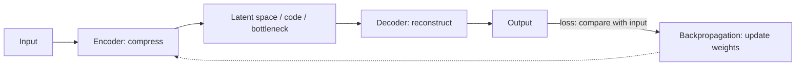
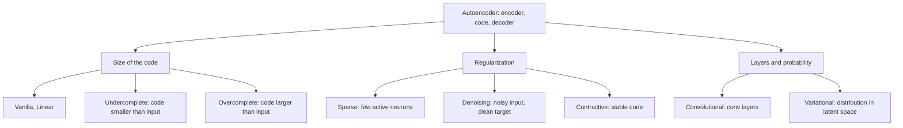
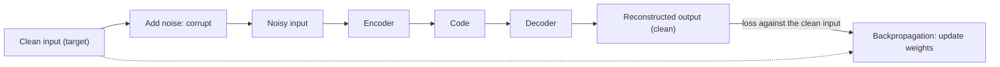
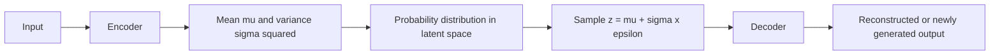

Before the new ideas, here are the old ones you need. If you already know them, skip to the next section.

## The basics first

- A **neuron** takes inputs, multiplies each by a **weight**, adds a **bias**, and passes the result through an activation function. The weights and biases are the **parameters** the network learns. <Cite id="class-dl-chp2" loc="slide 4" />
- The **loss** is the error: how far the output is from what we wanted. The network reduces the loss by **backpropagation** (the gradient flows back) and a weight update. <Cite id="class-dl-chp3" loc="slide 3" />
- **Supervised learning** needs labels (the right answer for every example). **Unsupervised learning** needs no labels. An autoencoder needs no labels because **the input is its own target**. <Cite id="class-dl-chp3" loc="slide 6" />
- **Dimensionality** is the number of values that describe one example. A 28 × 28 image has 28 × 28 = 784 pixel values, so it has 784 dimensions. <Cite id="class-dl-chp3" loc="slide 4" />

## What is an autoencoder?

**The problem.** Many real-world data (images, audio, text) are very large. The problems are high storage requirement, slow processing, many unnecessary features and difficulty in learning useful patterns. We need a method to compress the data without losing important information. <Cite id="class-dl-chp3" loc="slide 2" />

<Box kind="definition">

**Autoencoder:** an unsupervised neural network that learns to compress the input into a smaller representation (encoding) and then reconstruct the original input from that compressed representation. **Goal: Input ≈ Output.** <Cite id="class-dl-chp3" loc="slide 2" />

</Box>

The textbook words: "Autoencoders are self-supervised machine learning models which are used to reduce the size of input data by recreating it." They are trained like supervised models, but during inference they work as unsupervised models, which is why they are called self-supervised. One advantage over other dimensionality reduction techniques like PCA is that autoencoders can capture **complex non-linear correlations**. <Cite id="class-dl-m3" loc="p. 4" />

**Why is it called an "autoencoder"?** *Auto* means it learns automatically (without labels); *encoder* means it compresses data. So an autoencoder automatically learns how to encode (compress) and decode (reconstruct) data. <Cite id="class-dl-chp3" loc="slide 2" />

**Everyday analogy.** You read a long chapter and write a short summary of five lines (the encoder and the code). Later, only from those five lines, you try to rewrite the chapter (the decoder). If the summary kept the important points, the rewrite looks like the chapter. If you had no space limit you could just copy the chapter, and learn nothing; the **small summary size forces you to understand**.

### The main components

| Part | What it does |
|---|---|
| **Input** | The raw data (image, audio, text) |
| **Encoder (compress)** | Reduces dimensionality and extracts important information |
| **Latent space / Code / Bottleneck** | The small compressed representation (important features) |
| **Decoder (reconstruct)** | Uses the code to reconstruct the original data |
| **Output** | The reconstructed data; it looks like the input |

<Cite id="class-dl-chp3" loc="slide 2" />

<Cite id="class-dl-chp3" loc="slide 4" /> This is syllabus <Syl m="3" />.

The teacher separates two close words: **latent representation** is the overall compact representation learned by the encoder, and **latent code** is the numerical vector that represents it (for example [0.8, 0.3, 0.6, 0.2, …]). They are used interchangeably. <Cite id="class-dl-chp3" loc="slide 4" />

**Sum 1: how much smaller is the code?** <Cite id="class-dl-chp3" loc="slide 4" />

<Sum>

<Given>

Input of $28 \times 28$ pixels. The encoder reduces it $784 \to 128 \to 64 \to 16$.

</Given>

<Find>

the number of input values, and how many times smaller the code is.

</Find>

<Steps>

1. **Input values:** $28 \times 28 = 784$.
2. **Code size:** 16 values (the bottleneck).
3. **Compression:** $784 \div 16 = 49$.

</Steps>

<Answer>

The code has 16 values instead of 784: it is 49 times smaller.

</Answer>

<Box kind="verify">

Check backwards: $16 \times 49 = 784$. The decoder must rebuild all 784 pixels from only 16 numbers, which is why the output can only be close to the input, not identical.

</Box>

</Sum>

## How an autoencoder works and is trained

The teacher's steps (for an image): <Cite id="class-dl-chp3" loc="slide 2" />

1. Give input (image / data).
2. The encoder compresses it.
3. It stores the important information in the bottleneck.
4. The decoder reconstructs the original data.
5. Compare output with input.
6. The loss is calculated.
7. Backpropagation updates the weights.
8. Repeat until the output becomes similar to the input.

The textbook says the unlabeled dataset is framed as a supervised problem: output $\hat x$, a reconstruction of the input $x$, trained by minimizing the **reconstruction error** $L(x, \hat x)$, which measures the difference between the original input and the reconstruction. The bottleneck is the key: "without the presence of an information bottleneck, our network could easily learn to simply memorize the input values by passing these values along through the network". <Cite id="class-dl-m3" loc="p. 6" />

### The loss function

The loss measures the difference between input and output. The two most common loss functions are: <Cite id="class-dl-chp3" loc="slide 3" />

- **MSE loss:** $L_{MSE} = \dfrac{1}{n}\sum_{i=1}^{n} (x_i - \hat x_i)^2$
- **L1 loss (MAE):** $L_{L1} = \dfrac{1}{n}\sum_{i=1}^{n} |x_i - \hat x_i|$

where $x_i$ is the original input and $\hat x_i$ the reconstructed output.

**Sum 2: reconstruction loss.** <Cite id="class-dl-chp3" loc="slide 12" />

<Sum>

<Given>

Input $x = [1, 2, 3, 4]$ and reconstructed output $\hat x = [0.9, 1.9, 3.1, 4.0]$ (the teacher's linear autoencoder example).

</Given>

<Find>

the MSE loss and the L1 loss.

</Find>

<Steps>

1. **Differences** $x_i - \hat x_i$: $0.1, 0.1, -0.1, 0$.
2. **MSE:** squares $0.01, 0.01, 0.01, 0$; sum $= 0.03$; divide by $n = 4$: $0.03 / 4 = 0.0075$.
3. **L1:** absolute values $0.1, 0.1, 0.1, 0$; sum $= 0.3$; divide by 4: $0.3 / 4 = 0.075$.

</Steps>

<Answer>

MSE $= 0.0075$ and L1 $= 0.075$. Both are small because the output is close to the input.

</Answer>

<Box kind="verify">

A perfect reconstruction ($\hat x = x$) would give 0 for both. If the output were far (for example all zeros), the MSE would be $(1 + 4 + 9 + 16)/4 = 7.5$, so the loss clearly separates good from bad.

</Box>

</Sum>

### What to keep in mind when training (the teacher's list)

The **code (bottleneck) size** is the most critical hyperparameter: it decides how much the data is compressed and can also act as a regularization term. The **number of layers** is critical too: a higher depth increases model complexity, a lower depth is faster to process. The **number of nodes per layer** decreases with each subsequent layer in the encoder (and increases back in the decoder). The two famous reconstruction losses are MSE and L1. <Cite id="class-dl-chp3" loc="slide 7" />

### The ideal autoencoder balances two things

It should be sensitive to the inputs enough to accurately build a reconstruction, and insensitive enough that it does not simply memorize or overfit the training data. So the loss has two terms: a reconstruction loss $L(x, \hat x)$ and a **regularizer** that discourages memorization: $L(x, \hat x) + \text{regularizer}$. A scaling parameter in front of the regularizer adjusts the trade-off. <Cite id="class-dl-m3" loc="p. 7" />

## The architecture

- **Encoder:** converts high-dimensional input into a smaller representation and extracts important features (784 pixels become 64 features). <Cite id="class-dl-chp3" loc="slide 3" />
- **Bottleneck:** the smallest hidden layer; it stores only the most important information. Also called latent space, code or compressed representation. <Cite id="class-dl-chp3" loc="slide 3" />
- **Decoder:** uses the bottleneck representation to reconstruct the original input; converts the low-dimensional code back to high-dimensional data. The output should be as close as possible to the input. <Cite id="class-dl-chp3" loc="slide 3" />

**Advantages:** learns automatically (unsupervised), no labels required, compresses data, learns useful features, removes redundancy, useful for many applications. **Disadvantages:** the output is not always identical to the input, may lose some information during compression, needs a proper bottleneck size, can be computationally expensive for large data. <Cite id="class-dl-chp3" loc="slide 3" />

### Properties of autoencoders

The teacher's slides list three properties. <Cite id="class-dl-chp3" loc="slide 6" />

- **Data-specific:** autoencoders can only meaningfully compress data similar to what they were trained on. An autoencoder trained on handwritten digits cannot compress landscape photos. (They are different from a standard compression algorithm like gzip.)
- **Lossy:** the output is not exactly the same as the input; it is a close but degraded representation. If you want lossless compression, they are not the way to go.
- **Unsupervised:** no explicit labels are needed to train on. To be more precise they are **self-supervised**, because they generate their own labels from the training data.

### Autoencoder versus PCA

| Aspect | Autoencoder | PCA (Principal Component Analysis) |
|---|---|---|
| Type | Neural network (deep learning) | Mathematical technique (linear algebra) |
| Learning | Learns non-linear features | Learns linear features |
| Data | Works well with complex data | Works well with simple / linear data |
| Architecture | Encoder + bottleneck + decoder | No encoder or decoder |
| Power | More powerful | Simpler |

<Cite id="class-dl-chp3" loc="slide 3" />

The textbook: because neural networks can learn non-linear relationships, an autoencoder can be thought of as "a more powerful (nonlinear) generalization of PCA". PCA finds a lower-dimensional **hyperplane** that describes the data; autoencoders can learn non-linear **manifolds** (a manifold is, in simple terms, a continuous, non-intersecting surface). <Cite id="class-dl-m3" loc="p. 13" />

## The types of autoencoders

The teacher draws nine types: <Cite id="class-dl-chp3" loc="slide 8" />

| # | Type | Meaning | Main purpose |
|---|---|---|---|
| 1 | **Vanilla** | Basic autoencoder with one encoder and one decoder | Learns to compress and reconstruct the input |
| 2 | **Linear** | Uses only linear activation functions | Learns simple linear relationships (similar to PCA) |
| 3 | **Undercomplete** | Hidden layer (code) has fewer neurons than the input | Compresses data and learns important features |
| 4 | **Overcomplete** | Hidden layer has more neurons than the input | Learns detailed features (needs regularization to avoid simply copying the input) |
| 5 | **Sparse** | Only a few neurons are allowed to be active | Learns useful features while avoiding memorization |
| 6 | **Contractive** | Learns features that change very little for small input changes | Makes the model robust to small input variations |
| 7 | **Denoising** | Input is intentionally made noisy, but output should be the clean data | Removes noise and reconstructs clean input |
| 8 | **Convolutional (CAE)** | Uses convolutional layers instead of fully connected layers | Learns image features for compression, denoising and image reconstruction |
| 9 | **Variational (VAE)** | Learns a probability distribution instead of a fixed code | Generates new data similar to the training data (generative model) |

<Cite id="class-dl-chp3" loc="slides 8 and 29" />

### Vanilla autoencoder

<Box kind="definition">

**Vanilla Autoencoder:** the basic (standard) autoencoder that learns to compress the input into a smaller representation (code) and then reconstruct the original input. It consists of Encoder → Bottleneck (Code) → Decoder. <Cite id="class-dl-chp3" loc="slide 9" />

</Box>

"Vanilla" means the basic or standard version: it does not use special techniques like sparse constraints, noise addition, convolution layers or variational learning. <Cite id="class-dl-chp3" loc="slide 9" /> It is used for image compression, feature extraction, dimensionality reduction, data representation learning and learning basic patterns in data. **Disadvantages:** cannot remove noise effectively, cannot generate new data, may simply memorize the input if not designed properly, less powerful than advanced autoencoders. <Cite id="class-dl-chp3" loc="slide 10" />

### Linear autoencoder

<Box kind="definition">

**Linear Autoencoder:** an autoencoder that uses only linear activation functions (or no activation function) in both the encoder and the decoder. It learns only linear relationships in the data. <Cite id="class-dl-chp3" loc="slide 11" />

</Box>

The vanilla autoencoder can learn linear and non-linear patterns, but some datasets contain only simple linear relationships, where non-linear activations are unnecessary and add computation. No ReLU, Sigmoid, Tanh or Leaky ReLU is used. <Cite id="class-dl-chp3" loc="slide 11" />

**Mathematical idea.** Encoder: Code $Z = W_1 X + b_1$. Decoder: Output $\hat X = W_2 Z + b_2$, where $W$ is the weights and $b$ the bias. No activation function is used anywhere. <Cite id="class-dl-chp3" loc="slide 12" />

**Relationship with PCA.** A linear autoencoder behaves very similarly to Principal Component Analysis: both reduce dimensions, preserve important information and compress the data. The difference is that a linear autoencoder is neural-network based, learns through training and can be extended to deep networks, while PCA is a statistical technique using mathematical decomposition and is limited to linear dimensionality reduction. <Cite id="class-dl-chp3" loc="slide 12" />

**Advantages:** simple architecture, fast training, low computational cost, easy to implement. **Disadvantages:** learns only linear relationships, cannot capture complex non-linear patterns, less accurate for real-world image data. In the apple example, brightness-only changes (linear) work well; different backgrounds, rotations and shapes (non-linear) give poor reconstruction. <Cite id="class-dl-chp3" loc="slides 11 and 12" />

### Undercomplete autoencoder

**The problem.** A vanilla autoencoder may simply copy the input directly to the output without learning meaningful features. If the network has enough neurons, it can memorize the data instead of understanding it. We need a way to force the network to learn only the most important information. <Cite id="class-dl-chp3" loc="slide 13" />

<Box kind="definition">

**Undercomplete Autoencoder:** an autoencoder in which the hidden layer (Bottleneck/Code) has fewer neurons than the input layer. Because of this smaller bottleneck, the network is forced to compress the data and keep only the important features. <Cite id="class-dl-chp3" loc="slide 13" />

</Box>

It is called "undercomplete" because **Code Size < Input Size**. Example: Input layer 784 neurons, bottleneck 64 neurons, output layer 784 neurons: the bottleneck is smaller than the input. <Cite id="class-dl-chp3" loc="slide 13" /> The textbook explains it as "the simplest architecture for constructing an autoencoder is to constrain the number of nodes present in the hidden layer(s) of the network, limiting the amount of information that can flow through the network". By penalizing the network according to the reconstruction error, the model learns the most important attributes of the input. <Cite id="class-dl-m3" loc="p. 12" />

**How it works.** (1) Input enters the encoder. (2) The encoder compresses the information. (3) The bottleneck stores only important features. (4) The decoder reconstructs the original input. (5) Loss is calculated. (6) Weights are updated using backpropagation. <Cite id="class-dl-chp3" loc="slide 13" />

**Main idea.** The bottleneck forces the network to learn instead of memorize: only the most useful information passes through. Example: 100 input features, a bottleneck of 20, and 100 output features: the model must compress 100 features into only 20, which encourages learning of the most informative features. <Cite id="class-dl-chp3" loc="slide 14" />

**Advantages:** learns meaningful features, compresses data efficiently, prevents simple copying of the input, reduces overfitting, easy to train. **Disadvantages:** a too-small bottleneck may lose important information, reconstruction quality may decrease, choosing the bottleneck size is important. <Cite id="class-dl-chp3" loc="slide 14" /> It is used for image compression, feature extraction, dimensionality reduction, data representation learning and pre-training deep networks. <Cite id="class-dl-chp3" loc="slide 13" />

The textbook adds a caution: an undercomplete autoencoder has no explicit regularization term, so the only way to ensure it is not memorizing is to restrict the number of hidden nodes. For deep autoencoders the capacity of the encoder and decoder matters too: even a one-node bottleneck could memorize if they are powerful enough. <Cite id="class-dl-m3" loc="p. 15" />

| | Undercomplete | Vanilla |
|---|---|---|
| Bottleneck | Smaller than the input | Basic architecture; size not specifically constrained |
| Purpose | Forces data compression | May or may not compress strongly |
| What it learns | Important features | Basic version for reconstruction |
| Risk | If the bottleneck is too small, may lose information | If large, may just copy the input |

<Cite id="class-dl-chp3" loc="slide 14" />

### Overcomplete autoencoder

<Box kind="definition">

**Overcomplete Autoencoder:** an autoencoder in which the hidden layer (Code/Bottleneck) has more neurons than the input layer. This larger hidden layer allows the network to learn more detailed feature representations. It is called overcomplete because **Code Size > Input Size**. <Cite id="class-dl-chp3" loc="slide 15" />

</Box>

Example: 784 input neurons, 1024 bottleneck neurons, 784 output neurons. It helps to learn richer feature representations, preserve more information, capture fine details and improve reconstruction quality. <Cite id="class-dl-chp3" loc="slide 15" /> **The catch:** since the hidden layer has more neurons than the input, the network has enough capacity to memorize the input, so **regularization techniques (sparse regularization, dropout, noise injection) are added** to force it to learn meaningful features instead of copying. In the textbook's words, in the overcomplete case "even a linear encoder and linear decoder can learn to copy the input to the output without learning anything useful about the data distribution". <Cite id="class-dl-chp3" loc="slides 16 and 17" />

**Advantages:** learns rich feature representations, better reconstruction quality, preserves more information, useful for complex datasets. **Disadvantages:** may simply memorize the input, higher risk of overfitting, usually requires regularization, more computationally expensive than undercomplete autoencoders. <Cite id="class-dl-chp3" loc="slide 16" />

**Sum 3: undercomplete or overcomplete?** <Cite id="class-dl-chp3" loc="slides 13 and 15" />

<Sum>

<Given>

Three autoencoders, each with 784 input values: (a) code 64, (b) code 1024, (c) code 784.

</Given>

<Find>

which is undercomplete and which is overcomplete.

</Find>

<Steps>

1. **(a)** $64 < 784$: code smaller than input, so **undercomplete**.
2. **(b)** $1024 > 784$: code larger than input, so **overcomplete**.
3. **(c)** $784 = 784$: the code is neither smaller nor larger; it is not undercomplete (it is not forced to compress).

</Steps>

<Answer>

(a) undercomplete, (b) overcomplete, (c) neither (a plain vanilla design). The compression ratio of (a) is $784 \div 64 = 12.25$.

</Answer>

<Box kind="verify">

Rule: compare code size $k$ with input size $n$: $k < n$ undercomplete, $k > n$ overcomplete. (c) is the borderline case that the class sheets do not name.

</Box>

</Sum>

| | Undercomplete | Overcomplete |
|---|---|---|
| Hidden layer size | Fewer neurons than the input ($k < n$) | More neurons than the input ($k > n$) |
| Purpose | Forces compression | Learns richer representations but can memorize the input if not regularized |
| Information passed | Only important information passes through | Can pass more information than the input |
| Need for regularization | Less risk of memorization | High risk of memorization; needs regularization (sparse, dropout, weight decay) |

<Cite id="class-dl-chp3" loc="slides 14 and 16" />

## Regularized autoencoders

The textbook calls them autoencoders that provide the ability to choose the code dimension and the capacity of the encoder and decoder. Rather than limiting the model capacity by keeping the encoder and decoder shallow and the code size small, regularized autoencoders **use a loss function that encourages the model to have other properties besides the ability to copy its input to its output**: sparsity of the representation, smallness of the derivative of the representation, and robustness to noise or to missing inputs. A regularized autoencoder can be non-linear and overcomplete but still learn something useful about the data distribution, even if its capacity is great enough to learn a trivial identity function. <Cite id="class-dl-chp3" loc="slide 29" />

The teacher's reason: the autoencoder's job is to reconstruct the input as accurately as possible; if the model is too powerful it may simply memorize the training data instead of learning useful features, so we use regularization. <Cite id="class-dl-chp3" loc="slide 31" />

| Regularization | Idea | Used in |
|---|---|---|
| **L1** | Adds a penalty on the absolute values of the weights; some weights become zero or close to zero ("don't use unnecessary weights") | General autoencoders |
| **L2** | Adds a penalty on the squared values of the weights ("keep the weights small") | General autoencoders |
| **Sparse regularization** | Encourages only a few neurons to be active; most activations close to zero | Sparse autoencoder |
| **Denoising regularization** | Intentionally adds noise to the input; the model learns important features that remain even when some information is damaged | Denoising autoencoder |
| **Contractive regularization** | Encourages the encoder to produce representations that are less sensitive to small changes in the input | Contractive autoencoder |

<Cite id="class-dl-chp3" loc="slide 31" />

**Important clarification (the teacher's).** L1 and L2 are regularization **techniques**; Sparse, Denoising, Contractive, VAE, Convolutional and so on are autoencoder **variants/types**. Do not say "L1 is one type of autoencoder and L2 is another type". <Cite id="class-dl-chp3" loc="slide 31" />

## Sparse autoencoder

**The problem.** In an overcomplete autoencoder the hidden layer has many neurons, so the network may simply memorize or copy the input instead of learning useful features. We need a method that forces the network to use only a small number of neurons at a time. <Cite id="class-dl-chp3" loc="slide 19" />

<Box kind="definition">

**Sparse Autoencoder:** an autoencoder that forces only a small number of hidden neurons to be active at a time, while most neurons remain inactive. Goal: learn important and meaningful features instead of memorizing the input. <Cite id="class-dl-chp3" loc="slide 19" />

</Box>

"Sparse" means very few active neurons. Example: a hidden layer of 100 neurons where only 5 to 10 are active and most remain inactive; so the representation is called sparse. <Cite id="class-dl-chp3" loc="slide 19" />

The textbook: sparse autoencoders offer "an alternative method for introducing an information bottleneck **without requiring a reduction in the number of nodes** at our hidden layers". Instead, the loss function **penalizes activations within a layer**, so for any given observation the network relies on activating only a small number of neurons. This is a different approach to regularization, because we normally regularize the weights of a network, not the activations. Which neurons activate is **data-dependent**: different inputs activate different nodes. <Cite id="class-dl-m3" loc="p. 17" />

**How it works** (the teacher's six steps): <Cite id="class-dl-chp3" loc="slide 19" />

1. Input enters the encoder.
2. The encoder produces activations in the hidden layer.
3. A sparsity constraint / penalty encourages most neurons to remain inactive.
4. Only a few neurons become strongly active.
5. The decoder reconstructs the input.
6. **Reconstruction loss + sparsity penalty** are minimized.

**Sparse representation and how sparsity is enforced.** Without sparsity many neurons are active; with sparsity only a few are active and the rest are inactive (near-zero). A sparsity penalty is added to the loss function: **Total Loss = Reconstruction Loss + Sparsity Penalty**, so the model is encouraged to reconstruct the input correctly and keep most hidden neurons inactive. In the apple example, the hidden layer may learn "round shape", "red colour", "smooth texture", "stem" as separate neurons, and for one particular image only some of them activate. <Cite id="class-dl-chp3" loc="slide 20" />

### The two ways to impose the sparsity constraint

The textbook: both involve measuring the hidden layer activations for each training batch and adding a term to the loss to penalize excessive activations. The two terms are **L1 regularization** and **KL divergence** (Kullback-Leibler divergence). <Cite id="class-dl-m3" loc="p. 19" />

- **L1 regularization** on the activations adds a penalty equal to $\lambda \sum |a_j|$ (the sum of the absolute activations), so activations are pushed to zero.
- **KL divergence** "measures and limits the average activation rate of hidden units in neural networks to keep activity low". For discrete distributions $P$ and $Q$: $D(P \| Q) = \sum P(x) \log \dfrac{P(x)}{Q(x)}$. <Cite id="class-dl-m3" loc="pp. 17 and 19" />

The teacher's full loss is $L = \lVert x - \hat x \rVert^2 + \lambda \sum_{j=1}^{k} KL(\rho \,\|\, \hat\rho_j)$ with $\rho$ = desired sparsity (for example 0.05), $\hat\rho_j$ = average activation of hidden neuron $j$ and $\lambda$ the sparsity weight. <Cite id="class-dl-m3" loc="p. 18" />

**Sum 4: the L1 sparsity penalty (the teacher's activations).** <Cite id="class-dl-chp3" loc="slide 31" />

<Sum>

<Given>

Hidden activations of a sparse layer: $0.9, 0, 0, 0.7, 0, 0, 0.8, 0$. A dense layer with 8 activations of $0.5$ each. $\lambda = 0.1$.

</Given>

<Find>

the L1 sparsity penalty of each layer and how many neurons are active.

</Find>

<Steps>

1. **Sparse layer:** $\sum |a_j| = 0.9 + 0.7 + 0.8 = 2.4$. Penalty $= 0.1 \times 2.4 = 0.24$. Active neurons: 3 of 8.
2. **Dense layer:** $\sum |a_j| = 8 \times 0.5 = 4.0$. Penalty $= 0.1 \times 4.0 = 0.40$. Active neurons: 8 of 8.

</Steps>

<Answer>

The sparse layer is penalized 0.24 and the dense layer 0.40, so the penalty pushes the network toward the sparse pattern with only 3 of 8 neurons active.

</Answer>

<Box kind="verify">

$0.9 + 0.7 + 0.8 = 2.4$ and $0.1 \times 2.4 = 0.24$. The dense layer carries the larger total activation (4.0 against 2.4), so the larger penalty is the expected result.

</Box>

</Sum>

**Sum 5: KL divergence between two distributions (a small check).** <Cite id="class-dl-m3" loc="p. 19" />

<Sum>

<Given>

Two discrete distributions $P = (0.5, 0.5)$ and $Q = (0.9, 0.1)$. Natural logarithm.

</Given>

<Find>

$D(P \| Q) = \sum P(x) \ln \dfrac{P(x)}{Q(x)}$.

</Find>

<Steps>

1. **First term:** $0.5 \times \ln(0.5 / 0.9) = 0.5 \times (-0.588) = -0.294$.
2. **Second term:** $0.5 \times \ln(0.5 / 0.1) = 0.5 \times 1.609 = 0.805$.
3. **Add:** $-0.294 + 0.805 = 0.511$.

</Steps>

<Answer>

$D(P \| Q) \approx 0.511$. It is zero only when $P = Q$, so a bigger value means the two distributions are further apart.

</Answer>

<Box kind="verify">

Put $Q = P = (0.5, 0.5)$: each term is $0.5 \ln 1 = 0$, so $D = 0$. The formula behaves as a distance between distributions (it is not symmetric, so it is called a divergence).

</Box>

</Sum>

**How sparse AE differs from overcomplete:** the hidden layer of a sparse AE can be large or small and only a few neurons are active at a time; an overcomplete one uses a larger hidden layer, many neurons can be active and it may memorize. A sparse AE has a built-in sparsity that acts as regularization. <Cite id="class-dl-chp3" loc="slides 17 and 19" /> Why useful for overcomplete: "You have many neurons, but you can activate only a few at a time": overcomplete → many neurons → sparsity constraint → few active neurons → less memorization → better feature learning. <Cite id="class-dl-chp3" loc="slide 20" />

**Advantages of sparse autoencoders:** learns meaningful features, prevents memorization, reduces overfitting, works well with overcomplete hidden layers, learns more useful and interpretable representations. **Disadvantages:** requires an additional sparsity constraint/penalty, choosing the sparsity level is important, training can be more complex, too much sparsity may lose important information. <Cite id="class-dl-chp3" loc="slides 19 and 20" />

## Denoising autoencoder

**The problem.** Real-world data is often noisy or corrupted (random pixels, blur, sensor noise, distortions, missing information). A normal autoencoder may learn to reconstruct whatever is given to it, including the noise. We need an autoencoder that can remove the noise and recover the original clean data. <Cite id="class-dl-chp3" loc="slide 23" />

<Box kind="definition">

**Denoising Autoencoder (DAE):** an autoencoder that receives a noisy input but is trained to reconstruct the original clean input. Main idea: Noisy Input → Autoencoder → Clean Output. It is called "denoising" because the network learns to remove unwanted noise from the input while keeping the important information. <Cite id="class-dl-chp3" loc="slide 23" />

</Box>

The textbook explanation: "The input seen by the autoencoder is not the raw input but a stochastically corrupted version. A denoising autoencoder is thus trained to reconstruct the original input from the noisy version." <Cite id="class-dl-m3" loc="p. 26" /> And: with this approach the model cannot simply learn a mapping that memorizes the training data, because the input and the target output are no longer the same; the model learns a vector field mapping the input towards a lower-dimensional manifold (the high-density region where the data concentrates), so if this manifold describes natural data, "we've effectively canceled out the added noise". <Cite id="class-dl-m3" loc="p. 20" />

<Cite id="class-dl-chp3" loc="slide 23" />

**Key points.** The input given to the model is noisy data; the target/output is the original clean data; the model removes the noise automatically while learning; it learns important features that are insensitive to noise. **Remember: Input (noisy) ≠ Target (clean). This is the main difference!** <Cite id="class-dl-chp3" loc="slide 23" />

**Training process.** Take a clean image, add noise to get a noisy image, give the noisy image to the encoder, the decoder gives a reconstructed image, and compare it with the **clean target**. Then reconstruction loss, backpropagation, update weights. The loss functions are MSE (mean squared error) or MAE (mean absolute error). <Cite id="class-dl-chp3" loc="slide 24" />

**Types of noise** (the teacher's four): **Gaussian noise** (random variations in pixel values), **salt-and-pepper noise** (random black and white pixels), **masking noise** (some input values are randomly hidden), **speckle noise** (multiplicative noise often seen in images). <Cite id="class-dl-chp3" loc="slide 24" />

**Why does it reduce overfitting?** If the model simply copies the input, it would also copy the noise; but it is trained to produce the clean version. Therefore it must learn the important underlying features rather than memorizing every pixel. <Cite id="class-dl-chp3" loc="slide 24" />

**Sum 6: the target is the clean input.** <Cite id="class-dl-chp3" loc="slide 24" />

<Sum>

<Given>

Clean input $x = [0.2, 0.8]$. After adding noise the input to the network is $\tilde x = [0.5, 0.4]$. The network outputs $\hat x = [0.25, 0.75]$.

</Given>

<Find>

the MSE of the output against the clean input $x$ (correct) and against the noisy input $\tilde x$ (wrong target).

</Find>

<Steps>

1. **Against the clean input:** differences $0.2 - 0.25 = -0.05$ and $0.8 - 0.75 = 0.05$; squares $0.0025$ and $0.0025$; MSE $= 0.005 / 2 = 0.0025$.
2. **Against the noisy input:** differences $0.5 - 0.25 = 0.25$ and $0.4 - 0.75 = -0.35$; squares $0.0625$ and $0.1225$; MSE $= 0.185 / 2 = 0.0925$.

</Steps>

<Answer>

MSE against the clean input $= 0.0025$ (small: the noise was removed). Against the noisy input $= 0.0925$. A denoising autoencoder is trained to make the first number small, so its output is close to the clean data, not to the noisy input.

</Answer>

<Box kind="verify">

$0.0925 / 0.0025 = 37$, so the output is 37 times closer to the clean input than to the noisy input. This shows the output really is a cleaned version.

</Box>

</Sum>

**Advantages:** removes noise from data, learns robust features, reduces simple memorization, useful for image restoration, can improve generalization; it can also be used as a form of **data augmentation**, because the restored images can be used as augmented data. **Disadvantages:** requires suitable noisy training data, too much noise can destroy important information, may remove useful details along with noise, selecting the right type and level of noise may need domain knowledge, training can be more computationally expensive. <Cite id="class-dl-chp3" loc="slides 24 and 30" />

| | Denoising autoencoder | Normal autoencoder |
|---|---|---|
| Input | Noise / corrupted input | Clean input |
| Target / output | Original clean input | Same as input |
| Purpose | Remove noise and recover clean data | Reconstruct the input as it is |
| What it learns | Robust and meaningful features | May learn to copy the noise also |
| Use case | Noise removal, data cleaning | General representation learning |

<Cite id="class-dl-chp3" loc="slide 23" />

The teacher's easy trick: **DAE = Denoise and Reconstruct Clean Data.** The applications are image denoising, image restoration, medical image processing, speech denoising, removing sensor noise and feature learning. <Cite id="class-dl-chp3" loc="slide 24" />

## Contractive autoencoder

**The problem.** A normal autoencoder may become too sensitive to small changes in the input. A tiny change in brightness, position, pixel values or noise may produce a very different hidden representation. We want the autoencoder to learn **stable features** that do not change much when the input changes slightly. <Cite id="class-dl-chp3" loc="slide 21" />

<Box kind="definition">

**Contractive Autoencoder:** an autoencoder that learns a representation that is insensitive to small changes in the input. In simple words: **small input change → small change in the encoded representation**. "Contract" means pull closer / make less sensitive. <Cite id="class-dl-chp3" loc="slide 21" />

</Box>

**How it works.** A contractive autoencoder has an additional penalty that discourages the encoder from changing too much when the input changes slightly. The training objective is: **Total Loss = Reconstruction Loss + Contractive Penalty.** The contractive penalty encourages the hidden representation to remain stable. <Cite id="class-dl-chp3" loc="slide 21" />

The textbook's reasoning: for very similar inputs the learned encoding should also be very similar. We can train this explicitly by **requiring the derivative of the hidden layer activations to be small with respect to the input**. This is similar to a denoising autoencoder, since small perturbations of the input are considered noise. As the book puts it: "denoising autoencoders make the reconstruction function (i.e. decoder) resist small but finite-sized perturbations of the input, while contractive autoencoders make the feature extraction function (i.e. encoder) resist infinitesimal perturbations of the input." <Cite id="class-dl-m3" loc="p. 22" />

**Mathematical idea.** The contractive autoencoder adds a penalty based on how sensitive the encoder representation is to changes in the input. A common form is $L = L_{reconstruction} + \lambda \left\lVert \dfrac{\partial h}{\partial x} \right\rVert_F^2$, where $h$ is the hidden representation, $x$ the input, $\lambda$ the strength of the contractive penalty, and $\left\lVert \dfrac{\partial h}{\partial x} \right\rVert_F^2$ measures how sensitive the hidden representation is to the input. Simple meaning: smaller sensitivity → more stable features. <Cite id="class-dl-chp3" loc="slide 22" />

**Sum 7: a one-number contractive penalty (not in the class files; added to show the idea).** Take an encoder $h = w\,x$ with one weight, so the slope is $\partial h / \partial x = w$.

<Sum>

<Given>

Two encoders, $h = 0.5\,x$ and $h = 3\,x$. Contractive strength $\lambda = 0.1$. The input changes from $x = 1$ to $x = 1.1$.

</Given>

<Find>

the contractive penalty $\lambda (\partial h / \partial x)^2$ and the change in the code for each encoder.

</Find>

<Steps>

1. **Encoder 1 ($w = 0.5$):** penalty $= 0.1 \times 0.5^2 = 0.1 \times 0.25 = 0.025$. Code goes from $0.5$ to $0.55$, a change of $0.05$.
2. **Encoder 2 ($w = 3$):** penalty $= 0.1 \times 3^2 = 0.1 \times 9 = 0.9$. Code goes from $3$ to $3.3$, a change of $0.3$.

</Steps>

<Answer>

Encoder 1 has penalty 0.025 and a code change of 0.05; encoder 2 has penalty 0.9 and a code change of 0.3. The contractive penalty prefers encoder 1, whose code is much more stable for the same input change.

</Answer>

<Box kind="verify">

The code change equals slope $\times$ input change: $0.5 \times 0.1 = 0.05$ and $3 \times 0.1 = 0.3$. The ratio of penalties $0.9 / 0.025 = 36 = (3/0.5)^2$, as it must be.

</Box>

</Sum>

**Advantages:** learns robust features, less sensitive to small input variations, produces stable representations, useful for feature extraction. **Disadvantages:** more complicated than a basic autoencoder, requires an additional penalty term, choosing the correct $\lambda$ is important, computationally more expensive. <Cite id="class-dl-chp3" loc="slide 22" />

| | Sparse autoencoder | Contractive autoencoder |
|---|---|---|
| What it does | Makes few neurons active | Makes the representation stable |
| Uses | A sparsity constraint | A contractive penalty $\lambda \lVert \partial h/\partial x \rVert_F^2$ |
| Focus | Which neurons activate? | How much does the representation change? |

<Cite id="class-dl-chp3" loc="slide 22" />

### Sparse, denoising and contractive compared

| | Sparse | Denoising | Contractive |
|---|---|---|---|
| Idea | Only a few hidden neurons are active | Noisy input, clean target | Small change in input, small change in code |
| What is added | Sparsity penalty (L1 or KL divergence) on the activations | Noise added to the input | Contractive penalty on the derivative of the code |
| Loss | Reconstruction loss + sparsity penalty | Reconstruction loss against the clean input | Reconstruction loss + contractive penalty |
| Main benefit | Prevents memorization; works with overcomplete layers | Removes noise; robust features | Stable features, robust to small variations |
| Easy memory trick | Few neurons ON | Dirty input to clean output | Pull codes closer |

<Cite id="class-dl-chp3" loc="slides 19, 22 and 24" />

## Convolutional autoencoder (CAE)

**The problem.** A normal autoencoder uses fully connected layers. For images this is not efficient: images contain spatial information, nearby pixels are related, flattening an image loses 2D spatial structure, and fully connected layers require many parameters. We need an autoencoder specially designed to work with images. <Cite id="class-dl-chp3" loc="slide 25" />

<Box kind="definition">

**Convolutional Autoencoder (CAE):** an autoencoder that uses convolutional layers in the encoder and decoder to learn and reconstruct image features. It is mainly used for image data. <Cite id="class-dl-chp3" loc="slide 25" />

</Box>

The encoder is made of convolution and pooling layers that extract features and reduce size; the decoder uses upsampling / transposed convolution (deconvolution) and convolution layers to reconstruct the image. A CAE preserves spatial information, learns image features automatically, uses fewer parameters than fully connected networks and can compress, reconstruct and denoise images. <Cite id="class-dl-chp3" loc="slides 25 and 26" /> The convolution, max pooling and flatten steps used in it are explained in the CNN note. <Cite id="class-dl-chp3" loc="slide 5" />

**Advantages:** preserves spatial information, excellent for image data, learns image features automatically, uses convolutional filters to detect local patterns, useful for compression and denoising. **Disadvantages:** mainly designed for spatial/image data, more complex than a basic autoencoder, training can require significant computational resources, reconstruction may lose fine details. <Cite id="class-dl-chp3" loc="slide 26" />

## Variational autoencoder (VAE)

**The problem.** A normal autoencoder learns a **fixed** latent representation for each input (for example the code [0.2, 0.7, 0.4] for an apple image). That is useful for reconstruction but is not naturally designed to generate new data. If we want the model to create new images similar to the training data, we need a different approach. <Cite id="class-dl-chp3" loc="slide 27" />

<Box kind="definition">

**Variational Autoencoder (VAE):** a generative autoencoder that learns a probability distribution in the latent space and can use it to generate new data similar to the training data. **Simple meaning:** VAE learns a distribution of data and samples from it to generate new data. <Cite id="class-dl-chp3" loc="slide 27" />

</Box>

The textbook: "A variational autoencoder (VAE) provides a probabilistic manner for describing an observation in latent space. Thus, rather than building an encoder which outputs a single value to describe each latent state attribute, we'll formulate our encoder to describe a **probability distribution** for each latent attribute." <Cite id="class-dl-m3" loc="p. 28" />

**Why "variational"?** Instead of one fixed point, the encoder learns a distribution described by a **mean ($\mu$)** and a **variance ($\sigma^2$)**; so a normal autoencoder has Input → Encoder → Fixed code → Decoder → Output, while a VAE has Input → Encoder → $\mu$ and $\sigma^2$ → probability distribution in latent space → **sample a point $z$** → Decoder → Output. <Cite id="class-dl-chp3" loc="slide 27" />

**How it works (high level).** The encoder outputs $\mu$ and $\sigma^2$; from these we create a distribution; we then sample a point from this distribution (using random noise $\varepsilon$) and give it to the decoder. <Cite id="class-dl-chp3" loc="slide 27" /> The sampling formula in the textbook sheet is $z = \mu + \sigma \odot \varepsilon$ with $\varepsilon \sim N(0, I)$: this is the **reparameterization** (the randomness is moved into $\varepsilon$ so that the network can still be trained by backpropagation). <Cite id="class-dl-m3" loc="p. 29" />

<Cite id="class-dl-chp3" loc="slides 27 and 28" />

**Sum 8: sampling the latent variable.** <Cite id="class-dl-m3" loc="p. 29" />

<Sum>

<Given>

For one latent attribute the encoder gives $\mu = 0.5$ and $\sigma = 0.2$. Two random numbers from $N(0, 1)$ are $\varepsilon = 1.5$ and $\varepsilon = -1$.

</Given>

<Find>

the two sampled values $z = \mu + \sigma \varepsilon$.

</Find>

<Steps>

1. **First sample:** $z = 0.5 + 0.2 \times 1.5 = 0.5 + 0.3 = 0.8$.
2. **Second sample:** $z = 0.5 + 0.2 \times (-1) = 0.5 - 0.2 = 0.3$.

</Steps>

<Answer>

The same input gives two different latent values, $z = 0.8$ and $z = 0.3$, both around the mean 0.5. The decoder should reconstruct the input well from either one, which makes the latent space smooth.

</Answer>

<Box kind="verify">

The values lie within about $1.5$ standard deviations of the mean: $|0.8 - 0.5| = 0.3 = 1.5 \times 0.2$ and $|0.3 - 0.5| = 0.2 = 1 \times 0.2$.

</Box>

</Sum>

### Why we need reparameterization

Sampling a random point is not a calculation that backpropagation can pass the gradient through. Writing $z = \mu + \sigma \varepsilon$ separates the random part ($\varepsilon$, which needs no gradient) from the part the network learns ($\mu$ and $\sigma$), so the gradient can flow back to the encoder. (The class sheet shows the formula and says the latent vector is "sampled using reparameterization"; the reason above is the standard one and is kept short because the class files do not explain it further.) <Cite id="class-dl-m3" loc="p. 29" />

### The VAE loss function

VAE uses two important losses. **Total VAE Loss = Reconstruction Loss + KL Divergence Loss.** <Cite id="class-dl-chp3" loc="slide 28" />

1. **Reconstruction loss:** checks whether the reconstructed output is similar to the original input (commonly MSE or binary cross entropy).
2. **KL divergence loss:** keeps the learned latent distribution close to a standard normal distribution $N(0, 1)$. It helps make the latent space smooth, continuous, well-organized and suitable for sampling.

**Why do we need KL divergence?** Without the KL term the latent space could become irregular and difficult to sample from; KL encourages the latent representations to follow a known distribution (commonly $N(0, 1)$), which makes it easier to sample new points and generate new data. <Cite id="class-dl-chp3" loc="slide 28" />

### Autoencoder versus VAE

| Feature | Normal autoencoder | Variational autoencoder (VAE) |
|---|---|---|
| Latent representation | Learns a fixed code (point) | Learns a probability distribution (μ and σ²) |
| Main purpose | Mainly for reconstruction | For reconstruction + generation |
| Sampling | No sampling | Samples from the latent distribution |
| Latent space | May be irregular | Encourages a smooth, continuous space |
| KL divergence | Not used | Used to regularize the latent space |
| Generative ability | Cannot generate new data | Can generate new similar data |

<Cite id="class-dl-chp3" loc="slide 28" />

**Advantages of VAE:** can generate new data, learns a smooth latent space, useful for image generation, learns meaningful latent representations, can generate variations of existing data. **Disadvantages:** generated outputs can sometimes be blurry, more complex than a normal autoencoder, training requires balancing the reconstruction and KL losses, generated samples may not be as sharp as other models. <Cite id="class-dl-chp3" loc="slide 28" />

## Latent space and its visualization

The **latent space** is the space of the compressed code: each input is described by a small set of numbers, and the point of that input in the latent space is its representation. <Cite id="class-dl-chp3" loc="slide 4" />

**What the latent values mean (the textbook's face example).** An autoencoder with an encoding dimension of 6 on a large dataset of faces will ideally learn descriptive attributes of faces such as skin colour and whether the person is wearing glasses. Each attribute is described by a single value: Smile 0.99, Skin tone 0.85, Gender −0.73, Beard 0.85, Glasses 0.002, Hair colour 0.68. <Cite id="class-dl-m3" loc="p. 30" />

With a VAE each latent attribute is a **probability distribution** instead of one value. When decoding, we randomly sample from each latent distribution to make the input for the decoder, and "we expect an accurate reconstruction for any sample from the latent state distributions". <Cite id="class-dl-m3" loc="pp. 31-33" />

**What visualizing the latent space shows.** The teacher's picture puts red apples and green apples as two clusters in a two-dimensional latent space ($z_1$, $z_2$). **Similar inputs are located near each other**, and we can sample between the learned examples to generate new but similar data. <Cite id="class-dl-chp3" loc="slide 28" /> The textbook states the reason: the encoder outputs a range of possible values from which we sample, which enforces "a continuous, smooth latent space representation", so "values which are nearby to one another in latent space should correspond with very similar reconstructions". <Cite id="class-dl-m3" loc="p. 33" /> The aim of latent space visualization (one of the textbook's practice questions) is therefore to check what the autoencoder has learned: whether similar inputs sit together, whether the groups (like red and green apples) are separated, and whether the space is smooth enough to generate new samples. <Cite id="class-dl-m3" loc="p. 35" />

**Note on the sources.** The class files do not show how to draw a latent-space plot (for example by projecting to 2D); they only show the picture, the face attributes and the aim. The answer above is limited to that.

## Applications of autoencoders

The teacher lists eight applications: <Cite id="class-dl-chp3" loc="slides 34 and 35" />

| # | Application | What the autoencoder does | Simple example |
|---|---|---|---|
| 1 | **Image / file compression** | Reduces data size | Compress a large image |
| 2 | **Image denoising** | Removes noise | Noisy photo to clean photo |
| 3 | **Dimensionality reduction** | Reduces the number of features | 1000 features to 100 features (for classification or clustering) |
| 4 | **Feature extraction** | Learns important features | Learn facial features (edges, shapes) for another model |
| 5 | **Anomaly detection** | Finds unusual data | Train on normal machines; **high reconstruction error means an anomaly or defect** (fraud detection, industrial defect detection) |
| 6 | **Data restoration / missing data recovery** | Reconstructs damaged or missing data | Restore a damaged image |
| 7 | **Image / data generation (VAE)** | Generates new similar data | A VAE generates new fruit-like images (synthetic data creation) |
| 8 | **Recommendation systems** | Learns user and item patterns | Learns a user's preferences and recommends another movie |

**Important note (the teacher's).** Do not list "image transformation" as a general autoencoder application: image-to-image translation is more commonly associated with GANs, though autoencoder-based models can also be used for certain tasks. <Cite id="class-dl-chp3" loc="slide 34" />

The textbook's list adds: anomaly detection, data denoising (images, audio), image **inpainting** (filling a missing part), information retrieval; **watermark removal** (and removing an object while filming a video or a movie); **image colouring** (converting a black-and-white picture into a coloured one); **feature variation** (extracting only the required features of an image and generating the output by removing noise or unnecessary interruption). It also reminds that autoencoders learn compression from the data they saw, so they are typically only able to reconstruct data similar to the class of observations seen during training. <Cite id="class-dl-m3" loc="pp. 25-27" />

**Applications of the variational autoencoder** (the textbook's VAE sheet): image generation, image reconstruction, anomaly detection, drug / molecule generation, data compression, feature learning, signal processing and recommendation systems. <Cite id="class-dl-m3" loc="p. 29" />

**Image compression in the class.** The encoder makes the short code that is stored or sent, and the decoder rebuilds an approximate (lossy) image from it. The 64 × 64 × 3 image has $64 \times 64 \times 3 = 12{,}288$ values; a 128-dimensional code is $12{,}288 \div 128 = 96$ times smaller. <Cite id="class-dl-m3" loc="p. 34" />

## Where this was asked

| Question | What to write | Solution |
|---|---|---|
| "Explain denoising autoencoder" / "What are denoising autoencoders?" | Problem, definition, noisy input to clean output, training, noise types, table | <PYQ id="2023-12/q1d" /> <PYQ id="2024-12/q1d" /> |
| "What are undercomplete autoencoders?" | Definition, code size < input size, how it works, example, advantages | <PYQ id="2024-05/q1d" /> |
| "Main components of an autoencoder and its architecture" | Encoder, bottleneck, decoder, loss, with a diagram | <PYQ id="2024-05/q3b" /> |
| "Explain any three types of autoencoders" | Undercomplete, sparse, denoising (or contractive, VAE): definition, diagram, working | <PYQ id="2024-05/q5b" /> <PYQ id="2024-12/q5b" /> |
| "Working of autoencoders and the types in detail" | Training loop, loss, the nine types in a table | <PYQ id="2025-05/q2b" /> |
| "Applications of autoencoders and VAE" | The eight applications, VAE generation | <PYQ id="assignment-1/q3a" /> |
| "Role of latent space visualization" | Latent attributes, clusters, smooth space | <PYQ id="assignment-1/q3b" /> |
| "Effectiveness of sparse autoencoders against overfitting" | Sparsity penalty, few active neurons, limits | <PYQ id="assignment-1/q3c" /> |
| "Compare sparse, denoising and contractive" | Comparison table | <PYQ id="assignment-1/q3d" /> |

## Quick revision

- Autoencoder = Encoder + code (bottleneck) + decoder. Unsupervised (self-supervised). Goal: Input ≈ Output, trained with MSE or L1 reconstruction loss and backpropagation.
- Undercomplete: code smaller than input. Overcomplete: code larger than input, needs regularization. Linear: only linear activations (like PCA).
- Sparse: few active neurons (L1 or KL divergence penalty). Denoising: noisy input, clean target. Contractive: small input change, small code change.
- Convolutional AE uses conv layers for images. VAE learns a distribution (μ, σ²), samples $z = \mu + \sigma \varepsilon$, loss = reconstruction + KL, and can generate new data.
- Applications: compression, denoising, dimensionality reduction, feature extraction, anomaly detection (high reconstruction error), data restoration, generation (VAE), recommendation.
