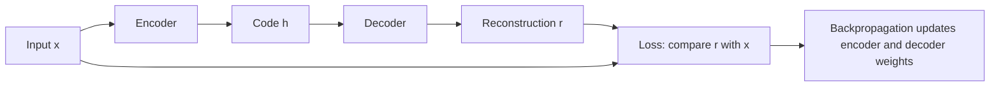
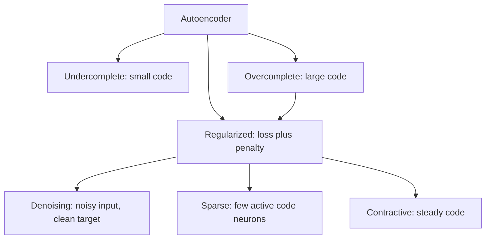
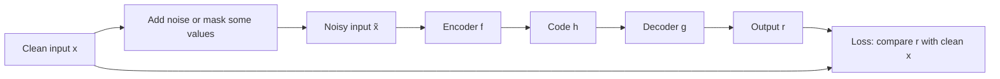
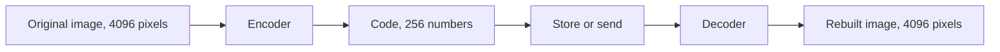

Before the new ideas, here are the old ones you need. If you already know them, skip to the next section.

## The basics first

- A neural network is a big formula with many adjustable numbers called **weights** (and **biases**, which are extra numbers added at each neuron).
- A **layer** is a row of neurons. Each neuron takes a weighted sum of its inputs and passes it through an **activation function** such as sigmoid or ReLU.
- **Training** means adjusting the weights so that the network's output gets close to a **target** (the answer we want).
- The **loss** is one number that says how far the output is from the target. Lower is better.
- **Backpropagation** works out how much each weight is to blame for the loss, and **gradient descent** nudges every weight a little to lower the loss.
- **Supervised learning** needs a label for every example (this photo is a "cat"). **Unsupervised learning** has no labels; the network must find patterns in the data by itself.
- **Regularization** means any trick that stops a network from simply memorizing, for example adding a penalty to the loss.

## Introduction: what an autoencoder is

**Analogy.** Think of how you send a long address to a friend by SMS. You do not type every word in full; you write a short version ("Flat 3B, Shanti Apts, nr station, Thane W"). Your friend reads it and rebuilds the full address. To write a good short version you must know which parts matter.

<Box kind="definition">

**Autoencoder:** a neural network that is trained to copy its input to its output through a narrow middle layer called the **code** (also called the bottleneck or latent representation). The first half, the **encoder**, squeezes the input into the code; the second half, the **decoder**, rebuilds the input from the code. The rebuilt output is called the **reconstruction**.

</Box>

This is syllabus <Syl m="3" />.

**Why it is needed.**

- Most real data (photos, sound, sensor readings) has no labels, and labelling is slow and costly. An autoencoder learns from the data alone, because **the input is its own target**.
- Real data has a lot of repetition. Neighbouring pixels in a photo are almost the same. An autoencoder finds a **short summary** that keeps the important patterns and drops the repetition.
- That summary is useful for compression, for removing noise, for plotting high-dimensional data, for spotting unusual inputs and as ready-made features for another network.

**The key point.** Copying sounds useless. The trick is that we do **not** let the network copy perfectly. We put a restriction on it (a narrow code, a noisy input, a penalty), so the only way to rebuild the input well is to learn the real patterns in the data. Those patterns, stored in the code, are what we want. <Cite id="gfdl-ch14" />

## Main components and architecture

| Part | What it is | What it does |
|---|---|---|
| Input layer | The data, for example a $28\times28$ image flattened to 784 numbers | What we want to compress |
| Encoder | One or more layers that get narrower | Turns the input into the short code |
| Code (bottleneck) | The narrowest layer in the middle | Holds the short summary of the input |
| Decoder | Layers that get wider again, often a mirror image of the encoder | Turns the code back into a full-size output |
| Output layer | Same size as the input | The rebuilt input (reconstruction) |
| Loss | Reconstruction error | Tells the network how well it rebuilt the input |

<Figure caption="A deep undercomplete autoencoder. The encoder narrows 6 inputs down to a 2-number code; the decoder widens it back to 6. The output layer is the same size as the input, and the goal is output equal to input.">
  <NetworkFigure layers="6,4,2,4,6" title="Encoder, code, decoder" labels="Input x,Encoder,Code h,Decoder,Output r" />
</Figure>

**The one formula to know.** In symbols the encoder is $h = f(x)$ (input $x$ becomes code $h$), the decoder is $r = g(h)$ (code becomes reconstruction $r$), and training lowers the reconstruction loss $L(x, g(f(x)))$. In words: "how different is the rebuilt output from the original input?" The usual choice for real numbers is the **squared error**: subtract each output value from its input value, square, and add up.

$$
L(x, r) = \sum_{i=1}^{d} (x_i - r_i)^2
$$

Here $d$ is the number of input values, $x_i$ the $i$-th input value and $r_i$ the $i$-th rebuilt value. For inputs between 0 and 1 (like pixel brightness), binary cross-entropy is also common. <Cite id="gfdl-ch14" loc="§14.1" /> <Cite id="keras-blog-autoencoders" />

**Tiny worked example.**

Given: input $x = [1, 0, 1, 0]$ and reconstruction $r = [0.9, 0.1, 0.8, 0.0]$.
To find: the squared-error loss $L(x, r)$.

1. Subtract each output from its input, to see how far off each value is: $1 - 0.9 = 0.1$, $0 - 0.1 = -0.1$, $1 - 0.8 = 0.2$, $0 - 0 = 0$.
2. Square each difference, so that a miss above and a miss below both count as positive: $0.01$, $0.01$, $0.04$, $0$.
3. Add the squares, because the loss is one number for the whole input: $0.01 + 0.01 + 0.04 + 0 = 0.06$.

**Loss $L = 0.06$** (no unit; a perfect copy would give $0$).

<Box kind="verify">

Add in a different order:

$$
(0.04 + 0) + (0.01 + 0.01) = 0.04 + 0.02 = 0.06
$$

Same answer. Range check: each value is off by at most $0.2$, so each square is at most $0.04$ and four of them give at most $0.16$; $0.06$ is between $0$ and $0.16$, so it is sensible.

</Box>

## How an autoencoder works (training)

1. Take an input (no label needed).
2. **Encode:** the encoder squeezes it into the short code.
3. **Decode:** the decoder rebuilds a full-size output from the code.
4. **Compare:** the loss measures how far the output is from the input.
5. **Learn:** backpropagation and gradient descent adjust the weights of both decoder and encoder to lower the loss.
6. **Repeat** over many examples and epochs. After training we often keep only the encoder (to make codes) or only the decoder (to rebuild from codes).

**Size of a real one.** The classic MNIST example compresses 784 pixels into a 32-number code, about 24.5 times smaller. <Cite id="keras-blog-autoencoders" />

**Deep autoencoders.** The encoder and decoder can have several layers each. Deeper ones can learn better codes; a deep autoencoder with a 30-unit code gave lower reconstruction error than PCA with 30 dimensions. <Cite id="gfdl-ch14" loc="§14.3" /> <Cite id="gfdl-ch14" loc="§14.9" />

**Advantages of autoencoders**

- Learn without labels, so they can use huge unlabelled datasets.
- Learn non-linear (curved) patterns, unlike PCA.
- Flexible: the same idea gives compression, denoising, anomaly detection and feature learning.

**Disadvantages**

- The rebuilt output is **lossy** (close, not exact), and often a little blurry for images.
- **Data-specific:** a model trained on faces does poorly on, say, maps. <Cite id="keras-blog-autoencoders" />
- Can **cheat by copying** if the code is too big or the network too powerful, so it needs a restriction.
- Choosing the code size and depth needs trial and error, and training takes time.

## Linear autoencoder and PCA

A **linear autoencoder** uses no activation function, so the encoder and decoder only do weighted sums (matrix multiplications). It can only find flat (straight-line, flat-plane) patterns.

**How it relates to PCA.** **PCA** (principal component analysis) is a classic method that keeps the directions in which the data spreads the most and throws away the rest. A linear autoencoder with a small code learns to do the same thing: if 2-D points lie close to one straight line, a 1-number code that says "how far along the line" is enough to rebuild them well.

<Box kind="exam">

**Key fact to write:** when the decoder is linear and the loss is mean squared error, an undercomplete autoencoder learns to span the **same subspace as PCA**. With non-linear encoder and decoder it becomes a more powerful, **non-linear generalization of PCA**: it can follow curved patterns. <Cite id="gfdl-ch14" loc="§14.1" /> <Cite id="wiki-pca" />

</Box>

| | PCA / linear autoencoder | Non-linear autoencoder |
|---|---|---|
| Patterns it can find | Flat (lines, planes) | Curved |
| Training | PCA has a direct solution; the linear AE uses gradient descent | Gradient descent |
| Power | Limited | Higher, but can overfit |
| Speed | Fast | Slower |

## Undercomplete and overcomplete autoencoders

<Box kind="definition">

**Undercomplete autoencoder:** the code is **smaller** than the input.
**Overcomplete autoencoder:** the code is **larger** than the input. (A code of the same size has the same problem as overcomplete.)

</Box>

**Undercomplete: the bottleneck forces learning.** If you must describe a whole movie in one sentence, you are forced to say only what matters. With a small code the network cannot copy every value, so it must keep the most important ("salient") features of the training data. No extra penalty is needed; it is trained with the plain reconstruction loss, because the narrow code itself stops copying. <Cite id="gfdl-ch14" loc="§14.1" /> <Cite id="gfg-undercomplete-autoencoder" />

<Box kind="pitfall">

A narrow code is not enough by itself. If the encoder and decoder are very powerful (deep and wide), they can still "cheat": in theory even a 1-number code could act like an index into the training set, so the network memorizes instead of learning useful features. Keep the capacity sensible. <Cite id="gfdl-ch14" loc="§14.1" />

</Box>

**Overcomplete: room to cheat.** With a code as big as or bigger than the input, even a simple network can pass each input value straight through and get a perfect score while learning nothing. So an overcomplete autoencoder is useful only when it is **regularized**: it gets an extra rule besides "copy the input". Its benefit is a large, rich code that can describe many features. <Cite id="gfdl-ch14" loc="§14.2" /> <Cite id="gfg-overcomplete-autoencoder" />

<Figure caption="Left: undercomplete, the code (2 neurons) is smaller than the input (5), so the network must summarize. Right: overcomplete, the code (6) is larger than the input (3), so without an extra rule it can just copy.">
  <NetworkFigure layers="5,2,5" title="Undercomplete" labels="Input,Code,Output" />
  <NetworkFigure layers="3,6,3" title="Overcomplete" labels="Input,Code,Output" />
</Figure>

| | Undercomplete | Overcomplete |
|---|---|---|
| Code size | Smaller than input | Larger than (or equal to) input |
| What stops copying | The narrow bottleneck | An added regularizer (sparsity, noise, contraction) |
| Advantage | Simple, no extra penalty, gives compression | Rich, detailed features |
| Disadvantage | Too narrow loses detail; too powerful can still memorize | Learns the identity (pure copy) if not regularized |
| Typical use | Compression, dimensionality reduction | Features for another task |

## Regularization in autoencoders

**What it is.** Instead of only making the code small, a **regularized autoencoder** adds a second goal to the loss, so the network must rebuild the input **and** have some other good property. In words: **total loss = reconstruction error + a penalty**. (In the book's symbols, $J = L(x, g(f(x))) + \Omega$, where $\Omega$, "omega", is the penalty.) <Cite id="gfdl-ch14" loc="§14.2" />

**Why it is needed.** It lets us use a large (even overcomplete) code without the network simply copying. The extra rule decides what kind of features are learned.

**The three good properties used in practice** (each gives one syllabus type):

| Property wanted | Type |
|---|---|
| Robust to noise or missing values | Denoising |
| Only a few code neurons active | Sparse |
| Code barely changes for tiny input changes | Contractive |

The ordinary tricks from Module 2 also apply, for example weight decay and dropout. <Cite id="gfdl-ch7" />

## Denoising autoencoder (DAE)

**What it is.** A denoising autoencoder is given a **damaged (noisy) copy** of an input and is trained to output the **clean original**. <Cite id="gfdl-ch14" loc="§14.2.2" />

**Analogy.** A teacher hands you a page with some words smudged and asks you to write out the full page. You can do it only if you understand the language, not by copying letters.

**Why it is needed.** A plain autoencoder with a large code can just copy. If the input is damaged but the target is clean, copying gives the damage back and is punished, so the network is forced to learn the real structure of the data.

**How it works, step by step**

1. Take a clean input.
2. **Corrupt** it with a random rule: either set a random fraction of the values to zero (**masking noise**, used in the original paper <Cite id="vincent2008" />) or add small random **Gaussian noise**. <Cite id="gfdl-ch14" loc="§14.5.1" />
3. Pass the noisy copy through the encoder to get a code, and the decoder to get an output.
4. Compute the loss between the output and the **clean** input (not the noisy one).
5. Backpropagate and update. Draw **fresh noise** every time an example is shown, so the network never sees the same damaged copy twice.

**Formula (in words first).** "Corrupt the input, encode and decode the corrupted copy, then compare with the clean input": $J = L(x, g(f(\tilde{x})))$, where $\tilde{x}$ ("x tilde") is the corrupted input. <Cite id="gfdl-ch14" loc="§14.5" />

**Why it works.** Real data (faces, digits) lies close to a thin, curved surface inside the space of all possible inputs, called a **manifold**. Noise pushes a point off that surface; the DAE learns to push it back, so it must learn where real data lives. <Cite id="gfdl-ch14" loc="§14.5" />

**Advantages:** learns robust features; does not simply learn the copy, even with a large code; removes noise directly; stacked DAEs were an early way to pretrain deep networks. <Cite id="vincent2010" />
**Disadvantages:** you must choose the noise type and amount (too little teaches nothing, too much destroys the signal); it only removes the kind of noise it was trained on; output can be blurry.

**Applications:** cleaning noisy photos, old scans and audio; robust feature learning; pretraining. <Cite id="keras-denoising-autoencoder" /> <Cite id="gfg-denoising-autoencoder" /> <Cite id="av-denoising-autoencoder" />

## Sparse autoencoder

**What it is.** An autoencoder whose code may be large, but for any one input **only a few code neurons are allowed to be active**; the rest stay at zero or very near zero. <Cite id="gfdl-ch14" loc="§14.2.1" />

**Analogy.** A big hospital has many specialists. For a broken arm only the bone doctor and the X-ray technician get involved; the rest stay quiet. Each specialist becomes good at one kind of case. In the same way each code neuron learns to respond to one particular pattern (an edge, a stroke, a texture).

**Why it is needed.** It gives a large, rich code without copying, and the features are easier to interpret because each neuron means one thing.

**How it works**

1. Encode the input as usual.
2. Add a **sparsity penalty** to the loss that grows when many code neurons are active. Note the penalty is on the **activations** (outputs of the code neurons), not on the weights.
3. Training now balances "rebuild well" against "use as few neurons as possible", so each input switches on a small, different group of neurons.

**The two common penalties (in words).** For a theory answer, the words are enough; write a formula only if the question asks for one.

- **L1 penalty:** add up the sizes of the code values (ignoring the minus sign) and multiply by a strength number $\lambda$ ("lambda"): $\Omega = \lambda\sum_j |h_j|$. Every active neuron adds to the cost, so training pushes most code values to zero or very near zero.
- **KL-divergence penalty:** choose a small target for how often each code neuron should be active on average (for example 0.05, meaning about 5% of the time). Measure each neuron's actual average activity over the training set, and add a penalty that grows the further it moves from the target. The penalty is zero when the average equals the target. <Cite id="ufldl-autoencoders" /> <Cite id="wiki-kl-divergence" />

**Tiny worked example (L1 penalty).**

Given: code $h = [0.5, 0, -0.2, 0]$ and strength $\lambda = 0.1$.
To find: the L1 sparsity penalty $\Omega$.

1. Take the size of each code value, dropping the sign, because a negative activity is still activity: $0.5, 0, 0.2, 0$.
2. Add them, to get the total activity of the code: $0.5 + 0 + 0.2 + 0 = 0.7$.
3. Multiply by the strength, which sets how much sparsity matters: $0.1 \times 0.7 = 0.07$.

**Penalty $\Omega = 0.07$** (no unit).

<Box kind="verify">

Multiply first, then add: $0.1 \times 0.5 = 0.05$ and $0.1 \times 0.2 = 0.02$, and $0.05 + 0.02 = 0.07$. Same answer. Sign check: an L1 penalty can never be negative, and $0.07 > 0$.

</Box>

<Figure caption="A sparse autoencoder with an overcomplete code of 6 neurons. For this one input, only 2 code neurons are active; the crossed-out ones are inactive (near zero). A different input would switch on a different few.">
  <NetworkFigure layers="4,6,4" title="Only a few code neurons fire" labels="Input,Code h,Output" dropped="1:1,1:2,1:4,1:5" />
</Figure>

**Advantages:** rich, overcomplete code without copying; neurons specialise, so features are easier to understand; good features for classification.
**Disadvantages:** extra settings to tune (target activity, penalty strength); too strong a penalty hurts reconstruction; the KL form needs average activity over many examples.

**Applications:** feature learning for classifiers, finding parts or patterns in images and text. <Cite id="gfg-sparse-autoencoder" />

## Contractive autoencoder (CAE)

**What it is.** An autoencoder whose code is forced to be **steady**: if the input changes only a tiny bit, the code should hardly change. <Cite id="rifai2011" />

**Analogy.** A car's suspension. Small bumps in the road (tiny, unimportant changes in the input) should barely move the passenger seat (the code). A real turn in the road still moves the car.

**Why it is needed.** Small meaningless changes (a pixel of noise, a slight brightness change) should not change what the network "thinks" the input is. A steady code gives robust features.

**How it works**

1. Encode the input as usual.
2. Measure how **sensitive** the code is: for every code value and every input value, how much does the code value change when that input value is nudged? These sensitivities form a table called the **Jacobian**. <Cite id="wiki-jacobian" />
3. Add a penalty equal to the sum of the squares of all entries in that table (its squared **Frobenius norm**).
4. Training balances two pulls: the reconstruction loss wants the code to change when the input really changes, and the penalty wants it to change as little as possible. The result: the code follows the directions in which real data varies and ignores the rest.

**Formula (only if asked):** total loss = reconstruction loss + strength $\times$ (sum of squared sensitivities), that is $J = L(x, g(f(x))) + \lambda\left\lVert \dfrac{\partial h}{\partial x}\right\rVert_F^2$, where $\lambda$ sets the strength. The name "contractive" means a small neighbourhood of inputs is mapped to an even smaller neighbourhood of codes. <Cite id="gfdl-ch14" loc="§14.7" />

**Advantages:** features robust to small changes; learns the shape of the data (its manifold).
**Disadvantages:** computing the sensitivity table is costly for large layers; one more setting ($\lambda$) to tune.

**Applications:** robust feature extraction, pretraining, classification on noisy data. <Cite id="gfg-contractive-autoencoder" />

**DAE versus CAE.** Close cousins. A denoising autoencoder makes the **reconstruction** resist small but finite changes of the input. A contractive autoencoder makes the **code (features)** resist very tiny changes of the input. <Cite id="gfdl-ch14" loc="§14.7" />

## Other types you may see

- **Convolutional autoencoder:** uses convolution layers in the encoder and decoder instead of dense layers. Best for images. <Cite id="keras-denoising-autoencoder" />
- **Variational autoencoder (VAE):** the encoder outputs an average and a spread for each code value, and the code is sampled from them, so its decoder can generate new data. It belongs more to generative models. <Cite id="kingma2013-vae" /> <Cite id="gfg-vae" />

## All types side by side

| Type | Rule that stops copying | What it learns | Main use |
|---|---|---|---|
| Undercomplete | Code smaller than input | The most important features | Compression, dimensionality reduction |
| Overcomplete | Code larger than input; needs a regularizer | Rich features (only if regularized) | Features for another task |
| Denoising | Noisy input, clean target | Robust features, how to remove noise | Image and audio cleaning |
| Sparse | Few code neurons active (penalty on activations) | One neuron per pattern | Features for classification |
| Contractive | Code insensitive to tiny input changes (penalty on derivatives) | Features that follow real data directions | Robust features |

## Application: image compression

**What it is.** Using an autoencoder to store or send an image as its short code instead of all its pixels. This is syllabus <Syl m="3" /> topic 3.3.

**Why it is needed.** Images are large. A $64 \times 64$ grey image is 4096 numbers; if the code has 256 numbers, that is 16 times less to store or send.

**How it works**

1. Train an undercomplete (usually convolutional) autoencoder on many images of the kind you want to compress.
2. **Compress:** run the image through the encoder only and keep the code.
3. **Store or send** the code instead of the image.
4. **Decompress:** run the decoder on the code to get back an image.

**Advantages:** learns a compression tuned to the type of images; one trained model works for any image of that kind; can be combined with denoising.
**Disadvantages:**

- It is **lossy**: the rebuilt image is close to, but not exactly, the original. <Cite id="keras-blog-autoencoders" />
- It is **data-specific**: trained on faces, it compresses faces well but not maps. <Cite id="keras-blog-autoencoders" />
- Both sides need the trained decoder.
- A simple autoencoder rarely beats JPEG. <Cite id="keras-blog-autoencoders" /> Carefully designed learned systems also round (quantize) the code and pack it with entropy coding; these have been reported to beat JPEG and JPEG 2000, or to be competitive with JPEG 2000. <Cite id="balle2016" /> <Cite id="theis2017" /> <Cite id="wiki-image-compression" />

## Other applications

- **Dimensionality reduction:** squeeze many features into a few for plotting or faster learning. <Cite id="gfdl-ch14" loc="§14.9" /> <Cite id="wiki-dimensionality-reduction" />
- **Feature learning and pretraining:** use the trained encoder as the first part of a classifier. <Cite id="mlm-autoencoder-features" />
- **Denoising:** clean noisy images or signals with a DAE. <Cite id="tf-autoencoder" />
- **Anomaly detection:** train only on normal data (for example normal bank transactions). A strange input is rebuilt badly, so a high reconstruction error flags it. <Cite id="tf-autoencoder" />
- **Information retrieval:** short binary codes let a database find similar items very fast (semantic hashing). <Cite id="gfdl-ch14" loc="§14.9" />

Good further reading on all of the above: <Cite id="gfg-autoencoders" /> <Cite id="gfg-autoencoder-types" /> <Cite id="gfg-autoencoder-working" /> <Cite id="ibm-autoencoder" /> <Cite id="av-autoencoders" /> <Cite id="tp-autoencoders" /> <Cite id="wiki-autoencoder" />, and the autoencoder lectures in <Cite id="nptel-dl" />.

## Where this was asked

| If the question says | What to write | Seen as |
|---|---|---|
| "Explain denoising autoencoder model" or "What are denoising autoencoders?" | Definition, why needed, corrupt-then-rebuild steps, flow diagram, masking or Gaussian noise, advantages, uses | <PYQ id="2023-12/q1d" /> <PYQ id="2024-12/q1d" /> |
| "What are undercomplete autoencoders?" | Code smaller than input, bottleneck forces important features, link to PCA, risk of too much capacity, uses | <PYQ id="2024-05/q1d" /> |
| "Main components of an autoencoder and its architecture" | Encoder, code, decoder, loss; the labelled diagram; training steps; advantages and uses | <PYQ id="2024-05/q3b" /> |
| "Explain any three types of autoencoders" | Undercomplete, denoising and sparse (or contractive): idea, working, pros and cons, use; a comparison table | <PYQ id="2024-05/q5b" /> <PYQ id="2024-12/q5b" /> |
| "Working of autoencoders and types in detail" | Architecture and training steps first, then undercomplete, overcomplete, denoising, sparse and contractive; comparison table | <PYQ id="2025-05/q2b" /> |

## Quick revision

- Autoencoder = encoder (input to short code) + code + decoder (code back to input), trained to make output equal input. No labels needed. Loss: $L(x, g(f(x)))$, usually squared error.
- Undercomplete: code smaller than input; the bottleneck forces learning. Linear plus squared error spans the PCA subspace.
- Overcomplete: code larger than input; can copy, so it must be regularized (loss + penalty).
- Denoising: noisy input, clean target. Learns robust features; used for cleaning images and audio.
- Sparse: only a few code neurons active; penalty on activations (L1 or KL with a small target such as 0.05).
- Contractive: code barely changes for tiny input changes; penalty = sum of squared sensitivities (Jacobian, Frobenius norm).
- Image compression: encoder makes the code, store or send it, decoder rebuilds. Lossy and data-specific.

**Conclusion.** An autoencoder learns a short, useful summary of unlabelled data by trying to rebuild its own input under a restriction; the restriction chosen (narrow code, noise, sparsity, steadiness) decides the type and what it is good for.
